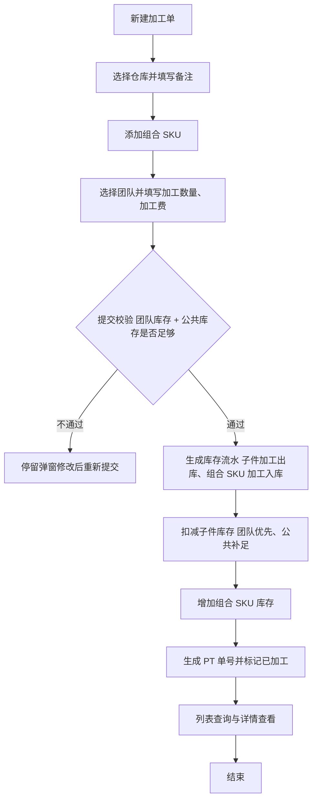
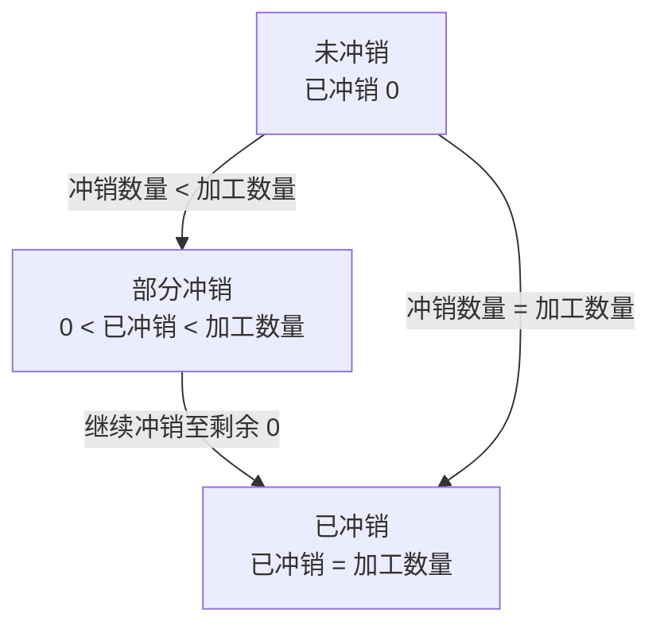
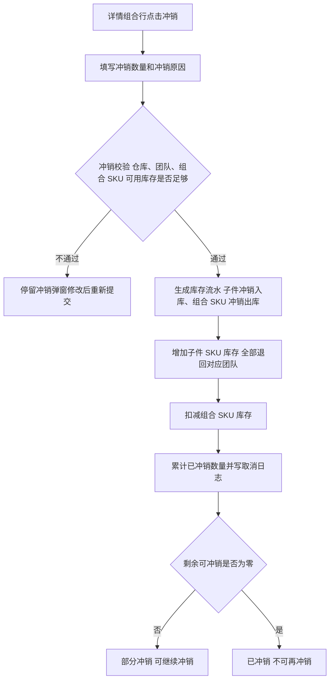

# 加工单全流程管理 PRD

## 1. 文档改动清单

| 序号 | 改动内容 | 对应章节 |
| --- | --- | --- |
| 1 | 补充库存取值规则：新建加工单优先扣减当前团队库存，团队库存不足时扣减同仓库公共库存；冲销库存全部退回对应团队。 | 4.1、4.4、5.2、5.4、7.2、7.3 |

## 2. 术语与口径

| 术语 | 定义 |
| --- | --- |
| 加工单 | 一次组合加工业务单据，包含一个仓库、多个团队、多个组合 SKU。 |
| 仓库属性 | 仓库主数据中的仓库类型；加工单仅支持自营仓、物流中转仓、供应商仓。 |
| 组合 SKU | 加工后产出的成品 SKU，由多个子件按固定配比组成。 |
| 子件 SKU | 加工过程中被消耗的原材料/配件 SKU。 |
| 单位配比 | 生产 1 件组合 SKU 需要消耗的子件数量。 |
| 最多可加工数量 | 按当前团队子件可用库存 + 同仓库公共库存、配比及其他组合占用计算出的最大可加工数量。 |
| 团队 | 仓库下独立维护库存的作业团队，同一 SKU 在不同团队有独立可用库存。 |
| 公共库存 | 同一仓库下不归属具体团队的共享子件库存；团队库存不足时用于补充扣减，不参与团队下拉选择。 |
| 已加工 | 加工单已提交并完成库存过账，子件已扣减、组合 SKU 已入库。 |
| 冲销 | 对已生效加工单做反向库存处理，不删除原单。 |
| 部分冲销 | 组合 SKU 只冲销部分加工数量，剩余数量仍可继续冲销。 |
| 已冲销 | 组合 SKU 的加工数量已全部冲销，剩余可冲销数量为 0。 |

## 3. 背景与目标

### 3.1 背景

加工单用于仓库组合加工：消耗子件 SKU，产出组合 SKU。旧版页面包含草稿、审核流、加工中/待完工状态，以及批次号、来源批次、库龄等字段，与实际业务不匹配，操作成本高。

本版本将加工单简化为“新建即完成过账”的单据：不设草稿和审核流，不维护批次与库龄；一张单支持多个团队、多个组合 SKU；组合 SKU 的子件明细自动展开，用户只填加工数量。

### 3.2 产品目标

- 新建提交即完成子件扣减、组合 SKU 入库，不需要额外审核或完工动作。
- 冲销按组合 SKU 执行，可填冲销数量，支持多次部分冲销。
- 冲销必须校验组合 SKU 库存，冲销后扣减组合 SKU、按配比返还子件。
- 去掉与当前业务无关的成本汇总字段，列表和详情保持精简。

## 4. 单据对象与状态机

加工单 = 单头 + 多条组合 SKU 明细 + 每条组合的子件明细。

### 4.1 业务流程图

- 提交校验：按「仓库 + 团队 + 子件 SKU」读取团队可用库存，不足部分读取同仓库「公共库存」；逐个子件校验本次耗用 ≤ 团队库存 + 公共库存。
- **校验通过后，先生成库存流水：子件扣减记录【加工出库】，组合 SKU 增加记录【加工入库】；再扣减子件 SKU 库存（先扣团队库存，不足扣公共库存）、增加组合 SKU 库存。**

### 4.2 单头字段

| 字段 | 来源 | 规则 |
| --- | --- | --- |
| 加工单号 | 系统生成 | `PT + yyMMdd + 4 位流水号`，如 `PT2608290003`，按日递增、全局唯一。 |
| 仓库 | 创建人选择 | 必选；一张加工单只能有一个仓库，全部组合和子件落在该仓库。仅可选择仓库属性为自营仓、物流中转仓、供应商仓的仓库，平台仓、海外仓等不可选。 |
| 创建人 / 创建时间 | 系统 | 创建操作人与时间，不可修改。 |
| 备注 | 创建人填写 | ≤ 200 字；列表支持行内编辑，修改写日志。 |
| 组合 SKU 数 | 明细汇总 | 单据下组合 SKU 数量。 |
| 加工数量 | 明细汇总 | 全部组合 SKU 加工数量之和。 |
| 加工费 | 明细汇总 | 全部组合 SKU 加工费之和。 |
| 成品单位成本 | 系统计算 | 详情展示，计算口径见 4.6。 |

- 不设「加工完成时间」「状态」「批次号」「来源入库批次」「库龄」字段。
- 单号后展示绿色「已加工」标签，不展示单据状态页签。

### 4.3 组合 SKU 行字段

| 字段 | 必填 | 规则 |
| --- | --- | --- |
| 组合 SKU | 是 | 只能选择组合 SKU，不允许选择子件 SKU；同一单据内不可重复。 |
| 品名 | — | 随组合 SKU 带出，只读。 |
| 团队 | 是 | 下拉来源为所选仓库下的团队，不包含「公共库存」。 |
| 加工数量 | 是 | 正整数，≤ 最多可加工数量。 |
| 加工费 | 是 | ≥ 0，最多 2 位小数。 |
| 最多可加工数量 | — | 系统计算，只读，加工数量后展示。 |
| 已冲销数量 | — | 系统维护，初始为 0。 |
| 剩余可冲销数量 | — | 加工数量 − 已冲销数量。 |

- 最多可加工数量按各子件的「团队可用库存 + 同仓库公共库存 − 本单其他组合占用」÷ 单位配比取最小值；公共库存被多个团队共用时按合计占用校验。
- 组合 SKU 可用库存按「仓库 + 团队 + 组合 SKU」读取，用于冲销校验。

### 4.4 子件明细字段

| 字段 | 规则 |
| --- | --- |
| 子件 SKU / 子件名称 | 由组合 SKU 配方带出，只读。 |
| 单位配比 | > 0，由配方带出，只读。 |
| 子件可用库存 | 当前团队可用库存 + 同仓库公共库存；团队库存优先扣减，不足时使用公共库存。 |
| 本次耗用 | 加工数量 × 单位配比。 |
| 单位成本 | 取库存成本快照。 |

- 子件明细不展示「子件成本」。

### 4.5 冲销状态

单据不维护状态；冲销状态下沉到组合 SKU 行：

| 组合行状态 | 条件 | 展示 | 可继续冲销 |
| --- | --- | --- | --- |
| 未冲销 | 已冲销数量 = 0 | 无标签 | 是 |
| 部分冲销 | 0 ＜ 已冲销数量 ＜ 加工数量 | 橙色「部分冲销」，悬停展示已冲销/加工数量 | 是 |
| 已冲销 | 已冲销数量 = 加工数量 | 红色「已冲销」 | 否 |

- 列表「冲销状态」查询：未冲销 = 所有组合已冲销数量为 0；部分冲销 = 存在已冲销数量 > 0 且仍有组合剩余可冲销；已冲销 = 所有组合剩余可冲销数量为 0。
- 单据编号后的「已加工」标签不因冲销变化。

### 4.6 计算规则

- 子件本次耗用 = 组合 SKU 加工数量 × 单位配比。
- 最多可加工数量 = `floor(min(子件可用量 ÷ 单位配比))`；同仓库同团队多个组合共用子件时，需扣除其他组合已占用数量。
- 加工费 = 各组合行加工费之和。
- 成品单位成本 =（全部子件成本 + 加工费）÷ 加工数量。
- 金额保留 2 位小数，**不使用千分号**，如 `¥12345.67`。

## 5. 功能范围

### 5.1 列表与查询

**查询条件**

| 条件 | 规则 |
| --- | --- |
| 加工单号 | 独立输入，支持多个，逗号、空格或换行分隔；模糊匹配单头。 |
| SKU | 独立输入，支持多个；支持组合 SKU 和子件 SKU，命中任一组合行或子件行即命中整单。 |
| 品名 | 独立输入，支持多个；命中任一组合行即命中整单。 |
| 仓库 / 团队 / 创建人 | 多选；团队命中任一组合行即命中整单。 |
| 创建时间 | 起止日期，必须同时填写，开始不得晚于结束。 |
| 冲销状态 | 全部 / 未冲销 / 部分冲销 / 已冲销。 |

- 不同查询项之间为「并且」；同一项多个值之间为「或者」；多选项之间为「或者」。
- 冲销状态口径见 4.5：未冲销 = 所有组合已冲销数量为 0；部分冲销 = 存在已冲销数量 > 0 且仍有组合剩余可冲销；已冲销 = 所有组合剩余可冲销数量为 0。

**列表结构**

| 层级 | 字段 |
| --- | --- |
| 一级横条 | 加工单号（点击打开详情，后跟「已加工」标签）、仓库、加工数量、备注（行内编辑）、创建人、创建时间、操作菜单。 |
| 二级明细 | 10 列：组合 SKU、品名、团队、加工数量、加工费、子件 SKU、子件名称、单位配比、本单耗用、单位成本。 |
| 底部汇总 | 共 X 张 · X 个成品 SKU · 加工 X 件。 |
| 分页 | 10 / 20 / 50 张每页，默认 10。 |

- 不展示状态页签和状态栏；不提供勾选框和批量冲销。
- 一级横条不展示成品、加工成本、状态。
- 二级明细不展示子件成本、组合总成本。
- 组合 SKU 蓝色高亮；部分冲销/已冲销按 4.5 展示标签。

**操作菜单**

| 场景 | 操作项 |
| --- | --- |
| 存在未冲销组合 | 日志、冲销（进入详情选择组合） |
| 全部组合已冲销 | 日志 |

**空态**：无符合条件单据时展示「暂无符合条件的加工单」，汇总归零。

### 5.2 新建加工单

**触发**：列表操作行「新建加工单」。

**流程**：选择仓库 → 填写备注 → 添加组合 SKU → 逐行选择团队、填写加工数量和加工费 → 提交。

**加工信息**

- 仓库必选；下拉仅展示仓库属性为自营仓、物流中转仓、供应商仓的仓库，平台仓、海外仓等不可选。未选仓库时点击「添加组合 SKU」或提交，仓库字段标红并提示「请先选择仓库」。
- 备注选填，≤ 200 字。
- 字段标签与组件同一行；不设加工完成时间。

**添加组合 SKU**

- 选择弹窗仅展示组合 SKU、品名，支持搜索和多选；不展示团队、可用库存、子件数。
- 同一单据内不可重复添加相同组合 SKU。
- 确认后自动生成组合行和子件明细，并带出配比、可用库存、单位成本。

**组合行**

- 团队下拉来源为所选仓库；切换团队后子件可用库存（团队库存 + 公共库存）、最多可加工数量实时重算。
- 子件耗用优先扣减当前团队库存，团队库存不足时差额从同仓库「公共库存」扣减；两者合计仍不足时不允许提交。
- 最多可加工数量按「团队库存 + 公共库存 − 本单其他组合已占用」÷ 单位配比计算；多个组合共用子件或公共库存时按合计占用校验。
- 加工数量后展示「最多可加工 X 件」，数字蓝色高亮；超过上限时输入框标红。
- 加工费在组合行内填写，≥ 0，最多 2 位小数。
- 子件表展示：子件 SKU、子件名称、单位配比、子件可用库存、本次耗用、单位成本。
- 支持「批量选择团队」和「按最高可加工数填充」；无仓库或无组合行时置灰。

**底部汇总**：已选 X 个组合 SKU · 加工数量 X 件 · 加工费 ¥X。

**提交校验**

| 校验项 | 提示 |
| --- | --- |
| 仓库为空 | 请选择仓库 |
| 无组合行 | 请至少添加一个组合 SKU |
| 重复组合 | 组合 SKU 已添加，请勿重复选择 |
| 团队为空 | 请选择团队 |
| 加工数量为空/非正整数/超上限 | 请填写正确的加工数量 / 加工数量不能超过最多可加工数量 |
| 加工费非法 | 请填写正确的加工费 |
| 子件可用库存不足 | 按「仓库 + 团队 + 子件 SKU」校验团队库存 + 公共库存，本次耗用 ≤ 两者合计，不足时拦截 | 子件库存不足，请调整加工数量 |

- **提交时按「仓库 + 团队 + 子件 SKU」读取团队可用库存，并补充读取同仓库「公共库存」；不能只依赖前端展示值；多个组合共用子件或公共库存时按合计耗用校验。**

**结果**

- **提交校验通过后，先生成库存流水：子件扣减记录【加工出库】、组合 SKU 增加记录【加工入库】；再扣减子件 SKU 库存（优先团队库存，不足扣公共库存）、增加组合 SKU 库存。**
- 生成 `PT + yyMMdd + 4 位流水号`，写「新增」日志。
- 关闭新建弹窗，刷新列表并打开详情，提示「加工单创建成功，库存已过账」。
- 失败时不生成单据、不扣库存，停留在弹窗并保留已填内容。

### 5.3 详情

点击列表加工单号打开，仅包含「基础信息」和「组合明细」两个分区，只读。

**基础信息**：加工单号、仓库、创建人、创建时间、组合 SKU 数、加工数量、加工费、成品单位成本、备注。

- 不展示单据状态、子件成本、成品总成本、加工成本。
- 弹窗宽度 `min(1180px, calc(100vw - 48px))`，最小高度 `min(640px, calc(100vh - 48px))`。

**组合明细**：11 列 = 组合 SKU、品名、团队、加工数量、加工费、子件 SKU、子件名称、单位配比、本单耗用、单位成本、操作。

- 组合 SKU 后展示「部分冲销」或「已冲销」标签。
- 剩余可冲销数量 > 0 时，操作列展示「冲销」；已全部冲销展示「—」。
- 不提供勾选框，不提供右下角「冲销选中」「关闭」按钮。
- 冲销弹窗叠在详情弹窗上打开，冲销成功后刷新详情，不关闭详情。

### 5.4 冲销

**粒度**：单个组合 SKU；可填冲销数量，支持多次部分冲销；不支持列表批量冲销。

**入口**：详情组合明细「操作」列「冲销」。

**冲销流程**

- 冲销校验：按「仓库 + 团队 + 组合 SKU」读取成品可用库存，校验本次冲销数量 ≤ 可用库存。
- 校验通过后，先生成库存流水：子件增加记录【冲销入库】，组合 SKU 扣减记录【冲销出库】；再增加子件 SKU 库存（全部退回原组合行对应团队，不退回公共库存）、扣减组合 SKU 库存。

**弹窗结构**

- 标题：冲销组合 SKU。
- 副标题：冲销时按「仓库 + 团队 + 组合 SKU」校验库存，成功后扣减组合 SKU、按配比返还子件 SKU 库存至对应团队。
- 冲销数量卡片：组合 SKU、团队、原加工数量、已冲销/剩余、本次冲销数量、组合 SKU 当前可用、冲销后可用、子件库存变化（子件 SKU、名称、配比、本次增加）。
- 冲销原因：必填，红色 `*`，≤ 120 字。

**冲销数量**

- 默认空，不预填；最多可冲销数量 = min（剩余可冲销数量，组合 SKU 当前可用库存）。
- 子件「本次增加」= 本次冲销数量 × 单位配比，实时计算。
- 数量为空或非法时「确认冲销」置灰；数量合法后可点击。
- 数量合法但原因为空时点击确认：自动定位并聚焦原因输入框、输入框标红，提示「请填写冲销原因」。

**校验**

| 校验项 | 提示 |
| --- | --- |
| 剩余可冲销为 0 | 该组合 SKU 已全部冲销 |
| 数量为空/非正整数 | 请输入大于 0 的整数 |
| 数量 > 剩余可冲销 | 最多可冲销 {剩余} 件 |
| 数量 > 组合 SKU 可用库存 | 按「仓库 + 团队 + 组合 SKU」校验，本次冲销数量 ≤ 可用库存 | 组合 SKU 可用库存仅 {可用} 件 |
| 原因为空 | 请填写冲销原因 |

- **冲销校验按「仓库 + 团队 + 组合 SKU」读取成品可用库存，库存不足时不允许提交。**
- 组合 SKU 可用库存为 0 时（仓库 + 团队 + 组合 SKU），输入框禁用，提示「组合 SKU 当前可用库存为 0 件，暂不可冲销」。
- 不校验下游占用。

**执行**

1. 生成库存流水：子件增加记录【冲销入库】，组合 SKU 扣减记录【冲销出库】。
2. 增加子件库存：全部退回原组合行对应团队库存（不退回公共库存），团队可用 + 本次冲销数量 × 单位配比。
3. 扣减组合 SKU 成品库存：当前可用 − 本次冲销数量。
4. 已冲销数量累加；累计等于加工数量时置为「已冲销」，否则「部分冲销」。
5. 写「取消」日志：`冲销组合 SKU：{SKU} × {本次数量} 件（累计 {已冲销}/{加工数量}）；原因：{原因}`。
6. 刷新列表和详情。

- **冲销返还的库存全部记入原组合行团队，不按原扣减来源拆分；即使新建时使用了公共库存，也不退回公共库存。**

**冲销日志**

- **每次冲销成功都必须写「取消」日志，部分冲销和全部冲销都要写，不合并。**
- **日志内容必须包含：组合 SKU、本次冲销数量、累计已冲销/加工数量、冲销原因。**
- 示例：`冲销组合 SKU：B20US007109 × 2 件（累计 2/5）；原因：客户取消部分加工`。
- 冲销原因必填，日志中不允许出现空原因。

**示例**

| 次数 | 本次冲销 | 已冲销/剩余 | 状态 |
| --- | --- | --- | --- |
| 初始 | — | 0/5 | 未冲销 |
| 第 1 次 | 2 | 2/3 | 部分冲销 |
| 第 2 次 | 3 | 5/0 | 已冲销 |

### 5.5 备注行内编辑

- 一级列表备注后展示铅笔图标，点击打开 330px 浮层。
- 文本框 ≤ 200 字，提供「取消」「确定」。
- 支持 Esc 关闭、点击浮层外关闭、Ctrl/Cmd + Enter 保存。
- 保存后更新备注并写「编辑」日志：`修改备注：{新备注}`，清空时记录「清空备注」。
- 备注为空展示「—」，悬停展示完整内容。

### 5.6 操作日志

- 入口：列表操作菜单「日志」。
- 字段：操作类型、日志内容、操作人、操作时间；按时间倒序，底部分页。
- 日志类型仅使用：新增、编辑、取消。

| 操作 | 类型 | 内容 |
| --- | --- | --- |
| 创建加工单 | 新增 | 创建加工单 {加工单号} |
| 修改备注 | 编辑 | 修改备注：{新备注} |
| 冲销组合 SKU | 取消 | 冲销组合 SKU：{SKU} × {本次数量} 件（累计 {已冲销}/{加工数量}）；原因：{原因} |

- 冲销日志必须同时记录本次冲销数量和冲销原因；部分冲销每次单独写一条，不合并。

### 5.7 导出

- 导出格式：`.xlsx`。
- 导出范围：当前筛选结果的全部页。
- 行粒度：一行一个组合 SKU；同一加工单有多个组合时导出多行。
- 不导出子件 SKU 及子件明细。
- 文件名：`加工单_YYYYMMDD.xlsx`。

| 字段 | 说明 |
| --- | --- |
| 加工单号 | 单据编号，如 `PT2608290003` |
| 仓库 | 加工单所属仓库 |
| 创建人 | 单据创建人 |
| 创建时间 | 单据创建时间 |
| 备注 | 单据备注，未填写时为空 |
| 组合 SKU | 组合 SKU 编码 |
| 品名 | 组合 SKU 名称 |
| 团队 | 该组合所属团队 |
| 加工数量 | 该组合的加工数量 |
| 加工费 | 该组合的加工费，保留 2 位小数、不使用千分号 |
| 已冲销数量 | 该组合累计已冲销数量，未冲销为 0 |
| 冲销状态 | 未冲销 / 部分冲销 / 已冲销 |

- 不导出：子件 SKU、子件名称、单位配比、本单耗用、单位成本、剩余可冲销数量、整单是否冲销、整单汇总字段、成品单位成本。

## 6. 功能清单

| 功能 | 功能描述 | 对应章节 |
| --- | --- | --- |
| 列表与查询 | 加工单列表展示、条件筛选、分页与汇总 | 5.1 |
| 新建加工单 | 选择仓库、添加多个组合 SKU、填写团队/加工数量/加工费，提交后完成库存过账 | 5.2 |
| 加工单详情 | 查看基础信息与组合明细，按组合行发起冲销 | 5.3 |
| 冲销 | 按组合 SKU 填写冲销数量，支持多次部分冲销，扣减组合库存并返还子件 | 5.4 |
| 备注行内编辑 | 一级列表直接编辑备注并写日志 | 5.5 |
| 操作日志 | 查看新增、备注编辑、冲销日志 | 5.6 |
| 导出 | 按当前筛选结果导出加工单明细 .xlsx | 5.7 |
| 库存流水 | 新建生成【加工出库】【加工入库】，冲销生成【冲销入库】【冲销出库】 | 7.2、7.3 |

## 7. 通用业务规则

### 7.1 单号规则

`PT + yyMMdd + 4 位流水号`，按创建日生成，当日从 `0001` 递增，全局唯一。示例：2026-08-29 第 3 张单为 `PT2608290003`。

### 7.2 库存联动

| 动作 | 库存影响 |
| --- | --- |
| 新建提交 | **先生成库存流水**：子件【加工出库】、组合 SKU【加工入库】；再按仓库 + 团队扣减子件库存（加工数量 × 配比，团队库存优先、不足扣公共库存）、增加组合 SKU 成品库存（加工数量）。 |
| 冲销 | **先生成库存流水**：子件【冲销入库】、组合 SKU【冲销出库】；再按仓库 + 团队增加子件库存（本次冲销数量 × 配比，全部退回对应团队）、扣减组合 SKU 成品库存（本次冲销数量）。 |

- 子件库存和成品库存均按「仓库 + 团队 + SKU」维护。
- 新建按「仓库 + 团队 + 子件 SKU」校验团队库存 + 同仓库公共库存；冲销按「仓库 + 团队 + 组合 SKU」校验成品可用库存。
- 库存流水与库存变动必须在同一事务内完成，**先写流水再变动库存**；失败整体回滚。

**库存取值规则**

- **新建加工单时，子件耗用优先扣减当前团队库存；团队库存不足时，差额从同仓库「公共库存」扣减。**
- **团队库存 + 公共库存仍不足时，拦截提交。**
- **冲销时，返还数量全部退回原组合行对应团队库存，不退回公共库存。**
- 同一子件耗用由团队库存和公共库存共同满足时，库存流水按实际扣减来源分别记录（团队库存、公共库存两条）。

### 7.3 库存变动类型

| 类型 | SKU 维度 | 方向 | 触发动作 | 说明 |
| --- | --- | --- | --- | --- |
| 加工出库 | 子件 SKU | 出库 | 新建提交 | 扣减子件库存时生成 |
| 加工入库 | 组合 SKU | 入库 | 新建提交 | 增加组合 SKU 库存时生成 |
| 冲销入库 | 子件 SKU | 入库 | 冲销 | 返还子件库存时生成；本次新增 |
| 冲销出库 | 组合 SKU | 出库 | 冲销 | 扣减组合 SKU 库存时生成；本次新增 |

- **【冲销入库】【冲销出库】为本次新增的库存变动类型。**
- 新建时若同一子件同时从团队库存和公共库存扣减，拆成两条【加工出库】流水，团队字段分别记录所选团队和「公共库存」。
- 库存流水需记录仓库、团队、SKU、方向、数量、关联加工单号、操作人、操作时间。

### 7.4 成本口径

- 子件单位成本取新建时的库存成本快照（移动加权平均价）。
- 冲销不重算成本，使用原单快照生成反向流水。
- 金额保留 2 位小数，不使用千分号。

### 7.5 日志规则

- 日志类型仅使用新增、编辑、取消。
- 日志不可删除、不可修改，按时间倒序展示。
- 冲销日志必须记录组合 SKU、本次数量、累计进度、原因、操作人和时间。

### 7.6 权限（待确认）

原型当前统一使用 `Admin`，未做权限隔离；正式系统需确认新建、查看、冲销、导出的角色和仓库/团队数据权限。

## 8. 边界与异常

| 编号 | 场景 | 系统行为 |
| --- | --- | --- |
| E1 | 查询只填开始或结束日期 | 提示「开始和结束日期必须同时填写」，不查询。 |
| E2 | 开始日期晚于结束日期 | 提示「开始日期不能晚于结束日期」，不查询。 |
| E3 | 查询无结果 | 展示空态「暂无符合条件的加工单」，汇总归零。 |
| E4 | 未选仓库点击添加组合 SKU | 仓库字段标红，提示「请先选择仓库」，不打开选择器。 |
| E5 | 未添加组合直接提交 | 提示「请至少添加一个组合 SKU」，不提交。 |
| E6 | 重复添加相同组合 SKU | 提示「组合 SKU 已添加，请勿重复选择」。 |
| E7 | 加工数量为空/为 0/小数 | 提示「请填写正确的加工数量」，不提交。 |
| E8 | 加工数量超过最多可加工数量 | 输入框标红，提示不能超过上限。 |
| E9 | 提交时团队库存 + 公共库存不足 | 提示具体子件和可用量，不生成单据、不扣库存。 |
| E10 | 组合 SKU 已全部冲销 | 不再展示「冲销」按钮；接口再次拦截。 |
| E11 | 冲销数量为空/为 0/小数 | 提示「请输入大于 0 的整数」，确认按钮置灰。 |
| E12 | 冲销数量超过剩余可冲销 | 提示「最多可冲销 {剩余} 件」，不提交。 |
| E13 | 冲销数量超过仓库 + 团队 + 组合 SKU 可用库存 | 提示「组合 SKU 可用库存仅 {可用} 件」，不提交。 |
| E14 | 冲销原因为空 | 定位并聚焦原因输入框，输入框标红，提示「请填写冲销原因」。 |
| E15 | 重复点击冲销/并发冲销 | 前端提交后禁用按钮；后端版本号校验，仅一次成功。 |
| E16 | 备注超过 200 字 | 行内编辑限制 200 字，不可继续输入。 |
| E17 | 库存流水生成失败 | 不扣减/增加库存，单据或冲销整体回滚，提示「库存流水生成失败，请重试」。 |
| E18 | 仓库属性不支持 | 仓库下拉不展示平台仓、海外仓等仓库；接口层再次校验并拦截。 |

## 9. 验收摘要清单

| 编号 | 模块 | 验收要点 |
| --- | --- | --- |
| A1 | 列表与查询（5.1） | 无状态页签/勾选/批量冲销；一级横条字段完整；二级明细 10 列无子件成本；加工单号/SKU/品名独立查询；冲销状态筛选正确（未冲销/部分冲销/已冲销）；日期范围校验。 |
| A2 | 新建（5.2） | 多团队、多组合；仓库未选拦截；选择器仅组合 SKU；子件自动展开；最多可加工数量（团队库存 + 公共库存）和批量填充正确；提交先生成【加工出库】【加工入库】流水，再扣子件（团队优先、公共补足）、增成品。 |
| A3 | 详情（5.3） | 基础信息 + 组合明细；无子件成本/成品总成本；组合行有冲销入口；弹窗尺寸符合规范。 |
| A4 | 冲销（5.4） | 可按组合、按数量冲销；多次部分冲销；校验组合库存；先生成【冲销入库】【冲销出库】流水，再增子件（全部退回对应团队）、扣组合；部分冲销/已冲销标签正确。 |
| A5 | 冲销弹窗（5.4） | 数量默认空；最多可冲销提示；组合库存前后变化；子件本次增加实时计算；原因必填标红；空原因自动定位。 |
| A6 | 备注（5.5） | 铅笔入口、330px 浮层、200 字限制、取消/确定/快捷键、保存写编辑日志。 |
| A7 | 日志（5.6） | 新增/编辑/取消三类日志齐全；冲销日志必须包含本次冲销数量、累计进度和冲销原因；部分冲销每次单独记录。 |
| A8 | 库存与编号（7.1、7.2） | 单号 `PT+yyMMdd+4 位`；新建/冲销库存方向正确；子件库存团队优先、不足扣公共库存，冲销全部退回对应团队；先写流水再变库存；金额 2 位小数、无千分号。 |
| A9 | 库存变动类型（7.3） | 新建生成【加工出库】【加工入库】；冲销生成【冲销入库】【冲销出库】；类型、方向、数量、关联单号正确，流水失败整体回滚。 |
