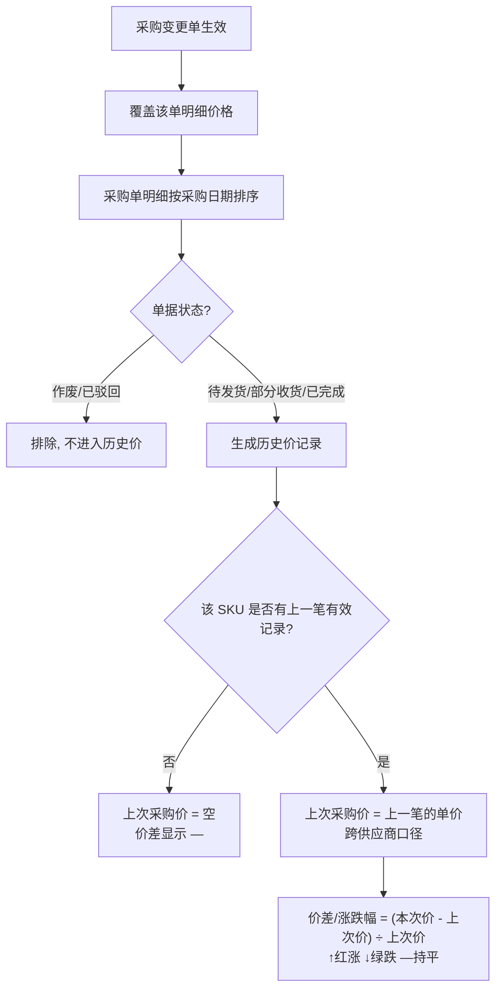

# 历史采购价管理 PRD

| 文档属性 | 内容 |
|---|---|
| 所属系统 | 供应链中台（SCM） |
| 功能模块 | 供应链协同 → 历史采购价 |
| 文档状态 | 待评审 |
| 关联原型 | `pages/historical-purchase-price/` |

## 1. 文档修订清单

| 版本 | 日期 | 改动内容 | 作者 |
|---|---|---|---|
| V1.0 | 2026-11-12 | 初稿：查询、列表、价差、导出、数据口径 | kafeiyang |

## 2. 术语与口径

| 术语 | 定义 |
|---|---|
| 历史采购价记录 | 一条采购单 SKU 明细对应一条记录，按明细级展示（一单多 SKU 拆多行） |
| 本次采购价 | 该笔采购单明细上的采购单价，**带采购单的含税口径**（含税价或未税价），单位人民币元 |
| 上次采购价 | 同 SKU 上一笔**有效**采购单的采购单价，**跨供应商口径**：不区分上一单是否同一家供应商 |
| 有效采购单 | 状态不为「作废」「已驳回」的采购单；待发货/部分收货/已完成均视为有效 |
| 价差/涨跌幅 | 本次采购价 − 上次采购价；涨跌幅 = 价差 ÷ 上次采购价。无上次价（首单）或价差为 0 时显示「—」 |
| 含税口径 | 增值税含税/未税标识，**挂采购单级**：同一采购单内所有 SKU 口径一致 |
| 领星 SKU | 领星 ERP 侧维护的 SKU 编码，中台 SKU 的映射标识；未维护显示「—」 |
| 供应商料号 | 供应商侧的物料编码；未维护显示「—」 |

## 3. 需求背景与目标

### 3.1 现状痛点

1. **价格数据埋在单据里**：一个 SKU 的历史成交价散落在各笔采购单明细中，采购员查价要靠翻单据或个人记忆，没有集中的价格视图。
2. **供应商涨价无感知**：供应商调价后，系统无任何提示，采购员可能在不知情的情况下按新价下单，价差被动接受而非主动议价。
3. **价格谈判缺数据支撑**：与供应商谈价时拿不出历史成交记录，压价没有依据；供应商提出涨价时，无法快速核对其历史涨幅，谈判处于信息劣势。
4. **比价意识无处落地**：同 SKU 换供应商、换采购员采购时价格差异无人对齐，可能出现「越买越贵」而无人发现。
5. **询价无基准**：新品询价、老品续订时缺少历史成交价作基准线，报价合理性无法判断。

### 3.2 产品目标

- 提供一个**以 SKU 明细为粒度、以采购单为来源**的历史采购价集中视图；
- 让「本次价 vs 上次价」的涨跌一眼可见，成为采购员日常比价与供应商价格管理的抓手；
- 沉淀价格数据资产，为后续成本分析、预算、供应商评估提供输入。

## 4. 需求效益

| 维度 | 效益 |
|---|---|
| 业务 | 供应商涨价透明化：调价当单即暴露（价差列），从「事后发现」变为「下单即见」；谈判有据：历史成交价、涨幅序列可直接作为议价依据，支撑批量压价与涨价合理性核对 |
| 财务 | 直接降本：识别涨价 SKU 并干预谈判，减少被动接受涨价；防止价格漂移：同 SKU 跨供应商、跨采购员的价格差异被持续暴露，避免越买越贵 |
| 合规 | 比价留痕：价格查询、导出均有记录，比价过程可追溯、可审计，满足内控对采购价格管理的要求 |
| 数据 | 价格数据资产化：历史价成为结构化数据资产，为成本核算（移动加权价的采购侧源头）、采购预算、供应商价格评估提供统一输入 |
| 效率 | 查价从「翻单据+问人」的分钟级降到输入 SKU 的秒级；导出功能支撑线下比价表、谈判材料的一次性生成 |

## 5. 数据范围与来源

### 5.1 数据来源与过滤口径

- 数据来源：**采购单明细**（SKU 级），采购单价、采购数量、收货数量、采购日期、采购员、采购仓库、含税口径等均取自采购单；
- **作废、已驳回的采购单不计入历史价**（其价格不代表真实成交）；
- **待发货（待收货）的采购单计入**——下单即成交，价格已确定，需要被比价和监控；
- 一笔采购单含 N 个 SKU，则产生 N 条历史价记录。

### 5.2 价格覆盖规则（采购变更联动）

- 采购变更单**审核通过生效后，以变更后的价格覆盖**该采购单对应明细的历史价记录；
- 覆盖后：该记录的「本次采购价」更新为变更后单价，其**之后**新采购单的「上次采购价」取覆盖后的新价；
- 变更被驳回/作废不影响原价格记录。

### 5.3 上次采购价与价差计算

### 5.4 历史数据初始化

- **上线时对存量采购单做一次性初始化**：把符合过滤口径的历史采购单明细全部写入历史采购价，保证页面一上线就有完整的价格数据可查；
- 初始化范围与实时口径一致：**有效采购单**（待发货/部分收货/已完成）全部纳入，**作废、已驳回的采购单排除**；
- 初始化时按 SKU **重建价格链条**：明细按采购日期升序排序后逐条计算「上次采购价」，同 SKU 最早一笔视为首单（上次价为空，价差显示「—」）；
- 存量采购单已被采购变更单生效覆盖的，初始化时**直接取变更后价格**；
- 领星 SKU、供应商料号等映射字段随采购单/明细现有数据带入，未维护显示「—」；
- 初始化为一次性任务，**支持重跑（幂等）**：重复执行不产生重复记录，以采购单明细为唯一键覆盖；
- 初始化完成后需对账校验：历史价记录数 = 存量有效采购单明细数（按 SKU 累加）；
- 初始化完成后，**增量数据实时写入**：新采购单按状态口径进入（待发货即计入），采购变更单生效后按 5.2 覆盖，无需再次人工触发。

## 6. 功能说明

### 6.1 页面入口

菜单路径：供应链 → 供应链协同 → 历史采购价。

### 6.2 查询区

| 查询项 | 控件 | 说明 |
|---|---|---|
| 编码组合 | 单选下拉 + 输入框 | 下拉选择 SKU / 领星 SKU / 供应商料号，输入对应编码查询；支持多个，用逗号或空格分隔；占位文案随类型联动 |
| 采购单号 | 输入框 | 支持多个，用逗号或空格分隔 |
| 产品名称 | 输入框 | 模糊匹配品名 |
| 供应商 | 输入框 | 匹配供应商名称或编码 |
| 采购员 | 多选下拉 | 可多选 |
| 采购单状态 | 多选下拉 | 可多选 |
| 采购仓库 | 多选下拉 | 可多选 |
| 含税口径 | 单选下拉 | 全部（默认）/ 含税 / 未税 |
| 日期组合 | 单选下拉 + 日期范围 | 下拉选择按「采购日期」或「最早收货时间」过滤，再选起止日期范围；按最早收货时间筛选时，无收货记录的行不命中 |
| 查询 / 重置 | 按钮 | 紧跟日期组合之后；重置恢复所有条件默认值 |

### 6.3 列表字段

一列一字段，不合并单元格；行高 38px；勾选列、SKU 列、领星 SKU 列固定在左侧，不参与横向滚动。

| # | 列名 | 口径说明 |
|---|---|---|
| 1 | 勾选 | 支持全选（当前页）与单行勾选，用于导出选中 |
| 2 | SKU | 中台 SKU 编码，蓝色链接样式（本期无跳转交互，仅高亮） |
| 3 | 领星 SKU | 领星侧编码，未维护显示灰色「—」 |
| 4 | 供应商料号 | 供应商侧编码，未维护显示灰色「—」 |
| 5 | 品名 | 24px 占位图 + 产品名称，超长省略 |
| 6 | 供应商 | 供应商名称 |
| 7 | 供应商编码 | 供应商编码 |
| 8 | 采购员 | 下单采购员 |
| 9 | 采购单号 | 蓝色链接样式；右侧挂「含税」（橙黄）/「未税」（灰）标签，口径随采购单 |
| 10 | 采购单状态 | 待发货 / 部分收货 / 已完成等 |
| 11 | 采购仓库 | 采购单收货仓库 |
| 12 | 本次采购价 | 该明细采购单价，蓝色加粗，不带货币符号 |
| 13 | 上次采购价 | 同 SKU 上一笔有效采购单价（跨供应商），绿色加粗；表头 ⓘ 提示口径 |
| 14 | 价差/涨跌幅 | `↑ 0.50（2.2%）` 涨红 / `↓ 2.00（2.3%）` 跌绿 / 首单或持平「—」灰 |
| 15 | 采购数量 | 该明细采购数量 |
| 16 | 收货数量 | 该明细累计收货数量（判断价格代表性：1 件小单与 80 件大单单价权重不同） |
| 17 | 采购日期 | 采购单下单时间 |
| 18 | 最早收货时间 | 该明细首次收货时间，未收货显示「—」 |

### 6.4 通用交互

- 分页：默认每页 10 条，底栏显示「已选择 N 条，共 M 条」；
- 空状态：无匹配数据时表格区显示「暂无符合条件的数据」。

### 6.5 导出

- 入口：列表上方【导出数据】按钮；
- 规则：勾选了行则导出勾选行，未勾选导出当前筛选结果全部；
- 内容：与列表一致的 18 列（含含税口径、价差/涨跌幅），CSV 平铺式布局，每字段一列，不合并单元格。

## 7. 应用场景

| 场景 | 操作路径 | 价值 |
|---|---|---|
| SKU 价格复盘 | 编码组合选 SKU 输入编码 → 查询，逐行看每笔成交价与价差 | 掌握单个 SKU 的完整价格轨迹，识别异常波动 |
| 供应商涨价识别与谈判 | 供应商筛选 + 日期范围选近 90 天 → 看价差列 ↓/↑ 分布，圈出涨价 SKU → 导出作谈判材料 | 涨价从被动接受变主动管理；带着历史涨幅数据与供应商谈，压价有依据 |
| 同 SKU 多供应商比价 | 编码组合选 SKU → 按供应商逐个筛选对比各家的本次价与涨幅 | 择优采购，避免「越买越贵」；含税口径标签辅助排除口径不一致的误比 |
| 询价基准 | 编码组合选 SKU/供应商料号 → 取最近几笔成交价作基准线 | 新品询价、续订议价有客观参照 |
| 采购员价格管理 | 采购员筛选 + 价差列复盘其经手订单的价格质量 | 采购价格绩效有了可量化的观察入口 |

## 8. 边界与异常

| 场景 | 处理规则 |
|---|---|
| 领星 SKU / 供应商料号未维护 | 正常显示记录，对应列显示灰色「—」；按该编码类型查询时无值行不命中 |
| 明细无收货记录 | 最早收货时间显示「—」；按「最早收货时间」筛选时该行被排除（无值无法落入任何区间）；按采购日期筛选不受影响 |
| 首单 SKU（无上次价） | 上次采购价按空处理，价差列显示「—」，不参与涨跌统计 |
| 含税/未税混合比价 | 口径随单，跨供应商比价时以含税标签为准自行判断口径一致性；系统本期不做自动换算 |
| 采购变更覆盖 | 变更生效后价格覆盖原记录，价差链条（后续单的上次价）随之更新，见 5.2 |
| 多币种 | 本期仅支持人民币，不涉及外币采购价 |
