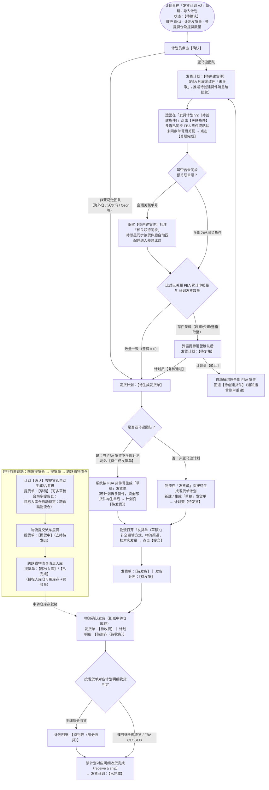
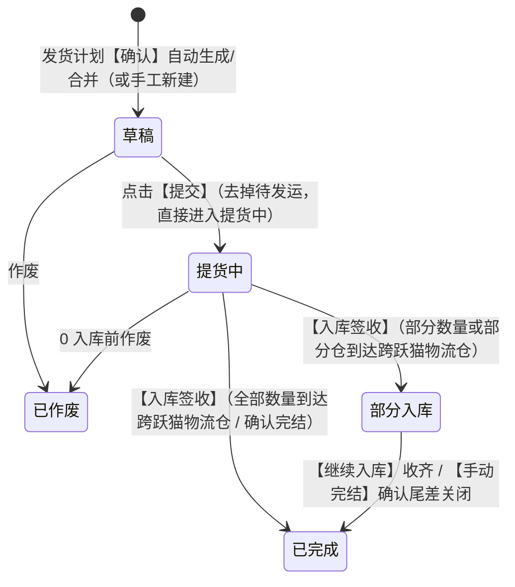
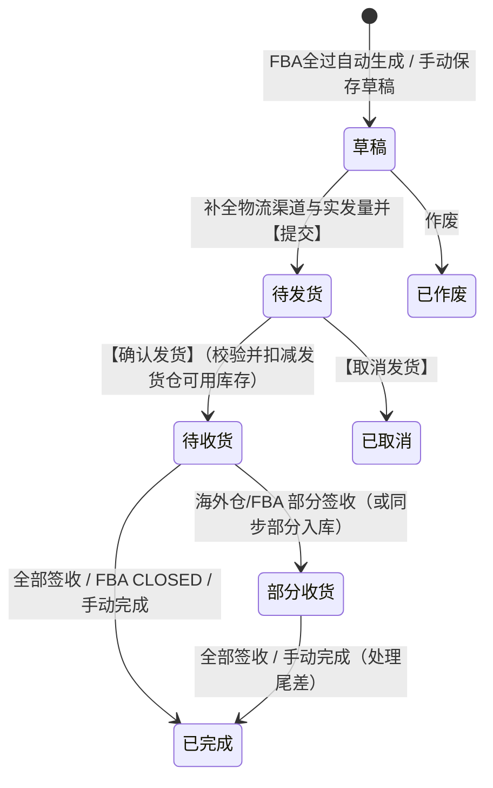

# 发货全链路协同管理 PRD（发货计划 V2 · FBA 货件 · 提货单 · 发货单）

> **文档定位与口径声明**：
> **本总纲整合「发货计划 V2」「FBA 货件」「提货单」「发货单」四张上下游单据的全流程口径，并替代原单点文档中涉及跨单据协同与状态联动的旧口径；原有单点 PRD 文件保持原样不动。**
>
> - **关联原型**：
>   - 发货计划 V2：`pages/shipment-plan-v2/`
>   - FBA 货件：`pages/fba-shipment/`
>   - 提货单：`pages/pickup-orders/`
>   - 发货单：`pages/shipment-orders/`
> - **替代/衔接的原单点文档**：[FBA 货件管理 V2PRD.md](./FBA%20货件管理%20V2PRD.md)、[发货单全流程管理-PRD-V2.md](./发货单全流程管理-PRD-V2.md)、[发货单优化 V2.2PRD.md](./发货单优化%20V2.2PRD.md)、[提货单全流程管理-PRD.md](./提货单全流程管理-PRD.md)、[提货-采购入库-发货全流程设计方案-V1.md](./提货-采购入库-发货全流程设计方案-V1.md)
> - **文档版本**：V3.0（端到端协同版）
> - **更新日期**：2026-11-17

---

## 1. 需求背景与全链路业务定位

### 1.1 现存痛点与本期升级目标

在海外仓与亚马逊 FBA 履约业务跑通前，原四张单据各自为战，存在以下断点：

| 现存痛点 | 本次总纲解决方式 |
| --- | --- |
| **计划生命周期断裂** | 旧版发货计划只有「待确认 → 待发货 → 已完成/已作废」，关联 FBA 或生成发货单草稿就提前变「已完成」，无法跟踪实际发货与签收。 | **重构为 8 态全生命周期（含「全部」共 9 个页签）**：`待确认 → 待创建货件 → 待复核 → 待生成发货单 → 待发货 → 待到齐（含待收货/部分收货标识，按发货单明细行判定） → 已完成` + `已作废`。 |
| **FBA 差异靠线下微信对齐** | 运营按整箱数创建 FBA 货件与计划不一致时（超建/少建），线下反复截图核对、漏建重发。 | FBA 关联确认时**自动比对差异**：无差异直通「待生成发货单」；有差异进计划「待复核」，计划员可「复核通过」或「驳回」。 |
| **物流手动建发货单效率低** | 运营关联好 FBA 后，物流仍要在发货单页手动点「新建」、自己找对应目的仓和数十个 SKU。 | **按「1 个 FBA 货件 = 1 张发货单」自动生成「草稿」发货单**，带齐目的仓、国家、SKU、计划号和申报量，物流只需补渠道与实发量并提交。 |
| **提货挂在发货单内导致库存滞后** | 原「待提货」是发货单内的动作，实物已发运装船，物流下周才补点确认提货，导致前置库存与物流仓账实严重滞后。 | **发货单正式去掉「待提货」状态**，提货动作完全剥离给独立的「**提货单**」；由发货计划【确认】时按提货仓自动生成/合并进提货单`草稿`（目标入库仓唯一为`跨跃猫物流仓`），经`提货中 → 部分入库 / 已完成`入库中转仓后，再由发货单出库。 |

### 1.2 四张单据的角色与分工矩阵

| 角色 | 发货计划 V2 | FBA 货件 | 提货单 | 发货单 |
| --- | --- | --- | --- | --- |
| **计划员** | 创建/导入计划、维护提货仓（**不可选跨跃猫物流仓**）及分仓提货量、首轮「确认」、审批亚马逊「待复核」差异单、异常作废 | 查看关联情况、处理差异驳回通知 | 查看计划分仓提货进度与关联草稿/单号 | 查看关联发货单号与发货/收货进度 |
| **亚马逊运营** | 在「待创建货件」行内或批量点击「关联货件」，**一次性关联 1 个或多个 FBA 货件**（含粘贴未同步单号预关联） | 领星/后台建货件同步中台、查看明细关联进度、处理驳回/必要时「取消关联」 | — | — |
| **仓库 / 物流** | 查看计划要求、预计发货/到货时间与提货仓分配 | — | 整理/合并`草稿`多提货仓合单、提交进入`提货中`安排揽货、执行`跨跃猫物流仓`「入库签收」 | 补全自动生成的「草稿」发货单（运输方式/渠道/实发量）、确认发货、跟进在途与签收、头程费用分摊 |
| **财务** | — | — | —（本期暂不做提货对账） | 核对头程物流费用、清关费与分摊 |

### 1.3 单据关系与核心基数约束

| 关联维度 | 约束口径 |
| --- | --- |
| **发货计划 ↔ 提货仓** | **1 条发货计划支持关联多个提货仓（源头禁止选择 `跨跃猫物流仓`）**，每个已选提货仓必须填写提货数量（正整数 `≥ 1`）；`各提货仓提货数量合计 ≤ 计划发货数量`（提货数量与计划发货数量各自独立，不自动反向覆盖计划发货数量）。 |
| **发货计划 ↔ FBA 货件明细** | **1 条 FBA 货件明细（货件 + SKU）只能关联 1 条发货计划**；**1 条发货计划支持关联多个 FBA 货件（1:N）**。**关联发起入口收敛至「发货计划 V2（待创建货件）」**，采用**一次性「关联完成」**动作（不设暂存状态），同时支持多选已同步货件及直接粘贴未同步 FBA 单号做「预关联」。 |
| **FBA 货件 ↔ 发货单** | **1 个 FBA 货件最多对应 1 张中台发货单**；同一货件关联的多条发货计划（多个 SKU）合并进入同一张发货单明细。 |
| **提货单 ↔ 发货计划 / 发货单** | **1 张提货单支持多个提货仓（按明细行记录提货仓，目标入库仓有且只有 `跨跃猫物流仓`）**；发货计划【确认】时按相同提货仓自动并入对应`草稿`提货单；每条明细强制关联**发货计划号与所属团队**，并在计划生成发货单后实时联动关联**发货单号**。 |
| **发货单 ↔ 发货计划** | **1 张发货单可包含多个 SKU / 多个发货计划**；若为亚马逊 FBA，则严格按 FBA 货件号整单生成，不跨货件混拼。 |

---

## 2. 端到端全链路流程与状态驱动矩阵

### 2.1 端到端业务流程图

### 2.2 四单据状态联动总表

| 触发事件 / 动作 | 发货计划 V2 状态变化 | FBA 货件状态 / 表现 | 提货单状态 | 发货单状态 |
| --- | --- | --- | --- | --- |
| 新建 / 导入发货计划 | **`待确认`** | — | — | — |
| 计划员点「确认」（非亚马逊团队） | `待确认` → **`待生成发货单`** | 不涉及（展示 `-`） | 按相同提货仓自动生成/合并入`草稿`（关联计划+团队） | 可被手工新建发货单选入 |
| 计划员点「确认」（亚马逊团队） | `待确认` → **`待创建货件`** | V2 展示红标`未关联` + `+ 关联货件` 入口；推送通知给运营 | 按相同提货仓自动生成/合并入`草稿`（关联计划+团队） | —（尚不可建发货单） |
| V2 一次性「关联完成」（全部已同步且无差异） | `待创建货件` → **`待生成发货单`** | 自动同步绑定对应货件明细`linkedPlans`；若货件全部计划均达`待生成发货单`，触发生成草稿发货单 | — | 货件全关联通过后自动产生 `草稿` |
| V2 一次性「关联完成」（全部已同步且存在差异） | `待创建货件` → **`待复核`** | 货件明细同步显示已关联该计划（标示待计划复核） | — | **暂不生成**草稿发货单 |
| V2 一次性「关联完成」（含未同步单号预关联） | 保持 **`待创建货件`**（标注`预关联待同步`） | 记录预关联单号；**待领星同步该货件后自动匹配明细并执行上述差异比对分流** | — | 待同步校验完成后触发 |
| 计划员在「待复核」点「复核通过」 | `待复核` → **`待生成发货单`** | 该货件全部关联计划均达`待生成发货单`时，自动生成草稿发货单 | — | 自动产生 `草稿`（写入 `发货单号`） |
| 计划员在「待复核」点「驳回」 | `待复核` → **`待创建货件`** | **自动解除全部关联货件绑定**，恢复红标`未关联`，通知运营删单重建 | — | — |
| 运营在 V2 调整解绑 / FBA 货件「取消关联」 | 若计划已无任何关联货件：`待复核/待生成发货单` → **`待创建货件`**；若已生成未提交的草稿发货单同步移除对应明细/删草稿 | 明细恢复`未关联` | — | 若仅关联该计划且处于`草稿`则同步移除/删除 |
| FBA 自动生成 / 人工新建草稿或待发货单 | 若为单货件，立即 `待生成发货单` → **`待发货`**；若 **1 计划关联多货件，须全部货件均已生成 `DN` 后才转 `待发货`**（此前暂保持 `待生成发货单`，逐步回写已生成的 `DN`） | 一级列表写入`中台发货单号` | 实时联动反写关联的 **`发货单号`（支持多单号）** 至明细与一级列表 | `草稿` / `待发货` |
| 提货单提交 → 跨跃猫物流仓签收 | 不改计划状态（仅保证跨跃猫物流仓库存充足） | — | `草稿` → `提货中` → `部分入库` / **`已完成`** | 为`待发货`发货单提供可用库存 |
| 物流在发货单点击「发货」 | `待发货` → **`待到齐`（标识：`待收货`）**（核心字段锁定只读） | 若领星同步 `SHIPPED`/`IN_TRANSIT` 亦推动至`待到齐` | — | `待发货` → **`待收货`** |
| 发货单按计划明细执行收货 | 按对应计划明细行判定：`0 < receive < ship` → **`待到齐`（标识：`部分收货`）**；`receive >= ship` → **`已完成`** | 货件按入库/CLOSED 收口 | — | `待收货` → **`部分收货`** / **`已完成`** |
| 发货计划作废（未出库前） | `待确认/待创建货件/待复核/待生成发货单/待发货` → **`已作废`** | 若曾关联未发货货件，自动解绑释放 | 若独立已发运提货单不影响，仍按提货单自身闭环 | 若已关联`草稿`发货单未提交，同步移出明细或作废该草稿 |
| 发货单在发货前作废 / 取消 | 释放关联计划：清空`发货单号`，计划回退至 **`待生成发货单`**（若同时取消 FBA 关联则回退`待创建货件`） | 回写清空一级列表`中台发货单号`（允许后续重新生成） | — | **`已作废`** / **`已取消`** |

### 2.3 库存与在途流转时点总口径

- **硬性口径**：
  1. 新建发货计划、确认发货计划、生成草稿/待发货发货单 **均不产生库存加减与「在库待发」冻结**。
  2. 提货单在「目标仓签收」这一唯一交易时点才扣减在途、增加物流中转仓可用库存并回写采购单。
  3. 发货单去掉「待提货」后，点击「发货」直接校验并扣减 **发货仓（物流中转仓）** 对应「SKU + 团队」的可用在库量。

---

## 3. 发货计划 V2（需求起点与生命周期中枢）

### 3.1 页面定位与菜单归属

- **菜单归属**：左侧主导航 **「计划管理」** 分组，排在 `采购计划`、`FBA货件`、`发货计划 V1` 之后（路由键值 `shipmentV2`）。
- **视觉与规范**：遵循全局 `UI_SPEC` 规范（查询卡片、透明操作行、状态 Tab + 单级表格卡片、右侧滑出列配置抽屉、底部分页栏）。

### 3.2 查询区规范（共 19 项条件）

采用两行自适应折叠流（默认展示前 2 行，其余收纳于 `展开/收起` 按钮下，`查询`/`重置` 跟随可见行末尾）：

| 序号 | 查询项名称 | 控件类型 | 口径说明 |
| --- | --- | --- | --- |
| 1 | **编码组合查询** | 下拉 + 输入框 | 支持切换 `SKU`、`供应商料号`、`领星SKU`、`SellerSKU`、`FNSKU`、`ASIN`，支持逗号/空格分隔多个精确或包含匹配 |
| 2 | **计划号** | 文本输入 | 支持逗号/空格分隔多个发货计划号查询 |
| 3 | **提货仓（可多选）** | 多选下拉 | **只要计划关联的多提货仓中包含任一所选仓库即命中** |
| 4 | **发货仓（可多选）** | 多选下拉 | 枚举有且仅有 **`跨跃猫物流仓`**（与提货单目标入库仓对齐） |
| 5 | **目的地仓（可多选）** | 多选下拉 | 支持多选目的地仓 |
| 6 | **目的地仓类型** | 单选下拉 | `海外仓`、`本地仓`、`平台仓` |
| 7 | **头程物流商** | 单选下拉 | 按头程服务商筛选 |
| 8 | **物流渠道** | 文本输入 | 支持模糊查询 |
| 9 | **运输方式** | 单选下拉 | `海派（6000）`、`海卡（6000）`、`空派（5000）`、`快递（8000）`、`铁运（5000）`、`卡航（5000）`、`一件代发（8000）`（与新建发货单一致） |
| 10 | **平台（可多选）** | 多选下拉 | `亚马逊`、`沃尔玛`、`Ozon`、`Shopify`、`TikTok` |
| 11 | **国家（可多选）** | 多选下拉 | `US`、`DE`、`UK`、`CA`、`JP`、`RU` |
| 12 | **店铺（可多选）** | 多选下拉 | 支持多选店铺 |
| 13 | **团队（可多选）** | 多选下拉 | 支持多选团队 |
| 14 | **日期组合查询** | 下拉 + 日期区间 | 口径：`创建时间`、`修改时间`、`预计发货日期`、`期望到货日期` |
| 15 | **创建人** | 单选下拉 | 按创建人筛选 |
| 16 | **发货计划备注** | 文本输入 | 支持模糊查询 |
| 17 | **采购单号** | 文本输入 | 支持多个采购单号 |
| 18 | **发货单号** | 文本输入 | 支持多个发货单号（含自动生成的 `DN...` 草稿/正式发货单号） |
| 19 | **FBA 货件号** | 文本输入 | 支持多个 FBA 货件单号 |
| 20 | **FBA 关联状态** | 单选下拉 | - **`未关联`**：**仅筛出 `团队 = 亚马逊团队` 且未关联任何 FBA 货件的记录**（对应列表标红`未关联`的记录） - **`已关联`**：筛出存在已关联 FBA 货件号的记录 |

### 3.3 状态 Tab、操作按钮与生命周期流转规则

#### 3.3.1 状态页签（8 业务状态，含「全部」共 9 个页签）
`全部` ｜ `待确认` ｜ `待创建货件` ｜ `待复核` ｜ `待生成发货单` ｜ `待发货` ｜ `待到齐` ｜ `已完成` ｜ `已作废`

> 其中 `待到齐` 状态下，列表计划号右侧同步展示行内明细收货标识：**`待收货`** 或 **`部分收货`**（依据发货单内该计划对应明细行的已发运量/已收货量实时判定）。

#### 3.3.2 顶部操作栏与行内操作列

| 位置 | 按钮名称 | 样式等级 | 可用状态与业务逻辑 |
| --- | --- | --- | --- |
| 顶部 1 | **新建发货计划** | 主按钮（蓝） | 常驻可点击；打开新建发货计划弹窗 |
| 顶部 2 | **确认** | 成功按钮（绿） | 勾选存在 `待确认` 计划时可用；提交后系统按团队自动分流： - `亚马逊团队` → 流转至 **`待创建货件`** - `非亚马逊团队` → 直接流转至 **`待生成发货单`** |
| 顶部 3 | **关联货件** | 常规按钮 | 勾选 `待创建货件`（及未生单的 `待复核` / `待生成发货单`）亚马逊计划时可用；打开「关联 FBA 货件」弹窗（多计划勾选支持左侧导航切换），一次性完成 **1 对多货件绑定** 或 **未同步单号预关联** |
| 顶部 4 | **复核通过** | 主按钮 / 辅按钮 | 勾选存在 `待复核`（仅亚马逊有差异单）计划时可用；计划员确认接受按 FBA 差异数量发货，点击后流转至 **`待生成发货单`**（若该计划关联的全部货件均已达成生单条件，立即触发生成草稿发货单并推至 **`待发货`**） |
| 顶部 5 | **驳回** | 警告 / 次按钮 | 勾选存在 `待复核` 计划时可用；计划员拒绝差异（需填/可填驳回原因），点击后计划退回 **`待创建货件`**，并自动解除关联原全部 FBA 货件号、恢复`未关联`红标，通知运营删单重建 |
| 顶部 6 | **导入发货计划** | 常规按钮 | 常驻可点击；复用三步导入弹窗（`下载模板 → 上传解析 → 确认导入`），支持导入多提货仓及提货数量 |
| 顶部 7 | **作废** | 危险按钮（红） | 勾选存在 `待确认 / 待创建货件 / 待复核 / 待生成发货单 / 待发货` 计划时可用；`待到齐`、`已完成`、`已作废` 禁止作废 |
| 顶部右 | **列配置**（图标） | 图标按钮 | 常驻可点击；右侧滑出 **单级平铺** 列配置抽屉（无一二级页签，支持搜索、显隐勾选、非固定列拖拽排序、恢复默认、本地持久化） |
| 列表行内操作列 | **关联货件 / 调整货件** + **日志** | 蓝字链接 + 灰字链接 | `待创建货件`（亚马逊团队）及可调整状态下直接展示「关联货件 / 调整货件」直达弹窗；所有状态保留灰色「日志」按钮 |

### 3.4 新建弹窗与列表核心交互规范

#### 3.4.1 新建发货计划弹窗
1. **顶部表单分区**（已去掉原冗余的「物流资料」手工编辑区块与`计划负责人`字段）：
   - **发货计划区**：`*发货方式`（枚举仅保留：**`本地仓发货`**、**`工厂直发`**，默认选中 **`本地仓发货`**）、`*发货仓`（枚举有且仅有 **`跨跃猫物流仓`**，**打开新建弹窗自动默认选中 `跨跃猫物流仓`**）、`运输方式`（紧跟`发货仓`之后，**非必填、默认不填**，枚举与新建发货单一致：`海派（6000）`、`海卡（6000）`、`空派（5000）`、`快递（8000）`、`铁运（5000）`、`卡航（5000）`、`一件代发（8000）`）、`目的地仓`。
   - **物流轨迹区**：`预计发货日期`（**非必填、默认为空**）、`预计物流时长(天)`（**非必填、默认为空**）、`期望到货日期`（**非必填、默认不填**；当`预计发货日期`与`预计物流时长`均已填写时自动辅助推算）。
   - **隐式带出**：`头程服务商`、`物流渠道` 根据「发货仓 + 目的地仓 + 发货方式」系统自动匹配带出，无需在新建时人工填写。
2. **SKU 明细区（「添加 SKU」独立小弹窗 + 表头「批量」）**：
   - 点击右上角 `添加 SKU` 打开 SKU 选择器，勾选添加至明细表（前 4 列 `SKU`、`领星SKU`、`品名`、`团队` 左侧固定，右侧 `操作` 固定）。
   - **字段带出与默认留空规则**：`SKU`、`领星SKU`（**只读自动带出，非输入框**）、`品名`、`供应商料号`、`国家`、`包装规格（cm）长宽高`、`箱规（cm）长宽高`、`箱规(数量)`、`箱数` 由系统自动带出（`箱数`随实填数量实时计算）；其余可编辑字段（`团队`、`平台`、`店铺`、`运营负责人`、`提货仓`、`计划发货数量`、`备注`）**加入后默认均为空**，由计划员手工填写或通过表头「批量」浮层统一填充。
   - 表头支持 **「批量」** 弹窗编辑的字段：`团队`、`平台`、`店铺`、`运营负责人`、`*提货仓`、`计划发货数量`、`备注`。
   - **「多提货仓 + 提货数量」胶囊与两列分配浮层（重点设计）**：
     - 明细行内「提货仓」展示带数量胶囊：如 `[深圳市摩仕达焊接设备有限公司仓库 · 10 ×] [常州市佳士精密工业有限公司仓库 · 6 ×] [+ 选仓]`（超过 2 个折叠 `+N`，悬停查看全部明细）。
     - 点击单元格或 `+ 选仓` 打开两列分配浮层：上方展示配额栏（`计划发货：16 件 ｜ 已填提货：16 件 ｜ 剩余可配：0 件`）；下方左侧勾选多个提货仓、右侧紧跟填写对应提货数量（件）。
     - **独立性与上限约束**：`提货仓` **源头禁止选择 `跨跃猫物流仓` 等物流仓**，枚举严格限定为：**`常州市佳士精密工业有限公司仓库`**、**`深圳市摩仕达焊接设备有限公司仓库`**、**`坪山石井本地仓`**；`提货数量` 与 `计划发货数量` 互不自动覆盖，但提交/保存时严格校验：**每条 SKU 明细至少选 1 个提货仓、每个已选提货仓数量 `> 0`，且 `Σ 各提货仓提货数量 ≤ 计划发货数量`**。
     - 表头 `*提货仓 [批量]` 浮层支持勾选多个提货仓并填写对应批量提货数量，底部提供 **「追加」** 和 **「覆盖」** 两个动作，均须满足上述上限校验。

#### 3.4.2 列表字段顺序、可编辑性与特殊渲染
- **系统列与固定列**：左固定 `_check`（复选框）+ 锁定的 `SKU`、`领星SKU`、`计划号`（**状态徽标内联展示在计划号右侧**）；右固定 `操作`（仅灰色`日志`）。
- **40 个业务列标准顺序**（已移除`计划负责人`，并将`预计到货日期`更名为`期望到货日期`）：
  `SKU` → `领星SKU` → `计划号(含状态)` → `品名` → `FNSKU` → `团队` → `平台` → `店铺` → `国家` → `计划发货数量` → `团队负责人` → `运营负责人` → `FBA 货件号` → `FBA 货件名称` → `备注` → `提货仓` → `发货单号` → `发货仓` → `目的地仓` → `发货方式` → `头程服务商` → `运输方式` → `物流渠道` → `箱数` → `体积(m³)` → `体积重(kg)` → `预计物流时效(天)` → `预计发货日期` → `期望到货日期` → `总毛重(kg)` → `总体积(m³)` → `总体积重(kg)` → `计划差额` → `创建时间` → `修改时间` → `创建人` → `箱规` → `箱规重量(kg)` → `箱规数量` → `计划交货日期` → `期望交货日期`。
- **各状态字段可编辑矩阵**：
  - **`待确认` / `待创建货件` / `待复核` / `待生成发货单` / `待发货`**：支持在列表中行内修改 `备注`、`提货仓（点击胶囊或 + 追加 增删改提货仓及分仓数量）`、`计划发货数量`（改小时不得小于当前已填提货数量合计）、`发货仓`、`目的地仓`、`发货方式`（`本地仓发货` / `工厂直发`）、`运输方式`、`预计物流时效`、`预计发货日期`、`期望到货日期`；`头程服务商/物流渠道` 均**只读展示**（随仓库/发货方式变更自动重算）。（注：当状态进入 `待发货` 且已自动生成草稿发货单时，若改关键数量或仓库需提示联动更新草稿或先解除。）
  - **`待到齐`**：数量、仓库、发货方式、日期等核心字段**锁定只读**，仅允许修改 `备注`。
  - **`已完成` / `已作废`**：**整行全字段只读**，提货仓仅展示胶囊，隐藏删除 `×` 与 `+ 追加`。
- **FBA 列特殊展示与行内关联交互**：
  - `团队 = 亚马逊团队` 且未关联 FBA 货件时，`FBA 货件号` 与 `FBA 货件名称` 两列均展示红色 **`未关联`** 标签，并在 `FBA 货件号` 旁直出 **`+ 关联货件`** 快捷按钮；非亚马逊团队未关联展示 `-`。
  - 被多个 FBA 货件关联时，`FBA 货件号` 展示全部关联货件号及汇总角标（已同步展示蓝底 `已关联 N 货件 / X 件`；含未同步预关联单号展示橙底 `已预关联 N 货件（待同步）` / `含 N 预关联`）+ **`管理`** 按钮。
  - **「关联 FBA 货件」弹窗核心交互**：
    - **已同步货件区（支持 1 计划多选 N 个货件）**：自动按计划的 **`店铺 + SKU（FNSKU 兼容 '-'）`** 过滤并置顶匹配货件，支持多单号粘贴搜索与「一键全选匹配项」；顶部实时计算 `计划发货数量`、`已选申报合计` 与 `计划差额`。
    - **未同步单号预关联区**：支持直接粘贴 1 个或多个尚未从领星同步的 FBA 单号（空格/逗号/换行分隔）；若粘贴单号实际已同步到系统，则智能自动勾选上方对应货件。
    - **一次性「关联完成」（不设暂存状态）**：点击 `关联完成` 即一次性锁定本次提交，无差异直接推进至 `待生成发货单`，存在数量差异则弹出二次确认框后提交 `待复核`；若含预关联单号则保留 `待创建货件` 等待领星同步后自动核对。

---

## 4. FBA 货件（亚马逊建单同步与下游生单枢纽）

### 4.1 角色定位与列表基础规范
- 位于左侧导航 **「计划管理」** 下（`采购计划` 与 `发货计划` 之间），采用一二级主从折叠结构、无横向固定列、支持一二级各自配置的抽屉式列配置、接入全局导出中心。
- **顶部操作栏收口**：由于「计划 ↔ 货件」关联入口已正式迁至 **发货计划 V2（待创建货件）**，本页 **已移除「关联发货计划」按钮及其弹窗（含勾选关联 / 导入关联）**；当前顶部保留：**`生成发货单`（人工兜底入口）**、**`取消关联`**、**`同步领星货件`（拉取最新货件并自动认领匹配 V2 预关联计划）**、**`导出`**。
- **一级列表 7 列**：`货件单号 / 货件名称`、`领星货件状态`、`STA任务 / Reference ID`、`店铺 / 国家编码 / 物流中心`、`中台发货单号 / 领星发货单号`、`总申报量（含关联进度）`、`创建时间 / 创建人`。
- **二级明细 11 列**：`SKU`、`领星 SKU`、`FNSKU`、`品名`、`申报量`、`实际发货`、`签收量`、`申发差异(?)`、`收发差异(?)`、`申收差异(?)`、`发货计划（已关联显示蓝色可跳转单号，未关联显示红标「未关联」）`。

### 4.2 预关联自动同步认领规则（V2 → FBA 货件双向打通）
- 当运营在 **发货计划 V2** 直接粘贴未同步 FBA 单号完成「预关联」后：
  - 系统在后台挂起该 `{ FBA货件单号 ↔ 发货计划号 / SKU }` 的预关联映射关系。
  - 当 FBA 货件通过领星定时任务或本页点击 **`同步领星货件`** 落库中台时，系统自动识别预关联映射，按 `SKU` 自动将对应货件明细的 `发货计划` 绑定至原计划，并将真实 `申报量` 反写至发货计划 V2，随即自动执行 **4.3 数量差异比对与分流**（无差异进 `待生成发货单` 并校验规则 A；有差异进 `待复核`）。

### 4.3 关联时的数量差异比对与取消关联回滚

无论从 **发货计划 V2 一次性点击「关联完成」**，还是 **预关联单号从领星同步落库触发自动校验**，系统均按每条受影响的发货计划计算累计关联申报量：

$$\text{关联差异} = \text{该计划已关联的全部 FBA 货件申报量之和} - \text{计划发货数量}$$

1. **情况 ①：无差异（$\text{关联差异} = 0$）**
   - 发货计划状态自动由 `待创建货件` → **`待生成发货单`**，并实时回写全部 `FBA 货件号`、`FBA 货件名称`、已关联申报汇总与 `计划差额 = 0`。
2. **情况 ②：存在差异（$\text{关联差异} \neq 0$，如超建、少建、按整箱取整导致差异）**
   - 手动关联点击「关联完成」时弹出 **差异提示确认框**，列明：计划号、SKU、计划发货数量、累计 FBA 申报数量、计划差额（标红提示）。
   - 运营确认「确认提交复核」后，发货计划流转至 **`待复核`**，写入差异值至 `计划差额` 列并通知计划员；计划员可「复核通过」或「驳回」退回 `待创建货件`。
3. **取消关联规则**：
   - 在 V2 管理弹窗取消勾选未生单货件，或在 FBA 货件页勾选已关联明细点击 **取消关联**（或计划员在`待复核`点击 **驳回**）：
     - 若该计划**已无**任何其他 FBA 货件关联：状态回退至 **`待创建货件`**，V2 恢复红色 `未关联` 标识；若此前已有未提交的`草稿`发货单且无其他明细，同步清理该草稿。
     - 若该计划**仍有**其他关联 FBA 货件（1:N 分仓场景）：按剩余货件重算累计申报量与差异，同步更新汇总数据（已生成正式发货单的货件不允许直接解绑）。

### 4.4 核心规则：全部计划通过后自动触发生成「草稿」发货单 + 拆单推进口径

- **触发时机（已确认规则 A）**：
  - 每次当某个 FBA 货件关联的发货计划状态更新为 `待生成发货单`（无差异直通、预关联同步无差异、或计划员`复核通过`）时，系统校验该 **FBA 货件**：
    1. 该 FBA 货件下的**全部 SKU 明细均已关联发货计划**（不存在未关联 SKU），**且**；
    2. 这些关联的发货计划**全部已处于 `待生成发货单` 状态**，**且**；
    3. 该 FBA 货件尚未生成过中台发货单（`!shipmentOrderNo`）。
  - **满足以上全部条件**：系统**一次性自动以该 FBA 货件号为单位，生成 1 张「草稿」状态的中台发货单**。
- **1 计划关联多个 FBA 货件时的「待发货」推进节点（暂行口径，见第 11.3 节待确认）**：
  - 若某发货计划被拆分关联了多个 FBA 货件（如 `FBA1 + FBA2`）：
    - 当 `FBA1` 率先满足规则 A 生成 `DN1` 而 `FBA2` 尚未生成发货单时：系统仅先把 `DN1` 增量回写至该计划的 `发货单号` 列，**计划状态必须继续保留在 `待生成发货单`**；
    - **仅当该计划所关联的全部 FBA 货件均已生成各自的中台发货单（且无待同步预关联单号）时，该发货计划才正式推进至 `待发货` 状态**，并将全部发货单号拼接展示在 `发货单号` 列（如 `DN1、DN2`）。
- **自动带出字段**：`FBA 货件号`、`Reference ID`、`目的仓`（按店铺映射）、`目的国家`、默认发货仓（`跨跃猫物流仓`）、默认发货方式（`FBA直发`）、货件下所有 SKU 明细，并反写 FBA 货件一级列表 `中台发货单号` 与涉及发货计划 V2 的 `发货单号` 列。
- **人工兜底入口**：FBA 货件页顶部保留 **「生成发货单」** 按钮（同样遵守「1 货件最多生成 1 张发货单」及「全部关联货件均生单后再推计划进`待发货`」规则）。

---

## 5. 提货单（前置仓 → 跨跃猫物流仓入库单据）

### 5.1 定位升级（由发货计划自动聚合生成 + 支持多提货仓合单）
- 正式将原属于发货单内的「确认提货」环节完全剥离至独立单据 **提货单**，形成「**前置提货仓提货入跨跃猫物流仓（提货单） → 跨跃猫物流仓发往海外仓/FBA（发货单）**」的清晰物理边界。
- **目标仓升级为「目标入库仓」**：枚举**有且仅有 `跨跃猫物流仓`**，且在查询条件、自动建单、新建/编辑弹窗中**全部默认自动选中**。
- **移除「对账信息」**：本期提货单暂不做财务对账功能，彻底移除查询区`对账状态`、一级列表`对账信息`列及详情页对账模块。

### 5.2 单据结构、列表字段与同仓合并规则（样式对齐采购计划）
- **两层单据结构（样式与列配置均对齐「采购计划」）**：
  - **一级列表（单行紧凑 56px，不做固定列，8 个业务列 + 勾选/展开/操作，不含提货仓/关联单据/团队/SKU）**：
    - `提货单号`（单号 + 复制按钮 + 状态标签）、`目标入库仓`（默认 `跨跃猫物流仓`）、`计划提货总量`、`已入库总量`、`预计提货日期`、`备注`（支持行内快捷气泡编辑）、`创建人`、`创建时间`、`操作`。
    - **操作列与顶部操作栏职责分离**：顶部操作栏仅保留 `新建提货单`、`提交`、`作废`、`导出` 与 `异常记录`（已去掉`合并草稿`与`导入新建`）；行内操作列**去掉「查看」「提交」「作废」**（`草稿` 仅保留 `编辑` + 灰色 `日志`；`提货中` 保留 `入库签收` + `日志`；`部分入库` 保留 `继续入库` + `手动完结` + `日志`；`已完成`/`已作废` 仅保留 `日志`）。
  - **二级列表（发货计划明细层，#f7f9fc 浅灰背景展开区 + 仅前 3 列固定 + 底部 `tfoot` 合计行）**：
    - **左侧固定不参与滚动的前 3 列（按 `发货计划号` `rowspan` 纵向合并）**：① `发货计划号`（含复制与多仓徽标）、② `SKU`（含复制）、③ `领星 SKU`（紧跟 `SKU` 之后，含复制）。
    - **可横向滚动的明细列与数据来源口径**：
      - 除`已入库数量`、`待入库数量`与`目的仓`外，其余字段均从上游 **发货计划** 自动带出；**`目的仓`** 则在关联发货单生成后从 **发货单** 的收货目的仓带出（未生成发货单时显示 `—`）。
      - 计划公共列（`rowspan` 合并）：`品名`（文字左侧统一前置商品占位缩略图 `26px×26px`，**严禁撑高既定 `40px` 行高**）、`FNSKU`、`供应商料号`、`团队`、`运营负责人`（紧跟`团队`之后）、`关联发货单号`（实时联动 `DN...`）、`计划发货数量`、`SKU 总提货数量`（统计当前提货单内同一个 SKU 跨计划/跨仓的提货总量，**该列在 `tfoot` 合计行不做合计**）、`平台`、`店铺`、`国家`、`发货计划备注`（紧跟`国家`之后）、`目的仓`（来自发货单）。
    - **按提货仓逐行展开的分仓明细列**：`提货仓`（仅限`常州市佳士精密工业有限公司仓库`、`深圳市摩仕达焊接设备有限公司仓库`、`坪山石井本地仓`）、`计划提货数量`、`SKU 总提货数量`（紧跟`计划提货数量`之后，不做合计）、`已入库数量`、`待入库数量`。
    - *(已移除原 `提货状态`、`发货方式`、`期望交货日期` 3 个冗余字段。)*
    - **多提货仓展示规则**：同一发货计划若包含多个提货仓（不同仓不同提货数量）且在同一张提货单内，所有计划公共列通过 `rowspan` 纵向合并仅展示 1 次，逐仓子行独立展示各自提货数量与入库进度；若分散在不同提货单，则在计划号旁标识`本单 1/N 仓`。
    - 支持右上角 **`列配置`** 抽屉（切换 `一级列表` / `二级列表` 页签分别显隐与拖拽排序）。
- **多提货仓与草稿自动合并规则**：
  1. **自动生成与相同提货仓合并进草稿**：当发货计划在 V2 点击【确认】后，系统按各明细填写的 `(提货仓, 提货数量)` 自动生成提货单草稿；若当前已存在包含**相同提货仓**且处于 **`草稿`**（尚未点击`提交`）的提货单，则直接合并追加进该 `草稿` 单据（不区分锁车开关，未提交均允许继续合入）。
  2. **支持一张提货单包含多个提货仓**：因为实际物流商往往顺路去多个前置仓揽货，提货单新建/编辑弹窗支持跨提货仓引入不同发货计划明细，或直接将已生成的草稿编辑补充其他提货仓明细。
  3. **关联下游发货单**：关联的发货计划在后续流程生成或绑定 `DN...` 发货单后，系统自动将 `发货单号` 联动展示在提货单二级明细的`关联发货单号`列（与详情页）。

### 5.3 精简状态机（去掉「待发运」）与入库规则

- **状态流转要点**：
  - 正式去掉原 `待发运` 状态：`草稿` 点击【提交】直接流转至 **`提货中`**；
  - 在 `提货中`（或 `部分入库`）执行 **`入库签收`**，将货物正式签收入 `跨跃猫物流仓` 对应 `SKU` 在库量，并同步执行自动采购单入库冲减（见 5.5 节）：全部收齐直接进 **`已完成`**，未收齐进 **`部分入库`**（亦可勾选确认尾差直接完结为 `已完成`）。

### 5.4 无发货计划提货（清库 / 凑重 / 呆滞尾货）
- **业务背景**：部分场景（如工厂清库、物流凑重、处理呆滞尾货）无需事先在发货计划 V2 下单，需要直接在提货单追加无计划 SKU 或整单纯清库发运。
- **交互与校验规则**：
  1. 提货单新建/编辑弹窗工具栏提供 **`+ 追加无计划提货（清库/凑重）`** 按钮，可从 SKU 目录勾选追加，并在二级列表标示 **`无计划补提`** 标签（`关联发货单` 与 `目的仓` 显示 `—`）。
  2. **允许整张提货单完全不含发货计划**：只要明细行数 ≥ 1，即可保存草稿或点击 `提交` 进入 `提货中`。
  3. **【团队】字段必填**：无计划补提明细在编辑表格中的 **`团队` 字段为强校验必填项**（带红色 `*` 必填标识）；未选择团队时阻止保存或提交，确保后续签收时可按准确归属团队匹配在途采购单。

### 5.5 提货入库自动冲减采购单在途 + 异常原因与「异常记录」集中核对
- **双通道入库联动（跨跃猫签收 → 采购单自动入库）**：
  - 提货单执行 **`入库签收`** 时，除增加目标入库仓（`跨跃猫物流仓`）可用库存外，系统同步按本次实收 `(SKU, 团队, 实收数量)` **自动冲减对应在途采购单（状态为 `待收货` 或 `部分收货`）的在途数量，并累加采购单实收数量与生成自动入库批次记录**：
    1. **第一优先级（同团队 FIFO 依次入完）**：检索 `采购单状态 ∈ [待收货, 部分收货]` 且 `明细行.团队 == 提货明细.团队` 且 `SKU 匹配` 且 `在途数量 > 0` 的采购单，按 **采购单创建时间从早到晚（FIFO）** 逐单依次扣减在途直至本次实收耗尽。
    2. **第二优先级（跨团队兜底 — 已确认方案 A）**：若找不到同团队在途采购单，或同团队全部在途扣完后仍有剩余实收数量，**去掉团队限制**，对全平台同 SKU 剩余在途采购单同样按 **最早创建时间（FIFO）** 依次直接入完（不做比例分摊），确保仓库先入实物、账务不卡死。
- **签收异常原因与集中「异常记录」弹窗（暂仅置于提货单页）**：
  1. 在 `入库签收` 弹窗中新增 **`签收异常原因`**（默认`正常到货`，可选`供应商库存不足少发`、`货不对板 / 错货退回待下批补发`、`包装破损拒收`）及 **`异常 / 到货差异说明`**。
  2. 每当触发以下 4 类情况之一时，系统自动写入提货单 **`异常记录`** 列表：
     - `跨团队入库（无本团队单）`：未匹配到该团队在途采购单，已跨团队自动入库；
     - `跨团队入库（本团队在途不足）`：本团队在途不足以抵扣全部实收，超出部分跨团队借单入库；
     - `全平台在途采购不足`：全平台所有在途单扣减完仍有盈余未匹配数量（疑似采购漏建单）；
     - `仓库签收差异`：签收人选择了`供应商库存不足少发` / `货不对板` / `包装破损拒收`等异常原因。
  3. **异常记录查看与核销入口**：提货单顶部操作栏新增 **`异常记录`** 按钮（带待核对红标数字），点击弹出集中核对弹窗，支持按 `全部 / 待核对 / 已核对`、异常类型与单号/SKU 检索，展示每条异常自动冲减的采购单拆分芯片（跨团队高亮标橙），采购或供应链同事核实补单/调拨后可点击 **`标记已核对`** 闭环。

---

## 6. 发货单（物流头程发运与履约追踪单据）

### 6.1 状态机精简（正式移除「待提货」）
依据最新业务共识，**发货单彻底去掉「待提货」状态与行内「提货」弹窗**，标准状态收口为 **8 个状态（9 个页签，含「全部」）**：

- **各状态操作列按钮**：
  - `草稿`：`编辑`、`提交`、`作废`、`日志`
  - `待发货`：`发货`、`数量调整`、`取消发货`、`日志`
  - `待收货`：`收货`、`数量调整`、`日志`
  - `部分收货`：`收货`、`数量调整`、`手动完成`、`日志`
  - `已完成` / `已取消`：`日志`
  - `已作废`：`编辑`（可改后重存草稿）、`日志`

### 6.2 发货单生成与编辑规范
1. **自动生成来源（亚马逊 FBA 线）**：
   - 如第 4.4 节所述，FBA 货件全部关联计划达`待生成发货单`后，自动落地至发货单 **`草稿`** Tab（对应发货计划 V2 同步进入 **`待发货`**）；已带出：目的仓、目的国家、关联 `FBA 货件号`、SKU 明细、关联`计划号`、`计划发货量`、`申报量`、初始 `发货量`、计划侧填写的 `提货仓分配`。
   - 物流打开编辑只需确认/补齐：**发货仓**（如 `跨跃猫物流仓`）、**发货方式**、**运输方式**（`海派(6000)`、`海卡(6000)`、`空派(5000)`、`快递(8000)`、`铁运(5000)`、`卡航(5000)`、`一件代发(8000)`）、**物流渠道**（`普船卡派`、`普船快递派`、`空运`、`快船快递派`、`快船卡派`、`铁路`、`自提卡派`）、**头程服务商**及 **实际发货量**，点击 `提交` 即进入 **`待发货`**。
2. **手动新建来源（非亚马逊 / 海外仓 / 特殊单）**：
   - 点击 `+ 新建发货单` → 点击 `新增 SKU`，可拉取处于 `待生成发货单` 的计划及 SKU，自动带出 `计划发货量` 和 `提货仓`，填写 `发货量`（必填 > 0）并按装箱数实时计算箱数，支持组合 SKU 加工配比校验。

### 6.3 发货单执行、头程费用与反向回写发货计划
- **发货校验（取代原提货卡点）**：点击「发货」时，实时校验发货仓（如物流中转仓）对应 `SKU + 团队` 在库可用量是否充足（若货还在供应商处未签收入中转仓，提示先完成对应提货单签收入库或调整发货量）；扣减发货仓在库、写入物流在途量并填写物流单号。
- **差异公式统一**：
  - `计划差异 = 计划发货量 − 实际发货量`
  - `收发差异 = 收货数量 − 实际发货量`
- **反向回写发货计划 V2（按发货单对应计划明细行判定）**：
  - 生成/关联发货单草稿或提交为 `待发货` → 发货计划 V2 同步进入 **`待发货`**；
  - 发货单点击 `发货`（对应计划明细行 `ship > 0` 且 `receive === 0`）→ 发货计划 V2 同步变 **`待到齐`（行内标识：`待收货`）**；
  - 发货单执行部分收货（该计划对应明细行 `0 < receive < ship`）→ 发货计划 V2 仍为 **`待到齐`（行内标识：`部分收货`）**；
  - 发货单对该计划明细行全部收完（`receive >= ship`，或该单手动完结）→ 该条发货计划 V2 **独立变更为 `已完成`**（同张发货单内其他尚未收完的计划行仍保持在 `待到齐`，互不干扰）；
  - `草稿`作废 或 `待发货`点击`取消发货` → 清空 V2 `发货单号` 并释放计划回 **`待生成发货单`**（若为 FBA 且同步取消关联货件则回`待创建货件`），同时允许 FBA 货件重新生成发货单。

---

## 7. 跨单据异常与回滚处理规范

| 异常场景 | 处理与系统防呆规则 |
| --- | --- |
| **1. FBA 货件整箱取整导致少建/超建** | 运营关联时触发「差异提示弹窗」；确认后发货计划进`待复核`；计划员「复核通过」则以实际关联货件继续进`待生成发货单`（满足全货件条件时生成草稿并将计划推至`待发货`）；若确认属超建错误，计划员点「驳回」→ 自动解绑原货件并退回`待创建货件`，通知运营去亚马逊/领星作废原货件后重建。 |
| **2. 多计划共用 1 个 FBA 货件时部分有差异** | 严格执行触发规则 A：**只要该 FBA 货件下还有任意 1 条关联计划卡在`待复核`或存在未关联 SKU，绝不提前生成草稿发货单**；直到该货件全部明细都变成`待生成发货单`，才统一生成 1 张完整草稿并将整批计划推进至`待发货`。 |
| **3. 发货单发货时物流中转仓库存不足** | 若物流未等前置提货单到仓签收就提前点发货，系统拦截并提示缺货仓库/团队/SKU 及在途提货单号，指引仓库优先完成提货单「目标仓签收」后再点发货（或做数量调整按现有可用量先发）。 |
| **4. 发货计划作废时的下游清理** | 仅允许在 `待到齐` 之前作废计划。作废时检查： - 若已生成`待收货`及以上发货单：拦截作废； - 若存在`草稿/待发货`发货单：提示先取消/移除发货单明细后再作废，或自动从草稿中剔除该明细并释放 FBA 关联； - 若仅关联了未发货 FBA 货件：自动解除绑定关系。 |
| **5. 计划发货数量在「待生成发货单 / 待发货」阶段被改小** | 校验不得小于当前「各提货仓提货数量合计」；若该计划已被放入未提交的「草稿」发货单，提示并同步刷新草稿明细中的`计划发货量`与`计划差异`。 |

---

## 8. 角色权限与消息通知矩阵

### 8.1 操作权限矩阵

| 功能模块 / 操作动作 | 计划员 | 亚马逊运营 | 采购员 | 物流/仓库 | 财务 |
| --- | :---: | :---: | :---: | :---: | :---: |
| 发货计划：新建 / 导入 / 编辑 / 确认 / 作废 | ✅ | ❌ | ❌ | ❌ | ❌ |
| 发货计划 V2：在「待创建货件」关联多 FBA 货件 / 预关联 | ✅（协助查看） | ✅ | ❌ | ❌ | ❌ |
| 发货计划：`待复核` 复核通过 / 驳回 | ✅ | ❌ | ❌ | ❌ | ❌ |
| FBA 货件：取消关联 / 同步领星货件 | 只读 | ✅ | ❌ | 只读 | ❌ |
| FBA 货件：手动「生成发货单」兜底 | ❌ | 辅助 | ❌ | ✅ | ❌ |
| 提货单：合并草稿 / 编辑 / 提交（进提货中） | 只读 | ❌ | ❌ | ✅（物流安排提货） | ❌ |
| 提货单：跨跃猫物流仓入库签收 | 只读 | ❌ | ❌ | ✅（入库确认） | ❌ |
| 发货单：头程费用分摊 | ❌ | ❌ | ❌ | ✅（费用录入） | ✅ |
| 发货单：完善草稿 / 提交 / 确认发货 / 数量调整 | 只读 | 只读 | ❌ | ✅ | 只读 |

### 8.2 关键消息与待办通知流转

1. **待创建货件通知**：亚马逊计划在 V2 点击`确认`进入`待创建货件` → 系统消息/待办推送给对应 SKU 的 **运营负责人**（「发货计划 `YMX...` 已下发，请尽快创建并关联 FBA 货件」）。
2. **差异待复核通知**：运营关联 FBA 存在数量差异进入`待复核` → 推送给对应 **计划员 / 创建人**（「FBA 货件 `FBA...` 与计划 `YMX...` 数量存在差异 `Δ`，请复核」）。
3. **驳回重建通知**：计划员对`待复核`点击`驳回` → 推送给 **运营负责人**（「计划 `YMX...` 差异复核被驳回，已解除原货件关联，请删单重建」）。
4. **草稿发货单就绪通知**：FBA 货件全部计划进入`待生成发货单`并自动生成草稿发货单 → 推送给 **物流人员**（「FBA 货件 `FBA...` 已自动生成草稿发货单 `DN...`，请核对物流渠道并安排发货」）。

---

## 9. 公共规范：操作日志与导出追溯

1. **统一操作日志弹窗规范**：
   - 发货计划 V2、提货单、发货单均采用统一四列表格卡片式日志弹窗（`操作类型`、`日志内容`、`操作人`、`操作时间`，支持 10 条/页分页），列表操作列统一使用灰色文字按钮`日志`。
   - 必须完整留痕所有跨单据动作（如：`确认分流`、`FBA关联写入`、`差异进入待复核`、`复核通过`、`驳回解绑`、`自动生成草稿发货单`、`提货单签收`、`修改/追加提货仓及数量`、`发货单状态反写`等）。
2. **全局导出中心接入**：
   - FBA 货件、发货单、发货计划、提货单的导出统一走 `global-export.js` 异步导出中心；导出字段需携带全链路追踪单号（`计划号`、`FBA货件号`、`提货单号`、`中台发货单号`）及各仓提货数量快照。

---

## 10. 分阶段上线与验收用例清单

### 10.1 关键端到端验收用例（UAT）

| 用例编号 | 场景 | 前置条件 | 操作步骤 | 预期结果 |
| --- | --- | --- | --- | --- |
| **UAT-01** | **非亚马逊计划快速直通** | 团队 = `非亚马逊团队`，多提货仓（仓A:10 + 仓B:14 ≤ 计划24） | 新建计划 → 点「确认」 → 在发货单新建选用该计划 → 提交并「确认发货」 → 收货完成 | 计划跳过`待创建货件`/`待复核`直达`待生成发货单`；创建并提交发货单后计划进入`待发货`；发货单执行发货→收货（无`待提货`环节），按明细驱动计划变为`待到齐（待收货 / 部分收货）`→`已完成`。 |
| **UAT-02** | **V2 一次性关联多 FBA 货件无差异自动生成草稿发货单** | 团队 = `亚马逊团队`，计划 P1=20 件（已点确认处于`待创建货件`）；存在两个同店铺同 SKU 货件 FBA1(12)、FBA2(8) | 在 V2 点击 P1 行内`+ 关联货件` → 多选勾选 FBA1(12) 与 FBA2(8)（合计20）→ 点击「关联完成」 | 数量差异=0，P1 直接进`待生成发货单`；当 FBA1 与 FBA2 均生成草稿发货单 `DN1、DN2` 后，P1 同步推进至`待发货`并展示 `DN1、DN2`（若仅 FBA1 生单而 FBA2 未生单，P1 暂留`待生成发货单`）。 |
| **UAT-03** | **V2 关联数量有差异 / 预关联 → 待复核 → 驳回** | 1. 计划 P3=40，实际货件申报 15 2. 计划 P4=20，直接粘贴未同步单号 `FBA18NEW01` 做预关联 | 1. 在 V2 关联差异货件并确认差异弹窗 2. 在 V2 粘贴未同步单号点「关联完成」，再去 FBA 货件点「同步领星货件」 | 1. P3 进`待复核`（`计划差额=-25`），点「驳回」退回`待创建货件`并解绑原货件 2. P4 预关联后暂留`待创建货件`（标示`已预关联待同步`），领星同步后自动认领绑定并按真实申报量判定进`待生成发货单`或`待复核`。 |
| **UAT-04** | **FBA 差异 → 复核通过 → 自动合并生成草稿** | 同一 FBA 货件含 P4(已无差异待生成发货单) 和 P5(有差异在`待复核`) | 计划员在 V2 对 P5 点「复核通过」 | P5 变为`待生成发货单`；此时该货件全部计划均达`待生成发货单`，系统立即一次性生成含 P4+P5 两条明细的`草稿`发货单并推至`待发货`。 |
| **UAT-05** | **提货单同仓自动合并 → 编辑多仓 → 入库签收** | 计划 P6（深圳市摩仕达焊接设备有限公司仓库:20）、P7（深圳市摩仕达焊接设备有限公司仓库:10）、P8（常州市佳士精密工业有限公司仓库:15）确认；发货单按明细独立判状态 | 1. 确认 P6/P7 进同一草稿，再编辑引入 P8 组成多提货仓草稿 → 顶部「提交」进`提货中`并完成`入库签收`（跨跃猫物流仓） 2. 发货单发货后对 P6 部分收货、P7 全收完 | 1. P6 与 P7 自动并入同一`草稿`提货单，目标入库仓自动为`跨跃猫物流仓` 2. 提交后直接变`提货中`，二级展开区按计划 `rowspan` 合并前3列固定并展示`运营负责人`、`SKU总提货数量`（不做合计）、`发货计划备注`及由发货单带出的`目的仓` 3. 发货单收货后按明细判定：P6 为`待到齐（部分收货）`，P7 独立提前变为`已完成`。 |
| **UAT-06** | **纯无计划清库提货 + 团队必填校验** | 无需上游发货计划 | 在提货单点击「新建提货单」→「+ 追加无计划提货（清库/凑重）」→ 先留空团队点提交 → 选定团队再点「提交」 | 留空`团队`时拦截提交并标红提示必填；补全团队后允许整单零发货计划直接进入`提货中`，展开子表标注`无计划补提`。 |
| **UAT-07** | **提货入库签收 FIFO 自动冲减采购在途 + 跨团队/异常记录联动** | `TH20261116003`（`DD123456` 26件，`刘绎天`）在提货中；采购单 `PO2026111202`（`刘绎天` 在途 18 件）与 `PO2026727007`（2026-08-12 较早创建，他团队在途 66 件） | 在提货单点击`入库签收`，选择签收异常或正常签收 26 件并确认 → 打开顶部「异常记录」弹窗核对 → 切换至「采购单」页检查收货数量与批次 | `PO2026111202` 优先扣完 18 件变为`已完成`；剩余 8 件跨团队 FIFO 冲减最早在途采购单 `PO2026727007`（在途减 8、实收加 8）；提货单「异常记录」弹窗准确生成`跨团队入库（本团队在途不足）`明细并支持`标记已核对`。 |

### 10.2 原型代码四单据协同落地说明
已同步按本 PRD 最新确认口径完成以下 4 个原型页面协同改造：
1. **发货计划 V2（`pages/shipment-plan-v2/`）**：状态机升级为 `待确认 / 待创建货件 / 待复核 / 待生成发货单 / 待发货 / 待到齐（待收货/部分收货） / 已完成 / 已作废`，新增 `复核通过`、`驳回` 与 **`关联货件`（行内 `+ 关联货件`/`管理` + 批量工具栏按钮）**；支持 **1 对多勾选已同步 FBA 货件** 与 **直接粘贴未同步单号预关联**，采用 **一次性「关联完成」** 提交，并落地「多货件全生单后再推计划进`待发货`」规则；源头限制`提货仓`不可选 `跨跃猫物流仓`。
2. **FBA 货件页（`pages/fba-shipment/`）**：正式移除「关联发货计划」按钮及其双向弹窗，改为纯下游展示与管控页；新增 **`同步领星货件`** 自动认领 V2 预关联单号并校验数量差异，继续支持 `取消关联` 与规则 A 自动写入草稿发货单至 `localStorage` 桥。
3. **发货单页（`pages/shipment-orders/`）**：移除`待提货`页签及提货弹窗动作；加载时读取自动生成的 FBA 草稿发货单并支持选用`待生成发货单`计划，按计划对应明细行实时反向更新发货计划 V2 状态。
4. **提货单页（`pages/pickup-orders/`）**：一二级列表全面对齐「采购计划」样式与双页签列配置抽屉（一级精简单行 56px、二级采用按发货计划 `rowspan` 合并 + 多提货仓逐行展开 + 底部 `tfoot` 汇总），落地 `草稿 → 提货中 → 部分入库 / 已完成`（含`已作废`，去掉`待发运`），移除`对账信息`，目标入库仓仅保留并自动选中`跨跃猫物流仓`。

---

## 11. 待确认事项清单（TBD）

以下跨单据细节规则已先做记录，待业务方进一步讨论确认后细化补充至正文及系统实现：

### 11.1 发货计划变更 / 作废时与提货单的联动规则（待确认）
- **问题背景**：当计划员在发货计划 V2 修改了某个提货仓的提货数量、删掉了某条提货仓配置，或直接整行作废发货计划时，上游需求已不再与先前生成给提货单的明细一致。
- **待确认方向**：
  1. 若对应提货单仍处于 **`草稿`**（物流尚未点击提交）：是由系统自动同步修改/删除对应提货单草稿明细（若该草稿全部明细被清空则自动删除或作废该草稿），还是仅弹出提示由物流人员手工调整？
  2. 若对应提货单已进入 **`提货中`** 或 **`部分入库`**（车辆已在途中或部分入库）：是否在发货计划侧二次弹窗提示「关联提货单 `TH...` 已在提货中/部分入库，改单不影响已在途车辆」，并在提货单对应明细行展示黄色警示标识（如`计划已变更 / 计划已作废`）提醒跨跃猫仓管注意？

### 11.2 提货单「入库签收」后与下游待发货发货单的交互提醒方式（待确认）
- **问题背景**：提货单在 `跨跃猫物流仓` 完成【入库签收】后，原本卡在仓库缺货等待该批货物到仓的 `待发货` 发货单已经具备发出条件，且提货单上已直接关联显示对应的 `发货单号`。
- **待确认方向**：
  1. 签收确认提交成功时，交互提醒采用哪种形式最优：
     - **方案 A（轻提示 / 弹窗回执）**：签收提交后 Toast 或结果弹窗提示「已入库跨跃猫物流仓 XX 件，关联发货单 `DN...` 已可安排发货」（支持一键跳转发货单页）；
     - **方案 B（状态徽标 + 系统通知）**：站内消息推送给对应发货单跟单物流人员，并在发货单列表显示「前置提货已入库就绪」徽标；
     - **方案 C**：仅作为信息关联展示，不做额外弹窗打断签收动作。

### 11.3 1 计划关联多个 FBA 货件时，部分货件先生成发货单的 V2 状态推进逻辑（待最终确认）
- **问题背景**：当 1 条发货计划拆分关联 `FBA1 + FBA2`（共 2 个及以上货件）时，若 `FBA1` 率先满足规则 A 生成发货单 `DN1`，而 `FBA2` 尚未满足生单条件（如 `FBA2` 内共用的另一条计划还在 `待复核`，或 `FBA2` 为预关联待同步状态），此时发货计划 V2 的主状态推进时机需要重点拍板。
- **当前暂行/原型落地口径**：先将 `DN1` 回写进计划的 `发货单号` 列，**V2 计划主状态暂留在 `待生成发货单`**，等待该计划关联的全部货件（`FBA1` 与 `FBA2`）均已生单后再切换至 **`待发货`**（拼装 `DN1、DN2`）。
- **后续重点评估与可能调整方向**：
  1. **方向 A（维持「全部关联货件均生单后再进待发货」）**：强管控未齐套风险，避免操作员看到计划已是`待发货`而误以为全部货件都已生成发货单、遗漏跟进尚未生单的 `FBA2`；但需评估若 `DN1` 已先行实际发运（`待发货 → 待收货`），上游计划主状态如何兼容展示。
  2. **方向 B（首张发货单生成即推进 `待发货` + 标注生单进度）**：`FBA1` 生单生成 `DN1` 后计划立即流转至 `待发货`（并在状态/单号旁提示 `已生单 1/2 货件`），与 `DN1` 后续的`待到齐 / 部分收货`履约流程保持同频，同时保留待生单货件进度提示以便物流补发 `DN2`。

### 11.4 二期规划留档：多计划 / 多 SKU 混箱装箱单改造（本期暂不纳入）
- **需求背景**：供应链反馈目前发货单/装箱明细难以表达「**同一物理纸箱内混装来自不同发货计划或不同 SKU 的尾货**」（一箱多计划/一箱多 SKU 混装），当前仅按 SKU 整箱数折算。
- **排期结论**：因涉及仓库作业规则与装箱单数据模型重构，确认**不纳入当前 1~2 周一期上线范围**，已留档作为二期供应链装箱单专题优化评估项。
