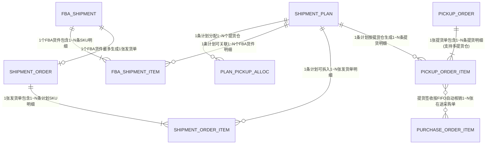
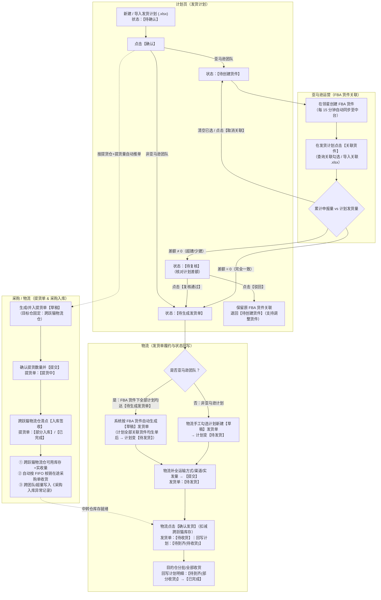
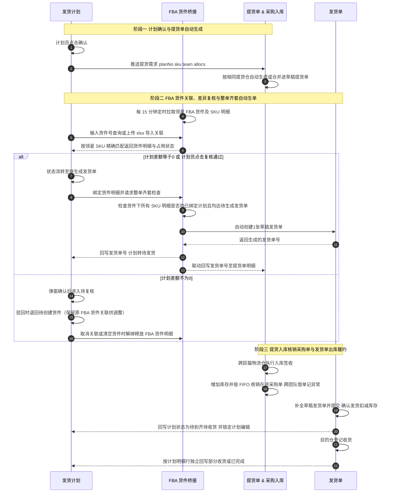
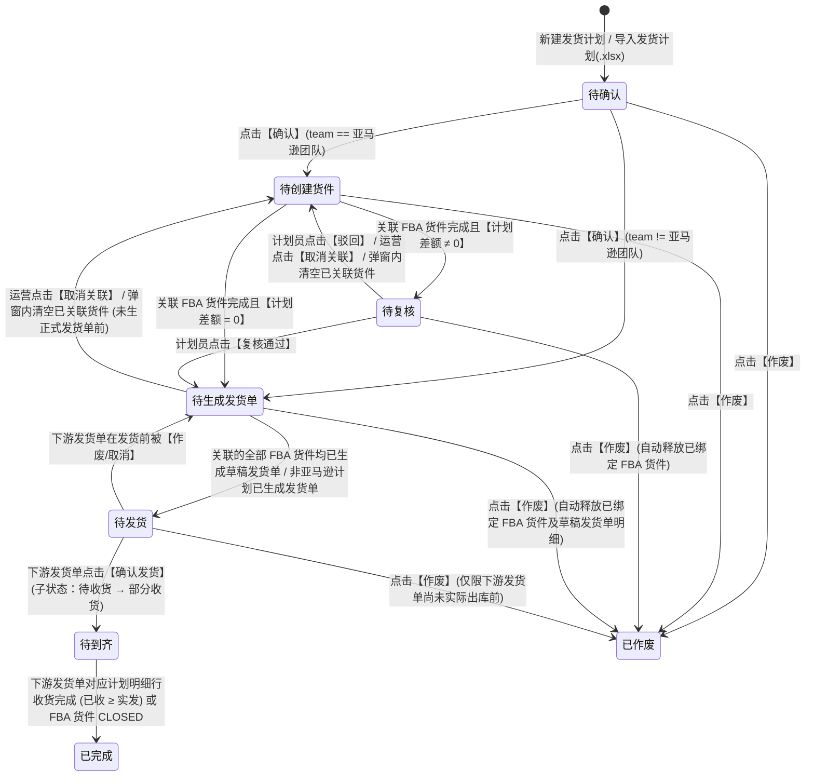
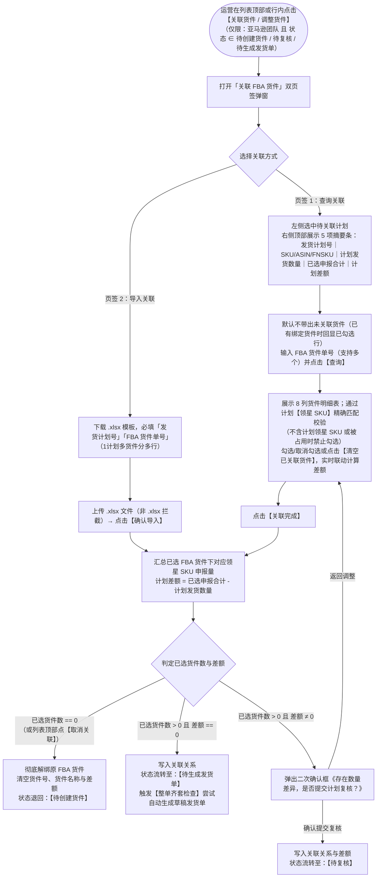
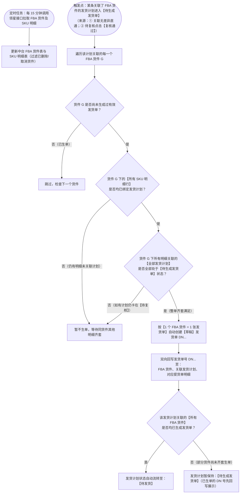
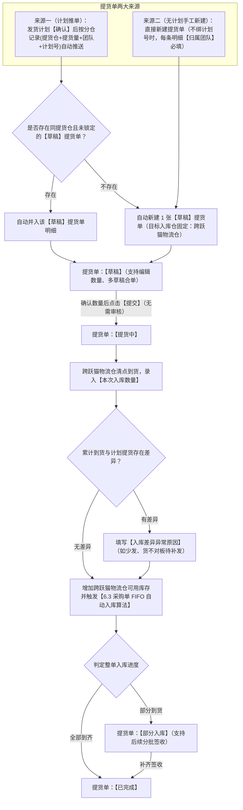
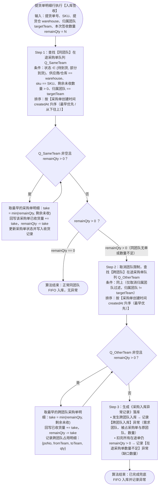
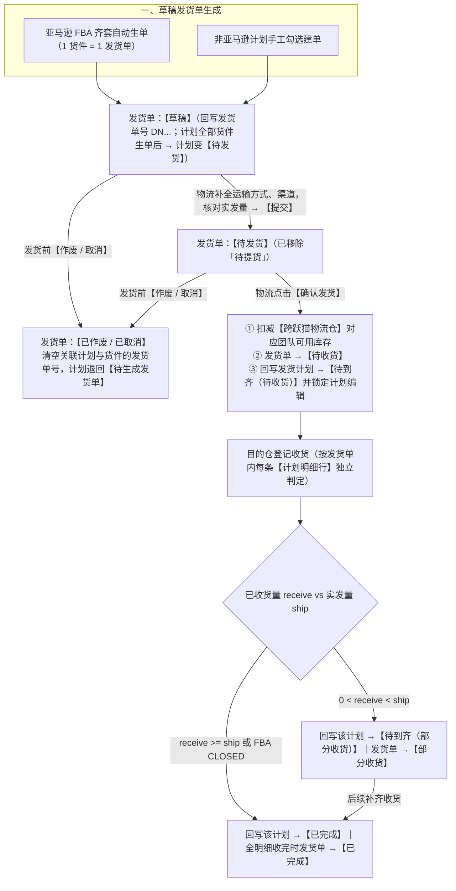

# 发货全链路协同管理 PRD

> **文档定位与口径声明**：
> 本文档整合「发货计划」「FBA 货件」「提货单」「发货单」四张上下游单据的全流程协同口径。文档按功能模块拆分编写，将状态机、流程图、业务规则归口至各自对应模块，并独立梳理功能清单索引与全链路库存流转逻辑，省略常规列表展示列与基础查询框罗列。
>
> - **关联原型**：
>   - 发货计划：`pages/shipment-plan-v2/`
>   - FBA 货件：`pages/fba-shipment/`
>   - 提货单：`pages/pickup-orders/`
>   - 发货单：`pages/shipment-orders/`
> - **文档版本**：V5.0
> - **更新日期**：2026-11-19

---

## 一、背景、目标与范围

### 1.1 背景与痛点

在海外仓与亚马逊 FBA 履约业务推进过程中，原「发货计划、FBA 货件、提货单、发货单」四张单据存在以下核心断点：
1. **计划生命周期断裂**：旧版发货计划在关联 FBA 或生成草稿发货单后即提前完结，无法跟踪后续实际发货与目的仓签收进度。
2. **FBA 货件关联与差异核对低效**：运营按整箱数创建 FBA 货件与计划不一致时（超建/少建），需线下反复核对；且缺乏整单齐套自动生单机制，物流仍需手工新建发货单并逐一匹配 SKU。
3. **提货挂在发货单内导致账实滞后**：原「待提货」归属发货单内部节点，实物已发运装船而系统补点确认滞后，导致供应商仓、物流中转仓库存与采购单收货状态严重脱节。

### 1.2 升级目标

1. **发货计划 8 态全生命周期闭环**：重构为 `待确认 → 待创建货件 → 待复核 → 待生成发货单 → 待发货 → 待到齐（待收货/部分收货） → 已完成 / 已作废`，全程联动下游履约结果。
2. **FBA 货件关联收敛与差异复核线上化**：关联入口统一收口至发货计划（支持查询关联与 `.xlsx` 导入关联，以及彻底取消关联），系统通过**领星 SKU**精确匹配货件明细并自动比对申报量与计划发货量，无差异直通生单，有差异进入「待复核」由计划员审批。
3. **FBA 整单齐套自动生成草稿发货单**：按「1 个 FBA 货件 = 1 张发货单」自动聚合生成草稿发货单，物流仅需补全渠道并核对实发量即可发货。
4. **提货独立成单并自动驱动采购单 FIFO 入库**：提货单从发货单剥离，计划确认时自动按提货仓生成草稿提货单；在 `跨跃猫物流仓` 签收时，除增加中转仓库存外，系统自动按 FIFO（创建时间从早到晚）核销在途采购单收货，并沉淀跨团队/超量入库异常记录。

### 1.3 本次范围与非本次范围

- **本次范围**：覆盖「发货计划管理」「FBA 货件同步与自动生单」「提货单与采购自动入库」「发货单履约与状态回写」四大模块的状态重构、跨模块联动、FIFO 自动入库与库存流转。
- **非本次范围**：本期暂不上线提货单运费财务对账功能；全中台导入、导出及模板下载不再支持 `.xls`、`.csv` 格式（统一仅支持 `.xlsx`）。

### 1.4 需求效益

| 维度 | 效益说明 |
| --- | --- |
| **业务协同效率** | 打通「发货计划 → FBA 货件 → 提货单 → 发货单」全链路状态回写，计划员与运营无需线下反复核对，关联 FBA 货件差异在线留痕审批，整单齐套自动生成草稿发货单，减少手工建单与 SKU 匹配工作量。 |
| **库存与账实一致** | 将提货节点从发货单剥离独立成单，跨跃猫物流仓签收即实时增加中转仓库存，并自动按 FIFO 核销在途采购单收货，消除供应商仓/中转仓库存与采购收货长期脱节的问题。 |
| **风险管控与合规** | 领星 SKU 精确匹配避免错绑货件，超建/少建差异强制触发「待复核」审批；跨团队及超量入库自动沉淀《采购入库异常记录》，方便财务与采购追溯及发起团队间货权调拨。 |
| **计划闭环与可追溯** | 发货计划由过去「生单即结束」升级为 8 态全生命周期跟踪，按明细行独立回写实际发货与目的仓签收进度，全链路单号双向穿透可查。 |

---

## 二、功能清单

| 序号 | 所属模块 | 功能名称 | 功能概述 | 对应章节索引 |
| --- | --- | --- | --- | --- |
| 1 | 发货计划管理 | 发货计划 8 态状态机 | 重构计划全生命周期状态流转、操作权限与字段编辑锁定矩阵 | [4.1](#41-发货计划状态机与流转规则) |
| 2 | 发货计划管理 | 新建、导入与编辑/批量编辑 | 规范 `SP+YYMMDD+4位流水` 编号、FNSKU 下拉、多提货仓校验及编辑弹窗 | [4.2](#42-新建导入与编辑批量编辑规则) |
| 3 | 发货计划管理 | 计划「确认」分流与推单 | 按亚马逊/非亚马逊团队分流状态，并自动推送提货需求生成草稿提货单 | [4.3](#43-计划确认分流与提货需求推送) |
| 4 | 发货计划管理 | 关联 / 调整 / 取消关联 FBA 货件 | 查询勾选与 `.xlsx` 导入关联货件、实时算差额、清空或取消关联退回 | [4.4](#44-关联--调整--取消关联-fba-货件) |
| 5 | 发货计划管理 | 「待复核」差异审批 | 复核通过进入生单；驳回退回「待创建货件」并保留原关联货件供调整 | [4.5](#45-待复核差异审批) |
| 6 | FBA 货件同步与自动生单 | 领星 FBA 货件同步与领星 SKU 匹配 | 每 15 分钟同步货件及明细，按计划「领星 SKU」精确校验关联资格 | [5.1](#51-领星-fba-货件定时同步与领星-sku-精确匹配) |
| 7 | FBA 货件同步与自动生单 | 整单齐套自动生成草稿发货单 | 1 货件下全部 SKU 关联计划均达「待生成发货单」时自动生成 1 张草稿 | [5.2](#52-整单齐套自动生成草稿发货单) |
| 8 | 提货单与采购自动入库 | 提货单状态机 | 定义「草稿 → 提货中 → 部分入库 → 已完成 / 已作废」流转（无审批流） | [6.1](#61-提货单状态机与流转规则) |
| 9 | 提货单与采购自动入库 | 提货单生成、合单与分批签收 | 计划推单自动并入同仓草稿、无计划新建团队必填、签收记录差异原因 | [6.2](#62-提货单生成合单与跨跃猫物流仓分批签收) |
| 10 | 提货单与采购自动入库 | 采购单 FIFO 自动入库与异常记录 | 签收时同团队最早在途采购单优先入库，不足跨团队兜底并记异常台账 | [6.3](#63-提货签收驱动采购单-fifo-自动入库算法) |
| 11 | 发货单履约与状态回写 | 发货单状态机（移除待提货） | 从发货单剥离待提货，重构为「草稿 → 待发货 → 待收货 → 部分收货 → 已完成」 | [7.1](#71-发货单状态机移除待提货) |
| 12 | 发货单履约与状态回写 | 发货单补全、扣库存与明细级回写 | 补全渠道与实发量、发货扣跨跃猫库存、按计划明细独立驱动计划完成 | [7.2](#72-发货单补全确认发货与按计划明细收货完成) |
| 13 | 全局库存 | 全链路库存与在途流转逻辑 | 明确提货在途、跨跃猫物流仓、采购在途、头程在途与目的仓的增减口径 | [八、库存流转逻辑](#八库存流转逻辑) |

---

## 三、核心定义与全局业务协同

### 3.1 核心对象与模块职责边界

| 对象 / 模块 | 业务定义与职责边界 | 上下游数据交互 |
| --- | --- | --- |
| **发货计划** | 计划员发起的发货指令单（**1 条发货计划 = 1 个 SKU**），维护 8 态生命周期、多提货仓分配及 FBA 货件关联。 | 确认时推提货需求至「提货单」；关联/复核/解绑时同步「FBA 货件桥接」。 |
| **FBA 货件** | 每 15 分钟从领星同步的亚马逊货件及明细，维护明细占用关系，判定整单齐套并触发草稿建单。 | 提供货件查询给「发货计划」；齐套时调用「发货单」建单并回写单号至计划与提货单。 |
| **提货单** | 将货物从前置提货仓发运至唯一目标仓 **`跨跃猫物流仓`** 的执行单据，含自动合单、分批签收及采购 FIFO 入库。 | 接收「发货计划」提货需求与「发货单」单号回写；签收时驱动「采购单」收货并增加中转仓库存。 |
| **采购入库异常记录** | 提货签收触发采购 FIFO 入库时，因「找不到同团队在途单跨团队入库」或「所有在途单入满仍有剩余」产生的异常台账。 | 供计划/采购在提货单页查阅，并作为团队间货权调拨依据。 |
| **发货单** | 物流执行从 `跨跃猫物流仓` 出库发往海外仓/FBA 仓的头程单据，扣减中转仓库存并按计划明细回写签收进度。 | 确认发货/收货/作废时反向回写「发货计划」状态与「FBA 货件」单号绑定。 |

### 3.2 跨单据关系与基数约束

| 关联维度 | 约束口径 |
| --- | --- |
| **发货计划 ↔ 提货仓** | **1 : N**。1 条计划支持选多个提货仓（可选：`常州市佳士精密工业有限公司仓库`、`深圳市摩仕达焊接设备有限公司仓库`、`坪山石井本地仓`；**发货仓固定为 `跨跃猫物流仓`**），`各提货仓提货数量合计 ≤ 计划发货数量`。 |
| **发货计划 ↔ FBA 货件明细** | **1 条发货计划 : N 个 FBA 货件**；**1 条 FBA 货件明细（`货件单号 + SKU`）最多只能绑定 1 条发货计划**。 |
| **FBA 货件 ↔ 发货单** | **1 : 1**。1 个 FBA 货件最多生成 1 张有效中台发货单；同一货件下的多个计划 SKU 聚合进入同一张发货单明细。 |
| **提货单 ↔ 提货仓 / 目标仓** | **目标入库仓唯一固定为 `跨跃猫物流仓`**；明细行记录各自提货仓、发货计划号与归属团队，支持多提货仓草稿合单。 |
| **提货签收 ↔ 采购单明细** | **N : M**。按 `SKU + 供应商/仓库 + 归属团队` 优先 FIFO 核销在途采购单，不足部分跨团队 FIFO 核销并记录异常。 |

### 3.3 全链路业务主流程

### 3.4 跨模块事件触发与数据流转

**四单据状态联动总表**

| 触发事件 / 动作 | 发货计划状态变化 | FBA 货件表现 | 提货单状态 | 发货单状态 |
| --- | --- | --- | --- | --- |
| 新建 / 导入发货计划 | **`待确认`** | — | — | — |
| 计划员点「确认」（非亚马逊） | `待确认` → **`待生成发货单`** | `-` | 按提货仓生成/并入`草稿` | 可手工选入建单 |
| 计划员点「确认」（亚马逊） | `待确认` → **`待创建货件`** | 展示红标`未关联` | 按提货仓生成/并入`草稿` | 尚不可建单 |
| 关联完成（差额 = 0） | `待创建货件` → **`待生成发货单`** | 明细绑定`linkedPlans`；齐套后自动生单 | — | 齐套后自动生成`草稿` |
| 关联完成（差额 ≠ 0） | `待创建货件` → **`待复核`** | 明细绑定`linkedPlans` | — | 暂不生单 |
| 「待复核」点击「复核通过」 | `待复核` → **`待生成发货单`** | 齐套后自动生单 | — | 齐套后自动生成`草稿` |
| 「待复核」点击「驳回」 | `待复核` → **`待创建货件`** | **保留原已关联明细**（可通过「调整货件」追加/减少/更换） | — | — |
| 取消关联 / 清空已关联货件 | `待复核/待生成发货单` → **`待创建货件`** | 自动解绑释放明细 | — | 若有未提交草稿同步清理 |
| 关联货件全部生成发货单 | `待生成发货单` → **`待发货`** | 写入`发货单号` | 实时回写`发货单号` | `草稿` / `待发货` |
| 提货单提交 → 跨跃猫签收 | 不改计划状态（保障中转仓库存） | — | `草稿` → `提货中` → `部分入库` / **`已完成`** | 提供中转仓可发库存 |
| 发货单点击「确认发货」 | `待发货` → **`待到齐（待收货）`** | — | — | `待发货` → **`待收货`** |
| 目的仓按明细行收货 | `0 < receive < ship` → **`待到齐（部分收货）`**；`receive >= ship` → **`已完成`** | 按入库/CLOSED 收口 | — | `待收货` → **`部分收货`** / **`已完成`** |
| 发货单在发货前作废 / 取消 | 清空发货单号，回退 **`待生成发货单`** | 清空`中台发货单号` | 清空对应`发货单号` | **`已作废`** / **`已取消`** |

---

## 四、发货计划管理

### 4.1 发货计划状态机与流转规则

| 状态 | 顶部/行内可执行操作 | 字段编辑方式 |
| --- | --- | --- |
| **待确认** | 确认、编辑、作废、日志 | 点击「编辑」进入编辑弹窗修改（含提货仓分配与计划发货数量）；列表仅支持备注行内浮层编辑 |
| **待创建货件** | 关联货件、编辑、作废、日志 | 点击「编辑」进入编辑弹窗修改；列表仅支持备注行内浮层编辑 |
| **待复核** | 复核通过、驳回、调整货件、取消关联、编辑、作废、日志 | 点击「编辑」进入编辑弹窗修改；列表仅支持备注行内浮层编辑 |
| **待生成发货单** | 调整货件（亚马逊）、取消关联（亚马逊且未生正式单）、编辑、作废、日志 | 点击「编辑」进入编辑弹窗修改；列表仅支持备注行内浮层编辑 |
| **待发货** | 作废、日志（隐藏编辑按钮） | **不可编辑**（已生成发货单）；列表仅支持备注行内浮层编辑 |
| **待到齐**（`待收货`/`部分收货`） | 仅查看、修改备注、日志（隐藏作废与编辑按钮） | **除列表「备注」行内编辑外，全部字段锁定只读** |
| **已完成** / **已作废** | 仅查看、日志 | **全部字段（含备注）完全只读** |

**一、正向流转明细**

| 当前状态 | 触发动作 / 条件 | 目标状态 | 联动下游动作 |
| --- | --- | --- | --- |
| （无） | 新建发货计划 / 导入发货计划（`.xlsx`） | **待确认** | 自动生成计划单号 `SP + YYMMDD + 4位流水号` |
| **待确认** | 计划员点击 **「确认」** 且 `团队 == 亚马逊团队` | **待创建货件** | 按计划分配的提货仓自动生成/并入 `草稿` 提货单；计划展示红标 `未关联` |
| **待确认** | 计划员点击 **「确认」** 且 `团队 != 亚马逊团队` | **待生成发货单** | 按计划分配的提货仓自动生成/并入 `草稿` 提货单；可被手工选入建发货单 |
| **待创建货件** | 运营关联 FBA 货件完成（查询/导入），且 **`计划差额 == 0`** | **待生成发货单** | 绑定货件明细 `linkedPlans`；触发 FBA 货件「整单齐套检查」 |
| **待创建货件** | 运营关联 FBA 货件完成（查询/导入），且 **`计划差额 != 0`** | **待复核** | 弹窗二次确认差异后提交；绑定货件明细，**暂不生成**发货单 |
| **待复核** | 计划员点击 **「复核通过」** | **待生成发货单** | 触发 FBA 货件「整单齐套检查」，按 FBA 实际申报量准备生单 |
| **待生成发货单** | ① 亚马逊：关联的**全部 FBA 货件**均已齐套生成草稿发货单；② 非亚马逊：物流手工勾选该计划新建发货单 | **待发货** | 回写 `发货单号 (DN...)` 至发货计划、FBA 货件及提货单明细（1 计划拆多货件须全部生单后才转 `待发货`） |
| **待发货** | 下游发货单点击 **「确认发货」** | **待到齐（待收货）** | 扣减跨跃猫物流仓库存；发货计划锁定不可再编辑、不可作废 |
| **待到齐（待收货）** | 目的仓登记收货，该计划对应明细行 **`0 < 已收货量 < 实发量`** | **待到齐（部分收货）** | 子状态标识由 `待收货` 切换为 `部分收货` |
| **待到齐（待收货 / 部分收货）** | 目的仓登记收货，该计划对应明细行 **`已收货量 >= 实发量`**（或关联 FBA 货件同步 `CLOSED`） | **已完成** | 按单条计划明细独立判定（同张发货单内其他计划未收齐不影响本计划完成） |

**二、逆向回退明细**

| 当前状态 | 触发动作 / 条件 | 回退目标状态 | 清理与联动动作 |
| --- | --- | --- | --- |
| **待复核** | 计划员点击 **「驳回」** | **待创建货件** | **不自动解绑**，继续保留原已关联的 FBA 货件与差额，运营可通过「调整货件」进行追加、减少或更换货件 |
| **待复核 / 待生成发货单** | 运营在列表顶部点 **「取消关联」**，或在「调整货件」弹窗点击 **「清空已关联货件」** 提交 | **待创建货件** | 仅限未生成正式发货单前；彻底解绑货件占用、清空货件号与差额 |
| **待发货** | 下游关联的发货单在「确认发货」前被 **「作废 / 取消」** | **待生成发货单** | 清空计划与 FBA 货件上的 `发货单号`，允许后续重新生单 |

**三、异常作废明细**

| 当前状态 | 触发动作 / 条件 | 目标状态 | 清理与联动动作 |
| --- | --- | --- | --- |
| **待确认 / 待创建货件 / 待复核 / 待生成发货单 / 待发货** | 计划员勾选并点击 **「作废」**（未实际发运出库前） | **已作废** | 自动解绑未发货的 FBA 货件占用，清理未提交的草稿发货单明细 |
| **待到齐 / 已完成 / 已作废** | 不可作废 | — | 顶部「作废」按钮隐藏 |

### 4.2 新建、导入与编辑/批量编辑规则

1. **发货计划号生成规则**：
   - **编码格式**：`SP`（Shipment Plan 缩写）+ `YYMMDD`（创建日期年月日，年份取最后 2 位，如 2026 年取 `26`）+ `4 位流水号`（每日从 `0001` 起顺序递增，超出 `9999` 顺延为 5 位）。
   - **示例**：2026 年 11 月 19 日生成的第 1 条计划为 `SP2611190001`，第 2 条为 `SP2611190002`。
   - **生成与唯一性约束**：新建或 `.xlsx` 导入提交时由后端按 `1 条发货计划 = 1 个 SKU` 逐条自动生成，不允许用户手工填写；已作废的计划号保留不回收，修改字段不改变已生成的发货计划号。
2. **主表与物流轨迹联动**：
   - `发货方式`（必填）：默认 `本地仓发货`，可选 `工厂直发`。
   - `发货仓`（必填）：唯一默认 `跨跃猫物流仓`。
   - `预计发货日期`、`预计物流时长(天)`、`期望到货日期` 均默认为空（选填）；当填写前两项时自动推算 `期望到货日期 = 预计发货日期 + 预计物流时长(天)`，仍支持手动调整。
3. **SKU 明细 `ASIN` / `FNSKU` 与默认空值规则**：
   - 添加 SKU 后，仅带出只读基础属性（`SKU`、`领星SKU`、`品名`、`国家`、`包装规格`、`箱规`、`箱规(数量)`、`供应商料号`）；`团队`、`平台`、`店铺`、`ASIN`、`运营负责人`、`提货仓`、`计划发货数量`、`备注` **默认全置空**。
   - **FNSKU 单选下拉规则**：当该 SKU 仅对应 **1 个** FNSKU 时自动默认选中；当对应 **多个** FNSKU 时渲染为单选下拉框，**默认不替用户选中**，必须手动选择。
4. **多提货仓分配与校验**：
   - 1 条计划可选择多个提货仓并分别填写提货数量，支持在弹窗表头通过「批量」执行 **追加 / 覆盖**（列表外层只读展示）。
   - **校验约束**：提交及编辑保存均须满足 `∑各提货仓提货数量 ≤ 计划发货数量`，且每个已选提货仓提货量 $> 0$。
5. **编辑与批量编辑发货计划**：
   - **可编辑范围**：仅 **`待确认`、`待创建货件`、`待复核`、`待生成发货单`** 且 **尚未生成发货单** 的发货计划允许编辑；已生成发货单或处于 `待发货 / 待到齐 / 已完成 / 已作废` 状态的计划禁止编辑（隐藏编辑按钮）。
   - **单条编辑**：点击行内「编辑」打开编辑弹窗，回显当前计划主表信息、物流轨迹与 SKU 明细（含提货仓分配），修改后点击「保存」生效并写入编辑日志。
   - **批量编辑**：在列表勾选多条可编辑计划后点击顶部「编辑」，弹窗左侧展示已选计划切换导航栏（支持移除某条计划），切换不同计划时自动暂存修改，点击底部「保存全部」统一保存并校验。

### 4.3 计划「确认」分流与提货需求推送

- 计划员勾选 `待确认` 计划点击「确认」：
  - `团队 == 亚马逊团队` $\rightarrow$ 流转至 `待创建货件`；
  - `团队 != 亚马逊团队` $\rightarrow$ 流转至 `待生成发货单`；
  - 同时将该计划的 `提货仓 + 提货数量 + 归属团队` 推送至「提货单」模块，自动生成或并入同提货仓的 `草稿` 提货单。

### 4.4 关联 / 调整 / 取消关联 FBA 货件

- **查询关联关键交互**：
  - 必须输入 FBA 货件单号并点击「查询」后才展示对应货件明细，禁止默认带出所有货件；
  - **领星 SKU 强校验**：系统通过计划的 **`领星 SKU`** 与 FBA 货件明细 SKU 进行精确匹配；**若某 FBA 货件中不包含该计划对应的领星 SKU，则禁止勾选关联该货件**；
  - 已被其他计划占用的货件明细复选框禁用并标注占用计划号；已生成正式发货单的货件锁定不可取消勾选。
- **彻底「取消关联」交互**：
  - 支持在列表顶部操作栏点击 **「取消关联」**（在 `全部 / 待复核 / 待生成发货单` 页签下展示），或在「调整货件」弹窗内点击 **「清空已关联货件」** 后提交「关联完成」，只要尚未生成正式发货单即可彻底解绑并退回 `待创建货件`。

### 4.5 「待复核」差异审批

- **复核通过**：计划流转至 `待生成发货单`，立即触发 FBA 货件整单齐套生单检查（发货单按 FBA 实际申报量生成）。
- **驳回**：支持填写驳回原因（选填，200 字），确认后退回 `待创建货件`；**不自动解绑原已关联的 FBA 货件**，继续保留原关联关系与差额，运营可在 `待创建货件` 状态点击「调整货件」进行追加、减少或更换货件（如需彻底清空可在顶部点击「取消关联」或弹窗内清空）。

### 4.6 业务案例

#### 案例 1：1 计划拆 2 个 FBA 货件 + 整箱少建 2 件触发「待复核」（通过 vs 驳回）
- **初始数据**：计划 `SP2611190002`（`领星SKU = ARC-MIG200-US`，`计划发货数量 = 20`，`待创建货件`）。
- **流转验证**：
  1. 运营查询勾选 `FBA18ARC201`（`10 件`）和 `FBA18ARC202`（`8 件`），顶部实时显示 `已选申报合计：18 件`、`计划差额：-2（提交待复核）`。
  2. 点击「关联完成」弹出差异确认框 $\rightarrow$ 确认提交后计划进入 `待复核`（不生成发货单）。
  3. **分支 A（复核通过）**：计划员点「复核通过」 $\rightarrow$ 系统自动分别为两个货件生成 2 张草稿发货单 `DN...01`、`DN...02` $\rightarrow$ 计划回写双单号并流转至 `待发货`。
  4. **分支 B（驳回）**：计划员点「驳回」并填原因 $\rightarrow$ 计划退回 `待创建货件`，**继续保留原关联的 `FBA18ARC201`、`FBA18ARC202`** $\rightarrow$ 运营点击「调整货件」即可在原货件基础上追加、减少或更换货件后重新提交「关联完成」。

#### 案例 2：取消关联 / 弹窗清空已选货件的逆向回退
- **初始数据**：计划 `SP2611050001` 已关联 `FBA18XYZ009` 处于 `待复核`（或尚未生正式单的 `待生成发货单`）。
- **流转验证**：在列表顶部点击「取消关联」，或在「调整货件」弹窗点击「清空已关联货件」并提交「关联完成」 $\rightarrow$ 系统彻底解绑 `FBA18XYZ009`，清空货件号与差额，计划状态退回 `待创建货件`。

### 4.7 模块验收标准

- ① 8 态流转与操作权限严格匹配（`待发货` 及已生单不可编辑）；
- ② `SP+YYMMDD+4位流水` 自动生成；
- ③ 多 FNSKU 下拉默认不选、唯一 FNSKU 自动选中；
- ④ 分仓提货量之和不超计划量；
- ⑤ 查询关联先查后显、支持 `.xlsx` 导入、支持彻底取消关联；
- ⑥ 驳回退回 `待创建货件` 时保留原关联货件供调整。

---

## 五、FBA 货件同步与自动生单

### 5.1 领星 FBA 货件定时同步与领星 SKU 精确匹配

- 系统每 15 分钟从领星拉取一次 FBA 货件头信息与 SKU 明细；自动过滤 `DELETED`、`CANCELLED`、`ABANDONED` 状态货件。
- **领星 SKU 精确匹配规则**：系统通过发货计划的 **「领星 SKU」** 与 FBA 货件明细中的 SKU（领星侧 SKU）进行精确匹配识别关联；**如果该 FBA 货件下不存在与该计划「领星 SKU」一致的明细行，则不允许该计划关联此货件**（而非通过普通 SKU 或 FNSKU 匹配）。

### 5.2 「整单齐套」自动生成草稿发货单

### 5.3 业务案例

#### 案例 1：标准亚马逊计划（1 计划 : 1 FBA 货件，无差异直通生单）
- **初始数据**：计划 `SP2611190001`（`领星SKU = ARC-MIG200-US`，`亚马逊团队`，`计划发货数量 = 20`，提货仓：`摩仕达仓 × 20`）。
- **流转验证**：
  1. 计划员点「确认」 $\rightarrow$ 计划变 `待创建货件`，同步在提货单生成 `摩仕达仓 × 20` 草稿。
  2. 运营查询并勾选含 `ARC-MIG200-US` 的 `FBA18ARC901`（申报 `20 件`）点击「关联完成」 $\rightarrow$ `计划差额 = 0` 直通 `待生成发货单` $\rightarrow$ 自动触发整单齐套生成草稿发货单 `DN20261119101` $\rightarrow$ 回写单号并将计划推进至 `待发货`。

#### 案例 2：多计划拼同一 FBA 货件的「整单齐套等待」生单
- **初始数据**：货件 `FBA19MIX001` 含 `SKU-A（30 件）` 和 `SKU-B（15 件）`；计划 `P1`（`领星SKU = SKU-A，30 件`）、计划 `P2`（`领星SKU = SKU-B，20 件`）。
- **流转验证**：
  1. `P1`、`P2` 关联 `FBA19MIX001` 后，`P1` 无差异进 `待生成发货单`，`P2` 差 `-5` 进 `待复核`。此时因 `P2` 未齐套，**不生成**发货单，`P1` 保持 `待生成发货单` 等待。
  2. 计划员将 `P2`「复核通过」 $\rightarrow$ `FBA19MIX001` 下全部明细均达 `待生成发货单` $\rightarrow$ 立即自动生成 **1 张**包含 `P1` 和 `P2` 的草稿发货单 `DN...`，`P1`、`P2` 同时推进至 `待发货`。

### 5.4 模块验收标准

- ① 15 分钟同步过滤已取消货件；
- ② 通过计划「领星 SKU」精确匹配货件明细，不含该领星 SKU 的货件禁止勾选关联；
- ③ 仅在货件全部明细关联计划均达 `待生成发货单` 时生成 1 张草稿发货单；
- ④ 1 计划拆多货件须全部生单后才转 `待发货`。

---

## 六、提货单与采购自动入库

### 6.1 提货单状态机与流转规则

- **状态流转**：`草稿 → 提货中 → 部分入库 → 已完成`（未入库前可 `已作废`）。
- **核心约束**：无需审批流，草稿确认提货数量后直接提交进入 `提货中`；目标入库仓唯一固定为 `跨跃猫物流仓`。

### 6.2 提货单生成、合单与跨跃猫物流仓分批签收

### 6.3 提货签收驱动「采购单 FIFO 自动入库」算法

- **异常记录查阅**：所有自动触发的异常均沉淀至提货单页「采购入库异常记录」弹窗，便于计划与采购核查并发起团队间货权调拨。

### 6.4 提货单列表、弹窗交互与日志记录范围

- **提货单查询区规范**：
  - 单号组合查询：`提货单号`、`发货计划号`、`发货单号`、`入库批次号`（支持多编码精确匹配）；
  - SKU 组合查询：`SKU`、`领星 SKU`（多编码精确匹配）与 `产品名称`（模糊匹配）；
  - 多选下拉筛选：`提货仓（可多选）`、`团队（可多选）`、`创建人（可多选）`（移除无效的单值`目标入库仓`下拉）；
  - 业务属性筛选：`服务商包提货`（全部 / 是 / 否）、`提货来源`（全部 / 计划关联 / 含无计划补提 / 纯无计划补提）；
  - 时间范围筛选：`创建时间`、`预计提货日`、`完成时间`。
- **状态页签与操作按钮**：
  - 顶部操作栏随状态页签动态切换：`全部` / `草稿` 展示 `提交` 与 `作废`；`提货中` 展示 `作废`（隐藏 `提交`）；`部分入库` / `已完成` / `已作废` 隐藏 `提交` 与 `作废`，仅保留 `新建提货单` 与 `导出`；
  - 行内操作列：`草稿` 与 `已作废` 展示 `编辑` + `日志`；`提货中` 展示 `编辑` + `入库签收` + `日志`；`部分入库` 展示 `继续入库` + `手动完结` + `日志`；`已完成` 展示 `日志`。
- **新建 / 编辑弹窗与列表辅助交互**：
  - **服务商包提货 & 提货运费联动**：单头提供 `服务商包提货` 纯勾选框（勾选代表包提货）与 `提货运费` 输入框（单位：元）；勾选包提货时禁用运费输入并按 `0` 处理，未勾选时允许输入非负金额；一级列表与详情弹窗同步展示。
  - **「新建提货」弹窗**：按钮为「新建提货」（无需关联发货计划，适用于清库 / 凑重 / 呆滞尾货等场景），支持 `SKU`、`领星 SKU`（多编码）与 `品名`（模糊）3 项独立查询，表格仅保留 `SKU`、`领星 SKU`、`产品名称`；加入明细后 `团队`、`提货仓`、`计划提货量` 均默认为空且全部为必填项（表头带红色 `*`）。
  - **表头「批量」快速填写**：明细表头提供 `* 团队 批量`、`* 提货仓 批量`、`* 计划提货量 批量` 按钮，点击弹出轻量浮层批量设置全部明细行（禁止在工具栏放「一键填充」或表格上方堆批量条）。
  - **明细「移除」二次确认与重复行合并校验**：点击明细行内「移除」需二次确认；保存或提交时自动检测相同 `SKU + 提货仓 + 团队` 的无计划重复行并提示合并数量。
  - **行内备注气泡编辑与列配置**：一级列表支持备注列铅笔气泡快捷编辑，列表右上角支持「列配置」抽屉（一级/二级列表分 Tab 显隐与拖拽排序）。
- **提货单操作日志记录范围**（操作类型仅限 `新增`、`编辑`、`同步`）：
  - **`新增`**：发货计划【确认】自动创建提货单草稿；人工新建提货单（保存草稿或直接创建并提交）。
  - **`同步`**：发货计划【确认】自动合入已有同提货仓草稿明细。
  - **`编辑`**：编辑单头/明细、行内气泡编辑备注、提交（单张或批量进入 `提货中`）、入库签收（批次号、实收数量、签收人、异常原因与状态流转）、手动完结、作废。（注：下游生成发货单号反写二级明细、入库签收自动冲减采购单在途结果**不记入**提货单操作日志。）

### 6.5 业务案例

#### 案例：提货签收驱动「采购单 FIFO 自动入库 & 跨团队异常记录」
- **前置采购单**（`SKU = 10230100501`，供应商仓 = `佳士精密仓`）：
  - `PO-001`（`2026-11-01`，`亚马逊团队`，未收 `30 件`）
  - `PO-002`（`2026-11-03`，`沃尔玛团队`，未收 `40 件`）
- **流转验证**：
  - 提货单 `TH20261119001`（`亚马逊团队`，`佳士精密仓`）在跨跃猫物流仓签收 **`50 件`**：
    1. 跨跃猫物流仓 `亚马逊团队` 可用库存 `+50 件`；
    2. 同团队最早在途单 `PO-001` 自动入库 `30 件`（变为 `已完成`），剩余 `20 件`；
    3. 取消团队限制，自动入库至全团队最早在途单 `PO-002`（`沃尔玛团队`）`20 件`（变为 `部分到货`）；
    4. 自动写入 1 条《采购入库异常记录》：`跨团队入库 20 件（需求团队：亚马逊团队，实际入库：PO-002 / 沃尔玛团队）`。

### 6.6 模块验收标准

- ① 计划确认自动并入同仓草稿提货单，无计划新建团队必填；
- ② 签收时同团队 FIFO 优先、跨团队 FIFO 兜底；
- ③ 跨团队或不足必写《采购入库异常记录》且支持弹窗查看。

---

## 七、发货单履约与状态回写

### 7.1 发货单状态机（移除「待提货」）

- **状态流转**：`草稿 → 待发货 → 待收货 → 部分收货 → 已完成`（发货前可 `已作废` / `已取消`）。
- **核心约束**：彻底剥离「待提货」节点；物流可在 `草稿` 和 `待发货`（确认发货前）修改实际发货数量。

### 7.2 发货单补全、确认发货与按计划明细收货完成

- **按计划明细行独立完成原则**：同一张发货单包含多条发货计划时，某条计划对应的明细行收货达到实发量（`receive >= ship`），该条计划立即独立流转至 `已完成`，不受同单其他未收齐计划影响。

### 7.3 模块验收标准

- ① 已移除「待提货」状态；
- ② 确认发货扣减跨跃猫物流仓库存并锁定计划；
- ③ 按计划明细行独立回写 `待到齐(部分收货)` 与 `已完成`；
- ④ 发货前作废可逆向退回 `待生成发货单`。

---

## 八、库存流转逻辑

### 8.1 全链路库存与在途流转总图

### 8.2 各业务节点库存变动明细表

| 触发节点 | 触发单据 | 前置提货仓 / 供应商 | 国内提货在途 | 采购单未收在途 | 跨跃猫物流仓（按团队） | 头程物流在途 | 目的仓（FBA/海外仓） | 口径与事务说明 |
| --- | --- | --- | --- | --- | --- | --- | --- | --- |
| **新建 / 确认发货计划** | 发货计划 | 不变 | 不变 | 不变 | 不变 | 不变 | 不变 | 仅生成提货需求与计划单，不实际扣减库存 |
| **提货单【提交】** | 提货单 | 若为自有本地仓（如坪山仓），扣减对应仓可用/占用 | **`+ 计划提货量`** | 不变 | 不变 | 不变 | 不变 | 物流开始赴供应商/本地仓揽货发往中转仓 |
| **跨跃猫物流仓【入库签收】** | 提货单 | 不变 | **`- 本次签收量`**（或按提货完结清零） | **`- 本次签收量`**（FIFO 自动核销） | **`+ 本次实收量`**（计入提货明细归属团队） | 不变 | 不变 | 与采购单 FIFO 自动收货同事务落库；若跨团队入库，物理货权仍计入提货需求团队并记异常供调拨 |
| **发货单【确认发货】** | 发货单 | 不变 | 不变 | 不变 | **`- 实际发货量`**（校验对应团队可用库存充足） | **`+ 实际发货量`** | 不变 | 扣减失败则拦截发货；发货后计划与发货单数量锁定 |
| **目的仓【登记收货】** | 发货单 | 不变 | 不变 | 不变 | 不变 | **`- 本次收货量`** | **`+ 本次收货量`** | 支持分批收货，按发货单内计划明细行回写计划完成度 |
| **发货前【作废 / 取消】** | 发货单 / 计划 | — | — | — | 不变（尚未出库未扣减） | — | — | 若提货单已完成入库，中转仓库存保留在跨跃猫物流仓可供其他计划使用或调拨 |

---

## 九、数量、差额与核销计算口径

### 9.1 箱数、分仓提货上限与 FBA 计划差额公式

1. **箱数公式**：$\text{箱数} = \lceil \text{计划发货数量} / \text{箱规(数量)} \rceil$。
2. **分仓提货上限**：$\sum \text{各提货仓提货数量} \le \text{计划发货数量}$。
3. **FBA 计划差额**：
   - $\text{已选申报合计} = \sum \text{选中 FBA 货件下对应领星 SKU 明细的申报量}$
   - $\text{计划差额} = \text{已选申报合计} - \text{计划发货数量}$（`0` 表示完全匹配，正数表示超建，负数表示少建）。

### 9.2 采购单 FIFO 核销优先级与缺口计算口径

- **核销优先级**：`同仓库 + 同 SKU + 同团队（创建时间升序）` $\rightarrow$ `同仓库 + 同 SKU + 跨团队（创建时间升序）` $\rightarrow$ `剩余缺口记异常`。

---

## 十、异常、边界处理与一致性要求

### 10.1 货件明细并发占用与锁定
- 同一条 FBA 货件明细只能绑定 1 条发货计划；若该货件已生成正式（非草稿）发货单，则禁止取消勾选或取消关联。

### 10.2 提货入库无在途单 / 在途不足处理
- 不阻塞物流签收和跨跃猫物流仓加库存，允许跨团队 FIFO 核销或保留缺口，并将明细写入《采购入库异常记录》。

### 10.3 单据作废与解绑级联清理
- 发货计划在 `待复核` / `待生成发货单` 执行「作废」或「取消关联」时，须同步释放所绑定的 FBA 货件明细，并清理尚未提交的草稿发货单对应明细（注：计划员点击「驳回」退回 `待创建货件` 时**不自动解绑**，保留原货件供运营调整）。
- 发货单在发货前作废或取消时，须清空关联计划与货件的 `发货单号`，并将计划退回 `待生成发货单`。

### 10.4 跨模块数据一致性、审计日志与 `.xlsx` 导入导出规范
1. **事务与幂等**：提货签收增加中转仓库存、采购单 FIFO 核销与异常记录落库须在同一事务内完成；FBA 整单齐套生成草稿发货单需做幂等控制，防止同一货件并发重复建单。
2. **操作日志审计**：全链路各单据操作日志的**操作类型统一仅允许 4 个枚举：`新增`、`编辑`、`审核`、`同步`**（禁止使用`创建`、`作废`、`取消`、`提交`、`入库签收`、`发货`等业务词作为操作类型）。计划创建、编辑/批量编辑、修改备注/提货仓、确认、关联/取消关联 FBA 货件、复核通过/驳回、作废、提货入库、发货单状态推进均需记录完整操作日志（含操作类型、变更内容、操作人、时间）。
3. **全局导入/导出格式约束**：全中台导入、模板下载、列表导出、异常导出统一仅支持 `.xlsx` 格式，前后端均须拦截非 `.xlsx` 文件。

---

## 十一、验收摘要

### 11.1 发货计划管理

- [ ] **单号自动生成与防重**：新建与 `.xlsx` 导入发货计划时，后端按 `1 条发货计划 = 1 个 SKU` 自动生成 `SP + YYMMDD + 4位流水号`（如 `SP2611190001`），不允许手填；已作废单号不回收复用，修改字段不改变原计划号。
- [ ] **新建字段与 FNSKU 联动**：新建弹窗发货仓默认且唯一为 `跨跃猫物流仓`；预计发货日期与预计物流时长联动推算期望到货日期；添加 SKU 后`团队/平台/店铺/ASIN/运营负责人/提货仓/计划发货数量/备注`默认全置空；FNSKU 仅 1 个时自动选中，多个时下拉默认不选。
- [ ] **多提货仓与数量校验**：1 条计划支持选多个提货仓并分别填提货数量，提交及编辑保存均严格校验 `∑各提货仓提货数量 ≤ 计划发货数量` 且每仓提货量 `> 0`。
- [ ] **外层列表只读与弹窗编辑**：列表外层不渲染任何字段输入框、下拉框或提货仓直接加减按钮（仅保留备注行内浮层编辑）；仅 `待确认 / 待创建货件 / 待复核 / 待生成发货单` 且尚未生成发货单的计划允许打开单条/批量编辑弹窗修改，进入 `待发货` 及之后状态隐藏并禁止编辑。
- [ ] **确认分流与自动推单**：`待确认` 计划点击「确认」后，亚马逊团队流转至 `待创建货件`，非亚马逊团队流转至 `待生成发货单`；同时均按提货仓自动生成或并入同仓 `草稿` 提货单。
- [ ] **关联 FBA 货件（查询与导入）**：查询关联弹窗未输入货件号查询时不默认带出全部货件（仅调整货件时回显已关联货件）；支持 1 条计划勾选多个 FBA 货件，顶部 5 项摘要条实时联动计算 `计划差额 = 已选申报合计 - 计划发货数量`；导入关联仅支持 `.xlsx` 模板且含 `发货计划号 + FBA 货件单号` 必填校验。
- [ ] **差异分流与审批（复核通过 / 驳回）**：关联完成差额为 `0` 时直通 `待生成发货单`，差额不为 `0` 时弹差异确认框后进入 `待复核`；`待复核` 点击「复核通过」进 `待生成发货单`；点击「驳回」退回 `待创建货件` 且**不自动解绑原关联货件**，保留关联供运营点击「调整货件」追加/减少/更换。
- [ ] **彻底取消关联**：在顶部操作栏点击「取消关联」或在「调整货件」弹窗点击「清空已关联货件」提交，未生成正式发货单前可彻底解绑货件占用、清空货件号与差额，并退回 `待创建货件`。
- [ ] **状态锁定与作废**：进入 `待到齐（待收货/部分收货）` 后仅备注行内可改，其余字段只读且隐藏作废与编辑按钮；`已完成 / 已作废` 全字段完全只读；`待确认～待发货` 未出库前作废同步释放未发货的 FBA 货件与草稿发货单明细。

### 11.2 FBA 货件同步与自动生单

- [ ] **定时同步与状态过滤**：每 15 分钟定时拉取领星 FBA 货件与明细，自动过滤 `DELETED`、`CANCELLED`、`ABANDONED` 状态货件。
- [ ] **领星 SKU 精确匹配强校验**：关联时严格通过发货计划的 `领星 SKU` 与 FBA 货件明细 SKU 精确匹配；货件下不含该计划 `领星 SKU` 时禁用勾选并提示不可关联；同一条货件明细被其他计划占用时禁用并标明占用计划号。
- [ ] **整单齐套自动生成草稿发货单**：仅当某 FBA 货件下**全部 SKU 明细均已绑定计划**且**所有关联计划均已达 `待生成发货单`** 时，才自动生成 1 张 `草稿` 发货单（1 货件 = 1 发货单，幂等防重）；同货件内有任意明细未关联或关联计划仍卡在 `待复核` 时暂不生单。
- [ ] **单号回写与多货件拆单判定**：自动生单后将 `DN...` 回写至 FBA 货件、发货计划及提货单明细；1 条计划拆关联多个 FBA 货件时，须全部关联货件均已生成发货单才流转至 `待发货`，部分生单时暂保持 `待生成发货单`。

### 11.3 提货单与采购自动入库

- [ ] **提货单状态与合单**：提货单按 `草稿 → 提货中 → 部分入库 → 已完成 / 已作废` 流转（无审批流），目标入库仓唯一固定为 `跨跃猫物流仓`；计划确认自动并入同提货仓草稿，支持多张草稿合并为多提货仓提货单。
- [ ] **无计划新建与交互规范**：支持「新建提货」不绑发货计划直接建单，明细 `团队`、`提货仓`、`计划提货量` 均默认置空且全部必填；支持表头「批量」填充、`服务商包提货` 与运费联动、相同 `SKU + 提货仓 + 团队` 重复行提示合并。
- [ ] **分批签收与差异原因**：提货中支持分批录入实收数量入库；当累计到货与计划提货存在差异时，须选择/填写 `入库差异异常原因`。
- [ ] **采购单 FIFO 自动入库**：每次入库签收在事务内自动触发采购单收货：优先按 `同提货仓(供应商) + 同 SKU + 同归属团队` 匹配最早创建的在途采购单（FIFO）核销；同团队无单或数量不足时，取消团队限制按全团队最早在途采购单兜底入库。
- [ ] **采购入库异常记录**：发生跨团队入库或全团队在途采购单扣完仍有缺口时，不阻塞物流签收，自动生成《采购入库异常记录》并在提货单页异常记录弹窗中完整展示。

### 11.4 发货单履约与状态回写

- [ ] **移除「待提货」状态**：发货单状态为 `草稿 → 待发货 → 待收货 → 部分收货 → 已完成 / 已作废 / 已取消`，物流可在 `草稿` 与 `待发货`（确认发货前）核对修改实际发货数量。
- [ ] **确认发货扣库存与锁定计划**：发货单点击「确认发货」校验并扣减 `跨跃猫物流仓` 对应团队可用库存，转 `待收货`，同时反向驱动关联发货计划流转至 `待到齐（待收货）` 并锁定计划核心字段。
- [ ] **按计划明细行独立完成**：目的仓登记收货时，按发货单内每条发货计划对应的明细行独立判定：`0 < 已收 < 实发` 回写计划 `待到齐（部分收货）`；`已收 ≥ 实发`（或 FBA 货件 `CLOSED`）立即回写该条计划 `已完成`，不受同单其他未收齐计划阻塞。
- [ ] **发货前作废逆向回退**：发货单在确认发货前作废或取消时，清空关联发货计划、FBA 货件及提货单上的 `发货单号`，并将关联发货计划回退至 `待生成发货单`。

### 11.5 全局库存流转、日志与导入导出

- [ ] **库存流转账实一致**：提货提交增加 `国内提货在途`；跨跃猫签收扣减提货在途并等额增加 `跨跃猫物流仓` 对应团队可用库存与核销采购在途；发货单确认发货扣减中转仓库存并增加 `头程在途`；目的仓收货扣减头程在途并增加目的仓库存。
- [ ] **审计日志枚举统一**：全链路各单据操作日志的操作类型严格限定为 `新增`、`编辑`、`审核`、`同步` 四个标准枚举，变更内容可完整追溯操作前后值、操作人与时间。
- [ ] **全中台仅支持 `.xlsx`**：所有页面的导入、模板下载、列表导出与异常明细导出统一仅支持 `.xlsx` 格式，上传 `.xls`、`.csv` 或其他格式文件时前后端均拦截提示。
