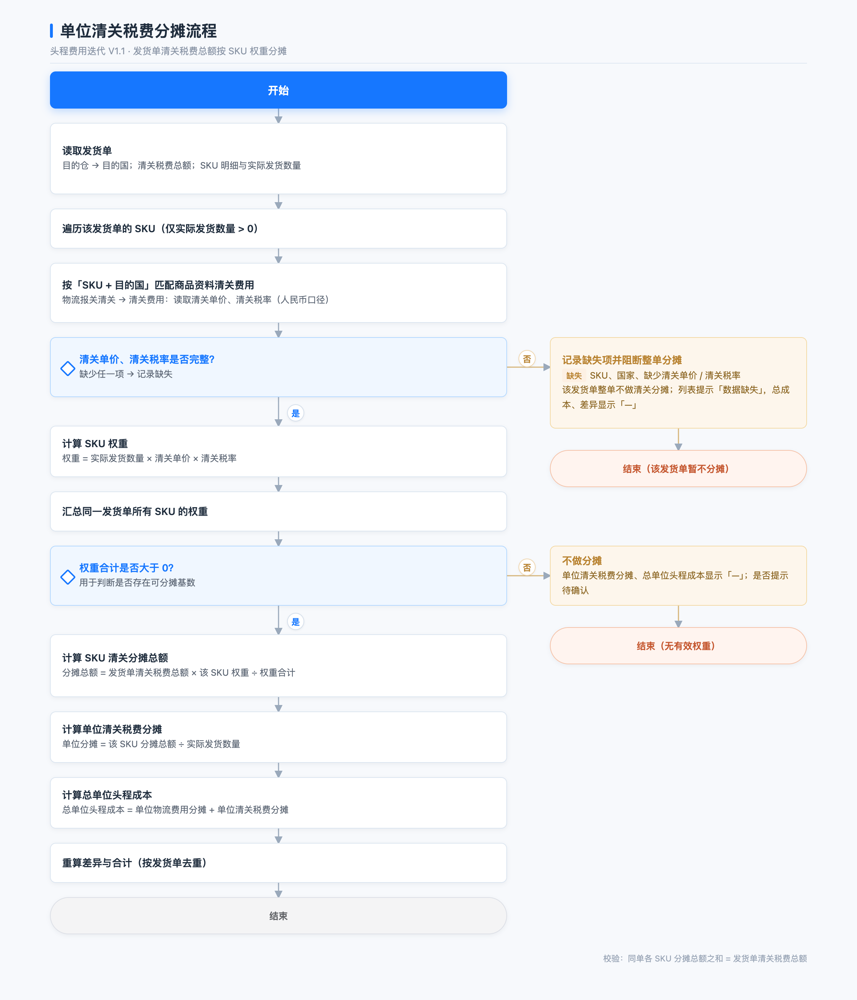

# 头程费用迭代 V1.1PRD

## 改动清单

| 标题 | 改动内容 | 对应章节 |
| --- | --- | --- |
| 异常整单阻断原则与独立分摊 | 明确物流分摊与清关分摊相互独立；当某项费用 `> 0` 且同发货单内任意参与分摊的 SKU（实际发货数量 `> 0`）缺失对应分摊依据时，**对应费用项整单不分摊**（不能分摊给同单其余 SKU），另一项分摊依据齐全的费用仍正常分摊并计入对应合计 | 1.2 目标、2.1 列清单、3.5 分摊差异与合计、4.1 异常触发规则与整单阻断 |
| 新增物流分摊异常校验 | 新增商品包装规格（长/宽/高）/包装毛重缺失触发整单物流不分摊校验 | 4.1 异常触发规则与整单阻断 |
| 调整清关异常口径 | 明确商品资料中「国家、清关单价、清关税率」为一组同时维护（国家必填），不存在仅缺国家的情况；新增「已录入清关税费（`> 0`）但参与分摊 SKU 权重合计为 0（例如税率全 0% 或单价为 0）」的异常触发校验 | 4.1 异常触发规则与整单阻断、4.4 其他边界场景 |
| 发货单号旁增加异常标识并移除顶部 Banner 与弹窗 | 在列表「发货单号」列中台单号旁增加红色「异常」标识（同单所有 SKU 行均显示），悬停直接展示具体异常原因与「请先补齐基础资料后，在发货单重新保存费用以触发重算」指引；移除列表顶部异常汇总 Banner，取消点击中台单号打开详情弹窗交互 | 1.2 目标、2.1 列清单、4.1 异常触发规则与整单阻断、5. 验收标准 |
| 拆分「分摊差异」与「是否异常」查询项 | 将查询项「分摊差异」选项调整为「有差异 / 无差异」（移除「数据缺失」）；新增独立查询项「是否异常」，枚举值为「是 / 否」，按整张发货单维度过滤 | 2.2 查询区与导出调整、5. 验收标准 |
| 导出格式调整为 .xlsx 并新增异常字段 | 导出格式由 CSV 统一调整为 `.xlsx`（文件名：`头程费用明细.xlsx`），导出按钮样式调整为白色背景，导出列新增「是否异常」「异常原因」，并补充完整导出字段模板 | 2.2 查询区与导出调整、2.3 导出字段模板（.xlsx）、5. 验收标准 |
| 调整列表底部合计规则 | 去掉「发货单总费用」「物流费用」「清关税费」「分摊差异」4 列的底部合计；仅保留「总单位头程成本」「单位物流费用分摊」「单位清关税费分摊」3 列的底部合计，按界面展示的 2 位小数单位金额乘以对应实际发货数量后求和 | 3.5 分摊差异与合计、5. 验收标准 |
| 国家列与筛选项展示国家代码 | 列表「国家」列、查询项「国家」下拉枚举及 `.xlsx` 导出均按「国家名称（2 位国家代码）」展示（如 `美国（US）`、`德国（DE）`、`英国（GB）`、`日本（JP）`），列宽调整为 106px | 2.1 列清单、2.2 查询区与导出调整、2.3 导出字段模板（.xlsx）、5. 验收标准 |

## 1. 背景与目标

### 1.1 业务背景与现状问题

头程费用是跨境供应链成本核算的重要一环，指货物从国内发往海外仓过程中产生的物流、清关等费用，需按 SKU 分摊后计入各 SKU 的头程单位成本，是后续移动加权成本、销售定价与毛利核算的基础。当前页面已支持基础查询，但存在以下问题：

- 缺少海外仓 SKU/FNSKU 映射，中台 SKU 与仓库编码无法快速对应；
- 单位头程成本未拆出物流、清关两部分，清关分摊是固定值、未按商品资料计算，费用构成无法核对；
- 中台单号无法点击查看发货单详情。

### 1.2 目标

1. 补齐海外仓 SKU/FNSKU、国家等关键字段；
2. 按「发货单 + SKU」维度分别独立计算物流费用分摊（按计费重）与清关税费分摊（按商品资料清关单价与税率权重），拆出物流费用分摊、清关税费分摊与分摊差异；
3. 明确分摊异常场景（包装规格/毛重缺失、清关资料整组缺失、清关单价/税率为 0 无法分摊）的整单阻断与异常标识提醒规则，支持按「是否异常」筛选；
4. 统一金额展示与列表视觉，通过发货单号旁异常标识与悬停提示直接排查异常，提升核对效率。

### 1.3 需求效益

1. **核算准确性**：清关税费由固定值改为按规则分摊，物流/清关费用构成透明，单位头程成本更准确，为移动加权成本与毛利核算提供可靠基础。
2. **数据完整性**：补齐海外仓 SKU/FNSKU、国家映射，打通中台 SKU 与海外仓编码，减少人工对照。
3. **工作效率**：缺失数据与异常原因直接在列表悬停提示、分摊差异可核对，减少线下核对与沟通成本。
4. **体验一致性**：统一表头、金额精度与布局，符合中台现有 UI 规范。

## 2. 页面与列表

### 2.1 列清单

| 列 | 宽度 | 说明 |
| --- | ---: | --- |
| 目的仓 | 92 | 固定 |
| 国家 | 106 | 固定；取发货单目的仓国家，按「国家名称（2 位代码）」展示，如 `美国（US）` |
| 发货单号 | 232 | 固定；中台单号（异常发货单右侧带红色「异常」标识）、易仓 ERP 单号两行 |
| SKU | 140 | 固定 |
| 海外仓 SKU/FNSKU | 190 | 固定；两行，缺失「—」 |
| 履约数量 | 115 | 实际发货 / 收货 |
| 发货单总费用 | 120 | 右对齐 |
| 物流费用 | 116 | 来自发货单；= 头程物流费 + 其他物流费用 |
| 清关税费 | 126 | 来自发货单；同单各行相同 |
| 总单位头程成本 | 147 | 蓝色；表头问号提示公式；任一分摊受阻或未分摊时显示「—」 |
| 单位物流费用分摊 | 150 | 黑色；表头问号提示计费重公式；缺失行标「资料缺失」，同单连带阻断行显示「—」 |
| 单位清关税费分摊 | 140 | 黑色；缺失行标「资料缺失」，同单连带阻断行显示「—」 |
| 清关单价 | 98 | 来自商品资料；2 位小数；问号提示取数口径 |
| 清关税率 | 93 | 来自商品资料；百分比展示；问号提示取数口径 |
| 分摊差异 | 130 | 两行：物流差异、清关差异；非 0 红、0 灰、未分摊/阻断「—」 |
| 物流信息 | 175 | 运输方式 / 渠道 |
| 创建时间 | 125 | — |

要点：

- 海外仓 SKU/FNSKU：平台仓显示 FNSKU，海外仓/独立站显示海外仓 SKU，同一行不会同时存在。
- 国家：取发货单的「目的仓国家」，固定在目的仓后，统一按「国家名称（2 位国家代码）」展示（如 `美国（US）`、`德国（DE）`、`英国（GB）`、`日本（JP）`）；缺失显示「—」。查询区「国家」下拉枚举值同步采用该格式。
- 发货单号异常标识：中台发货单号为纯文本展示（不提供点击打开弹窗）；当发货单触发物流分摊异常或清关分摊异常时，中台单号右侧展示红色「异常」角标（同单所有 SKU 行均显示），悬停展示具体异常原因与重算操作指引。
- 易仓 ERP：查询下拉、列表行、导出表头统一为「易仓 ERP 单号」；移除「易仓」标签。
- 物流费用：取发货单物流费用，等于头程物流费 + 其他物流费用，也等于发货单总费用 − 清关税费；表头问号提示该公式。
- 清关税费：直接取发货单清关税费总额，同一发货单各行相同，保留 2 位小数。
- 清关单价、清关税率：按 SKU + 目的国取商品资料维护值（国家、单价、税率同组维护）；单价 2 位小数，税率按百分比展示；表头问号分别提示「按 SKU + 目的国从产品列表清关费用中取的每件清关价格，人民币口径」「按 SKU + 目的国从产品列表清关费用中取的税率，用于计算分摊权重」；任一参与分摊（实际发货 `> 0`）的 SKU 缺失时，**整单清关费用不分摊**（不摊给其余 SKU）。
- 物流费用分摊与清关税费分摊**互相独立**：任一方分摊受阻时，仅受阻方整单不分摊，另一方依据齐全则照常分摊并计入对应合计；「总单位头程成本 = 单位物流费用分摊 + 单位清关税费分摊」，在任一方未分摊时显示「—」。
- 金额统一 2 位小数、四舍五入（4.105→4.11）；0 显示 0.00，无值「—」；导出同步。

### 2.2 查询区与导出调整

- **分摊差异**：下拉枚举值调整为 `有差异` / `无差异`（移除原 `数据缺失` 选项）。
- **是否异常**：新增独立下拉查询项，枚举值为 `是` / `否`（默认全部），按整张发货单是否触发分摊异常过滤（选择「是」时返回异常发货单下的全部 SKU 明细行）。
- **布局规则**：查询区默认展示两行，新增「是否异常」后溢出至第 3 行时自动显示「展开 / 收起」按钮，操作按钮组固定在第二行最右侧。
- **导出（.xlsx）**：操作栏「导出」按钮样式调整为白色背景（默认边框按钮样式）；在原导出列基础上，于「易仓 ERP 单号」后新增 `是否异常`（是/否）、`异常原因` 两列，按 `.xlsx` 格式（文件名：`头程费用明细.xlsx`，Sheet 名：`头程费用明细`）同步导出当前全部筛选结果。

### 2.3 导出字段模板（.xlsx）

| 序号 | 导出表头名称 | 数据来源 / 取值规则 | 格式与空值规范 |
|---:|---|---|---|
| 1 | 目的仓 | 发货单目的仓 | 文本 |
| 2 | 国家 | 发货单目的仓国家，按「国家名称（2 位代码）」展示（如 `美国（US）`） | 文本，缺失显示「—」 |
| 3 | 中台发货单号 | 发货单中台单号 | 文本 |
| 4 | 易仓 ERP 单号 | 发货单关联的易仓 ERP 单号 | 文本，缺失显示「—」 |
| 5 | 是否异常 | 该发货单是否触发物流或清关分摊异常 | 「是」/「否」 |
| 6 | 异常原因 | 聚合该发货单的异常明细（如 `【物流分摊异常】...；【清关分摊异常】...`） | 多条以「；」拼接；无异常显示「—」 |
| 7 | SKU | 中台 SKU 编码 | 文本 |
| 8 | 海外仓 SKU | 海外仓/独立站模式下的海外仓 SKU | 文本，缺失/不适用显示「—」 |
| 9 | FNSKU | 平台仓模式下的 FNSKU | 文本，缺失/不适用显示「—」 |
| 10 | 实际发货数量 | 该明细行的实际发货数量 | 数值（整数） |
| 11 | 收货数量 | 该明细行的实际收货数量 | 数值（整数） |
| 12 | 发货单总费用 | 头程物流费 + 清关税费 + 其他物流费用（同单各行相同） | 数值（CNY，保留 2 位小数，无值「—」） |
| 13 | 物流费用 | 头程物流费 + 其他物流费用（同单各行相同） | 数值（CNY，保留 2 位小数，无值「—」） |
| 14 | 清关税费 | 发货单清关税费总额（同单各行相同） | 数值（CNY，保留 2 位小数，无值「—」） |
| 15 | 总单位头程成本 | 单位物流费用分摊 + 单位清关税费分摊 | 数值（CNY，保留 2 位小数；任一方未分摊或实发为 0 显示「—」） |
| 16 | 单位物流费用分摊 | 按计费重占比分摊后的单位物流费用 | 数值（CNY，保留 2 位小数；物流异常或实发为 0 显示「—」） |
| 17 | 单位清关税费分摊 | 按清关权重占比分摊后的单位清关税费 | 数值（CNY，保留 2 位小数；清关异常或实发为 0 显示「—」） |
| 18 | 清关单价 | 商品资料按「SKU + 目的国」维护的清关单价（CNY） | 数值（保留 2 位小数，缺失显示「—」） |
| 19 | 清关税率 | 商品资料按「SKU + 目的国」维护的清关税率 | 百分比（如 `5%`，缺失显示「—」） |
| 20 | 物流费用差异 | Σ（单位物流费用分摊 × 实际发货数量）− 物流费用（同单各行相同） | 数值（CNY，保留 2 位小数；物流异常或实发为 0 显示「—」） |
| 21 | 清关税费差异 | Σ（单位清关税费分摊 × 实际发货数量）− 清关税费（同单各行相同） | 数值（CNY，保留 2 位小数；清关异常或实发为 0 显示「—」） |
| 22 | 运输方式 | 发货单运输方式（如海运、空运、快递） | 文本 |
| 23 | 物流渠道 | 发货单物流渠道 | 文本 |
| 24 | 创建时间 | 发货单创建时间（`YYYY-MM-DD`） | 日期文本，无值显示「—」 |

## 3. 单位清关税费分摊

### 3.1 取数口径

- 发货单：目的仓 → 目的国、清关税费总额、SKU 实际发货数量。
- 分摊维度：按「发货单 + SKU」计算，与发货计划、团队无关；同一 SKU 在同一发货单下有多个发货计划时，先合计该 SKU 的实际发货数量，再参与单位物流费用分摊和单位清关税费分摊，同一 SKU 各行的单位分摊值一致。
- 商品资料「物流报关清关 → 清关费用」：按 SKU + 国家维护清关单价、清关税率，物流人员手工维护。
- 列表同时展示物流费用、清关税费（发货单）和清关单价、清关税率（商品资料），用于核对费用构成与分摊依据。
- 清关单价按人民币处理，不做币种折算；实际发货数量为 0 的 SKU 不参与。

### 3.2 计算公式

- 权重 = 实际发货数量 × 清关单价 × 清关税率
- SKU 清关分摊总额 = 发货单清关税费总额 × 该 SKU 权重 ÷ 权重合计
- 单位清关税费分摊 = 分摊总额 ÷ 实际发货数量
- 总单位头程成本 = 单位物流费用分摊 + 单位清关税费分摊
- 计算使用原始精度，展示、合计、导出保留 2 位；每个发货单各 SKU 分摊总额之和 = 该单清关税费总额。

### 3.3 计算示例

以发货单 DN20260808002 为例：目的仓德国仓，目的国德国；清关税费总额 `856.97`，发货单总费用 `3276.98`，物流费用 `2420.01`（3276.98 − 856.97）。

**步骤 1：整理基础数据**

| SKU | 实际发货数量 | 清关单价 | 清关税率 | 单位物流费用分摊 |
| --- | ---: | ---: | ---: | ---: |
| SPU-3001 | 380 | 2.00 | 5% | 3.98 |
| SPU-4001 | 250 | 1.50 | 10% | 4.85 |

**步骤 2：计算权重**

| SKU | 计算过程 | 权重 |
| --- | --- | ---: |
| SPU-3001 | 380 × 2.00 × 5% | 38.00 |
| SPU-4001 | 250 × 1.50 × 10% | 37.50 |
| 合计 | — | 75.50 |

**步骤 3：计算权重占比**

- SPU-3001：38.00 ÷ 75.50 = 50.3311%
- SPU-4001：37.50 ÷ 75.50 = 49.6689%

**步骤 4：分摊清关税费总额**

| SKU | 计算过程 | 分摊总额 |
| --- | --- | ---: |
| SPU-3001 | 856.97 × 50.3311% | 431.32 |
| SPU-4001 | 856.97 × 49.6689% | 425.65 |
| 合计 | — | 856.97 |

**步骤 5：计算单位清关税费分摊**

| SKU | 计算过程 | 单位清关分摊 |
| --- | --- | ---: |
| SPU-3001 | 431.32 ÷ 380 | 1.14 |
| SPU-4001 | 425.65 ÷ 250 | 1.70 |

**步骤 6：计算总单位头程成本**

| SKU | 物流分摊 | 清关分摊 | 总单位头程成本 |
| --- | ---: | ---: | ---: |
| SPU-3001 | 3.98 | 1.14 | 5.12 |
| SPU-4001 | 4.85 | 1.70 | 6.55 |

**步骤 7：校验分摊差异**

- 清关分摊总额：431.32 + 425.65 = 856.97，等于发货单清关税费总额。
- 物流费用差异：（3.98 × 380 + 4.85 × 250）− 2420.01 = 2724.90 − 2420.01 = 304.89。
- 清关税费差异：856.97 − 856.97 = 0.00。
- 分摊差异：304.89 + 0.00 = 304.89。
- 说明：以上分摊总额、单位值按展示 2 位小数；页面内部使用原始精度计算。若直接用展示的 5.12 × 380 + 6.55 × 250 = 3583.10，再减 3276.98 会得到 306.12，与 304.89 的差异来自 2 位小数舍入，以原始精度计算的分摊差异 304.89 为准。

### 3.4 流程图

### 3.5 分摊差异与合计

- 分摊差异 = 物流费用差异 + 清关税费差异（两条费用线各自独立计算；任一方因异常未分摊时，对应差异显示「—」，另一方已成功分摊的差异仍正常计算）。
- 物流费用差异 = Σ（单位物流费用分摊 × 实际发货数量）− 物流费用。
- 清关税费差异 = Σ（单位清关税费分摊 × 实际发货数量）− 清关税费。
- 按原始精度计算；0 表示分摊完整，负数表示有费用未分摊到 SKU；同一发货单下所有有效参与分摊 SKU 行的差异相同，实发为 0 的 SKU 行显示「—」。
- 合计基于全部查询结果（不分页），底部合计行仅对「总单位头程成本」「单位物流费用分摊」「单位清关税费分摊」3 列展示合计（「发货单总费用」「物流费用」「清关税费」「分摊差异」不展示底部合计）。
- 3 列合计均按**列表界面展示的 2 位小数单位金额 × 对应实际发货数量**逐行计算后再求和：
  - `总单位头程成本合计 = Σ（展示的总单位头程成本[2 位小数] × 实际发货数量）`（仅统计物流与清关均成功分摊的行，不含显示「—」的行）
  - `单位物流费用分摊合计 = Σ（展示的单位物流费用分摊[2 位小数] × 实际发货数量）`（仅统计物流成功分摊的行）
  - `单位清关税费分摊合计 = Σ（展示的单位清关税费分摊[2 位小数] × 实际发货数量）`（仅统计清关成功分摊的行）

## 4. 异常场景处理

### 4.1 异常触发规则与整单阻断

核心原则：**物流费用分摊**与**清关税费分摊**各自独立校验与分摊；只要同一发货单内任意参与分摊的 SKU（实际发货数量 `> 0`）缺少对应分摊依据（或清关权重合计为 0），则**对应费用项整单不分摊**（绝对不能将该笔费用错误集中分摊给同单剩下的 SKU），但不影响另一项已满足条件的费用正常分摊。

| 分摊线 | 触发条件 | 异常场景 | 阻断与展示规则 | 异常提示文案示例 |
|---|---|---|---|---|
| **物流分摊线**（当发货单物流费用 `> 0` 时校验） | 同单任一实际发货 `> 0` 的 SKU 缺少商品资料「包装规格（长/宽/高）」或「包装毛重」（含未维护或值 `≤ 0`） | 包装规格/毛重缺失 | 整单物流费用不分摊；缺失 SKU 行的「单位物流费用分摊」显示红色「资料缺失」，同单其余 SKU 行显示「—」；「物流差异」「总单位头程成本」显示「—」；清关分摊不受影响 | `【物流分摊异常】SKU SPU-9001 缺少包装宽、包装毛重` |
| **清关分摊线**（当发货单清关税费 `> 0` 时校验） | 同单任一实际发货 `> 0` 的 SKU 在商品资料中未维护目的国清关费用记录（说明：国家、清关单价、清关税率在商品资料中为一组同时维护，国家为必填，要么齐全、要么整组缺失） | 目的国清关资料缺失 | 整单清关税费不分摊；缺失 SKU 行的「单位清关税费分摊」显示红色「资料缺失」，同单其余 SKU 行显示「—」；「清关差异」「总单位头程成本」显示「—」；物流分摊不受影响 | `【清关分摊异常】SKU SH-UK-0022（英国）未维护清关资料（国家/清关单价/清关税率）` |
| | 已录入清关税费（`> 0`），且所有参与分摊的 SKU 均已维护清关资料，但清关单价或清关税率均为 0（导致有效分摊依据为 0） | 清关单价/税率为 0 无法分摊 | 整单清关税费不分摊；参与行的「单位清关税费分摊」统一显示红色「资料缺失」；「清关差异」「总单位头程成本」显示「—」；物流分摊不受影响 | `【清关分摊异常】已录入清关税费 ¥126.49，但参与分摊的 SKU 清关单价或清关税率均为 0，无法分摊` |

**异常提醒交互规范：**

- **发货单号旁异常标识**：凡触发上述任意异常的发货单，在列表「发货单号」列中台单号右侧固定展示红色「异常」标识（同一异常发货单的每一行均显示），中台单号保持纯文本展示，不打开弹窗。
- **悬停详情与操作指引**：不采用列表顶部汇总 Banner；鼠标悬停异常标识时，聚合展示该单全部异常明细（分清【物流分摊异常】/【清关分摊异常】、具体 SKU 与缺失项），并在尾部统一附带操作指引：`处理建议：请先补齐基础资料后，在发货单重新保存费用以触发重算。`
- **不触发异常的边界**：实际发货数量为 `0` 的 SKU 不参与分摊，不触发缺失异常；清关税费 `= 0` 时即使税率为 `0%` 也不触发权重为 0 异常（直接分摊 `0.00`）。

### 4.2 费用清空

- 清空发货单的清关税费：该发货单的清关税费、单位清关税费分摊、清关税费差异同步清空显示「—」；物流费用与单位物流费用分摊保持不变；总单位头程成本因缺少清关部分显示「—」。
- 清空物流费用：单位物流费用分摊、物流费用差异同步清空显示「—」；清关税费与单位清关税费分摊保持不变；总单位头程成本显示「—」。
- 已清空的费用重新录入并保存后，按新录入金额重新触发分摊，恢复对应字段。
- 仅修改费用金额（非清空）时，保存后同样按最新金额重新分摊。

### 4.3 数据取值时点

- 分摊取费用录入时刻的产品资料数据（包装规格/毛重、清关单价、清关税率）与体积参数配置。
- 后续修改产品资料不会自动重算已生成的分摊，需在发货单重新保存费用触发重算（异常提示中同步引导业务人员执行该操作）。
- 重新保存费用时，取当前最新维护的产品资料与体积参数重新计算分摊并刷新异常状态。

### 4.4 其他边界场景

- 税率 0%：视为有效维护值，权重为 0；若同单存在其他税率 `> 0%` 的 SKU，则该 0% SKU 分摊清关税费 `0.00`，其余 SKU 正常分摊；若同单全部实发 SKU 的清关单价或税率均为 0 且清关税费 `> 0`，则按 4.1「清关单价/税率为 0 无法分摊」触发整单清关异常（单元格标「资料缺失」），不分摊。
- 清关税费总额为 0：单位清关分摊显示 0.00，不触发异常；总额被清空时按 4.2 清空处理。
- 实际发货数量为 0：该 SKU 不参与分摊，单位分摊与分摊差异均显示「—」，不影响同单其他 SKU 正常分摊。

## 5. 验收标准

| 验收项 | 预期结果 |
| --- | --- |
| 表头与边框 | 17 列表头全白、无竖线；宽屏下完整展示，1440/1024 横向滚动，前 5 列固定 |
| 发货单号异常标识 | 存在分摊异常的发货单，中台单号右侧显示红色「异常」标识（同单各行均显示）；悬停提示具体缺失 SKU/字段及重算操作指引；中台单号为纯文本不打开弹窗；列表顶部无汇总 Banner |
| 独立分摊与整单阻断 | 物流缺失（缺包装长宽高/毛重）时仅整单物流不分摊，清关仍正常分摊；清关缺失（缺目的国清关资料或单价/税率均为 0）时仅整单清关不分摊，物流仍正常分摊；任一受阻时总单位头程成本显示「—」；缺失行统一标「资料缺失」，同单其余 SKU 对应列显示「—」 |
| 国家展示与筛选 | 列表「国家」列、查询区「国家」下拉枚举及 `.xlsx` 导出均按「国家名称（2 位国家代码）」展示（如 `美国（US）`、`德国（DE）`、`英国（GB）`、`日本（JP）`），缺失「—」 |
| 查询项与筛选 | 「分摊差异」选项为「有差异 / 无差异」；新增独立查询项「是否异常（是 / 否）」，选「是」时按整单维度返回异常发货单的全部 SKU 行；查询区两行展示，溢出项通过「展开/收起」切换 |
| 合计口径 | 底部整行合计基于全部查询结果（不分页）；「发货单总费用」「物流费用」「清关税费」「分摊差异」不展示合计；仅「总单位头程成本」「单位物流费用分摊」「单位清关税费分摊」3 列展示合计，按界面 2 位小数单价乘以对应实际发货数量后求和 |
| 费用清空与重算指引 | 清空清关税费或物流费用后对应分摊与差异清空，另一方保留；修改商品资料后需在发货单重新保存费用触发重算 |
| 回归与导出 | 无 JS 报错；`validate-ui` 通过；「导出」按钮为白色背景；`.xlsx` 导出包含「是否异常」「异常原因」及全部列表字段，金额保留 2 位小数 |
