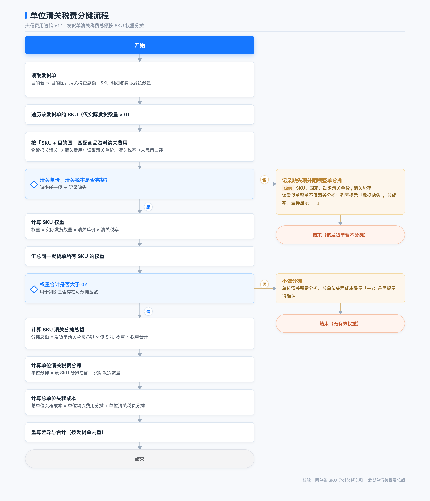

# 头程费用迭代 V1.1PRD

| 项目 | 内容 |
| --- | --- |
| 文档版本 | V1.1（2026-11-11，待评审） |
| 关联页面 | 财务 · 成本核算 · 头程费用（pages/sku-first-leg-cost） |
| 关联文档 | 《头程费用查询页-PRD》 |

## 1. 背景与目标

### 1.1 业务背景与现状问题

头程费用是跨境供应链成本核算的重要一环，指货物从国内发往海外仓过程中产生的物流、清关等费用，需按 SKU 分摊后计入各 SKU 的头程单位成本，是后续移动加权成本、销售定价与毛利核算的基础。当前页面已支持基础查询，但存在以下问题：

- 缺少海外仓 SKU/FNSKU 映射，中台 SKU 与仓库编码无法快速对应；
- 单位头程成本未拆出物流、清关两部分，清关分摊是固定值、未按商品资料计算，费用构成无法核对；
- 中台单号无法点击查看发货单详情。

### 1.2 目标

1. 补齐海外仓 SKU/FNSKU、国家等关键字段；
2. 按「发货单 + SKU」维度、依据商品资料清关单价与税率规则计算清关分摊，拆出物流费用分摊、清关税费分摊与分摊差异；
3. 缺失数据明确提示，异常场景（资料缺失、费用清空、取值时点）有明确规则；
4. 统一金额展示与列表视觉，支持发货单详情查看，提升核对效率。

### 1.3 需求效益

1. **核算准确性**：清关税费由固定值改为按规则分摊，物流/清关费用构成透明，单位头程成本更准确，为移动加权成本与毛利核算提供可靠基础。
2. **数据完整性**：补齐海外仓 SKU/FNSKU、国家映射，打通中台 SKU 与海外仓编码，减少人工对照。
3. **工作效率**：缺失数据明确提示、发货单详情弹窗、分摊差异可核对，减少线下核对与沟通成本。
4. **体验一致性**：统一表头、金额精度与布局，符合中台现有 UI 规范。

## 2. 页面与列表

### 2.1 列清单

| 列 | 宽度 | 说明 |
| --- | ---: | --- |
| 目的仓 | 92 | 固定 |
| 国家 | 60 | 固定；取发货单目的仓国家 |
| 发货单号 | 210 | 固定；中台单号、易仓 ERP 单号两行 |
| SKU | 140 | 固定 |
| 海外仓 SKU/FNSKU | 190 | 固定；两行，缺失「—」 |
| 履约数量 | 115 | 实际发货 / 收货 |
| 发货单总费用 | 120 | 右对齐 |
| 物流费用 | 116 | 来自发货单；= 头程物流费 + 其他物流费用 |
| 清关税费 | 126 | 来自发货单；同单各行相同 |
| 总单位头程成本 | 147 | 蓝色；表头问号提示公式 |
| 单位物流费用分摊 | 133 | 黑色 |
| 单位清关税费分摊 | 140 | 黑色；缺失显示「—」 |
| 清关单价 | 98 | 来自商品资料；2 位小数；问号提示取数口径 |
| 清关税率 | 93 | 来自商品资料；百分比展示；问号提示取数口径 |
| 分摊差异 | 130 | 两行：物流差异、清关差异；非 0 红、0 灰、缺失「—」 |
| 物流信息 | 175 | 运输方式 / 渠道 |
| 创建时间 | 125 | — |

要点：

- 海外仓 SKU/FNSKU：平台仓显示 FNSKU，海外仓/独立站显示海外仓 SKU，同一行不会同时存在。
- 国家：取发货单的「目的仓国家」，固定在目的仓后；缺失显示「—」。
- 易仓 ERP：查询下拉、列表行、导出表头统一为「易仓 ERP 单号」；移除「易仓」标签。
- 物流费用：取发货单物流费用，等于头程物流费 + 其他物流费用，也等于发货单总费用 − 清关税费；表头问号提示该公式。
- 清关税费：直接取发货单清关税费总额，同一发货单各行相同，保留 2 位小数。
- 清关单价、清关税率：按 SKU + 目的国取商品资料维护值；单价 2 位小数，税率按百分比展示；表头问号分别提示「按 SKU + 目的国从产品列表清关费用中取的每件清关价格，人民币口径」「按 SKU + 目的国从产品列表清关费用中取的税率，用于计算分摊权重」；缺失显示「—」，该 SKU 不参与清关分摊，不影响同单其他 SKU。
- 总单位头程成本 = 单位物流费用分摊 + 单位清关税费分摊；字段值和合计为蓝色（#1677ff）。
- 金额统一 2 位小数、四舍五入（4.105→4.11）；0 显示 0.00，无值「—」；导出同步。

## 3. 单位清关税费分摊

### 3.1 取数口径

- 发货单：目的仓 → 目的国、清关税费总额、SKU 实际发货数量。
- 分摊维度：按「发货单 + SKU」计算，与发货计划、团队无关；同一 SKU 在同一发货单下有多个发货计划时，先合计该 SKU 的实际发货数量，再参与单位物流费用分摊和单位清关税费分摊，同一 SKU 各行的单位分摊值一致。
- 商品资料「物流报关清关 → 清关费用」：按 SKU + 国家维护清关单价、清关税率，物流人员手工维护。
- 列表同时展示物流费用、清关税费（发货单）和清关单价、清关税率（商品资料），用于核对费用构成与分摊依据。
- 清关单价按人民币处理，不做币种折算；实际发货数量为 0 的 SKU 不参与。

### 3.2 计算公式

- 权重 = 实际发货数量 × 清关单价 × 清关税率
- SKU 清关分摊总额 = 发货单清关税费总额 × 该 SKU 权重 ÷ 权重合计
- 单位清关税费分摊 = 分摊总额 ÷ 实际发货数量
- 总单位头程成本 = 单位物流费用分摊 + 单位清关税费分摊
- 计算使用原始精度，展示、合计、导出保留 2 位；每个发货单各 SKU 分摊总额之和 = 该单清关税费总额。

### 3.3 计算示例

以发货单 DN20260808002 为例：目的仓德国仓，目的国德国；清关税费总额 `856.97`，发货单总费用 `3276.98`，物流费用 `2420.01`（3276.98 − 856.97）。

**步骤 1：整理基础数据**

| SKU | 实际发货数量 | 清关单价 | 清关税率 | 单位物流费用分摊 |
| --- | ---: | ---: | ---: | ---: |
| SPU-3001 | 380 | 2.00 | 5% | 3.98 |
| SPU-4001 | 250 | 1.50 | 10% | 4.85 |

**步骤 2：计算权重**

| SKU | 计算过程 | 权重 |
| --- | --- | ---: |
| SPU-3001 | 380 × 2.00 × 5% | 38.00 |
| SPU-4001 | 250 × 1.50 × 10% | 37.50 |
| 合计 | — | 75.50 |

**步骤 3：计算权重占比**

- SPU-3001：38.00 ÷ 75.50 = 50.3311%
- SPU-4001：37.50 ÷ 75.50 = 49.6689%

**步骤 4：分摊清关税费总额**

| SKU | 计算过程 | 分摊总额 |
| --- | --- | ---: |
| SPU-3001 | 856.97 × 50.3311% | 431.32 |
| SPU-4001 | 856.97 × 49.6689% | 425.65 |
| 合计 | — | 856.97 |

**步骤 5：计算单位清关税费分摊**

| SKU | 计算过程 | 单位清关分摊 |
| --- | --- | ---: |
| SPU-3001 | 431.32 ÷ 380 | 1.14 |
| SPU-4001 | 425.65 ÷ 250 | 1.70 |

**步骤 6：计算总单位头程成本**

| SKU | 物流分摊 | 清关分摊 | 总单位头程成本 |
| --- | ---: | ---: | ---: |
| SPU-3001 | 3.98 | 1.14 | 5.12 |
| SPU-4001 | 4.85 | 1.70 | 6.55 |

**步骤 7：校验分摊差异**

- 清关分摊总额：431.32 + 425.65 = 856.97，等于发货单清关税费总额。
- 物流费用差异：（3.98 × 380 + 4.85 × 250）− 2420.01 = 2724.90 − 2420.01 = 304.89。
- 清关税费差异：856.97 − 856.97 = 0.00。
- 分摊差异：304.89 + 0.00 = 304.89。
- 说明：以上分摊总额、单位值按展示 2 位小数；页面内部使用原始精度计算。若直接用展示的 5.12 × 380 + 6.55 × 250 = 3583.10，再减 3276.98 会得到 306.12，与 304.89 的差异来自 2 位小数舍入，以原始精度计算的分摊差异 304.89 为准。

### 3.4 流程图

### 3.5 分摊差异与合计

- 分摊差异 = 物流费用差异 + 清关税费差异。
- 物流费用差异 = Σ（单位物流费用分摊 × 实际发货数量）− 物流费用。
- 清关税费差异 = Σ（单位清关税费分摊 × 实际发货数量）− 清关税费。
- 按原始精度计算；0 表示分摊完整，负数表示有费用未分摊到 SKU；同一发货单下所有 SKU 行相同。
- 合计基于全部查询结果；发货单总费用、物流费用、清关税费、分摊差异按单去重；清关税费合计与单位清关税费分摊合计一致。
- 物流费用合计 = 发货单总费用合计 − 清关税费合计 = 8353.20 − 2704.73 = 5648.47。

## 4. 异常场景处理

### 4.1 清关资料缺失

- 缺失情况：无 SKU + 国家清关费用记录（缺单价、税率）、单价为空、税率为空、目的仓无法映射国家。
- 缺失 SKU 的「单位清关税费分摊」「总单位头程成本」显示「—」，该 SKU 不参与清关分摊；同发货单其他 SKU 正常分摊，不强制阻断流程。
- 清关税费总额仍全额分摊给有有效清关资料的 SKU，权重合计只统计这些 SKU。
- 列表顶部提示具体缺失项，文案示例：`清关税费分摊数据缺失：发货单 DN... 的 SKU（国家）缺少清关税率。该 SKU 暂不参与清关分摊，请先在商品资料维护。`
- 实际发货数量为 0 的 SKU 不触发缺失提示；税率为 0 视为有效维护值。

### 4.2 费用清空

- 清空发货单的清关税费：该发货单的清关税费、单位清关税费分摊、清关税费差异同步清空显示「—」；物流费用与单位物流费用分摊保持不变；总单位头程成本因缺少清关部分显示「—」。
- 清空物流费用：单位物流费用分摊、物流费用差异同步清空显示「—」；清关税费与单位清关税费分摊保持不变；总单位头程成本显示「—」。
- 已清空的费用重新录入并保存后，按新录入金额重新触发分摊，恢复对应字段。
- 仅修改费用金额（非清空）时，保存后同样按最新金额重新分摊。

### 4.3 数据取值时点

- 分摊取费用录入时刻的产品资料数据（清关单价、清关税率）。
- 后续修改产品资料不会自动重算已生成的分摊，需重新录入费用触发重算。
- 重新录入时，取重新录入时刻产品资料维护的清关单价、清关税率。

### 4.4 其他边界场景

- 税率 0%：视为有效维护值，权重为 0；同单权重合计为 0 时不分摊，单位清关分摊显示「—」。
- 清关税费总额为 0：单位清关分摊显示 0.00；总额被清空时按 4.2 清空处理。
- 实际发货数量为 0：该 SKU 不参与分摊，单位分摊显示「—」。
- 目的仓无法映射国家：视同清关资料缺失，按 4.1 处理。

## 5. 验收标准

| 验收项 | 预期结果 |
| --- | --- |
| 表头与边框 | 17 列表头全白、无竖线；2383 宽屏下 17 列完整展示，无横向滚动；1440/1024 横向滚动，前 5 列固定 |
| 新增字段 | 目的仓后显示国家（取发货单目的仓国家，缺失「—」）；发货单总费用后显示物流费用（= 头程物流费 + 其他物流费用）、清关税费（取发货单值，同单相同）；单位清关税费分摊后显示清关单价、清关税率（取商品资料，单价 2 位小数、税率百分比，表头问号提示取数口径）；缺失「—」 |
| 新列 | SKU 后显示海外仓 SKU/FNSKU，两行且互斥，缺失「—」 |
| 命名与公式 | 易仓 ERP 单号、无「易仓」标签；总单位头程成本蓝色，问号提示公式 |
| 金额 | 2 位小数；4.105→4.11；0→0.00；无值「—」；合计：总费用 8353.20、物流费用 5648.47、清关税费 2704.73、总单位成本 11284.73、物流分摊 8580.00、清关分摊 2704.73、分摊差异 2931.53 |
| 分摊差异 | 物流差异分别为 2598.62 / 304.89 / 28.02 / 0.00，清关差异均为 0.00；0 发货行显示「—」；合计 2931.53 |
| 分摊示例 | DN20260808002：清关单价 2.00 / 1.50、税率 5% / 10%；SPU-3001 单位清关 1.14、SPU-4001 1.70；总成本 5.12 / 6.55 |
| 数据缺失 | 缺失 SKU 的清关分摊与总单位头程成本显示「—」，同单其他 SKU 正常分摊；顶部提示具体缺失字段，不整单阻断 |
| 费用清空 | 清空清关税费后清关分摊、清关差异清空，物流分摊保留；清空物流费用后反之；总单位头程成本显示「—」；重新录入后恢复 |
| 取值时点 | 修改产品资料不自动重算；重新录入费用后按最新清关单价、税率重算 |
| 发货单弹窗 | 点击中台单号打开；信息 10 项；SKU 全量；1180 宽；≤1200 两列；可关闭 |
| 查询 | SKU 类型真实筛选；占位动态；多选无「（可多选）」；2048/1440 两行，1024 可展开 |
| 回归 | 无 JS 报错；validate-ui 通过；导出含新列且金额 2 位 |
