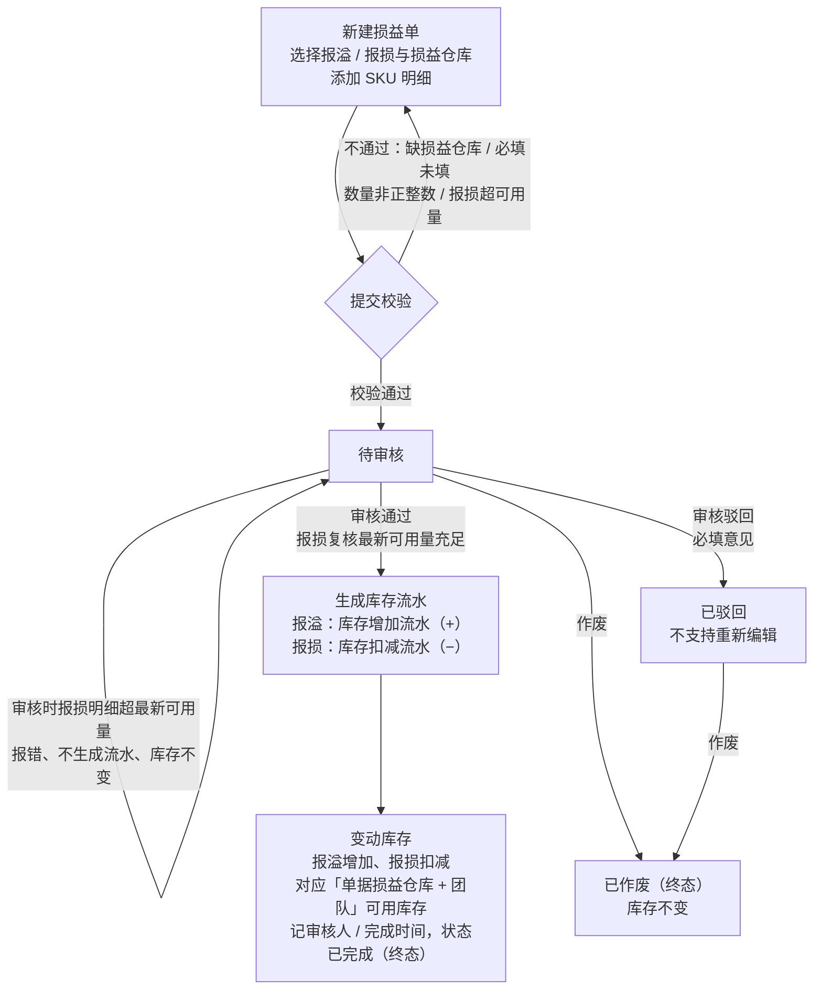

# 损益单全流程管理 PRD

## 1. 文档改动清单

| 序号 | 改动内容 | 对应章节 |
| --- | --- | --- |
| 1 | 初版发布：定义损益单新建、编辑、审核、作废、查询、导出全流程 | 全文 |
| 2 | 补充业务价值；审核前增加报损实时可用量复核，批量审核按单粒度部分通过 | 3.3、4.3、5.4、7 |
| 3 | 新建弹窗 SKU 选择器改为「先查询后加载候选」 | 5.2 |
| 4 | 删除冲销相关概念与规则（状态流转、操作菜单、异常场景、权限点、导出） | 4.3、5、6、7、8 |
| 5 | 正文压缩；删除功能编号与 TBD 标注，改为中文表述 | 全文 |
| 6 | 状态流转新增 mermaid 流程图 | 4.3 |
| 7 | 新增验收摘要清单 | 8 |
| 8 | 损益仓库升级为单据级公共字段（一张单仅一个损益仓库），SKU 选择器与明细表联动调整；移动加权价改为纯文本展示；损益金额去掉货币符号 | 2、4、5.1、5.2、5.6、6.1、6.2、7、8 |
| 9 | 删除「决策记录与未决问题清单」章节（决策已全部落正文），原第 9 章验收摘要清单调整为第 8 章 | 8 |
| 10 | 新建损益类型默认值由「报损」改为空（必选，未选时提交拦截）；清理指向已删除章节的引用 | 4.1、5.2、5.7、7 |
| 11 | 移除「完成时间」查询项，时间类型固定为创建时间 | 5.1、7 |
| 12 | 明确审核通过后必须先生成库存流水（报溢 + / 报损 −，按明细逐条）再变动库存，流水与库存变动同事务；状态流转图与 5.4 / 6.1 同步更新 | 4.3、5.4、6.1 |

## 2. 术语与口径

| 术语 | 定义 |
| --- | --- |
| 损益单 | 承载库存报溢、报损调整的业务单据，审核通过后驱动库存变动，是库存调整的唯一入口单据。 |
| 报溢 | 库存增加类调整（盘盈、漏入库补登等），明细数量在单据中以 **+N** 展示。 |
| 报损 | 库存减少类调整（盘亏、破损、丢失、销毁等），明细数量在单据中以 **-N** 展示。 |
| 损益仓库 | 单据级公共字段：创建人在新建 / 编辑时选择，**一张损益单只能有一个损益仓库**，全部明细与库存调整均落在该仓库。 |
| 移动加权价 | SKU 在损益仓库当前的移动加权平均成本单价，由系统自动带出，作为损益金额的计算单价，**不允许手工修改**。 |
| 当前可用量 | SKU 在「单据损益仓库 + 团队」维度下的可用库存数量，选择 SKU 时带出，作为报损数量的上限校验依据。 |
| 团队 | 库存的归属团队（公共库存 / Temu团队 / 亚马逊北美团队 / 独立站团队），损益调整必须落到具体团队库存。 |

## 3. 背景与目标

### 3.1 背景

账面库存与实物库存的差异在跨境仓储链路中不可消灭，来源贯穿全链路：运输丢损（头程 / 尾程丢件破损）、仓储损耗（破损、受潮、过期、丢失偷盗）、收发货差错（错发多发追不回、多发未入账、退货已回仓未记账）、单据与外部校准（历史录错、迁移修正、海外仓 / FBA 校准）。实物多于账面即**报溢**，少于账面即**报损**。此类差异只能靠**规范的单据机制**持续修正（盘点 / 对账发现差异 → 单据调整对齐），不能直接改库存数字：

| 直接改库存数字 | 用损益单修正 |
| --- | --- |
| 无痕迹，无从追溯谁改的、为什么改 | 单据记录 SKU、数量、原因、责任方、时间，全程可追溯 |
| 无权限管控，任何人都能动库存 | 必须审核通过才生效库存，越权操作被拦截 |
| 财务对不上账：存货少了，账面无法解释 | 报损进费用、报溢冲成本，损益金额口径与财务一致，审计可过 |
| 无法复盘损耗出在哪个环节 | 原因结构化沉淀，可统计损耗率、定位问题环节 |

现状问题：库存调整缺少统一单据承载，原因无法结构化沉淀、动作缺少审核把关、错误调整无法规范纠正。损益单用于收口全部库存调整场景，成为中台库存调整的**唯一合规入口**。

### 3.2 产品目标

损益单定位为库存调整的**唯一合规修正入口**：一切账实差异修正必须落在单据上、审核通过后才动库存。

- **统一入口**：报溢 / 报损调整均以损益单为唯一载体，单张支持多 SKU 明细，限定一个损益仓库、可跨团队。
- **审核把关**：审核通过才生效库存；驳回、作废均不产生库存变动。
- **全程留痕**：创建、编辑、审核、作废、备注修改全部记入操作日志。
- **金额可计量**：按移动加权价计量损益金额，与财务核算口径一致。

### 3.3 业务价值

一张审核通过的损益单，同时解决三件事：

| 价值 | 说明 |
| --- | --- |
| **库存对齐** | 账面重新等于实物，可售、占用、缺货判断恢复准确，避免超卖或缺货误判。 |
| **留痕追责** | 谁提的、谁审的、为什么改、改了多少，均有单据与日志可查，责任可界定。 |
| **财务记账** | 报损进费用、盘盈冲成本，损益金额口径与财务、审计一致。 |

长期价值：原因结构化沉淀后，可按仓库 / 团队 / 原因统计损耗率与盘差率，反向定位问题环节，为供应链改善提供数据依据。

## 4. 单据对象与状态机

损益单 = 单头 + 多条 SKU 明细。一张单据只有一个损益类型（报溢 / 报损）、**只有一个损益仓库**，明细可跨团队。

### 4.1 单头字段

| 字段 | 来源 | 规则 |
| --- | --- | --- |
| 损益单号 | 系统生成 | 规则 `SY + YYMMDD + 4位顺序号`（如 `SY2610080001`），按日递增，全局唯一。 |
| 单据状态 | 系统 | 待审核 / 已完成 / 已驳回 / 已作废，详见 4.3。 |
| 损益类型 | 创建人选择 | 报溢 / 报损，单选；**新建默认为空**（占位「请选择损益类型」），未选择时提交拦截。**已有明细时切换类型将清空全部已选 SKU**（原因字典随类型变化）。 |
| 损益仓库 | 创建人选择 | 必选，**单据级唯一**（字典随仓库主数据维护：华东实体仓 / SZ01坪山石井仓 / Temu09-全托管平台仓 / 快猫物流中转仓）；未选择时不允许添加 SKU 与提交，见 5.2。 |
| 损益数量 | 明细汇总 | 全部明细损益数量之和（绝对值，方向由类型表达）。 |
| 损益金额 | 明细汇总 | 全部明细损益金额之和（绝对值），计算口径见 6.2。 |
| 单据备注 | 创建人填写 | ≤ 500 字；列表行内可直接编辑，任何状态下均可修改，修改记入日志。 |
| 创建人 / 创建时间 | 系统 | 创建操作人与时间，不可修改。 |
| 审核人 / 完成时间 | 系统 | 审核通过时记录操作人为审核人、当前时间为完成时间；驳回 / 作废不记录。 |

### 4.2 明细字段（SKU 损益明细）

| 字段 | 必填 | 规则 |
| --- | --- | --- |
| SKU | 是 | 通过 SKU 选择器添加（候选限定单据损益仓库，见 5.2）；同一单据内按「SKU + 团队」组合去重，同组合不可重复添加。 |
| 产品名称 | — | 随 SKU 带出，只读。 |
| 团队 | 是 | 下拉选择：公共库存 / Temu团队 / 亚马逊北美团队 / 独立站团队。 |
| 当前可用量 | — | 选入 SKU 时按「SKU + 单据损益仓库 + 团队」带出可用量快照，只读，仅作录入参考；报损数量校验使用同维度**实时可用量**（提交时校验、审核前复核，见 5.4）。 |
| 损益数量 | 是 | 正整数；报损时 **≤ 当前可用量**；报溢无上限。 |
| 移动加权价 | — | 系统按 SKU 当前移动加权平均成本自动带出，**以纯文本展示，不可编辑**（不使用输入框）。 |
| 损益金额 | — | = 损益数量 × 移动加权价，随数量实时联动，只读，展示为「千分位 + 两位小数」纯数字（**不带货币符号**）。 |
| 损益原因 | 是 | 从当前损益类型对应的原因字典选择（字典见 6.3）。 |
| 备注 | 否 | ≤ 120 字。 |

编辑提效：明细表头的「团队 / 损益数量 / 损益原因 / 备注」均提供**批量设置**入口，一键应用到全部明细行（损益仓库为单据级字段，不参与批量设置）。

### 4.3 状态流转

库存复核只针对**报损明细**，报溢不校验上限；批量审核按单粒度判定，库存不足的单不影响同批其他单（见 5.4）。

| 当前状态 | 可编辑 | 可审核 | 可作废 | 说明 |
| --- | --- | --- | --- | --- |
| 待审核 | ✓ | ✓ | ✓ | 库存未变动，可任意修改或撤回。 |
| 已完成 | — | — | — | 库存已生效，终态。 |
| 已驳回 | — | — | ✓ | **不支持重新编辑**；如需调整须重新建单。 |
| 已作废 | — | — | — | 终态，仅可查日志。 |

## 5. 功能范围

### 5.1 列表页与查询

损益单统一工作台：多条件检索、状态分栏、批量操作、行内明细与备注维护。

**查询条件**

| 条件 | 规则 |
| --- | --- |
| 编码查询（下拉 + 输入） | 类型三选一：**SKU / 产品名称 / 损益单号**；支持多值输入（逗号、空格、换行分隔），自动去重、忽略大小写、模糊匹配。SKU / 产品名称命中**任一明细行**即命中整单；单号匹配单头。提示语随类型联动。 |
| 损益类型 | 报溢 / 报损，单选。 |
| 仓库 / 团队 / 创建人 | 多选下拉；**仓库匹配单头损益仓库**，团队命中**任一明细行**即命中整单；**创建人默认勾选当前登录人**，进入页面只看本人单据，重置后恢复该默认。 |
| 时间范围 | 时间类型固定为**创建时间**（不提供完成时间筛选），配起止日期（含首尾）。开始、结束日期必须同时填写，且开始日期不得晚于结束日期（违规时 toast 拦截，不执行查询）。 |
| 展开 / 收起 | 查询项超出两行时自动出现「展开 / 收起」开关，默认收起。 |

**状态分栏**：全部 / 待审核 / 已完成 / 已驳回 / 已作废，每个页签带计数（计数口径 = 应用除状态外全部查询条件后的结果数）。切换页签清空已勾选并回到第一页。

**列表结构（一级横条 + 二级明细）**

| 层级 | 字段与规则 |
| --- | --- |
| 一级横条 | 勾选框、损益单号（点击打开详情）、单据状态标签、损益类型标签（报溢 / 报损）、损益仓库、损益数量、损益金额、备注（行内编辑，≤500 字，保存写日志）、创建人、创建时间、操作菜单。 |
| 二级明细（常显） | 8 列：SKU、产品名称（左侧 22px 占位图，行高不变）、团队、损益数量（报溢 **+N** / 报损 **-N**）、移动加权价、损益金额、损益原因、备注。 |
| 底部汇总 | 「共 X 张 · X 个 SKU · 报溢数量 +X · 报损数量 -X · 报溢金额 X · 报损金额 X」（数量带方向符号，金额为纯数字），对当前筛选全集（非当前页）统计。 |
| 分页 | 10 / 20 / 50 张每页，默认 10。 |

**操作菜单（按状态）**

| 状态 | 操作项 |
| --- | --- |
| 待审核 | 编辑、日志 |
| 已完成 | 日志 |
| 已驳回 | 日志（**不提供编辑**） |
| 已作废 | 日志（**不提供编辑**） |

**操作行（列表上方）**：「新建损益单」「导出」「审核」「作废」四个按钮；审核 / 作废作用于已勾选单据（表头复选框全选当前筛选结果）。

**空态**：无符合条件单据时展示「暂无符合条件的损益单」。

### 5.2 新建损益单

**触发**：操作行点击「新建损益单」，弹出编辑器。

**流程**：选择损益类型（默认报损）与**损益仓库**（必选）→ 添加 SKU（选择器，可多选）→ 逐行或批量补全团队 / 数量 / 原因 / 备注 → 提交审核 → 生成待审核单并置顶列表。

**SKU 选择器**

- 检索条件：SKU（多值，逗号 / 空格分隔）、产品名称、团队（单选）。**仓库不作为检索条件**：候选锁定为单头所选损益仓库，弹窗标题下方展示「损益仓库：X」。
- **打开选择器时不自动加载候选 SKU**，列表区显示空态「请输入查询条件后点击『查询』加载 SKU」；点击「查询」（或在 SKU / 产品名称输入框回车）后按条件加载候选，查询无结果显示「暂无符合条件的 SKU」。未查询前表头全选不可用。
- 候选项维度为「SKU + 团队」（仓库维度即单据损益仓库），展示可用库存；**已加入单据的同「SKU + 团队」组合行禁用勾选**。
- 确认时至少选择 1 个，否则提示「请至少选择一个 SKU」；添加后明细行带入 SKU、名称、团队、当前可用量、移动加权价（纯文本），数量 / 原因 / 备注待填。

**批量设置**：团队 / 损益数量 / 损益原因 / 备注四类表头批量入口（损益仓库为单据级字段，不参与批量设置）；值为空时提示「请先填写X」；数量为「必须为正整数」校验，原因选项随当前损益类型。

**提交校验**

1. 损益仓库必选，否则提示「请选择损益仓库」。
2. 至少添加 1 个 SKU 明细，否则提示「请至少添加一个 SKU」。
3. 每条明细：团队、损益原因必填，且原因必须属于当前损益类型字典。
4. 每条明细：损益数量为正整数；**报损单数量 ≤ 提交时实时可用量**（防止明显超量单据进入审核）。
5. 任一明细不满足：提示「{SKU} 的团队、损益原因或数量不符合要求」，不提交。

**结果**

- 生成单号（规则见 4.1），状态 = 待审核，插入列表顶部，提示「损益单创建成功」。
- 写操作日志：类型「新增」，内容「创建{type}损益单」。
- 单头损益仓库 = 创建人所选仓库（单据级，见 4.1）。

**异常**：已有明细时切换损益类型，清空全部已选 SKU 并提示「损益类型已变更，已清空已选 SKU」（防止原因字典错配）。

### 5.3 编辑损益单

**触发**：仅**待审核**单据的操作菜单提供「编辑」入口。

**规则**

- 编辑器与新建完全同构，预填单头与全部明细；明细可增删改。
- 校验规则与新建一致（5.2 提交校验全量适用）。
- 提交按钮为「保存」；保存后状态保持**待审核**，不重新生成单号。

**结果**：提示「损益单已保存」；写日志：类型「编辑」，内容「保存损益单修改」。已驳回、已作废、已完成单据**无编辑入口**。

### 5.4 审核

**触发**：勾选单据后点击操作行「审核」，支持批量（仅**待审核**进入审核范围；勾选集中无待审核时提示「请选择待审核的损益单」）。

**规则与结果**

- 审核弹窗含「审核意见」输入框（≤300 字，实时字数统计），意见对本次所选全部单据生效。
- **通过**：意见可留空。系统先按单复核报损明细的**最新实时可用量**：
  - 复核通过（报溢明细无需复核）：**生成库存流水**（报溢 +、报损 −，每条 SKU 明细一条流水）→ 按流水变动对应「单据损益仓库 + 团队」可用库存 → 状态 → 已完成，记录审核人 = 当前操作人、完成时间 = 当前时间；写日志「审核通过并完成{type}库存调整：{意见}」，提示「审核通过，库存已更新」（口径见 6.1）。
  - 任一报损明细数量 > 最新可用量：本张单审核失败，提示「{SKU} 当前可用库存不足，不能扣成负库存」；状态保持**待审核**，不进入已完成，库存不变。
- **批量审核按单粒度处理**：库存充足单正常通过，不足单报错并保持待审核；完成后反馈成功 N 张、失败 M 张，清空勾选并刷新列表。
- **驳回**：意见必填，未填时行内报错「驳回时请填写原因」且不提交。单据状态 → 已驳回，写日志「审核驳回：{意见}」，提示「已驳回所选损益单」；库存不变。

### 5.5 作废

**触发**：勾选单据后点击操作行「作废」，支持批量。

**规则**

- 仅**待审核**、**已驳回**可作废；勾选集中无满足条件单据时提示「所选单据不可作废」。
- 二次确认弹窗：「确定作废已选择的 N 张损益单吗？」，确认 / 取消。

**结果**：确认后状态 → 已作废，写日志：类型「作废」，内容「作废损益单，未产生库存变动」，提示「损益单已作废」。**作废全程不产生任何库存变动**（仅允许在库存未生效前作废）。

### 5.6 详情与操作日志

**详情弹窗**：点击列表单号打开。单头区展示：损益单号、单据状态、损益类型、损益仓库、创建信息（创建人 / 创建时间）、单据备注；下方为完整明细表（同列表二级明细 8 列）。只读，不提供编辑。

**操作日志弹窗**：任何状态单据的操作菜单均有「日志」。字段：操作类型、日志内容、操作人、操作时间；按时间倒序（最新在前）。

| 日志类型 | 记录时机 |
| --- | --- |
| 新增 | 创建损益单。 |
| 编辑 | 保存单据修改；修改单据备注。 |
| 审核 | 审核通过 / 审核驳回（含意见）。 |
| 作废 | 作废损益单。 |

### 5.7 导出

**触发**：操作行「导出」按钮。

**规则**：按当前全部查询条件（含状态页签）圈定结果集，创建异步导出任务，提示「已创建 N 张损益单的导出任务」。暂定异步导出，文件在导出中心生成后下载；导出字段清单与文件格式见第 8 章 Q3。

## 6. 通用业务规则

以下规则全局唯一定义，各功能章节不再重复。

### 6.1 库存生效时机

| 单据动作 | 库存影响 | 说明 |
| --- | --- | --- |
| 新建 / 编辑保存 | 不变动 | 待审核阶段仅为申请；提交时做报损实时可用量校验。 |
| 审核通过前库存复核失败 | 不变动 | 报损明细超最新可用量时审核报错，单据保持待审核，不能扣成负库存。 |
| 审核通过 | **生效** | ①先按每条 SKU 明细**生成库存流水**（单据号关联，报溢方向 +、报损方向 −，记录 SKU / 仓库 / 团队 / 数量 / 操作人 / 时间）；②再按流水变动对应「单据损益仓库 + 团队」可用库存；③更新单据状态为已完成。无论报损还是报溢都必须生成流水，流水与库存变动在同一事务内，失败则整体回滚、单据保持待审核。 |
| 审核驳回 / 作废 | 不变动 | 不生成流水；日志明确「未产生库存变动」。 |

库存流水是审核通过后库存变动的**唯一凭证**：库存查询 / 库存流水页面可按单据号追溯本单产生的全部流水；无流水的库存变动不允许存在。流水存储与库存底座的对接方式由库存底座承载。

### 6.2 金额计算口径

- 明细损益金额 = 损益数量 × 移动加权价（带出值，不可改）。
- 单头损益金额 = 明细金额之和，**以绝对值展示**；方向由损益类型表达。
- 列表汇总区：数量按类型带方向符号（报溢 +X、报损 -X）；**金额为纯数字，不带符号**（报溢金额 X、报损金额 X，方向由标签表达）。
- 金额展示：千分位 + 两位小数，**不带货币符号（¥）**；数量为整数（明细行），汇总数量两位小数格式。

### 6.3 损益原因字典

报溢、报损分别维护原因字典，服务于事后归因统计与财务口径区分；切换损益类型时字典整体切换、已选明细清空（见 5.2 异常）。

**报损原因（10 项）**

| 枚举值 | 适用场景 | 归类 |
| --- | --- | --- |
| 盘点盘亏 | 盘点数 < 账面数的亏空 | 账实更正 |
| 海外仓库存校准 | 第三方海外仓对账产生的差异 | 账实更正 |
| 系统迁移修正 | 历史数据迁移后的批量修正 | 账实更正 |
| 商品丢失 | 仓内商品找不到、疑似偷盗 | 经营损耗 |
| 商品破损 | 仓储、搬运、操作造成的物理破损 | 经营损耗 |
| 过期销毁 | 临期 / 过期商品的报废处理 | 经营损耗 |
| 退货坏品报废 | 退件无法二次销售、直接销毁 | 经营损耗 |
| 质检报废 | 来料不良、质检不合格的报废（可向供应商索赔） | 经营损耗 |
| 错发漏发 | 多发 / 错发给客户且无法追回 | 经营损耗 |
| 其他盘亏 | 以上均不适用时的兜底 | 兜底 |

**报溢原因（7 项）**

| 枚举值 | 适用场景 | 归类 |
| --- | --- | --- |
| 盘点盘盈 | 盘点数 > 账面数的盈余 | 账实更正 |
| 退货漏入库 | 退件已回仓但未及时记账 | 账实更正 |
| 历史入库遗漏 | 历史入库单据漏录、少录 | 账实更正 |
| 收货多收 | 供应商多发、头程到货多于单据数量 | 账实更正 |
| 海外仓库存校准 | 第三方海外仓对账产生的差异 | 账实更正 |
| 系统迁移修正 | 历史数据迁移后的批量修正 | 账实更正 |
| 其他盘盈 | 以上均不适用时的兜底（含错发追回等低频场景） | 兜底 |

归类口径：**经营损耗** = 真实损失，计入损耗费用，需管理重点关注；**账实更正** = 非真实损失，仅修正账面。导出与统计建议按「归类」聚合。

交互与实现约定（2026-11-02 产品确认）：

1. **下拉按归类分组展示**：编辑明细与批量设置中的原因下拉，按「账实更正 / 经营损耗 / 兜底」分组渲染（报溢无经营损耗组），提升选择效率并直观表达财务口径。
2. **兜底原因强制备注**：明细选择「其他盘亏 / 其他盘盈」时，该行备注必填，未填写时提交拦截并提示「{SKU} 选择了『其他盘亏/其他盘盈』，请填写备注说明具体原因」，防止兜底被滥用导致归因失真。
3. **「样品领用」本期不启用**（产品确认内部领用场景暂不通过损益单承载），后续有需求再补枚举与「内部领用」归类。
4. **本期原因字典为前端枚举**，不做后台可配置；调整字典需随版本发布。若后续字典变更频繁，再评估后台配置方案。

### 6.4 单号规则

`SY + YYMMDD + 4位顺序号`，按创建日生成、当日从 0001 递增。是否要求跨日连续 / 全局唯一序列，由研发按单号服务现状确认。

### 6.5 操作日志规则

所有状态变更与内容修改必须写日志（类型枚举见 5.6）；日志不可删除、不可修改，倒序展示。日志是审核追溯与财务核查的唯一依据。

### 6.6 权限点（待确认）

| 权限点 | 待定内容 |
| --- | --- |
| 新建 / 编辑 | 开放角色范围；是否限制只能编辑本人单据。 |
| 审核 | 审核角色；是否禁止审核本人创建的单据（职责分离）。 |
| 作废 | 是否需要主管及以上角色。 |
| 导出 | 是否按数据权限（仓库 / 团队维度）过滤可导出范围。 |

原型当前未做权限隔离（所有操作可见可用），上线前需评审确认。

## 7. 边界与异常

| 编号 | 场景 | 系统行为 |
| --- | --- | --- |
| E1 | 查询只填开始或结束日期其一 | toast「开始和结束日期必须同时填写」，不执行查询。 |
| E2 | 开始日期晚于结束日期 | toast「开始日期不能晚于结束日期」，不执行查询。 |
| E3 | 查询无结果 | 列表区展示空态「暂无符合条件的损益单」，汇总归零。 |
| E4 | 新建时不添加 SKU 直接提交 | toast「请至少添加一个 SKU」，拦截。 |
| E5 | 明细必填缺失 / 数量非正整数 / 报损超提交时可用量 | toast「{SKU} 的团队、损益原因或数量不符合要求」，拦截并定位到首个问题行。 |
| E6 | 编辑器中切换损益类型 | 清空全部已选 SKU 并 toast 告知，防止原因字典错配。 |
| E7 | SKU 选择器重复添加同「SKU+团队」 | 候选行复选框禁用，不可重复添加。 |
| E8 | SKU 选择器未勾选即确认 | toast「请至少选择一个 SKU」，拦截。 |
| E9 | 批量设置时无任何明细行 | toast「请先添加 SKU 明细」。 |
| E10 | 批量设置值为空 / 数量非正整数 | toast「请先填写X」/「损益数量必须为正整数」，不应用。 |
| E11 | 审核勾选集中无待审核单 | toast「请选择待审核的损益单」，不弹审核窗。 |
| E12 | 驳回时未填审核意见 | 行内报错「驳回时请填写原因」，输入框标红，不提交。 |
| E13 | 作废勾选集中无可作废单 | toast「所选单据不可作废」，不弹确认窗。 |
| E14 | 作废确认弹窗点取消 | 关闭弹窗，无任何变更、无日志。 |
| E15 | 对已完成 / 已驳回 / 已作废单编辑 | 操作菜单无「编辑」入口，不可触发（入口级控制优于报错）。 |
| E16 | 导出结果集为 0 | 仍创建导出任务（N=0），提示文案待确认，或改为 toast 拦截。 |
| E17 | 审核通过时报损明细最新可用量不足 | 本张单审核失败：toast「{SKU} 当前可用库存不足，不能扣成负库存」；状态保持待审核，库存不变。 |
| E18 | 批量审核中部分单据库存不足 | 按单粒度处理：库存充足单通过并生效库存；不足单报错并保持待审核；反馈成功 N 张、失败 M 张。 |
| E19 | 未选择损益仓库时点「添加 SKU」或「提交审核」 | 分别 toast「请先在单头选择损益仓库」/「请选择损益仓库」，不打开选择器、不提交。 |

## 8. 验收摘要清单

验收按模块逐项核对，详细规则以对应章节为准。

| 编号 | 模块 | 验收要点 |
| --- | --- | --- |
| A1 | 列表查询（5.1） | 编码查询多值分隔、去重、模糊命中明细行；创建人默认勾选当前登录人、重置后恢复；时间范围成对填写且开始 ≤ 结束；状态页签计数=除状态外全部条件过滤后的结果数。 |
| A2 | 列表展示（5.1） | 一级横条 + 二级明细 8 列常显（明细不含损益仓库列）；报溢 +N / 报损 -N，金额纯数字无符号；底部汇总对筛选全集统计；操作菜单：待审核=编辑+日志，其余状态=仅日志。 |
| A3 | 新建（5.2） | 单头损益仓库必选（未选时添加 SKU 与提交均被拦截）；SKU 选择器打开不自动加载、查询 / 回车后才出候选、未查询前全选不可用，候选锁定单据损益仓库；同「SKU+团队」不可重复；提交校验：至少 1 条明细、必填完整、正整数、报损 ≤ 实时可用量；切换类型清空已选 SKU。 |
| A4 | 编辑（5.3） | 仅待审核有编辑入口；校验与新建一致；保存后保持待审核、单号不变；已驳回 / 已作废 / 已完成无编辑。 |
| A5 | 审核（5.4） | 通过前按单复核报损实时可用量，不足报错且保持待审核；批量按单粒度部分通过并反馈成功 N / 失败 M；驳回必填意见；通过才记审核人 / 完成时间。 |
| A6 | 库存生效（6.1） | 仅审核通过生效库存（报溢增加、报损扣减对应「单据损益仓库 + 团队」）；新建 / 编辑 / 驳回 / 作废 / 复核失败均不变动，不能扣成负库存。 |
| A7 | 作废（5.5） | 仅待审核、已驳回可作废；二次确认弹窗；全程不变动库存并写日志。 |
| A8 | 详情与日志（5.6） | 任意状态可查日志；新增 / 编辑 / 审核 / 作废四类日志齐全、倒序、不可删改；详情只读。 |
| A9 | 导出（5.7） | 按当前全部查询条件（含状态页签）圈定结果集，异步任务并提示 N 张。 |
| A10 | 金额与单号（6.2 / 6.4） | 明细金额 = 数量 × 移动加权价且不可改（加权价纯文本展示）；单头金额绝对值；金额千分位两位小数、**不带货币符号**，汇总金额纯数字无符号；单号 `SY+YYMMDD+4位` 按日递增全局唯一。 |
