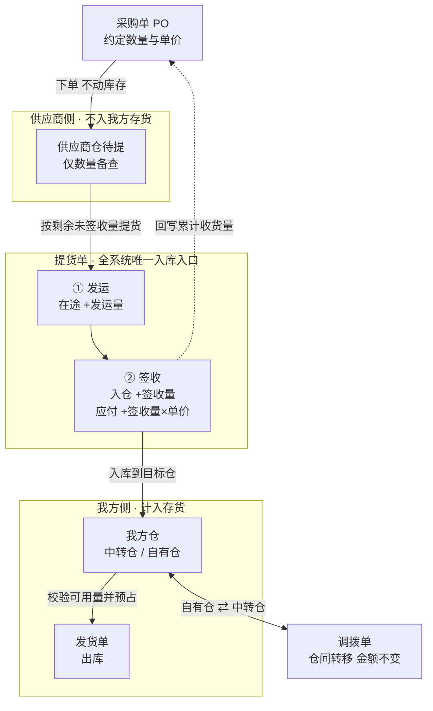
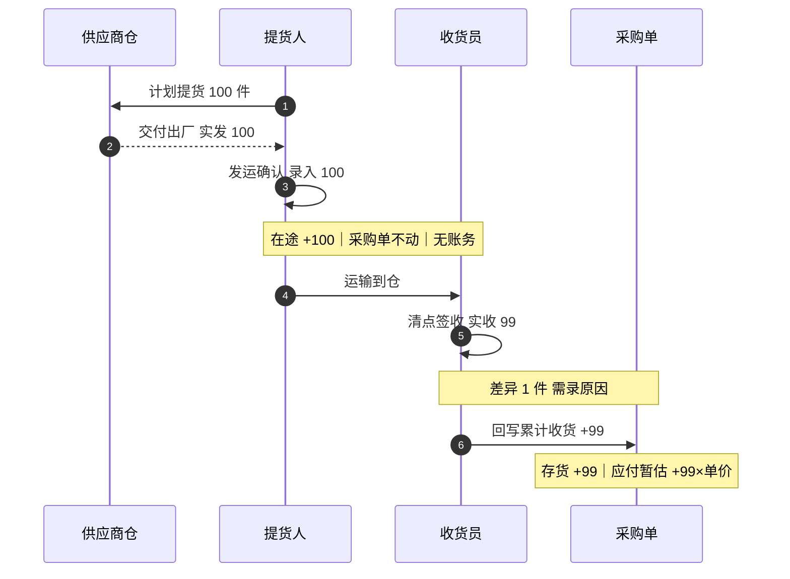
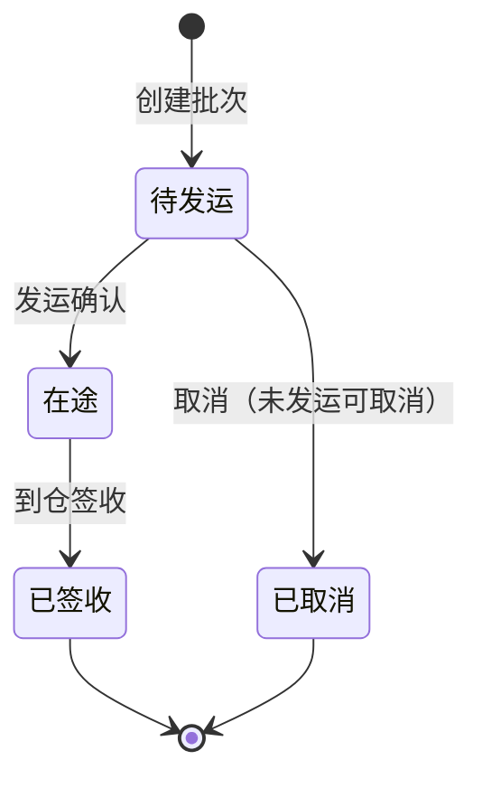
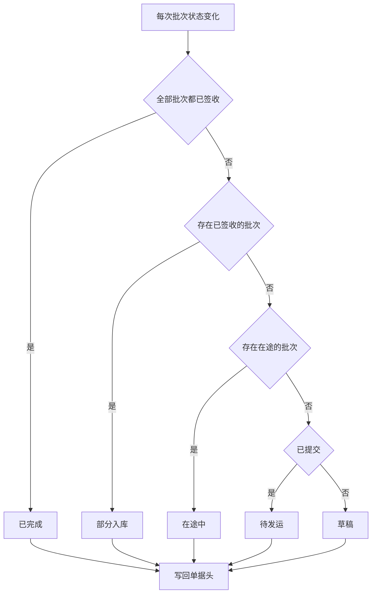
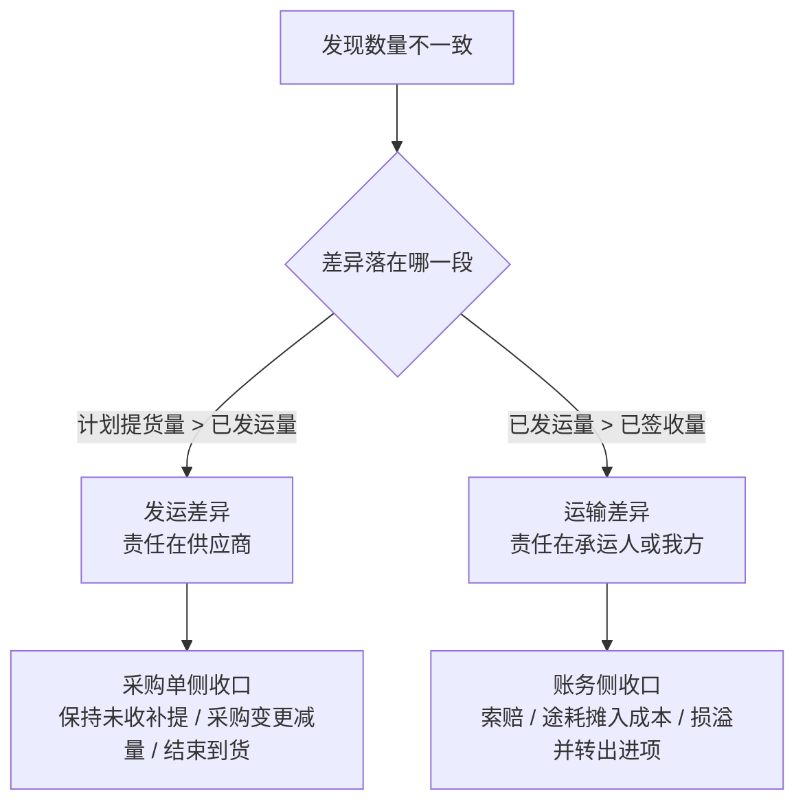
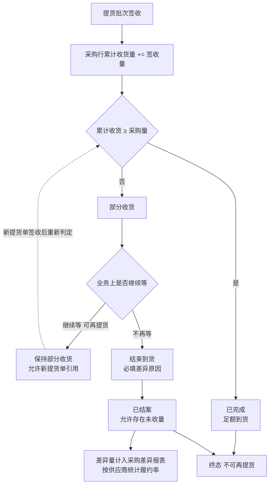
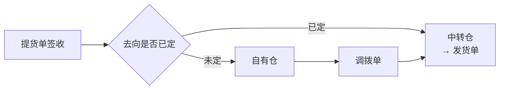

# 提货 · 采购入库 · 发货 全流程设计方案

> 版本：V1.1（补充流程图）
> 日期：2026-10-31
> 定位：**体系设计**——四张单据如何协同。单张提货单的字段级规格见《提货单全流程管理-PRD》。
> 范围：采购单、提货单、调拨单、发货单，以及它们共同影响的库存与应付。

**关于流程图**：本文共 7 张流程图，使用 Mermaid 语法（` ```mermaid ` 代码块）。GitHub、Typora、VS Code（装 Markdown Preview Mermaid 插件）、语雀均可直接渲染；不支持 Mermaid 的环境会显示为代码块，内容仍可读。

| 章节 | 图 | 回答什么问题 |
|---|---|---|
| 2.1 | 端到端单据流与库存动作 | 货从下单到发货，经过哪几个位置，钱在哪一步产生 |
| 3.3 | 发运与签收的时序 | 100 和 99 分别记在哪，账务为什么只在签收发生 |
| 3.4 | 批次状态机 | 一个批次能走哪些状态，为什么发运后不能取消 |
| 3.4 | 单据状态聚合 | 单据状态怎么算出来，判定顺序为什么不能颠倒 |
| 3.5 | 差异判定路径 | 出现数量差时，先判断责任段还是先看差异值 |
| 4.4 | 采购单完结判定 | 「已完成」和「已结案」在哪一步分叉 |
| 6.3 | 自有仓到中转仓的调拨 | 用途未定时为什么要绕一次 |

另有一份可直接在浏览器查看的渲染版：`outputs/提货全流程设计方案-预览.html`（由 `scripts/md-preview.py` 生成）。

---

## 零、这份文档要解决什么

把「供应商仓提货 → 我方仓入库 → 采购单完结 → 应付确认 → 发货」这条链路上的四张单据，定成一个能自洽运行的整体。

前期讨论的结论散落在多处，本章做一次收口，并明确哪些是已经拍死的、哪些还留了选择。

---

## 一、已确认的业务约束

以下约束来自前期讨论，本方案不得违反：

| 编号 | 约束 | 来源 |
|---|---|---|
| C1 | 提货单与发货单**解耦、平级**，只通过仓库库存关联，不互相关联单据 | 用户确认 |
| C2 | 提货单上游**只有采购单** | 用户确认 |
| C3 | 仅 JASIC 精密、摩仕达两家供应商有提货概念 | 用户确认 |
| C4 | 目标仓可为**自有仓或物流商仓**，两者都会出现 | 用户确认 |
| C5 | 业务是**两段式**：发运 100 → 中转仓清点 99，以 99 为准 | 用户确认 |
| C6 | 采购单**收货即入库**，签收时回写采购收货量 | Q1 决策 |
| C7 | 入库必须带**团队**，默认继承采购行 | Q2 决策 |
| C8 | 入库**不得落供应商仓** | PRD 5.4 |
| C9 | **提货签收是唯一交易节点**，应付只产生一次 | PRD 7.3 |
| C10 | 一张采购单可**分多次提货**，每次目标仓可不同 | 用户确认 |
| C11 | **用途未定是常态**，提货单不承担用途字段 | 用户确认 |
| C12 | **自有仓 → 中转仓调拨**是常规动作，非例外 | 用户确认 |
| C13 | 组合件、发货计划**不纳入**提货单 | 用户确认 |

---

## 二、体系全景

### 2.1 四张单据的职责边界

| 单据 | 一句话职责 | 动库存 | 产生应付 |
|---|---|---|---|
| 采购单 | 约定买多少、什么价 | 否 | 否（预付除外） |
| **提货单** | 把货从供应商仓搬到指定仓，并记录实收 | **是** | **是** |
| 调拨单 | 我方仓之间搬货 | 是（内部转移） | 否 |
| 发货单 | 从仓里出货发往海外仓/客户 | 是（出库） | 否 |

**全系统只有提货单能从外部把库存「增」进来，也只有它有资格确认应付。** 调拨和发货都是我方内部流转，金额不变、不产生负债。

这条决定了：提货单做错，后面所有报表都是错的；提货单做对，后面只需要管扣减。

**端到端单据流与库存动作**



图中有三条线需要特别注意：

- **实线 `SIGN → WH`** 是全系统唯一的库存增加路径。其他任何地方都不该出现「库存 +」的动作。
- **虚线 `SIGN → PO`** 是收货回写，发生在签收时而非发运时。
- **`WH → TR → WH` 自环**是自有仓到中转仓的调拨，金额不变、不产生损益。

### 2.2 库存的三个位置

| 位置 | 归属 | 进存货科目 | 数据来源 |
|---|---|---|---|
| 供应商待提（在供应商仓） | 供应商 | **否**，仅数量参考 | 采购剩余量反推 |
| 在途 | 我方（视合同条款） | 视方案（见 5.4） | 提货单「发运」动作 |
| 我方仓（中转仓/自有仓） | 我方 | **是** | 提货单「签收」动作 |

这张表是整份方案的地基。前期所有争论——能不能入供应商仓、要不要过账、在途算不算存货——答案都在这张表里。

### 2.3 一个关键简化：不维护供应商仓库存台账

原设计有个「提货仓可用量」字段，但它的数据来源没有答案：供应商仓不是我方仓，我方不盘点、不记账，余额只能依赖供应商口头报数。

**本方案的处理：不维护供应商仓库存台账。提货上限 = 采购行剩余未签收量。**

供应商实际备货不足时（例如订 100 只备了 60），不需要系统预判，由提货人在**发运**时录 60，形成「发运差异」。这才是真实信息的采集点，比预先维护一个没人维护得准的台账可靠。

此条同时解决原 PRD 中的 Q3（提货仓可用量口径）。

---

## 三、提货单设计

### 3.1 结构与粒度

```
提货单（单头：一个供应商 + 一个提货仓 + 一个目标仓）
  └─ 提货批次（一次发运 + 一次签收）
       └─ 批次明细（SKU / 本次数量 / 团队）
```

批次必须是**实体**，不能是日志。理由：交接凭证（司机、车牌、签收人）挂在批次上，运输责任判定以批次为单位，对账也按批次逐笔核。

建议批次字段：

| 字段 | 说明 |
|---|---|
| 批次号 | 单号-序号 |
| 发运时间 / 发运人 | 出厂时点 |
| 司机 / 电话 / 车牌 / 运输方式 | 交接信息 |
| 签收时间 / 签收人 | 到仓时点 |
| 批次状态 | 待发运 / 在途 / 已签收 |
| 差异原因 | 存在发运或运输差异时必填 |

### 3.2 三条数量线（本方案核心）

明细行必须保留三个数量，不能只留一个累计值：

| 数量 | 含义 | 谁录入 | 时点 |
|---|---|---|---|
| **计划提货量** | 本单打算提多少 | 提货人 | 创建时 |
| **已发运量** | 装车出厂多少 | 提货人/司机 | 发运时 |
| **已签收量** | 到仓清点实收多少 | 目标仓收货员 | 签收时 |

由此产生两种差异，性质完全不同：

| 差异 | 公式 | 责任方 | 处理方向 |
|---|---|---|---|
| **发运差异** | 计划 − 发运 | 供应商（备货不足/少发） | 补提，或采购变更减量 |
| **运输差异** | 发运 − 签收 | 承运人 / 我方（途中短少、破损） | 索赔，或计入合理途耗 |

**这是两段式最大的价值：把「供应商没给够」和「路上丢了」拆开。** 现在合成一个数，出问题永远定不了责，供应商也会用「路上丢的」来搪塞少发。

### 3.3 两个确认点

| 动作 | 谁操作 | 库存动作 | 采购单动作 | 账务动作 |
|---|---|---|---|---|
| **发运** | 提货人 / 仓库 | 在途 +发运量 | **不动** | 无（见 5.4） |
| **签收** | 目标仓收货员 | 在途 −发运量、目标仓 +签收量 | 累计收货 **+签收量** | 存货 + 应付 + 进项 |

发运不回写采购单，因为货还没收到。这条是 C6「收货即入库」的落地方式——**签收才是收货，发运不是。**

**发运与签收的时序**



时序图里第二条 `Note`（在途 +100）是账务的分界线。发运之后、签收之前，这张单在账上是不存在的——只有数量在动，金额不动。账务动作被压缩进第三条 `Note`，与签收同时发生，这正是 C9「唯一交易节点」的图形化表达。

### 3.4 状态机

**批次级（三态）**



注意 `在途` 状态没有回到 `待发运` 的路径，也没有 `取消` 出口（对应 E4：发运后不允许取消，只能走退回流程）。这是有意为之——货已经出厂，状态就不能再「撤回」。

**单据级（由批次聚合，不单独维护）**

| 单据状态 | 聚合条件 |
|---|---|
| 草稿 | 未提交 |
| 待发运 | 全部批次均未发运 |
| 在途中 | 存在在途批次，且无任何已签收批次 |
| 部分入库 | 存在已签收批次，但非全部签收完成 |
| 已完成 | 全部批次已签收（含差异签收） |
| 已取消 | 未发运前取消；已发运不允许取消，走差异收口 |

聚合优先级：**部分入库 > 在途中**。因为「第一批已到、第二批在路上」这个信息比单纯的「在途」更有价值，用户关心的是「到了多少」。

**单据状态是算出来的，不是存出来的**



判定顺序不能颠倒：先看是否全部签收，再看是否有部分签收，最后才看在途。如果先判在途，「第一批已到、第二批在路上」会被误显示成「在途中」，丢掉已到货的信息。

### 3.5 差异处理矩阵

| 差异类型 | 典型原因 | 采购单动作 | 库存动作 | 账务动作 | 单据收口方式 |
|---|---|---|---|---|---|
| 发运差异 | 供应商备货不足 | 剩余量保持未收，可补提 | 无（未发出） | 无 | 继续等，或走「结束到货」 |
| 发运差异 | 供应商确认不再供货 | 采购变更减量 | 无 | 冲减应付额度 | 采购变更单 |
| 发运差异 | 我方放弃剩余量 | 结束到货 | 无 | 无 | 采购单置「已结案」 |
| 运输差异 | 承运人丢失/破损 | 按实收量收货 | 按签收量入目标仓 | 差额转索赔应收 | 索赔单 |
| 运输差异 | 合理途耗 | 按实收量收货 | 按签收量入目标仓 | 差额成本摊入实收存货 | 批次标记途耗 |
| 运输差异 | 我方管理不善 | 按实收量收货 | 按签收量入目标仓 | 差额进「待处理财产损溢」+ 进项转出 | 损溢单 |

**差异判定路径**



判定的第一步不是问「差多少」，而是问「差在哪一段」。这个顺序决定了责任归属，也决定了后面走哪套账务。

图中只画到责任分流这一层，六种具体情形与对应账务见上表——**同一段差异可能对应多套处理，图不能替代表格**。

**规则：差异原因必须在批次上选择，不能只留一个数字。** 六种情况对应六套账务，混在一起财务无法做账。

### 3.6 上限与校验

| 校验项 | 规则 |
|---|---|
| 计划提货量 | ≤ 采购行剩余未签收量 |
| 发运量 | ≤ 计划提货量（超发需单独审批，不允许默认通过） |
| 签收量 | ≤ 发运量（超收说明发运漏记，需先改发运数） |
| 提货仓 | 必须属于该供应商名下，且该供应商已标记为「提货型」 |
| 目标仓 | 自有仓或物流商仓，**不得为供应商仓**（C8） |
| 团队 | 必填，默认继承采购行团队，允许改，改动留痕（C7） |
| 一车多单 | 允许一张提货单关联多张采购单，但必须同供应商同提货仓 |

---

## 四、采购单设计

### 4.1 收货回写规则

| 项 | 规则 |
|---|---|
| 触发时点 | 提货批次**签收**时，非发运时 |
| 回写内容 | 采购行累计收货量 += 本批次**签收量** |
| 幂等 | 以批次为最小单元，同一批次不重复回写 |
| 状态流转 | 累计 0 → 待收货；0 < 累计 < 采购量 → 部分收货；累计 ≥ 采购量 → 已完成 |
| 操作入口 | 提货型供应商**关闭人工收货入口**，避免与提货回写重复 |
| 事务 | 批次签收、目标仓入库、采购回写在**同一事务**内，任一失败整体回滚 |

### 4.2 状态与终态改造（必须有）

现状问题：采购单只有「已完成」一个终态，导致有差异的单永远完结不了。

建议终态拆成两个：

| 终态 | 含义 | 触发条件 | 是否允许有未收量 |
|---|---|---|---|
| **已完成** | 足额到货 | 累计收货 ≥ 采购量 | 否 |
| **已结案** | 有差异，但业务上不再等 | 人工「结束到货」+ 必填差异原因 | 是 |

**必须拆的理由**：供应商少发 50 件、我们决定不追了，这是常见业务。如果只有一个「已完成」，这单就永远挂在「部分收货」，月末采购结账时会被当成异常反复排查。

### 4.3 现有「结束到货」的缺陷与改造

`pages/purchase-orders/app-1.7.61.js` 第 306–327 行的实现：

```js
selected.forEach(select => {
  const item = row.items.find(item => item.id === select.dataset.itemId);
  if (item) item.transitQty = 0;   // 只清在途数量
});
```

它只把在途数量清零，**不改采购数量、不改收货量、不改状态**。而完结判定是 `receiveQty >= purchaseQty`，所以点完之后单据依旧无法完结。

改造要求：

| 项 | 改造内容 |
|---|---|
| 状态 | 置为「已结案」，不置「已完成」 |
| 必填 | 差异原因必填（供应商少发 / 我方放弃 / 价格或其他） |
| 差异留痕 | 记录结案数量、差异数量、结案人、结案时间 |
| 差异报表 | 差异量进入**采购差异报表**，按供应商统计履约率 |
| 可逆性 | 已结案单据**不可再提货**，如需追加采购另开新单 |

第四条价值最高，也最容易被省掉：不做这张报表，这两家供应商少发多少永远没人看见，谈价格时没有数据。

### 4.4 完结判定汇总

| 判定 | 规则 |
|---|---|
| 行级收完 | 该行累计签收量 ≥ 采购数量 |
| 单级完结 | 所有行收完 → 已完成 |
| 单级结案 | 存在未收完的行，人工结束到货 → 已结案 |
| 不可完结的情形 | 有行未收完且未结案 → 保持「部分收货」 |

**完结判定流程**



两个终态的区别就在 `E` 这个判断上：**已完成是「货到齐了」，已结案是「不等了」**。业务上两者都算闭环，但账上是两回事——前者差异为零，后者要把差异量显性记录下来。

如果不区分这两种，会出现一个具体后果：供应商少发 50 件、业务决定不追，单据将永远停在「部分收货」，月末采购结账时被反复当成异常排查，而真正的异常（该收没收）反而被淹没在里面。

---

## 五、库存与账务

### 5.1 库存动作全表

| 环节 | 供应商待提 | 在途 | 我方仓 | 凭证 |
|---|---|---|---|---|
| 采购下单 | +采购量（参考） | — | — | 无 |
| 提货单提交 | — | — | — | 无（仅锁定计划量） |
| **发运** | −发运量 | **+发运量** | — | 无（见 5.4） |
| **签收** | — | **−发运量** | **+签收量** | 入库单/提货单 |
| 差异（途损） | — | — | 已按签收量入账 | 损溢单或索赔单 |
| 自有仓 → 中转仓调拨 | — | — | 转出仓 −、转入仓 + | 调拨单 |
| 发货 | — | — | 发货仓 − | 发货单 |

### 5.2 应付产生时点

**签收时，且仅在签收时。** 金额 = 签收量 × 采购单价（单价取采购单快照，不在提货时重新定价）。

| 环节 | 应付变动 |
|---|---|
| 下单 | 无（预付款另挂预付账款） |
| 发运 | 无（货在路上，数量未定） |
| **签收** | **+签收量 × 单价（暂估）** |
| 对账 | 无（只是验算，有差异则调整暂估） |
| 开票 | 暂估转正式应付，确认进项税额 |
| 付款 | 冲减应付 |

### 5.3 会计分录

**场景一：签收，无差异（发运 100 / 签收 100）**

```
借：库存商品            100 × 单价
    应交税费—应交增值税（进项税额）
  贷：应付账款—暂估应付款
```

**场景二：签收，运输途损 1 件（发运 100 / 签收 99）**

```
借：库存商品            99 × 单价
    待处理财产损溢       1 × 单价
  贷：应付账款—暂估应付款  99 × 单价
      （差 1 件对应金额挂损溢，责任认定后再转索赔或费用）
```

若属管理不善造成被盗、丢失、霉烂变质，对应进项税额需转出。

**场景三：入自有仓后调拨到中转仓**

```
借：库存商品—中转仓
  贷：库存商品—自有仓
```
（金额不变，仅仓库维度转移，不产生损益）

### 5.4 在途是否入账：两个方案

**方案甲：签收才入账（推荐）**

| 项 | 内容 |
|---|---|
| 发运 | 只做数量台账，不产生凭证 |
| 签收 | 一次性确认存货 + 应付 |
| 优点 | 简单；与 C9 一致；同城运输在途期极短，无跨期风险 |
| 风险 | 月末最后一天发运、次月签收时，存货跨月少计 |
| 风险处置 | 月末对「已发运未签收」批次做暂估入库，次月红冲；或约定月末最后一日不发运 |

**方案乙：发运即入账（在途物资）**

| 项 | 内容 |
|---|---|
| 发运 | 借：在途物资；贷：应付账款—暂估 |
| 签收 | 借：库存商品；贷：在途物资；差异另调 |
| 优点 | 账面更贴近物理位置 |
| 缺点 | 多一套在途科目；差异要在发运、签收两处处理；对账复杂度翻倍 |

**推荐甲**。理由：你们是东莞/深圳工厂到本地中转仓，当天往返，在途期以小时计。为几小时的在途单独设一个科目，运维成本高于收益。只有在运输周期跨省、跨周时才值得上方案乙。

---

## 六、发货单衔接

### 6.1 解耦后发货单必须自己校验库存

原来提货动作保证了「货在我仓里」，发货单填个数量就能发。解耦后，**发货单提交时必须校验发货仓的实际可用量**，这是解耦最容易漏掉的副作用。

| 校验 | 规则 |
|---|---|
| 可用量 | 发货仓该 SKU 可用量 ≥ 本次发货量 |
| 可用量口径 | 在库量 − 已被其他单据预占量 |
| 不足时 | 阻断提交，提示「库存不足，可用 X 件」，不允许负库存 |

### 6.2 库存预占

发货单**提交即预占**，不等到出库才扣。否则两张发货单可以把同一批 300 件各发 300 件。

| 单据 | 预占时点 | 释放时点 |
|---|---|---|
| 发货单 | 提交 | 出库（转实际扣减）或取消 |
| 调拨单 | 提交 | 出库或取消 |

### 6.3 自有仓的货要发海外，必须走调拨

C12 决定了这条链路是常规路径而非例外：



上行直达是 A 路径，下行绕行是 B 路径。两者库存金额完全相同，区别只在移动次数和中间停留。B 路径入自有仓后，也可能不走海外而是用于库存缓冲、国内销售，此时库存停在这一步不再往下流。

运营上应尽量在提货时判断去向，能直接提到中转仓的就不要绕。但预测不了的时候，绕一次是业务本身的不确定，不是设计缺陷。

### 6.4 提货与发货之间没有单据关联

这是 C1 的直接后果，也是一条**架构约束**：提货单不存发货单号，发货单不存提货单号。二者唯一的联系是「仓库里有多少货」。

如果后续业务提出「发货时要能追溯是哪个批次提来的」，正确做法是通过**库存批次**追溯（入库批次号 → 出库批次号），而不是加单据关联字段。否则解耦就白做了。

---

## 七、对账

### 7.1 三单匹配

| 单据 | 角色 | 匹配项 |
|---|---|---|
| 采购单 PO | 价格基准 | 单价、订购数量 |
| 提货单 GRN | 实收依据 | 签收量、批次 |
| 发票 Invoice | 计税凭证 | 数量、单价、金额、税额 |

规则：数量 ≤ PO 剩余可收、单价 = PO 单价、金额 = 数量 × 单价，三项全过才允许付款。任一不过则挂起，财务不得手工放行。

### 7.2 对账粒度

按**签收批次**逐笔核对，按供应商 + 对账期间汇总。归属期间按**签收日期**，不按创建日期、不按发运日期。

### 7.3 对账状态独立于执行状态

执行状态（是否提完）与对账状态（是否核完）是两条独立轴，不能合并成一个状态。否则「已提完但未对账」这个最常见的情况无法表达。

---

## 八、异常场景

| 编号 | 场景 | 处理规则 |
|---|---|---|
| E1 | 已发运，货在途丢失 | 批次签收量为 0 或部分，运输差异挂索赔，采购单按实收收货 |
| E2 | 签收后才发现短少 | 不允许改签收量，走损溢单或索赔单，保留原始签收记录 |
| E3 | 供应商拒绝认可签收量 | 对账差异处理，提货单不进对账，挂「对账异常」，不得付款 |
| E4 | 发运后取消提货 | **不允许**。货已出厂，只能走退回流程（反向入库），并记录原因 |
| E5 | 一个批次送错仓 | 不允许改签收仓，改用调拨单纠正，保留原始入库记录 |
| E6 | 采购单已结案后又来货 | 不允许再提货，另开新采购单 |
| E7 | 跨月发运未签收 | 月末暂估入库，次月红冲（见 5.4 方案甲） |
| E8 | 提货回写失败 | 签收、入库、回写同一事务；失败则批次不落库，需有告警与补偿任务 |

---

## 九、分期落地建议

| 期 | 范围 | 依赖 |
|---|---|---|
| **一期** | 提货单基础能力：单/批次/明细三层、发运与签收两个动作、三条数量线、采购收货回写、入库团队 | 采购单增加「收货仓库」字段 |
| **二期** | 采购单终态改造：已完成/已结案、结束到货改造、采购差异报表 | 一期上线 |
| **三期** | 对账与三单匹配、发票与税额字段、差异处理单据 | 二期上线 |
| **四期** | 在途科目（若确认需要方案乙）、索赔单、途耗自动分摊 | 财务确认口径 |

一期最关键，也最容易做偏。**一期的验收标准应该是**：发运 100、签收 99 时，系统能同时说清「供应商少发 0、路上丢 1」，并且采购单按 99 收货、应付按 99 挂账、中转仓库存 +99。

---

## 十、待确认问题

| 编号 | 问题 | 影响 | 建议 |
|---|---|---|---|
| Q1 | 两家供应商仓在我方仓库主数据中是否已有库存余额？ | 有余额说明历史入库落错仓，需先做存量结转才能上线 C8 | 上线前必须查清 |
| Q2 | 供应商结算方式是月结还是款到发货？ | 影响预付账款与账期起点 | 需财务确认 |
| Q3 | 运费由谁承担、发票开给谁？ | 供应商代运属价外费用须并货物开 13%；我方直付承运人才可取得 9% 运输专票 | 需财务确认 |
| Q4 | 运输差异是否设金额阈值（如 0.5% 以内视为合理途耗）？ | 影响差异走索赔还是走成本 | 建议设阈值，减少小额索赔单据 |
| Q5 | 在途是否启用方案乙（在途物资科目）？ | 影响账务复杂度 | 建议一期用方案甲，跨省业务出现后再评估 |
| Q6 | 已结案采购单是否允许追加提货？ | 影响完结判定 | 建议不允许，另开新单 |
| Q7 | 提货单是否需要审批流？ | 影响状态机是否增加「待审核」 | 建议金额超阈值才走审批 |
