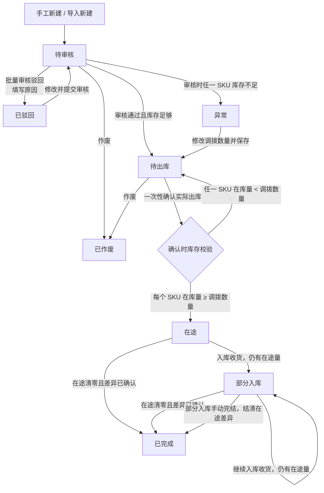
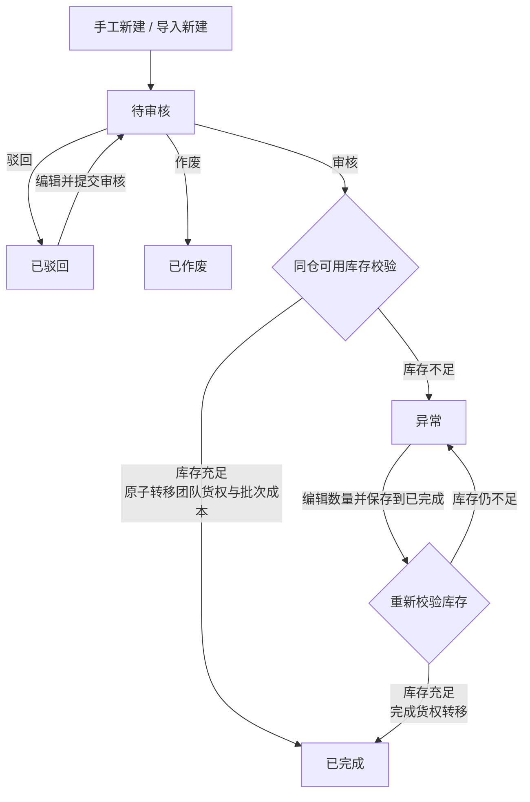

# 调拨单全流程管理 PRD

> 本文件沉淀当前已确认的调拨单方案；“待确认”内容不作为研发实现依据。

## 一、需求背景与目标

### 1.1 背景

现有跨仓移货依赖线下表格与人工库存调整，无法完整记录谁发起、谁审核、实际发出多少、到货多少、运输中剩余多少及费用归属。发生一次性出库少于申请量、分批入库、短少或破损时，库存位置和差异责任难以追溯。

### 1.2 目标

1. 以调拨单承接跨仓实物迁移及同仓团队货权转移，形成统一业务入口。
2. 分别记录申请、实际出库、实际入库、在途和差异数量。
3. 支持审核、出库、入库与异常处理的状态闭环。
4. 支持调拨运费、其他费用、明细调拨金额及调拨总金额查看。
5. 为一次性实际出库、库存流水、批次与库龄继承提供明确的业务口径。
6. 保留操作人、时间、理由与前后数据，满足库存对账和审计追溯。

---

## 二、需求收益

| 收益维度 | 具体收益 |
|---|---|
| 库存准确性 | 记录实际出库、在途、入库及同仓货权转移，保证库存与归属可追溯。 |
| 履约效率 | 仓库、物流和运营围绕同一张单据协作。 |
| 异常可控 | 记录出入库差异，支持短少、破损等异常闭环。 |
| 成本可见 | 汇总 SKU 调拨成本、运费和其他费用。 |
| 审计与责任追溯 | 关键操作保留操作人、时间和日志。 |

---

## 三、业务流程

### 3.1 主流程图

#### 3.1.1 仓间调拨流程

#### 3.1.2 货权调拨流程

### 3.2 库存流转口径

调拨分为“仓间调拨”和“货权调拨”两类，均使用同一张调拨单，但库存动作、字段和状态分支不同。

| 基础口径 | 规则 |
|---|---|
| 库存维度 | `SKU + 仓库 + 团队/货主`；库存校验和扣减均按此维度执行。 |
| 库存状态 | 仅使用在库量、在途量；本方案不引入库存锁定或在库待发量。 |
| 可用库存 | 当前库存服务返回的可用在库量。 |
| 扣减顺序 | 确认出库时，按该维度下的库存批次先进先出扣减。 |
| 仓间调拨 | 货物发生跨仓物理移动；调入后继承调出团队/货主，不改变货权归属。 |
| 货权调拨 | 货物不发生空间移动；在同一仓库内将库存从调出团队/货主原子转移给调入团队/货主，批次与成本快照随数量转移。 |

#### 3.2.1 仓间调拨库存流转表

| 动作 | 触发条件 | 扣减什么 | 增加什么 | 数据流向 | 数量口径与状态结果 |
|---|---|---|---|---|---|
| 新建、导入新建 | 保存或提交调拨单 | — | — | 仅创建单据 | 不产生库存变化，单据进入待审核。 |
| 审核驳回、待审核作废 | 单据未通过审核或在待审核状态作废 | — | — | 不发生库存流转 | 不产生库存变化。 |
| 审核通过 | 审核时所有 SKU 的实时可用库存均不少于调拨数量 | — | — | 仅改变单据状态 | 不扣减库存、不锁定库存，单据进入待出库。任一 SKU 库存不足则进入异常。 |
| 审核库存不足 | 审核时至少一个 SKU 的实时可用库存小于调拨数量 | — | — | 不发生库存流转 | 单据进入异常，记录不足 SKU、调拨数量和审核时可用库存。 |
| 确认出库 | 待出库状态，一次性填写实际出库数量，并重新读取实时库存 | 调出仓在库量 | 调入仓在途量 | 调出仓 → 调入仓在途 | • 确认时任一 SKU 实时在库量小于调拨数量，阻止确认，保持待出库，不进入异常 • 校验通过后，实际出库数量必须大于 0，且不超过调拨数量和确认时实际可用库存；允许小于调拨数量或可用库存 • 实际少于调拨数量时记录未出库差异，本单不再支持第二次出库 • 按 FIFO 扣减批次 |
| 入库收货 | 在途或部分入库状态 | 调入仓在途量 | 调入仓在库量 | 调入仓在途 → 调入仓在库 | • 累计入库数量不得超过累计实际出库数量 • 入库完成后若仍有未入库在途量则保持部分入库 • 全部在途清零且差异已确认后完成 |
| 待出库作废 | 待出库状态作废 | — | — | 不发生库存流转 | 单据作废后不可继续出库。 |
| 手动完结：在途差异 | 部分入库状态下，剩余在途货物短少、破损、丢失等无法收货 | 调入仓在途量 | — | 调入仓在途 → 差异结清 | • 仅处理当前剩余在途数量 • 不恢复调出仓库存，必须记录差异原因、数量和处理说明 • 在途状态不提供手动完结入口 |
| 手动完结：完成判定 | 在途差异已结清，且未出库差异已记录 | — | — | 仅结清本单在途余额 | • 手动完结只展示和处理“在途差异数量”，不处理未出库差异 • 在途清零后进入已完成 |
| 已出库后取消或退回 | 已发生实际出库，用户反悔不再需要调拨 | — | — | 继续完成原单入库 | • 原单不允许直接作废或撤销 • 先完成原调拨入库，再新建调入仓 → 调出仓的反向调拨单 • 本期不做在途撤销、物流拦截或原单冲销 |

#### 3.2.2 货权调拨库存口径

货权调拨仅允许同一物理仓库内的团队/货主之间转移库存。它不创建在途量、物流记录，也不触发预计到仓和库龄重新计算。

| 节点 | 库存与成本动作 | 单据状态 |
|---|---|---|
| 新建 / 编辑 | 仅校验“所在仓库 + 调出团队 + SKU”的可用库存，并选择调入团队；不产生库存变化。 | 待审核 |
| 审核通过 | • 在单个库存事务内，按 FIFO 扣减调出团队的在库批次 • 同时向调入团队写入相同批次标识、原始库龄来源、成本价与分摊数量 • 总量和仓库位置不变 | 已完成 |
| 审核库存不足 | 不发生任何转移；记录不足 SKU、申请量和可用量。 | 异常 |
| 异常编辑保存 | 异常状态下调整调拨数量等异常处理字段，点击“保存到已完成”。 | • 保存时重新校验调出团队可用库存 • 校验通过后在同一库存事务内完成团队货权、批次来源和成本快照转移，进入已完成 • 仍不足则保持异常，不触发二次审核 |
| 驳回 / 待审核作废 | 不发生库存变化。 | 已驳回 / 已作废 |

货权调拨的明细转出数量和转入数量必须相等，且等于已审核完成的调拨数量。系统必须为该动作写入成对的团队库存流水，并使用同一幂等键保证重复提交不会重复转移。

#### 3.2.3 并发、幂等与追溯

| 控制项 | 规则 |
|---|---|
| 原子提交 | • 确认出库、入库收货、货权转移和差异结清必须由库存服务原子提交，页面不得直接修改库存余额 • 确认出库时必须在同一事务内重新读取并扣减可用库存 |
| 并发控制 | 不使用库存锁定；多个单据同时出库时，以库存服务原子扣减结果为准，后提交单据只能按当时剩余库存实际出库，不能超卖。 |
| 幂等控制 | 每次库存操作使用唯一幂等键，例如“调拨单号 + 明细行 + 操作类型”；重复提交不得重复扣减、入库或结清差异。 |
| 追溯信息 | 每个节点记录库存余额变动、出入库/差异流水、来源批次、操作人、操作时间和关联调拨单号。 |
| 结清校验 | 单据完成的必要条件： • 本单据每个明细的在途量为 0 • `申请数量 = 累计已出库数量 + 未出库差异数量` • `累计已出库数量 = 累计已入库数量 + 已确认在途差异数量` |

#### 3.2.4 库龄规则

**业务背景**：跨仓调拨需要明确“库存年龄是否因换仓而重置”。若没有该规则，老库存可在每次调拨后被按调入日期重新计龄，造成库龄报表失真、呆滞库存被掩盖，并可能破坏临期预警和 FIFO/FEFO 的出库顺序。

| 当前口径 | 适用业务场景 | 调入仓处理规则 | 业务作用 |
|---|---|---|---|
| 继承库龄 | 仅发生物理搬运、货物身份没有变化：总仓与区域仓调拨、仓库搬迁、库区调整、委外仓与自营仓之间移货，以及未发生重新质检、返工、重包装或重新入库的场景。 | 调入库存必须按实际出库批次逐批建立在库记录，保留原始入库日期、批次号、生产日期、效期等库龄来源字段；不得合并为一条重新计龄的库存。 | 保持库存真实年龄，确保 FIFO/FEFO、呆滞分析和临期预警不因调拨被“洗白”。 |

当前版本不提供“不继承库龄”选项。若未来出现退货重验收、返工/翻新/重包装或其他需要重新入库计龄的场景，应通过独立的入库/库存调整业务定义新的库龄起算点，不在调拨单中切换。

**多批次扣减与继承示例**：调拨 100 个 SKU，调出仓按 FIFO 从批次 A 扣减 40 个、批次 B 扣减 60 个。仓间调拨按继承库龄处理时，调入仓必须接收两条库存批次记录：`批次 A / 40 个 / 原库龄起算日` 与 `批次 B / 60 个 / 原库龄起算日`；不得计算平均库龄，也不得将 100 个统一按调入日期重新计龄。

**系统控制规则**：

1. 仓间调拨统一按“继承库龄”处理，页面不提供该字段的选择项。
2. 调入库存按实际出库批次逐批继承原始入库日期、批次和效期等库龄来源；系统内部保留库龄口径用于库存流水与审计。
3. 系统不提供库龄口径的手工变更；如未来确需重新计龄，应通过独立的入库/库存调整业务处理，不在调拨单中切换。
4. 库存流水必须记录来源批次、调拨单号、出库批次分摊数量和调入批次标识。

## 四、状态与业务规则

### 4.1 当前状态机

| 状态 | 含义 | 可执行操作 | 下一状态 |
|---|---|---|---|
| 待审核 | 新建或编辑后等待审核 | 编辑 单条作废 审核 作废 日志 | 仓间调拨：待出库 / 异常 / 已驳回 / 已作废 货权调拨：已完成 / 异常 / 已驳回 / 已作废 |
| 待出库 | 审核通过，等待一次性确认实际出库 | 确认出库 作废 日志 | 在途 / 已作废；确认出库时库存不足则保持待出库 |
| 在途 | 已完成一次实际出库，存在尚未收货的在途量；不允许再次确认出库 | 入库收货 日志 | 部分入库 / 已完成 |
| 部分入库 | 已部分收货，仍存在调入仓在途量；不允许再次确认出库 | 入库收货 手动完结 日志 | 部分入库 / 已完成 |
| 已完成 | 在途量已清零，未出库差异和在途差异均已记录或结清 | 日志 | 终态 |
| 已驳回 | 审核未通过 | 编辑 日志 | 待审核 |
| 已作废 | 未履约单据已取消 | 编辑 日志 | 待审核 |
| 异常 | 审核时任一 SKU 实时库存不足 | 编辑 日志 | 仓间调拨：待出库 货权调拨：已完成（保存时库存仍不足则继续保持异常） |

### 4.2 状态规则

1. 新建和导入新建后直接进入“待审核”；当前页面不提供草稿保存。
2. 批量审核只允许选择“待审核”状态的单据。
3. 审核时必须实时校验所有 SKU 的可用库存；仓间调拨和货权调拨任一 SKU 库存不足均进入异常。仓间调拨审核通过后不扣减、不锁定库存，进入待出库；货权调拨审核通过后在同一库存事务内完成团队库存、成本和批次来源转移。
4. 待审核、已驳回、已作废单据均通过同一个编辑弹窗编辑，提交后进入“待审核”；已驳回单据需保留此前驳回意见与审核日志。异常单也复用同一个编辑弹窗：仓间调拨异常编辑保存并校验通过后直接进入“待出库”；货权调拨异常编辑主按钮为“保存到已完成”，保存时重新校验库存，校验通过后直接完成货权转移，仍不足则继续保持“异常”；两类异常编辑均不再提交审核或触发二次审批。
5. 待审核、待出库单据允许作废；已出库后不允许直接作废。
6. 确认出库是一次性动作。系统在提交时重新读取调出仓当前可用库存；若任一 SKU 的实时在库量小于调拨数量，则阻止确认、提示“SKUxxxx 在库量小于调拨数量，库存不足”，状态保持待出库，不进入异常。校验通过后，实际出库数量必须大于 0，且不超过调拨数量和当前可用库存；实际出库少于调拨数量时记录未出库差异，本单不再支持第二次出库。按 FIFO 扣减调出仓在库量，并增加调入仓在途量。
7. 入库收货支持多次操作，但每次累计入库数量不得超过累计实际出库数量。收货后仍有在途量时保持“部分入库”；在途量清零且差异已确认后进入“已完成”。
8. 手动完结仅适用于部分入库状态，仅处理剩余在途数量的短少、破损、丢失等差异；在途状态不展示手动完结按钮。必须填写差异处理原因和说明，不处理未出库差异。所有处理均写入操作日志和库存流水。
9. 仓间调拨审核前后均按“继承库龄”口径处理，用户不可修改；页面不提供“不继承库龄”选项。
10. 新建/编辑调拨单时，SKU 明细“调拨金额”按当前 FIFO 批次成本预估；确认出库后，系统必须按最终实际扣减批次重新计算并固化。多批次成本必须逐批相乘后汇总，不允许使用 SKU 单一均价替代。

### 4.3 作废、冲销与反向调拨边界

| 场景 | 处理方式 |
|---|---|
| 待审核、待出库 | 可直接作废；不发生库存扣减。 |
| 已出库、未入库 | 不允许直接作废或撤销；继续完成原调拨入库，完成后新建调入仓 → 调出仓的反向调拨单。本期不做在途撤销或物流拦截。 |
| 已部分入库 | 继续完成原调拨剩余入库；原单完成后，按实际已入库数量新建调入仓 → 调出仓的反向调拨单。本期不在原单上增加撤销状态。 |
| 已完成 | 不允许删除或直接撤销原单；需创建与原单关联的反向调拨单。 |

> 本期不做原单撤销、在途退回或物流拦截；反向调拨沿用新建调拨单流程，原单关联、专用入口和审批规则后续再补充。

---

## 五、角色与权限

### 5.1 页面按钮权限矩阵

页面按钮必须同时满足“功能权限”和“数据权限”。无功能权限时不展示按钮；有功能权限但不满足当前状态或仓库数据范围时，按钮置灰并提示原因。权限校验以后端为准，前端仅负责展示控制。

| 页面按钮 / 入口 | 建议权限编码 |
|---|---|
| 新建调拨单 | `transfer.create` |
| 导入新建 | `transfer.import` |
| 导出 | `transfer.export` |
| 审核 | `transfer.audit` |
| 作废 | `transfer.void` |
| 编辑 | `transfer.edit` |
| 确认出库 | `transfer.outbound` |
| 入库收货 | `transfer.inbound` |
| 手动完结 | `transfer.complete` |
| 操作日志 | `transfer.log.read` |

---

## 六、功能需求

| 功能模块 | 功能说明 | 关键规则 |
|---|---|---|
| 查询与状态筛选 | 支持按调拨单号/物流单号、SKU/产品名称、调出仓、调入仓、调出团队、物流渠道、创建人、是否有入库差异、创建时间查询。 | • 创建人筛选默认不选中任何账号，表示不限制创建人 • “是否有入库差异”枚举为“是/否”，默认不限制 • “是”仅匹配已完成且入库差异数量不为 0 的单据，“否”匹配其余单据 • 开始和结束日期必须成对填写，开始时间不得晚于结束时间 |
| 列表与展开明细 | 一级列表展示调拨单核心信息；展开后展示 SKU 明细。 | • 一级列表单号可点击查看详情；不在操作列重复放置“查看” • 二级列表支持横向滚动，前 4 列固定 |
| 新建调拨单 | 选择“仓间调拨”或“货权调拨”，录入基础信息与多个 SKU 明细，提交后进入待审核。 | • 两类调拨均保持同一套表单布局 • 切换调拨类型时，无论当前是否已有明细，均直接清空已选 SKU 明细，避免将不适用的仓库、团队和数量带入另一种业务 • 仓间调拨的调出/调入仓由用户填写且不可相同，系统统一按继承库龄处理，页面不展示库龄选择项 • 货权调拨的调出仓由用户填写、调入仓自动同步为调出仓并置灰，预计到仓、物流及费用字段保留原位置但置灰 • 货权调拨每行调入团队不得等于调出团队 • 至少 1 个 SKU • 点击“添加 SKU”时先校验基础必填项，缺项不打开选品弹窗，并在对应字段下方显示红色提示 • 数量为大于 0 的整数且不超过可用量 |
| 导入新建 | 通过模板批量导入仓间调拨明细，并按规则拆分、合并生成一张或多张调拨单。 | • 当前导入仅支持仓间调拨 • 按“调出仓库 + 调入仓库 + 预计到仓 + 物流渠道 + 物流单号 + 运费 + 其他费用”分组；导入模板不包含“是否继承库龄”，仓间调拨导入默认按继承库龄处理 • 同组内按“SKU + 调出团队 + 调入团队 + SKU备注”合并明细并累加数量，SKU备注不同则保留为独立明细 • 按“SKU + 调出仓库 + 调出团队”汇总校验可用库存 • 一份文件可生成多张待审核调拨单，预览展示预计生成的单据数和 SKU 明细行数 • 任意行校验失败则整份文件不可提交且不创建部分单据 • 导入预校验不产生库存占用，确认出库时仍需原子复核 |
| 货权调拨导入新建 | 选择“货权调拨”类型后，通过货权调拨模板批量导入同仓团队货权调整明细。 | • 货权调拨模板与仓间调拨模板分开下载，模板字段不混用 • 模板字段为“所在仓库、SKU、调出团队、调入团队、调拨数量、SKU备注”，字段说明写在模板第二行 • 按“所在仓库”分组生成一张或多张待审核货权调拨单；同仓库内按“SKU + 调出团队 + 调入团队 + SKU备注”合并数量 • 按“SKU + 所在仓库 + 调出团队”汇总校验可用库存，调入团队不同也不能绕过库存限制 • 货权调拨不导入预计到仓、库龄继承、物流和费用字段；这些字段按页面规则置灰或按不适用值处理 • 任意行校验失败则整份文件不可提交且不创建部分单据；导入预校验不产生库存变化 |
| 编辑调拨单 | 待审核、已驳回、已作废、异常状态均提供“编辑”，且复用同一个编辑调拨单弹窗。 | • 待审核、已驳回、已作废编辑后提交审核 • 仓间调拨异常编辑弹窗右下角主按钮文案为“保存到待出库”，保存并校验通过后直接流转待出库 • 货权调拨异常编辑弹窗主按钮文案为“保存到已完成”，保存时重新校验库存，校验通过后直接完成货权转移 • 两类异常编辑均不再触发二次审核 • 异常编辑仅允许修改调拨数量等异常处理字段；数量增加须重新校验可用量 |
| 审核 | 列表顶部提供绿色“审核”按钮。 | • 仅待审核单据可勾选审核 • 通过意见可空，驳回原因必填 • 审核弹窗复用统一审核弹窗规范 |
| 作废 | 列表顶部提供红色“作废”按钮。 | • 当前允许待审核、待出库状态作废 • 作废后不可继续履约，且不发生库存扣减 |
| 确认出库 | 按 SKU 一次性填写实际出库数量与物流信息。 | • 物流渠道和物流单号必须同时填写或同时为空 • 确认时重新校验实时在库量；任一 SKU 在库量小于调拨数量时阻止确认，提示“SKUxxxx 在库量小于调拨数量，库存不足”，保持待出库，不进入异常 • 校验通过后，实际出库数量必须大于 0，且不超过调拨数量和确认时的实际可用库存；实际少于调拨数量时记录未出库差异，本单不再支持第二次出库 |
| 入库收货 | 按 SKU 填写本次实际入库数量，支持多次入库。 | • 累计入库数量不得超过累计实际出库数量 • 未收足时保持部分入库 |
| 手动完结 | 对部分入库单据未入库的在途数量进行差异结清。 | • 仅部分入库状态提供入口 • 仅展示和处理在途差异数量 • 必须填写差异处理原因和说明，并记录操作人 • 未出库数量不通过手动完结处理，而是在一次性确认出库时记录为未出库差异 |
| 详情与日志 | 单号点击展示只读详情；日志独立弹窗查看。 | • 详情无输入框、无底部操作按钮，仅保留关闭入口 • 日志按钮统一灰色，并固定为操作列最后一个按钮 |
| 导出 | 按当前查询条件导出调拨单明细。 | • 采用“一行一个 SKU”的明细导出方式 • 导出当前查询结果，不受当前分页限制 • 单据头字段在同一调拨单的多行中重复展示 • 导出内容必须遵守仓库、组织和成本字段权限 |

---

## 七、页面与交互说明

### 7.1 一级列表

| 列 | 展示内容 | 交互说明 |
|---|---|---|
| 勾选框 | 单据选择 | 支持当前页全选；审核、作废使用。 |
| 展开 | 统一展开三角图标 | 展开/收起 SKU 二级列表。 |
| 调拨单号 | 单号 + 同行状态标签 | 点击单号打开只读详情；单号与状态标签不可换行分离。 |
| 调拨方向 | 调出仓 → 调入仓 | 当前页面使用纵向箭头样式展示。 |
| 调拨进度 | 出库数量、入库数量、在途数量、入库差异数量 | 入库差异数量仅在已完成状态统计，其他状态展示 `—`；字段和值均不加粗，不附加数量单位。 |
| 费用信息 | 运费、其他费用、调拨总金额 | 金额保留 `¥` 符号。调拨总金额 = `Σ 明细调拨金额 + 运费 + 其他费用`。 |
| 物流信息 | 物流渠道、物流单号、预计到仓 | 物流渠道和物流单号同时为空时均展示 `—`。 |
| 备注 | 单据备注 | 列表只读；修改在详情/编辑弹窗完成并记录日志。 |
| 出入库时间 | 出库时间、入库时间分行展示 | 两个时间均取该调拨单对应操作记录的最早时间；未发生对应操作时显示 `—`。表头右侧展示统一问号图标。 |
| 创建信息 | 创建人、创建时间 | 用于追溯。 |
| 操作 | 依据状态显示操作链接 | 操作竖向排列；日志固定最后且使用灰色；作废使用红色。 |

固定列规则：勾选框、展开、调拨单号、调拨方向固定在左侧；操作列固定在右侧。固定列边缘复用采购单样式的轻量阴影，以清晰区分横向滚动区域。

“出入库时间”问号提示文案：

> 出入库时间表示该调拨单实际发生出库和入库的时间。 
> 出库时间取该单最早出库时间，入库时间取该单最早入库时间；未发生对应操作时显示“—”。该字段仅用于展示，不参与状态和数量计算。

### 7.2 二级列表 / 调拨明细

一级、二级列表及详情统一使用仓间调拨字段：SKU、产品名称、调出团队、调入团队、调拨数量、调拨金额、已出库数量、已入库数量、在途数量、入库差异数量、SKU 备注。字段、表头和顺序不随调拨类型变化；调拨金额紧跟调拨数量并保留 `¥`，入库差异数量右侧展示统一问号说明。

货权调拨固定展示：调出仓 = 调入仓；运费、其他费用为 `¥0.00`；物流渠道、物流单号、预计到仓为 `—`；出库、入库、在途及入库差异数量为 `0`。实际货权转移以调拨数量、调拨金额、调出团队和调入团队表达，单号下方展示“货权调拨”标签。

二级列表支持横向滚动，前 4 列固定，不参与横向滚动。

### 7.3 详情弹窗

- 单击单号进入只读详情；顶部展示标题、单号和调拨方向，右上角提供关闭按钮。
- 基础信息使用“字段名：字段值”同行展示，不提供输入框、表格线或操作日志区。
- 明细字段与二级列表一致，表头样式一致；调拨单号排在单据状态之前。

### 7.4 审核弹窗

审核弹窗统一使用全局规范：标题为 `审核调拨单`，副标题为 `已选择 X 张待审核调拨单`；不展示单据卡片、方向或数量汇总。内容区仅提供审核意见，placeholder 为“审核通过可留空，驳回时请填写原因”，最多 500 字。按钮顺序为取消、驳回、通过，驳回红色、通过绿色。

### 7.5 导入弹窗

- 标题为 `导入新建调拨单`，三步骤为“下载模板 → 选择文件 → 确认导入”。
- 弹窗尺寸复用发货单导入弹窗；支持模板下载、点击/拖拽上传 `.xlsx`，单次仅导入一个文件。
- 校验通过后预览预计生成的调拨单数和 SKU 明细行数，并按单据头分组、按文件首次出现顺序生成。
- 任意行失败时确认按钮不可用，提示行号、字段和原因；整份文件不得生成部分单据。
- 弹窗提供“调拨类型”选择，下拉框与“下载模板”按钮放在同一行，调拨类型在前、下载按钮在后。选择“货权调拨”后，仅下载并校验货权调拨模板；切换类型会清空已选择文件和校验结果，避免模板类型混用。
- “下载模板”按钮根据当前调拨类型下载对应的 `.xlsx` 导入模板；货权调拨模板字段为“所在仓库、SKU、调出团队、调入团队、调拨数量、SKU备注”，仓间调拨模板字段按 8.3 节执行，模板第二行提供字段说明。
- 模板说明文案固定为： 1. 请勿修改模板表头。支持.xlsx文件，单次仅导入一个文件；模板第二行是字段说明 2. 调拨类型不同下载的导入模板不同
- 仓间调拨导入模板不再提供“是否继承库龄”字段；导入创建和手工新建/编辑的仓间调拨均统一按继承库龄处理，页面不展示库龄选择项。

### 7.6 导出字段与口径

导出采用“一行一个 SKU”；单据字段在每个明细行重复展示，范围为当前查询条件下的全部结果，不受分页限制。

| 顺序 | 字段 | 字段层级 | 导出口径 |
|---:|---|---|---|
| 1 | 调拨单号 | 单据 | 系统生成的调拨单号。 |
| 2 | 单据状态 | 单据 | 当前单据状态。 |
| 3 | 调拨类型 | 单据 | 仓间调拨 / 货权调拨。 |
| 4 | 调出仓库 | 单据 | 仓间调拨的调出仓；货权调拨为所在仓库。 |
| 5 | 调入仓库 | 单据 | 仓间调拨的调入仓；货权调拨与调出仓相同。 |
| 6 | 预计到仓 | 单据 | 预计到仓日期；不适用时导出 `—`。 |
| 7 | 是否继承库龄 | 单据 | 仓间调拨固定导出“是”；货权调拨不适用时导出 `—`。该列为系统输出，不代表页面可选字段。 |
| 8 | 物流渠道 | 单据 | 物流渠道；无值或货权调拨导出 `—`。 |
| 9 | 物流单号 | 单据 | 物流单号；无值或货权调拨导出 `—`。 |
| 10 | 运费 | 单据 | 单据运费，保留金额格式。 |
| 11 | 其他费用 | 单据 | 单据其他费用，保留金额格式。 |
| 12 | 调拨总金额 | 单据 | `Σ 明细调拨金额 + 运费 + 其他费用`。 |
| 13 | 调拨备注 | 单据 | 单据级备注。 |
| 14 | 出库时间 | 单据 | 取该调拨单实际出库操作记录的最早时间；未发生时导出 `—`。 |
| 15 | 入库时间 | 单据 | 取该调拨单实际入库操作记录的最早时间；未发生时导出 `—`。 |
| 16 | 创建人 | 单据 | 创建该调拨单的用户。 |
| 17 | 创建时间 | 单据 | 调拨单创建时间。 |
| 18 | SKU | SKU 明细 | 当前明细的 SKU 编码。 |
| 19 | 产品名称 | SKU 明细 | SKU 对应的产品名称。 |
| 20 | 调出团队 | SKU 明细 | 当前明细的调出团队。 |
| 21 | 调入团队 | SKU 明细 | 当前明细的调入团队。 |
| 22 | 调拨数量 | SKU 明细 | 当前明细申请的调拨数量。 |
| 23 | 调拨金额 | SKU 明细 | 当前明细调拨金额，按批次成本分摊后汇总。 |
| 24 | 已出库数量 | SKU 明细 | 当前明细累计实际出库数量。 |
| 25 | 已入库数量 | SKU 明细 | 当前明细累计实际入库数量。 |
| 26 | 在途数量 | SKU 明细 | 当前明细剩余在途数量。 |
| 27 | 入库差异数量 | SKU 明细 | 仅已完成状态统计，公式为 `累计入库数量 − 累计出库数量`；其他状态导出 `—`。 |
| 28 | SKU 备注 | SKU 明细 | 当前明细备注。 |

导出不包含“未出库差异数量”和“更新时间”字段。导出文件格式、文件命名和最大导出量沿用平台导出规范；若用户无成本字段权限，调拨金额和调拨总金额按权限策略脱敏或不导出。

货权调拨导出补充口径：

- 采用“一行一个 SKU”的明细导出方式，单据头字段在同一调拨单的各 SKU 行中重复展示。
- 调出仓库和调入仓库均导出同一个“所在仓库”；预计到仓、是否继承库龄、物流渠道、物流单号导出 `—`；运费和其他费用导出 `¥0.00`。
- 已出库数量、已入库数量、在途数量和入库差异数量均导出 `0`；出库时间和入库时间导出 `—`。
- 调拨数量、调拨金额、调出团队、调入团队和 SKU 备注按货权转移明细导出；调拨总金额等于各明细调拨金额之和。
- 导出数据遵守当前查询条件、仓库/组织/成本权限和平台导出规范。

---

## 八、数据与字段规则

### 8.1 调拨单头字段

货权调拨仍保留原表单布局，但预计到仓、物流和费用字段置灰不可填；页面不展示库龄选择项。列表中物流类字段显示 `—`，费用显示 `¥0.00`，批次库龄随货权转移。

| 字段 | 类型 | 必填 | 规则 / 口径 |
|---|---|---|---|
| 调拨单号 | 系统生成 | 是 | 规则：`TF + YYMMDD + 4位顺序号`，例如 `TF2609280001` 顺序号每天从 `0001` 重新开始 |
| 调拨类型 | 枚举 | 是 | • `仓间调拨`或`货权调拨`；创建时选择，单据创建后不得变更 • 一级列表在单号下方展示类型 |
| 调出仓库 | 仓库 | 是 | 两类调拨均填写，必须为已启用的物理仓库。 |
| 调入仓库 | 仓库 | 是 | 仓间调拨由用户填写且不能与调出仓相同；货权调拨自动同步为调出仓并置灰。 |
| 预计到仓 | 日期 | 条件必填 | 仅仓间调拨填写，格式 `YYYY-MM-DD`；货权调拨置灰。 |
| 物流渠道 | 文本/枚举 | 条件必填 | 仅仓间调拨填写，与物流单号成对；新建、编辑和确认出库均支持“＋ 新增渠道”。 |
| 物流单号 | 文本 | 条件必填 | 仅仓间调拨填写，与物流渠道成对。 |
| 运费 | 金额 | 条件必填 | 仅仓间调拨填写，大于等于 0，最多两位小数，展示 `¥`。 |
| 其他费用 | 金额 | 条件必填 | 仅仓间调拨填写，大于等于 0，最多两位小数，展示 `¥`。 |
| 调拨总金额 | 金额 | 系统计算 | 单据级金额：`Σ 明细调拨金额 + 运费 + 其他费用`。明细级金额按实际/预估批次成本分摊计算，详见 8.2。 |
| 调拨备注 | 文本 | 否 | 最多 500 字。 |
| 创建人 / 创建时间 | 系统字段 | 是 | 创建时写入。 |
| 更新时间 | 系统字段 | 是 | 每次影响业务数据的操作后更新。 |

库龄口径不作为调拨单表单字段：仓间调拨统一按“继承库龄”处理，按实际出库批次逐批继承；货权调拨不涉及跨仓库龄重算，批次库龄随货权转移。详见 3.2.4。

### 8.2 调拨 SKU 明细字段

| 字段 | 必填 | 规则 / 口径 |
|---|---|---|
| SKU | 是 | “添加调拨 SKU”仅展示调出仓有可用库存的 SKU；未选择调出仓时不可打开；切换调出仓须清空已选明细。 |
| 产品名称 | 系统带出 | 由 SKU 主数据带出。 |
| 调出团队 | 是 | 从库存归属带出，是库存校验维度之一。 |
| 调入团队 | 是 | 仓间调拨默认等于调出团队且可修改；货权调拨必填且不能等于调出团队。 |
| 调拨数量 | 是 | 大于 0 的整数，不超过当前实时可用在库量；审核和确认出库时均需重新校验。 |
| 调拨金额 | 系统计算 | 紧跟调拨数量、只读并保留 `¥`；按实际扣减批次成本固化，新建时可展示预估值，不得使用 SKU 均价。 |
| 已出库数量 | 系统累计 | 仓间调拨仅允许一次确认出库，数量可小于申请量；货权调拨固定为 `0`。 |
| 未出库差异数量 | 系统计算 | `申请调拨数量 - 实际出库数量`；确认出库时记录，不扣库存且不可再次出库。 |
| 已入库数量 | 系统累计 | 仓间调拨为各次入库之和且不得超过已出库数量；货权调拨固定为 `0`。 |
| 在途数量 | 系统计算 | `已出库数量 - 已入库数量 - 已确认在途差异数量`；货权调拨固定展示为 `0`。 |
| 入库差异数量 | 系统计算 | 仅在单据已完成状态统计，计算公式为 `累计入库数量 − 累计出库数量`；入库少于出库时以负数展示，其他状态展示 `—`。 |
| 货权转移完成数量 | 隐藏系统字段 | 仅货权调拨使用，完成货权转移后等于调拨数量；用于库存流水、批次成本追溯和审计，不替代固定列表字段。 |
| SKU 备注 | 否 | 单 SKU 备注，最多 120 字。 |
| 批次库存成本价 / 成本分摊快照 | 系统字段 | 保留实际扣减批次、分摊数量、成本价及金额，用于固化调拨金额、目标批次成本和审计。 |

### 8.3 导入模板字段及顺序

| 顺序 | 字段 | 必填 | 第二行填写说明 |
|---:|---|---|---|
| 1 | SKU | 是 | • 填写有效 SKU；SKU 必须存在且在调出仓、调出团队下有可用库存 • 相同库存维度重复出现时，系统按合计数量校验，不得超出可用库存 |
| 2 | 调出仓库 | 是 | 填写系统已启用的调出仓库名称。 |
| 3 | 调入仓库 | 是 | 填写系统已启用的调入仓库名称，不能与调出仓库相同。 |
| 4 | 调出团队 | 是 | 填写 SKU 当前所属团队，必须与库存归属一致。 |
| 5 | 调入团队 | 是 | 填写本次调拨的目标团队。 |
| 6 | 调拨数量 | 是 | • 填写大于 0 的整数 • 同一单据头分组内按“SKU + 调出仓库 + 调出团队”汇总数量，不得超过确认导入时的可用库存 |
| 7 | 预计到仓 | 否 | 填写日期，格式 `YYYY-MM-DD`。 |
| 8 | 物流渠道 | 否 | 填写物流渠道名称；如填写物流单号，本字段必须同时填写。 |
| 9 | 物流单号 | 否 | 填写物流单号；如填写物流渠道，本字段必须同时填写。 |
| 10 | 运费 | 否 | 填写大于等于 0 的数字，最多两位小数。 |
| 11 | 其他费用 | 否 | 填写大于等于 0 的数字，最多两位小数。 |
| 12 | SKU备注 | 否 | 填写当前 SKU 的备注，最多 120 个字符。 |

导入规则：

1. 一份文件可以生成一张或多张调拨单。系统先将空值和“—”统一视为空，运费、其他费用空值统一按 0 处理，再按“调出仓库、调入仓库、预计到仓、物流渠道、物流单号、运费、其他费用”组成的单据头字段分组。仓间调拨导入不读取“是否继承库龄”，统一按继承库龄处理；只要上述任一字段不同，就自动拆分为不同调拨单，不因组间字段不同阻断整份文件导入。
2. 同一单据头分组内，只有“SKU、调出团队、调入团队、SKU备注”全部一致时才合并为一条明细，合并时仅累加调拨数量；SKU备注不同的行不得合并，须保留为独立明细，避免覆盖备注内容。
3. 库存校验仍按“SKU + 调出仓库 + 调出团队”汇总，不受调入团队是否不同影响；同组内不同调入团队消耗同一库存时，必须合计校验，不能通过拆分明细绕过库存限制。
4. 按各分组在文件中的首次出现顺序生成调拨单，并在预览中展示预计生成的调拨单数量和 SKU 明细行数。任意一行校验失败，整份文件均不可提交，不创建部分调拨单。
5. 导入完成只创建待审核单据，不锁定或占用库存；多个待审核/待出库单据可能同时通过预校验，最终以确认出库时库存服务的原子扣减结果为准。

### 8.3.1 货权调拨导入模板

货权调拨导入与仓间调拨导入使用不同模板。用户在导入弹窗中选择“货权调拨”后，下载并上传货权调拨模板；模板不包含调拨类型字段，调拨类型以弹窗选择为准。

| 顺序 | 字段 | 必填 | 第二行填写说明 |
|---:|---|---|---|
| 1 | 所在仓库 | 是 | 填写库存当前所在仓库；系统将其作为调出仓和调入仓，必须为已启用仓库。 |
| 2 | SKU | 是 | 填写有效 SKU，且该 SKU 必须在所在仓库和调出团队下存在可用库存。 |
| 3 | 调出团队 | 是 | 填写当前库存归属团队，必须与库存归属一致。 |
| 4 | 调入团队 | 是 | 填写目标货权团队，不能与调出团队相同。 |
| 5 | 调拨数量 | 是 | 填写大于 0 的整数，不得超过对应库存维度的可用量。 |
| 6 | SKU备注 | 否 | 填写当前 SKU 的货权调整说明，最多 120 个字符。 |

货权调拨导入规则：

1. 同一文件中“所在仓库”相同的行合并生成同一张货权调拨单；所在仓库不同则拆分为不同单据，并按文件中首次出现的顺序生成。
2. 同一单据内，只有“SKU、调出团队、调入团队、SKU备注”全部一致时才合并为一条明细，合并时仅累加调拨数量；SKU备注不同的行保留为独立明细。
3. 库存校验按“SKU + 所在仓库 + 调出团队”汇总。同一库存维度下即使调入团队不同，也必须合计校验，不得通过拆分行绕过可用库存限制。
4. 任意行缺少必填字段、仓库或库存维度不存在、调入团队与调出团队相同、数量非法或合计数量超过可用库存时，整份文件不可提交，不生成部分单据。
5. 导入预校验不产生库存变化、不锁定库存。导入成功后单据进入“待审核”；审核时按同一库存事务校验并完成团队货权、批次来源和成本快照转移，成功后进入“已完成”，库存不足进入“异常”。
6. 货权调拨不导入预计到仓、是否继承库龄、物流渠道、物流单号、运费和其他费用；列表和导出按货权调拨固定口径展示：调出仓等于调入仓，物流和预计到仓为 `—`，费用为 `¥0.00`，出库、入库、在途及入库差异数量为 `0`。

---

## 九、异常与边界场景

| 场景 | 系统处理 | 用户提示 / 留痕 |
|---|---|---|
| 仓间调拨的调出仓与调入仓相同 | 阻止提交和导入。 | 提示“调入仓库不能与调出仓库相同”。 |
| 货权调拨的调入团队与调出团队相同 | 阻止提交。 | 提示“货权调拨的调入团队不能与调出团队相同”。 |
| 货权调拨的物流或预计到仓 | 保留字段原位置但置灰，不允许填写；接口按不适用值处理。页面不展示库龄选择项。 | 物流与预计到仓展示 `—`，费用为 `0`。 |
| 无 SKU 明细 | 阻止提交。 | 提示至少添加一个 SKU。 |
| 数量非法 | 阻止提交。 | 提示数量须为大于 0 的整数且不超过可用量。 |
| 确认出库时实时在库量小于调拨数量 | • 阻止确认出库 • 不产生库存扣减或在途量 • 状态保持待出库，不进入异常；用户修正库存或调拨数量后再重试 | 按不足 SKU 提示“SKUxxxx 在库量小于调拨数量，库存不足”，并记录本次校验结果。 |
| 货权调拨审核时库存不足 | • 不发生货权转移并进入异常 • 异常编辑后点击“保存到已完成”，系统重新校验库存 • 校验通过后直接完成货权转移，仍不足则继续保持异常 | 记录不足 SKU、申请量、可用量及保存时的库存校验结果；不触发二次审核。 |
| 物流渠道与单号仅填一项 | 阻止保存/导入/出库。 | 提示两项需同时填写。 |
| 无物流信息 | 允许保存，渠道和单号均展示 `—`。 | 后续是否允许在途补录物流待确认。 |
| 入库数量大于在途 | 阻止收货。 | 提示不能超过该 SKU 当前在途量。 |
| 导入同一库存维度重复 SKU | • 按“SKU + 调出仓库 + 调出团队”汇总后校验 • 合计数量超过可用库存时阻止整批导入 | 提示重复维度、合计申请量、可用库存和超出数量。 |
| 导入文件包含多组单据头字段 | • 按单据头字段分组，自动生成多张待审核调拨单 • 不因组间字段不同阻止导入 • 每组内再按 SKU、团队和备注合并明细 | 预览展示预计生成的调拨单数量和 SKU 明细行数，并按文件中首次出现顺序生成单据。 |
| 导入 SKU 不属于调出仓或团队 | 阻止导入。 | 提示具体行号、SKU、调出仓库和调出团队。 |
| 驳回未填原因 | 阻止驳回。 | 审核意见输入框显示必填错误。 |
| 批量操作混入非目标状态 | 阻止整批操作。 | 提示仅支持对应状态的单据。 |
| 重复提交 / 网络失败 | 服务端以单据版本、操作幂等键处理。 | 提示操作结果，失败不应产生半笔库存流水。 |
| 已出库后请求作废 | 阻止直接作废。 | 提示需先完成原单入库，再新建反向调拨单。 |

---

## 十、数据、审计与合规要求

### 10.1 库存与金额口径

1. 调拨单涉及库存位置变化，在库量、在途量、批次和成本变动必须可追溯。
2. 调拨总金额和明细调拨金额仅作为调拨成本展示口径，不代表采购应付、供应商结算或开票金额。
3. 运费和其他费用应保留原始录入值、修改记录、币种及后续分摊结果；当前默认币种为 CNY，展示使用 `¥`。
4. 费用、数量、状态和库存变更不得通过覆盖历史数据的方式修改；应保留事件或流水记录。

### 10.2 操作日志

每张调拨单至少记录：

- 创建、导入、修改、提交审核、审核通过、审核驳回、作废；
- 确认出库、入库收货、补录/变更物流、手动完结、异常编辑；
- 操作人、操作时间、操作类型、操作原因、修改前值、修改后值；
- 关联库存流水号、关联来源单据号及后续反向调拨单号。

日志应为追加式记录，普通用户不可删除或覆盖。

---

## 十一、验收标准摘要

1. 新建单据号符合 `TF + YYMMDD + 4位日顺序号`，每日从 `0001` 重新计数。
2. 支持仓间调拨和货权调拨；调拨类型创建后不可变更。仓间调拨的调出仓与调入仓不能相同；货权调拨的调入仓自动同步为调出仓并置灰，调入团队不得等于调出团队。
3. 切换调拨类型时清空已选 SKU；添加 SKU 前校验对应必填字段，缺项显示红色边框和就地提示；选品弹窗只展示调出仓有可用库存的 SKU，仓间调拨的调入团队默认等于调出团队。
4. 两级列表和详情使用固定字段；二级列表支持横向滚动且前 4 列固定，货权调拨不改变表头，仅按既定口径展示。
5. 新建和导入进入待审核；待审核、已驳回、已作废、异常均使用同一编辑弹窗。审核时库存不足进入异常；仓间异常保存到待出库，货权异常保存到已完成；确认出库时库存不足仅提示并保持待出库；异常处理不触发二次审核。
6. 审核、作废、出库、入库和手动完结只能在规定状态执行；已出库单据不可直接作废，在途不显示手动完结；审核驳回必须填写原因，日志按钮统一灰色、作废按钮为红色。
7. 审核时所有 SKU 均需通过实时库存校验，任一不足进入异常。仓间调拨确认出库仅允许一次；确认时若任一 SKU 在库量小于调拨数量，则提示库存不足并保持待出库，不进入异常；校验通过后实际出库量不得超过调拨量和确认时可用库存，少于调拨量时记录未出库差异且不能再次出库。累计入库不得超过累计出库，在途清零且差异已记录或结清后才完成。
8. 物流渠道与物流单号必须同时填写或同时为空；货权调拨不产生在途和物流记录。费用和调拨总金额按 PRD 规定的金额公式计算，明细金额按实际 FIFO 批次成本分摊。
9. 仓间调拨统一按“继承库龄”处理；按实际出库批次逐批继承，页面不展示库龄选择项。
10. 仓间调拨导入模板按第 8.3 节执行：不包含“是否继承库龄”，统一按继承库龄处理；按单据头字段分组生成一张或多张单据，组内按 SKU、团队和 SKU 备注合并数量，按“SKU + 调出仓库 + 调出团队”汇总库存校验；预览显示单据数和明细行数，任意行失败则整份拒绝且不生成部分单据。
11. 导出采用一行一个 SKU，字段和范围按第 7.6 节执行；出入库时间取对应操作记录的最早时间，未发生时展示 `—`。
12. 查询区创建人默认不选中；“是否有入库差异”提供“是/否”且默认不限制。审核、出库、入库、作废、手动完结、异常编辑和导入均产生追加式日志，并受仓库、组织和成本权限控制。
13. 货权调拨审核或异常保存时，在同一库存事务内完成团队货权、批次来源和成本快照的转移；库存总量和仓库位置不变且可审计。
14. 货权调拨支持导入新建和导出：导入模板仅包含所在仓库、SKU、调出团队、调入团队、调拨数量、SKU备注；按所在仓库分组、按 SKU/团队/备注合并、按 SKU+所在仓库+调出团队汇总校验；导出按一行一个 SKU 输出固定货权调拨口径。

---
