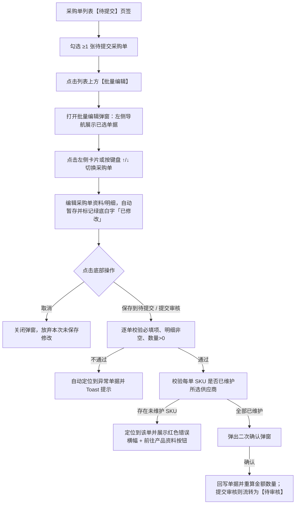
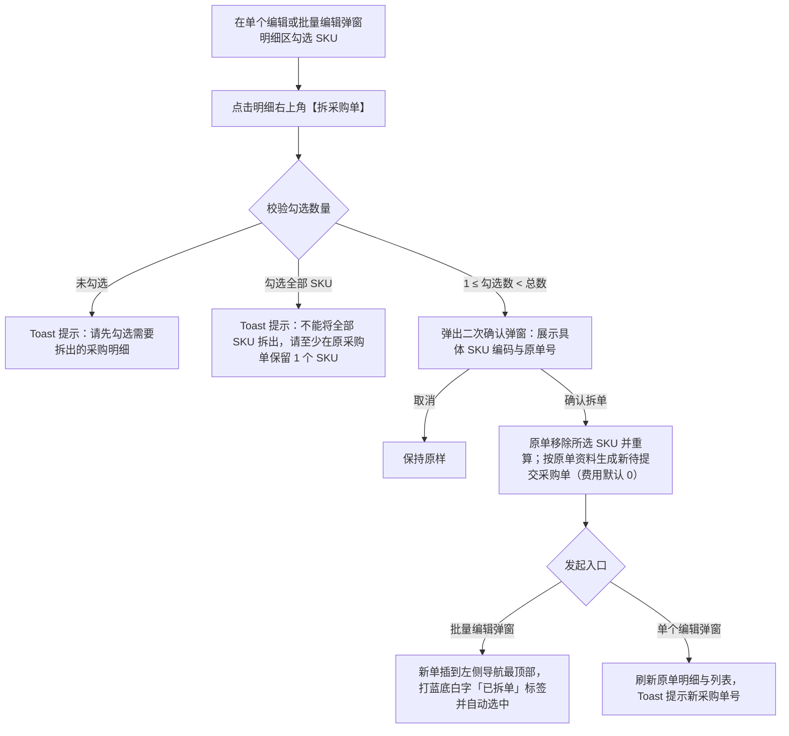

# 采购单批量编辑及拆采购单 PRD

> 对应原型：[pages/purchase-orders/index.html](../pages/purchase-orders/index.html)

---

### 一、需求概述

#### 1. 背景说明
采购单在「待提交」状态下，业务人员经常需要连续调整多张采购单的采购仓、采购员、供应商、费用、明细数量/单价或将部分 SKU 拆分为独立采购单。此前仅支持在列表操作列逐张点开「编辑」弹窗处理，切换成本高；同时原单据编辑限制仅 1 个 SKU 或多 SKU 场景下供应商不可直接修改、明细「更换供应商」操作分散，影响协同效率。

#### 2. 目标摘要
1. 在采购单列表 **【待提交】** 页签上方新增 **【批量编辑】** 入口，支持一次勾选多张待提交采购单，在同一弹窗内通过左侧导航或键盘 `↑`/`↓` 键快速切换编辑并统一保存或提交审核。
2. 统一单个编辑与批量编辑的交互能力：供应商支持直接下拉修改（提交/保存时校验 SKU 是否已维护对应供应商）；明细操作列改为明细区右上角 **「拆采购单」** 与红色 **「移除」** 按钮，均配二次确认弹窗（含具体 SKU 提示）。
3. 统一采购单相关弹窗与列表的字段/视觉规范：品名列前置商品缩略图，采购单全模块移除 `SellerSKU/Asin` 字段，「保存到待提交」与「提交审核」统一增加二次确认弹窗。

#### 3. 影响对象
- **页面模块**：供应链 → 采购单列表页（【待提交】页签）、批量编辑采购单弹窗、单个编辑采购单弹窗、新增 SKU 弹窗、采购运费分摊弹窗、列配置。
- **关联页面**：产品资料（产品列表页 `pages/product-list/index.html`，用于 SKU 供应商维护快捷跳转）。

#### 4. 本次需求说明
本次仅针对采购单「待提交」批量编辑弹窗、单个编辑弹窗拆单/移除/供应商校验联动，以及采购单弹窗字段规范对齐进行改造；不涉及产品资料内部供应商绑定功能本身的新增或改造，也不新增跨状态批量编辑。

---

### 二、业务价值

- **员工操作效率提升**：多张待提交采购单无需反复开关编辑弹窗，支持左侧导航及键盘 `↑`/`↓` 快速切换，修改自动暂存后统一提交。
- **拆单与供应商调整更清晰**：将行内「更换供应商」收口为「拆采购单」+「允许直接改供应商 + 绑定校验」，既满足单据内调整供应商的诉求，又支持多选 SKU 一键拆出新采购单并在批量编辑导航中置顶续编。
- **降低误操作风险**：拆单、移除 SKU、保存到待提交、提交审核全链路配备明确二次确认弹窗（含具体单号与 SKU 明细），防止误删或误流转。

---

### 三、业务流程

#### 1. 批量编辑与保存/提交审核流程图

#### 2. 拆采购单流程（单个编辑 & 批量编辑共用）

#### 3. 关键节点说明

| 步骤 | 操作 | 系统处理 | 输出结果 |
|---|---|---|---|
| 1 | 【待提交】页签勾选单据并点击【批量编辑】 | 校验已勾选且全为「待提交」状态，生成每单草稿与原始快照 | 打开批量编辑弹窗，默认定位首张单据 |
| 2 | 切换左侧导航 / 按 `↑` `↓` 键 | 切换前自动暂存当前草稿，对比原始快照显示「已修改」标签 | 右侧表单与左下角统计同步切换为目标单据 |
| 3 | 勾选明细点击【拆采购单】或红色【移除】 | 校验至少保留 1 个 SKU，弹出含具体 SKU 编码的二次确认弹窗 | 拆单生成新待提交单并置顶；移除则从当前单据删除所选 SKU |
| 4 | 点击【保存到待提交】或【提交审核】 | 逐单校验必填、数量、SKU-供应商维护关系，弹出二次确认弹窗 | 确认后重算全部单据金额/数量并刷新列表与页签统计 |

---

### 四、功能需求

| 功能模块 | 功能说明 | 关键规则 | 对应章节索引 | 备注 |
|---|---|---|---|---|
| 列表【批量编辑】入口 | 仅在【待提交】页签列表上方操作区显示【批量编辑】按钮 | 未勾选单据或混选非待提交单据时点击拦截并提示 | [五、1 列表页入口](#1-列表页入口与弹窗骨架) [八、异常与边界场景](#八异常与边界场景) | 其他状态页签隐藏该按钮 |
| 批量编辑左侧导航 | 展示本次编辑的采购单列表、移除单据 `✕` 按钮与状态标签 | 发生变更显示「已修改」；拆单新单置顶并显示「已拆单」；支持点击或键盘 `↑`/`↓` 切换 | [五、1 列表页入口与弹窗骨架](#1-列表页入口与弹窗骨架) [八、异常与边界场景](#八异常与边界场景) | 焦点在输入框/下拉框内时不触发 `↑`/`↓` 切换；全部移出则关闭弹窗 |
| 采购单资料编辑 | 单个编辑与批量编辑均支持修改采购单基础资料与费用 | **供应商允许下拉修改**（无论单据只有 1 个还是多个 SKU）；必填项：供应商、采购仓、采购员、结算方式、采购主体 | [五、2 统一规范调整](#2-统一规范调整单个编辑--采购单全模块) [六、1 采购单资料字段](#1-采购单资料字段单个--批量一致) | 运费、优惠金额、其他费用默认可改，实时影响单据总金额 |
| 明细勾选与【拆采购单】 | 明细表第一列支持全选/单选，右上角提供【拆采购单】按钮 | 至少保留 1 个 SKU；确认后带出原单基础资料（含原供应商，费用归零）生成新待提交单 | [三、2 拆采购单流程](#2-拆采购单流程单个编辑--批量编辑共用) [七、状态与业务规则](#七状态与业务规则) | 去掉明细表格「操作」列，收口为右上角按钮操作 |
| 明细批量【移除】 | 明细区右上角【拆采购单】按钮右侧放置红色【移除】按钮 | 至少保留 1 个 SKU；确认弹窗列出具体 SKU 编码，确认后移除并重算主单 | [五、3 提示与二次确认文案](#3-提示与二次确认文案清单) [七、状态与业务规则](#七状态与业务规则) | 不再使用行内移除链接及原因气泡 |
| 统一保存与提交审核 | 底部提供【取消】、【保存到待提交】、【提交审核】 | 校验全部单据必填项、数量 > 0 及 SKU-供应商维护关系，通过后弹出二次确认弹窗 | [六、3 SKU与供应商校验](#3-sku-与供应商维护关系校验待后端联调确认) [十、合规与审计要求](#十合规与审计要求) | 保存后重算主单 `purchaseQty`、`pendingQty`、`amount`、`totalFees` 及更新时间 |

---

### 五、页面与交互说明

#### 1. 列表页入口与弹窗骨架
- **入口按钮**：位于【待提交】页签列表上方操作栏，样式为标准次按钮（`.btn`），文案 `批量编辑`。
- **批量编辑弹窗**：左右分栏布局（左侧导航宽 `264px`，右侧编辑区自适应内部滚动；头部与底部固定）。
  - 顶部副标题：`已选 N 张待提交采购单 · 切换单据自动暂存，底部按钮统一生效`。
  - 左侧导航卡片展示：采购单号、状态标签（`已拆单` 蓝底白字、`已修改` 浅绿 `#67c23a` 底白字）、`供应商 · 采购员`、`X 个 SKU · ¥ 总金额`、右上角移出按钮 `✕`。
  - 右侧面板头部展示：`当前编辑：POxxxxxxxx` 与提示文案 `点击左侧或按 ↑ ↓ 键切换采购单`（无上一张/下一张按钮）。
- **底部栏**：
  - 左侧为**当前编辑单据**的 3 个统计胶囊（随切换单据与行内修改实时更新）：`共 X 个 SKU`、`采购数量 Y`、`采购金额 ¥ Z`。
  - 右侧按钮：`取消`、`保存到待提交`、`提交审核`。

#### 2. 统一规范调整（单个编辑 & 采购单全模块）
- **品名列前置商品缩略图**：单个编辑与批量编辑明细表中，商品缩略图统一放在 **品名** 列文本左侧（SKU 列仅保留纯编码加粗）。
- **全局移除 `SellerSKU/Asin`**：采购单列表列配置、新建/单个编辑弹窗、批量编辑弹窗、新增 SKU 弹窗、采购运费分摊弹窗均移除 `SellerSKU/Asin`（`Seller SKU`）字段列。
- **单个编辑弹窗对齐**：供应商由只读改为下拉可编辑；明细区增加全选/行复选框，去掉「操作」列，右上角在编辑待提交单据时展示 `拆采购单` + 红色 `移除` 按钮；底部保留 `保存到待提交` 与 `提交审核`。

#### 3. 提示与二次确认文案清单

| 场景 | 触发位置 | 提示形式 | 文案规范 |
|---|---|---|---|
| 拆采购单确认 | 单个/批量编辑点击【拆采购单】 | 二次确认弹窗 | `确认将选中的 N 个 SKU（SKU1、SKU2）从 POxxxxxxxx 拆出生成新采购单吗？` |
| 移除 SKU 确认 | 单个/批量编辑点击红色【移除】 | 二次确认弹窗 | `确认从采购单 POxxxxxxxx 移除选中的 N 个 SKU（SKU1、SKU2）吗？` |
| 保存到待提交确认 | 点击【保存到待提交】 | 二次确认弹窗 | 单个：`确认保存采购单 POxxxxxxxx 到待提交吗？` 批量：`确认将采购单 POxxxx、POxxxx 保存到待提交吗？` |
| 提交审核确认 | 点击【提交审核】 | 二次确认弹窗 | 单个：`确认将采购单 POxxxxxxxx 提交审核吗？` 批量：`确认将采购单 POxxxx、POxxxx 提交审核吗？` |
| SKU 未维护供应商 | 保存/提交审核校验不通过 | 顶部红色横幅 + Toast | `采购单 POxxxxxxxx 中 SKU（SKU1、SKU2）尚未维护供应商「XXX」，请先前往产品资料维护` + 快捷按钮 **`前往产品资料 →`**（点击跳转产品列表页时，自动带入未维护的 SKU 编码作为查询条件默认筛选） |

---

### 六、数据与字段规则

#### 1. 采购单资料字段（单个 & 批量一致）

| 字段名称 | 类型 | 是否必填 | 规则说明 |
|---|---|---|---|
| 供应商 | 下拉选择 | 是 | 允许修改（含仅有 1 个 SKU 的采购单）；保存/提交审核时校验所有明细 SKU 是否已维护该供应商 |
| 采购仓 / 采购员 / 结算方式 / 采购主体 | 下拉选择 | 是 | 缺失任意一项时阻止保存/提交，批量编辑自动定位到对应单据 |
| 预付比例 / 税率 | 数值(%) | 否 | 非负数，区间 0～100 |
| 是否含税 | 下拉选择 | 否 | 枚举：`否` / `是` |
| 运费 / 优惠金额 / 其他费用 | 金额(¥) | 否 | 非负数，支持两位小数，实时参与采购单总金额计算 |
| 备注 | 多行文本 | 否 | 自由输入 |

#### 2. 采购明细字段与合计规则
- **明细列（共 16 列）**：勾选框、序号、采购计划、SKU、品名（前置缩略图）、团队、平台、店铺、计划采购数量、采购数量（必填 > 0）、采购单价（≥ 0）、采购金额（`采购数量 × 采购单价`）、箱规数量、计划下单日期、计划交货日期、备注。
- **合计行与左下角胶囊**：
  - 表格合计行汇总：`计划采购数量`、`采购数量`、`采购金额`、`箱规数量`。
  - 左下角统计胶囊展示当前单据：`共 X 个 SKU`、`采购数量`、`采购金额`。
- **主单汇总重算公式**：
  - `采购数量 = Σ(明细采购数量)`
  - `待收货数量 = max(采购数量 - 已收货数量, 0)`
  - `采购单金额 = max(0, Σ(明细采购数量 × 采购单价) + 运费 + 其他费用 - 优惠金额)`

#### 3. SKU 与供应商维护关系校验（待后端联调确认）
- **当前原型逻辑**：以初始化采购单中的「SKU → 供应商」集合作为已维护关系演示；若切换供应商后存在未在该集合中的 SKU，即触发未维护拦截并展示「前往产品资料 →」跳转按钮。
- **正式业务口径（待确认）**：具体以产品资料中哪个维度的供应商绑定表为准（默认供应商 / 备选供应商列表 / 停启用状态），需在评审时与产品资料模块对齐。

---

### 七、状态与业务规则

| 操作 / 状态 | 原单状态 | 处理后状态 | 业务规则 |
|---|---|---|---|
| 保存到待提交 | 待提交（或单个编辑已驳回） | 待提交 | 保存基础资料与明细修改，更新 `updatedBy`、`updatedAt` |
| 提交审核 | 待提交（或单个编辑已驳回） | 待审核 | 校验全部必填、明细数量 > 0 及 SKU-供应商绑定通过并二次确认后流转 |
| 拆采购单 | 待提交 | 原单：待提交 新单：待提交 | 新单沿用原单基础资料（含原供应商），`运费`/`优惠金额`/`其他费用`默认 `0`，生成新单号；批量编辑中插至左侧导航最顶部 |
| 移除 SKU | 待提交 | 待提交 | 至少保留 1 个 SKU；不支持将采购单明细全部清空 |

---

### 八、异常与边界场景

| 场景 | 触发条件 | 系统处理 | 用户提示 |
|---|---|---|---|
| 未勾选或混选单据 | 未勾选或勾选了非「待提交」单据点击【批量编辑】 | 拦截弹窗打开 | `请先勾选需要批量编辑的待提交采购单` / `批量编辑仅支持待提交状态的采购单，请取消勾选 POxxxx` |
| 必填项缺失 | 保存/提交审核时某单据缺少必填字段 | 阻止提交，自动切换定位到该单 | `POxxxxxxxx 存在未填写的必填项（供应商/采购仓/采购员/结算方式/采购主体），已定位到该单，请补全后再提交` |
| 全选拆单或移除 | 勾选了当前单据全部 SKU 后点击【拆采购单】或【移除】 | 拦截操作 | `不能将全部 SKU 拆出，请至少在原采购单保留 1 个 SKU` / `采购单至少保留 1 个 SKU，如需整单取消请使用「作废」` |
| SKU 未维护供应商 | 保存/提交审核时单据内存在未绑定所选供应商的 SKU | 阻止提交，批量编辑自动定位到该单，顶部渲染错误横幅 | `采购单 POxxxxxxxx 中 SKU（...）尚未维护供应商「XXX」，请先前往产品资料维护` + `前往产品资料 →` |
| 键盘误触切换 | 焦点在 `<input>` / `<textarea>` / `<select>` 内按 `↑`/`↓` | 忽略单据切换，保留输入框原生行为 | 无 |

---

### 九、系统影响

| 系统 / 模块 | 影响内容 | 是否本次处理 | 备注 |
|---|---|---|---|
| 采购单列表 & 编辑弹窗 | 新增【批量编辑】弹窗；统一单个/批量编辑的拆单、移除、供应商编辑、缩略图前置及去掉 `SellerSKU/Asin` | 是 | 已在原型 `pages/purchase-orders/` 落地 |
| 产品资料模块 | 作为错误横幅「前往产品资料 →」跳转目标页，支持接收 URL 参数自动带入未维护的 SKU 编码作为默认筛选条件 | 是（联调参数） | 跳转后自动触发或回填 SKU 查询条件 |
| 采购计划 / 操作日志 | 拆单与移除 SKU 后的计划回写及操作日志记录（待确认） | 待确认 | 需确认移除 SKU 是否仍需回写采购计划「已移除」状态 |

---

### 十、合规与审计要求

- **供应商与金额变更留痕**：批量编辑或单个编辑修改采购单供应商、数量、单价及费用（运费、优惠、其他费用）后，保存时须记录操作人（`updatedBy`）与操作时间（`updatedAt`），并在操作日志中可追溯变更前后值（具体日志字段格式待后端确认）。
- **拆单与移除追溯**：拆采购单生成的新单据建议保留来源采购单号关联（`sourceOrderNo`，待确认），移除 SKU 操作建议记录操作人与被移除 SKU 明细。

---

### 十一、验收标准摘要

#### 1. 核心验收标准
1. 【待提交】页签上方可见【批量编辑】按钮，其他状态页签不可见；勾选多张待提交单据可打开左右分栏批量编辑弹窗，未勾选或混选非待提交单据时正确拦截。
2. 左侧导航支持点击切换及焦点不在输入框时键盘 `↑`/`↓` 切换；单据修改后显示浅绿底白字 `已修改` 标签，拆单新单置顶并显示蓝底白字 `已拆单` 标签；右下角支持移出单据。
3. 批量编辑与单个编辑弹窗：供应商均允许下拉修改；明细第一列支持全选/单选，表格无「操作」列，右上角【拆采购单】与红色【移除】按钮均弹出带具体 SKU 编码的二次确认弹窗；【保存到待提交】与【提交审核】均弹出二次确认弹窗。
4. 品名列前置商品缩略图，采购单全模块不出现 `SellerSKU/Asin` 字段；左下角统计胶囊与表格合计行实时随编辑联动。
5. 当单据存在未维护所选供应商的 SKU 时，保存/提交审核被拦截并展示红色提示横幅与 `前往产品资料 →` 按钮；点击跳转产品列表页时，自动带入未维护的 SKU 编码作为查询条件默认筛选。

