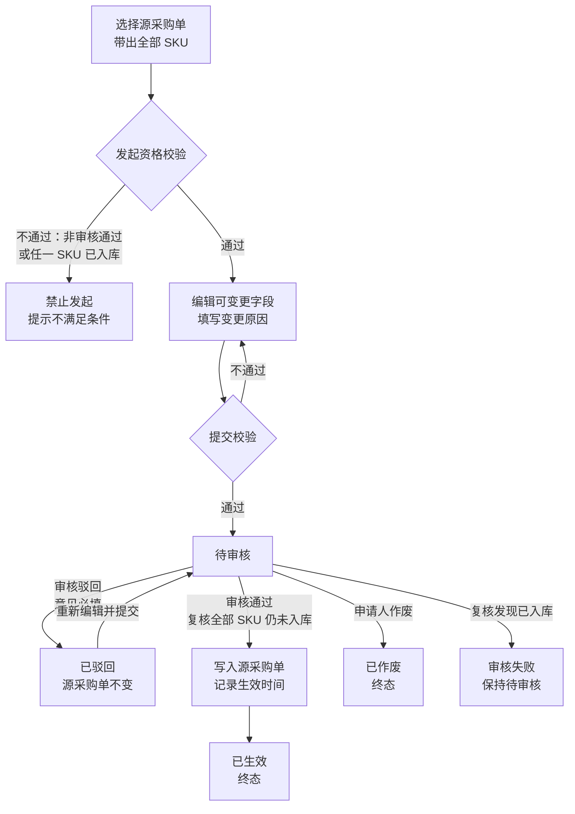

# 采购变更全流程管理 PRD

## 1. 文档改动清单

| 序号 | 改动内容 | 对应章节 |
| --- | --- | --- |
| 1 | 初版发布：定义采购变更单的发起资格、可变更字段、审核、生效、驳回、作废、查询与日志规则 | 全文 |
| 2 | 明确一张变更单只关联一张采购单、可包含该采购单下多个 SKU，不关联采购计划、不推送易仓／领星 | 3.3、3.4、4.1、7.4 |
| 3 | 仅允许“采购单审核通过且所有 SKU 累计入库数量均为 0”时发起变更 | 5.1、6.2、7.2 |
| 4 | 确定本期可变更 14 个字段，供应商、采购主体、SKU 增删不在本期范围 | 5.2、5.3 |
| 5 | 补充结算方式、预付比例、含税、税率在已付款／已开票场景下的限制 | 5.3、8 |

## 2. 术语与口径

| 术语 | 定义 |
| --- | --- |
| 采购单 | 中台已创建并完成审核的采购单据，是采购变更的唯一来源单据。 |
| 采购变更单 | 承载已审核采购单信息调整的独立单据，拥有独立变更单号和审核流程；审核通过后覆盖采购单当前生效内容。 |
| 源采购单 | 被变更的采购单。一张变更单只能关联一张源采购单，变更单号与源采购单号均保留。 |
| 累计入库数量 | 源采购单各 SKU 已确认收货并实际入库的数量之和，不包含采购在途、已发运未签收数量。 |
| 全部未入库 | 源采购单下**每一个 SKU 的累计入库数量均为 0**。任一 SKU 入库数量大于 0，即不满足发起条件。 |
| 变更前 / 变更后 | 变更单提交时记录的源采购单快照，与本次变更审核生效后的目标值。 |
| 生效 | 变更单审核通过并写入采购单当前内容的过程；生效前源采购单保持原值。 |
| 变更原因 | 申请人填写的本次调整背景，必填，≤ 300 字。 |
| 金额口径 | 采购单金额 = 货款 + 运费 + 其他费用 − 优惠金额；金额按纯数字展示，不使用千位分隔符。 |

## 3. 背景与目标

### 3.1 背景

采购单审核通过后，供应商报价、交期、送货仓库、结算条件等信息仍可能发生变化。当前缺少受控的变更入口，若直接修改已审核采购单，会带来以下问题：

- 原审核记录与当前单据内容不一致，审批失去可追溯性；
- 采购金额、税率、结算方式变化没有二次审核；
- 变更内容无法与后续收货建立清晰的时间边界；
- 操作人、修改前后值、变更原因缺少完整留痕。

因此需要独立的采购变更单，对已审核且尚未发生入库的采购单进行受控调整。

### 3.2 产品目标

- **受控变更**：已审核采购单不开放原单直接编辑，统一通过采购变更单发起。
- **审核生效**：变更单审核通过后才覆盖源采购单，驳回、作废不改变源采购单。
- **边界清晰**：仅允许所有 SKU 均未入库的采购单发起，避免改写已发生的收货与库存事实。
- **全程留痕**：记录变更前后值、变更原因、申请人、审核人、审核意见及生效时间。

### 3.3 本次范围

- 新增【采购变更】列表页、查询区、状态分栏及分页。
- 新建变更单：从【采购单】发起，带出该采购单全部 SKU，可同时修改多个 SKU。
- 变更审核：审核通过生效、审核驳回、待审核作废。
- 已驳回变更单重新编辑并再次提交。
- 详情页查看变更前后差异、金额影响及操作记录。
- 采购变更的**唯一发起入口**为【采购单】列表操作列【发起变更】按钮；采购变更列表不提供新建入口。

### 3.4 非本次范围

| 不包含项 | 处理方式 |
| --- | --- |
| 关联采购计划 | 采购变更不回写采购计划，不改变采购计划状态与数量。 |
| 推送易仓／领星 | 不调用外部 ERP 更新接口，审核通过后仅在中台生效。 |
| 已入库采购单变更价格、数量等 | 本期不支持；需走后续财务价格调整或专门流程。 |
| 更换供应商 | 不支持直接修改；应作废原单后按新供应商重新建单。 |
| 修改采购主体 | 涉及合同与财务核算主体，本期不开放。 |
| 新增 SKU、删除 SKU 明细 | 不支持；新需求回到采购计划重新建单。 |
| 修改库存、收货数量、收货批次 | 不属于采购变更范围。 |
| 团队货权调整 | 沿用现有【货权调整】功能。 |

### 3.5 业务价值

| 价值 | 说明 |
| --- | --- |
| 审批可追溯 | 已审核采购单的每次调整都有独立单据、原因和审核记录。 |
| 数据可信 | 变更生效前不影响源采购单，避免未审核内容提前进入收货与财务环节。 |
| 责任清晰 | 逐字段记录修改前后值，可定位申请人、审核人与生效时间。 |
| 风险可控 | 通过“全部未入库”与字段白名单限制，避免变更覆盖已发生的库存事实。 |

## 4. 单据对象与状态机

采购变更单 = 单头 + 源采购单全部 SKU 明细。一张变更单只关联一张采购单，至少包含 1 个 SKU，可同时修改多个 SKU。

### 4.1 单头字段

| 字段 | 来源 | 规则 |
| --- | --- | --- |
| 变更单号 | 系统生成 | 规则 `PC + YYYYMMDD + 4 位顺序号`，按日递增、全局唯一。 |
| 变更状态 | 系统 | 待审核 / 已生效 / 已驳回 / 已作废，详见 4.3。 |
| 源采购单号 | 申请人选择 | 仅可选择满足 5.1 发起资格的采购单，提交后不可更换。 |
| 供应商 | 源采购单带出 | 只读，不允许修改。 |
| 源采购单金额 | 系统计算 | 按变更前快照计算，只读。 |
| 变更后金额 | 系统计算 | 按变更后内容计算，只读。 |
| 金额变化 | 系统计算 | 变更后金额 − 变更前金额，可为正、负或 0。 |
| 变更字段 | 系统汇总 | 展示本次发生变化的字段名称，SKU 数量与单价按字段类型汇总展示。 |
| 变更原因 | 申请人填写 | 必填，≤ 300 字；驳回后重新提交时必须保留或重新确认。 |
| 申请人 / 申请时间 | 系统 | 提交时记录当前操作人与时间。 |
| 审核人 / 审核时间 | 系统 | 审核通过或驳回时记录；待审核为空。 |
| 生效时间 | 系统 | 审核通过并写入源采购单时记录；驳回、作废为空。 |
| 审核意见 | 审核人填写 | ≤ 300 字；审核通过时选填，驳回时必填。 |

### 4.2 SKU 明细字段

| 字段 | 来源 | 规则 |
| --- | --- | --- |
| SKU | 源采购单带出 | 只读，不可新增、删除或替换。 |
| 产品名称 | 源采购单带出 | 只读。 |
| 累计入库数量 | 系统 | 只读；发起、提交、审核时均需为 0。 |
| 采购数量（变更前） | 快照 | 只读，展示源采购单提交变更时的数量。 |
| 采购数量（变更后） | 申请人填写 | 必填，正整数；本期因全部未入库，不设已入库数量下限。 |
| 采购单价（变更前） | 快照 | 只读。 |
| 采购单价（变更后） | 申请人填写 | 必填，≥ 0，最多保留 2 位小数。 |
| 变更后货款 | 系统计算 | 采购数量 × 采购单价。 |
| SKU 备注（变更前 / 变更后） | 申请人填写 | 选填，≤ 120 字。 |
| 变更标记 | 系统 | 该 SKU 的数量、单价或备注任一变化时展示“已变更”，否则“未变更”。 |

### 4.3 状态流转

| 当前状态 | 可编辑 | 可审核 | 可作废 | 说明 |
| --- | --- | --- | --- | --- |
| 待审核 | — | ✓ | ✓ | 源采购单保持原值，可审核或作废；不支持修改已提交内容。 |
| 已驳回 | ✓ | — | — | 可重新编辑后再次提交，沿用原变更单号。 |
| 已生效 | — | — | — | 已写入源采购单，终态；再次调整需新建变更单。 |
| 已作废 | — | — | — | 终态，源采购单不变。 |

同一张源采购单同一时间只允许存在一张“待审核”变更单。已驳回变更单重新提交时占用该唯一名额。

## 5. 发起资格与字段范围

### 5.1 发起资格

同时满足以下条件才允许发起采购变更：

1. 源采购单已审核通过，且当前处于“待到齐／待收货”阶段。
2. 源采购单下所有 SKU 的累计入库数量均为 0；任一 SKU 入库数量大于 0 即禁止发起。
3. 源采购单未完成、未作废。
4. 该采购单不存在其他“待审核”状态的变更单。

不满足时：

- 【发起变更】按钮禁用，或点击后提示“该采购单已有入库记录，不能发起采购变更”；
- 新建变更弹窗的采购单下拉不展示不满足条件的采购单；
- 若选择采购单后、提交前发生入库，提交校验拦截并提示“采购单已发生入库，不能提交变更”。

### 5.2 可变更字段（本期 14 项）

| 分类 | 字段 | 必填 | 变更规则 |
| --- | --- | --- | --- |
| 基础信息 | 采购仓 | 是 | 单选；生效后仅影响后续入库仓库，已发生数据不回写。 |
| 基础信息 | 采购负责人／采购员 | 是 | 选择有效采购员。 |
| 结算与税务 | 结算方式 | 是 | 使用采购单现有结算方式枚举；已付款或已开票时禁止变更。 |
| 结算与税务 | 预付比例 | 否 | 0–100 的整数百分比；已付款或已开票时禁止变更。 |
| 结算与税务 | 是否含税 | 是 | 是 / 否；已付款或已开票时禁止变更。 |
| 结算与税务 | 税率 | 否 | 0–100，最多 2 位小数；已付款或已开票时禁止变更。 |
| 费用信息 | 运费 | 否 | ≥ 0，最多 2 位小数；参与采购单金额重算。 |
| 费用信息 | 其他费用 | 否 | ≥ 0，最多 2 位小数；参与采购单金额重算。 |
| 费用信息 | 优惠金额 | 否 | ≥ 0，最多 2 位小数；参与采购单金额重算。 |
| 整单信息 | 采购单备注 | 否 | ≤ 500 字。 |
| SKU 明细 | 采购数量 | 是 | 按 SKU 修改，正整数；每条 SKU 均需保留且数量 > 0。 |
| SKU 明细 | 采购单价 | 是 | 按 SKU 修改，≥ 0，最多 2 位小数。 |
| SKU 明细 | SKU 备注 | 否 | 按 SKU 修改，≤ 120 字。 |
| 交期信息 | 预计交货日期 | 否 | 可按 SKU 调整，不得早于变更发起当日。 |

### 5.3 不可变更字段

| 字段 | 原因 |
| --- | --- |
| 供应商 | 涉及合同主体、采购来源及后续对账，须重新建单。 |
| 采购主体 | 涉及合同及财务核算主体。 |
| SKU、产品名称、供应商料号 | 属于产品主数据，不通过采购变更修改。 |
| SKU 增删 | 会破坏源采购单的采购来源与明细完整性。 |
| 采购单号、变更单号 | 系统标识，不可修改。 |
| 累计入库数量、收货记录、库存 | 已发生的业务事实，不允许通过变更覆盖。 |
| 创建人、创建时间、审核记录 | 审计留痕字段。 |

### 5.4 结算与税务字段的附加限制

结算方式、预付比例、是否含税、税率虽然属于本期可变更范围，但需同时满足：

- 源采购单不存在已确认的付款记录；
- 源采购单不存在已开具的发票；
- 不存在基于原结算条件生成的待付款或待开票任务。

任一条件不满足时，四个字段置灰，并提示“该采购单已发生付款或开票，不能变更结算及税务信息”。其他未涉及付款、开票的字段仍可变更。

## 6. 功能范围

### 6.1 列表页与查询

采购变更独立工作台，用于查看、审核和追踪已审核采购单的变更。

**查询条件**

| 条件 | 规则 |
| --- | --- |
| 单号查询 | 下拉选择变更单号或采购单号，支持多个单号，逗号、空格、换行分隔，模糊匹配。 |
| SKU／产品名称 | 命中任一 SKU 明细即命中整单。 |
| 供应商 | 单选，来源于源采购单。 |
| 变更字段 | 采购数量、采购单价、采购仓、采购员、预计交货日期、结算方式、预付比例、税务信息、费用、备注。 |
| 申请人 | 单选。 |
| 时间范围 | 支持申请时间、生效时间；起止日期需同时填写，开始日期不得晚于结束日期。 |

**状态分栏**：全部 / 待审核 / 已生效 / 已驳回 / 已作废，页签展示数量。计数口径为应用除状态外全部查询条件后的结果。

**列表字段**

| 字段 | 说明 |
| --- | --- |
| 变更单号 | 点击打开详情。 |
| 状态 | 待审核 / 已生效 / 已驳回 / 已作废。 |
| 采购单信息 | 源采购单号、供应商。 |
| 变更内容 | 变更字段标签、涉及 SKU 数量。 |
| 变更前金额 / 变更后金额 | 按 7.1 计算。 |
| 金额变化 | 正数、负数或 0，使用颜色区分。 |
| 申请信息 | 申请人、申请时间。 |
| 审核／生效信息 | 审核人及审核时间，已生效展示生效时间。 |
| 勾选 | 单选；选中后启用列表上方对应状态的操作按钮。 |
| 详情入口 | 点击变更单号打开详情；列表不再单独设置【查看】按钮。 |

**列表操作按钮**

操作按钮统一放在列表上方，不放在行内操作列。按钮随状态页签切换，只显示当前状态支持的操作；未勾选变更单或勾选单据状态不匹配时按钮置灰。

| 状态页签 | 可用按钮 |
| --- | --- |
| 全部 | 审核、作废、重新编辑（需勾选对应状态的变更单） |
| 待审核 | 审核、作废 |
| 已驳回 | 重新编辑 |
| 已生效 / 已作废 | 不显示操作按钮，仅提示当前状态无可执行操作 |

审核、作废、重新编辑均针对勾选的那一张变更单；勾选其他行时自动取消上一行。

**底部汇总**：当前查询结果张数、变更后金额合计、金额差合计。

**分页**：10 / 20 / 50 张每页，默认 10。

### 6.2 新建采购变更

**入口**：【采购单】列表操作列【发起变更】（收起一级列表时为行内“操作 ⌄”菜单中的【发起变更】）。采购变更列表不提供新建入口，避免绕过采购单直接建变更单。

**显示条件**：采购单状态为待到齐，且累计入库数量为 0，才展示【发起变更】；已入库或未审核通过的采购单不展示该按钮。

**流程**

1. 点击【发起变更】后跳转采购变更页，自动打开新建变更弹窗，并带入该采购单；采购单已锁定，不可更换。
2. 系统带出该采购单全部 SKU、基础信息、费用及变更前金额。
3. 申请人修改允许变更的字段，可只改一个 SKU，也可同时改多个 SKU。
4. 填写变更原因。
5. 提交前展示变更前后差异、采购数量变化、金额变化。
6. 提交后生成待审核变更单，源采购单内容保持不变。

**提交校验**

| 校验项 | 提示 |
| --- | --- |
| 源采购单满足发起资格 | 采购单已发生入库，不能提交变更 |
| 至少一个字段发生变化 | 尚未修改任何字段，无需提交变更 |
| 变更原因已填写 | 请填写变更原因 |
| 采购数量为正整数 | {SKU} 的采购数量必须为正整数 |
| 采购单价与费用金额合法 | 金额必须大于等于 0，且最多 2 位小数 |
| 预付比例、税率在 0–100 之间 | 比例或税率必须在 0–100 之间 |
| 预计交货日期不早于当日 | 预计交货日期不能早于今天 |
| 结算与税务限制 | 该采购单已发生付款或开票，不能变更结算及税务信息 |
| 无其他待审核变更 | 该采购单存在待审核变更，请先处理原变更单 |

校验全部通过后生成变更单，状态为待审核。

### 6.3 重新编辑已驳回变更

- 仅“已驳回”变更单提供【重新编辑】入口。
- 编辑器预填原变更内容、变更原因和源采购单全部 SKU。
- 源采购单在驳回后已发生入库时，禁止重新提交。
- 重新提交后状态回到待审核，沿用原变更单号，追加操作日志。

### 6.4 审核

**入口**：在待审核页签勾选变更单后，点击列表上方【审核】。

**页面**：展示变更单信息、逐字段前后差异、SKU 明细差异、金额汇总、变更原因、历史操作记录和审核意见。

**通过**

1. 重新校验源采购单所有 SKU 累计入库数量仍为 0，且无其他已生效冲突。
2. 将变更结果写入源采购单当前版本。
3. 记录审核人、审核时间、生效时间及审核意见。
4. 变更单状态变为已生效，源采购单内容更新；不回写采购计划、不推送外部 ERP。
5. 后续收货按变更后的采购仓、数量、单价、交期执行。

**驳回**

- 审核意见必填，未填写时拦截。
- 状态变为已驳回，源采购单保持原值。
- 记录审核人、审核时间及驳回意见。

**审核期间发生入库**

- 若审核时发现任一 SKU 累计入库数量大于 0，审核失败，状态保持待审核；
- 提示“采购单已发生入库，本次变更不能生效，请作废后按实际业务处理”；
- 不写入源采购单。

### 6.5 作废

**入口**：在待审核页签勾选变更单后，点击列表上方【作废】。

- 仅“待审核”变更单可作废。
- 二次确认后状态变为已作废，源采购单不变。
- 作废需记录操作人、时间及日志。
- 已生效变更单不可作废；如需再次调整，新建下一张变更单。

### 6.6 详情与操作日志

**详情**展示：

- 单头：变更单号、状态、源采购单号、供应商、申请人、申请时间、审核人、审核／生效时间、变更原因、审核意见；
- 基础字段：逐项展示“变更前 → 变更后”，未变化字段只展示当前值；
- SKU 明细：SKU、产品名称、累计入库数量、采购数量前后值、采购单价前后值、SKU 备注前后值、变更后货款、变更标记；
- 金额汇总：变更前金额、变更后金额、金额变化、涉及 SKU 数；
- 操作记录：提交、重新提交、审核通过、驳回、作废。

**操作日志字段**：操作类型、操作内容、操作人、操作时间，按时间倒序展示。

## 7. 通用业务规则

### 7.1 金额与批次成本价

采购单金额计算沿用现有口径：

`采购单金额 = Σ(SKU 采购数量 × SKU 采购单价) + 运费 + 其他费用 − 优惠金额`

批次成本价按变更后的数据重新计算：

`批次成本价 = SKU单价 + {[(SKU单价 × SKU数量) ÷ 采购单总货款] × (采购单运费 + 其他费用 − 优惠金额)} ÷ SKU数量`

- 当 SKU 数量或采购单总货款为 0 时，批次成本价取 SKU 单价；
- 所有金额不显示千位分隔符，保留 2 位小数；
- 变更前金额始终使用变更单创建时快照，审核通过后不重算历史快照。

### 7.2 发起、提交、审核三次校验

| 节点 | 校验目的 |
| --- | --- |
| 发起 | 过滤不满足“已审核且全部未入库”的采购单。 |
| 提交 | 防止编辑期间发生入库，确保变更进入审核时仍满足条件。 |
| 审核 | 防止审核期间发生入库，确保生效时源采购单没有已发生的入库事实。 |

三次校验中任一节点发现已入库，均不写入源采购单。

### 7.3 并发与唯一性

- 一张采购单同一时间最多一张待审核变更单。
- 提交变更时记录源采购单基准版本；审核生效时重新读取源采购单版本。
- 若提交后源采购单被其他流程改变，审核时提示“采购单内容已变化，请重新发起变更”。
- 变更单提交后不可直接修改，避免审核内容与提交内容不一致。

### 7.4 生效后的数据边界

- 采购仓变更仅影响生效后的收货入库，不迁移历史库存。
- 采购数量、单价、费用、税率变更只更新源采购单当前内容及后续应收／应付计算依据。
- 不修改已存在的收货单、入库单、库存流水、发票及付款记录。
- 不回写采购计划；不推送易仓／领星。
- 已生效变更单不可删除、不可覆盖；后续调整必须新建变更单。

### 7.5 日志规则

| 操作类型 | 记录时机 | 日志内容 |
| --- | --- | --- |
| 提交 | 新建变更提交成功 | 提交采购变更申请 |
| 重新提交 | 已驳回变更重新提交 | 重新编辑并提交变更申请 |
| 审核通过 | 审核通过并生效 | 审核通过，采购变更已生效 |
| 审核驳回 | 审核驳回 | 驳回申请：{审核意见} |
| 作废 | 申请人作废 | 作废变更单 |

日志必须包含变更单号、源采购单号、操作人、操作时间和具体内容。

## 8. 边界与异常

| 场景 | 处理 |
| --- | --- |
| 采购单任一 SKU 已入库 | 禁止发起；已提交的禁止提交／审核生效。 |
| 采购单部分 SKU 已入库、部分未入库 | 按“已入库”处理，禁止发起。 |
| 采购单已完成或已作废 | 不出现在可选采购单中。 |
| 采购单已存在待审核变更 | 禁止再发起，提示先处理原变更单。 |
| 编辑期间发生入库 | 提交时拦截，保留编辑内容但不生成变更单。 |
| 审核期间发生入库 | 审核失败，变更单保持待审核，源采购单不变。 |
| 变更后金额小于 0 | 禁止提交；提示检查优惠金额及费用。 |
| 采购数量为 0、负数或小数 | 禁止提交。 |
| 采购单价、运费、其他费用、优惠金额为负数 | 禁止提交。 |
| 预付比例或税率超出 0–100 | 禁止提交。 |
| 供应商在变更期间被停用 | 不影响已提交变更审核，但提示供应商状态异常，需人工确认。 |
| 用户重复提交 | 前端防重复点击；服务端按变更单幂等校验，只生成一张变更单。 |
| 已生效后需要再次变更 | 新建下一张变更单，原生效单保留。 |

## 9. 权限与审计

### 9.1 权限点

| 权限 | 说明 |
| --- | --- |
| 采购变更-查看 | 查看列表、详情及操作日志，数据范围继承源采购单。 |
| 采购变更-发起 | 新建变更、重新编辑已驳回变更。 |
| 采购变更-审核 | 审核通过或驳回。 |
| 采购变更-作废 | 作废待审核变更。 |

### 9.2 审计要求

- 不允许申请人审核本人提交的变更单（待确认是否强制执行）。
- 逐字段保存修改前后值、变更原因、申请人与审核人。
- 已生效变更单永久保留，不提供物理删除。
- 审核意见、驳回原因必须随单据保存。
- 导出或查看详情时，金额、数量均以变更前后对照形式展示。

## 10. 验收摘要清单

| 编号 | 验收项 | 预期结果 |
| --- | --- | --- |
| E1 | 已审核、所有 SKU 未入库的采购单发起变更 | 可正常进入编辑器并带出全部 SKU。 |
| E2 | 任一 SKU 已入库的采购单发起变更 | 不展示该采购单或提示不能发起。 |
| E3 | 一张变更单包含多个 SKU | 可同时修改多个 SKU 的数量、单价、备注。 |
| E4 | 修改采购仓、采购员、预计交期 | 保存后差异区正确展示变更前后值。 |
| E5 | 修改结算方式、预付比例、含税、税率 | 满足付款／开票限制时可提交。 |
| E6 | 已付款或已开票的采购单修改结算／税务字段 | 字段置灰并提示限制。 |
| E7 | 修改运费、其他费用、优惠金额 | 采购单金额及金额差实时重算。 |
| E8 | 修改采购数量或单价 | 货款、采购单金额、批次成本价按新值重算。 |
| E9 | 未填写变更原因 | 提交被拦截。 |
| E10 | 未修改任何字段 | 提交被拦截。 |
| E11 | 提交后源采购单 | 内容保持不变，仅新增待审核变更单。 |
| E12 | 审核通过 | 变更写入源采购单，状态已生效，记录审核人与生效时间。 |
| E13 | 审核驳回未填写意见 | 拦截并提示必填。 |
| E14 | 审核驳回 | 状态已驳回，源采购单不变，可重新编辑。 |
| E15 | 待审核变更作废 | 状态已作废，源采购单不变。 |
| E16 | 提交或审核时发生入库 | 操作失败，不写入源采购单。 |
| E17 | 同一采购单重复发起待审核变更 | 拦截并提示已有待审核变更。 |
| E18 | 已生效变更再次查看 | 详情展示完整前后值及操作日志，不可编辑。 |
| E19 | 采购变更列表 | 不展示【新建采购变更】按钮，无法从本页直接建单。 |
| E20 | 采购单操作列【发起变更】 | 仅在待到齐且累计入库为 0 时展示；点击跳转并自动打开带单的变更弹窗。 |
| E21 | 切换状态页签 | 待审核只显示【审核】【作废】，已驳回只显示【重新编辑】，已生效／已作废不显示操作按钮。 |
| E22 | 未勾选或勾选状态不匹配的变更单 | 上方操作按钮置灰不可点击。 |
| E23 | 列表行内操作列 | 不展示【查看】按钮，点击变更单号打开详情。 |
| E19 | 查询与状态分栏 | 查询条件、状态计数、分页及底部汇总一致。 |
