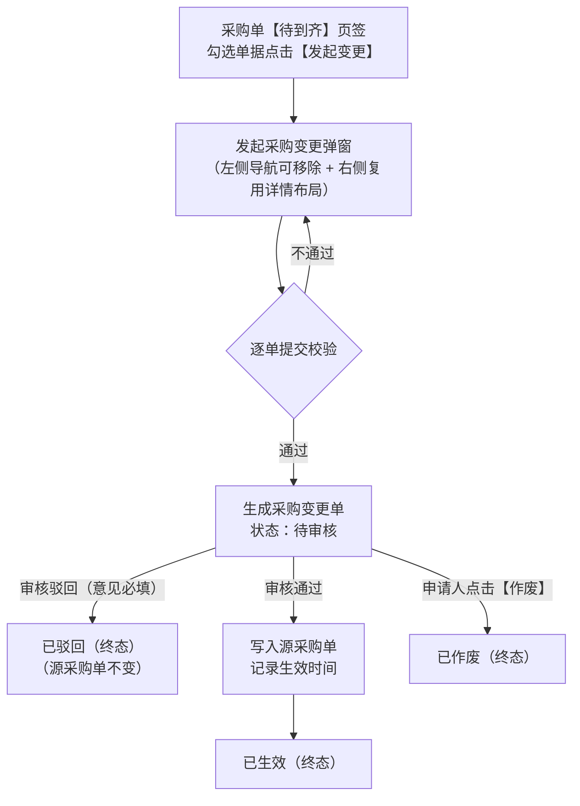

# 采购变更全流程管理 PRD

## 1. 文档改动清单

## 2. 需求背景与目标

### 2.1 业务背景与痛点

采购单审核通过进入【待到齐】阶段后，供应商报价、交期、送货仓库、结算条件等信息仍可能发生变化。若直接修改已审核采购单，会带来以下问题：

- 原审核记录与当前单据内容不一致，审批失去可追溯性；
- 采购金额、税率、结算方式变化没有二次审核；
- 变更内容无法与后续收货建立清晰的时间边界；
- 操作人、修改前后值、变更原因缺少完整留痕。

因此需要独立的采购变更单，对已审核进入待到齐阶段的采购单进行受控调整，并在发起弹窗上复用用户熟悉的【采购单详情】信息架构，降低学习与核对成本。

### 2.2 产品目标

- **受控变更**：已审核采购单不开放原单直接编辑，统一通过采购变更单发起。
- **体验一致**：【发起采购变更】弹窗复用【采购单详情】的卡片分区与锚点布局（仅保留「采购单信息」「采购明细」，去掉「收货明细」「费用分摊明细」），让采购员在熟悉的详情视图中直接完成字段调整。
- **多单连贯处理**：支持在【待到齐】页签勾选多张采购单进入弹窗，左侧导航栏支持搜索、切换（自动暂存草稿）与红色「移除」按钮，提交时按修改的采购单分别生成对应变更单。
- **审核生效与全程留痕**：变更单审核通过后才覆盖源采购单，驳回、作废不改变源采购单；逐字段记录变更前后值、变更原因、申请人、审核人及操作时间。

---

## 3. 功能清单

| 序号 | 一级模块 | 二级功能 | 功能描述与核心业务规则 | 对应章节索引 |
| :--- | :--- | :--- | :--- | :--- |
| **F01** | **采购单发起变更** | 发起入口管理 | 支持在采购单【待到齐】页签通过操作栏【发起变更】按钮多选批量发起，或在单据行内操作列单独唤起发起弹窗；非待到齐状态不可发起；**同采购单存在待审核变更单时拦截发起**；采购变更页不开放直接新建。 | [4.1 发起入口与可用条件](#41-发起入口与可用条件) |
| **F02** | 采购单发起变更 | 多单勾选与映射 | 勾选多张待到齐采购单点击发起时，全部带入弹窗左侧；遵循“一单一变更”原则，提交时按发生修改的采购单独立生成待审核变更单。 | [4.2 勾选带入与单据映射规则](#42-勾选带入与单据映射规则) |
| **F03** | 采购单发起变更 | 左侧多单导航与草稿暂存 | 左侧卡片直接展示勾选的采购单号、供应商、仓库及 SKU 数（去除了搜索框）；卡片右上角提供红色文字按钮【移除】；多单切换编辑时自动暂存草稿不丢失。 | [4.3 左侧采购单导航栏交互](#43-左侧采购单导航栏交互) |
| **F04** | 采购单发起变更 | 基础与结算信息变更 | 去除右侧锚点导航栏，内容区全宽呈现；复用详情 3 列网格，支持修改仓库、采购负责人、结算方式、预付比例、含税、税率、运费、其他费用、优惠金额；去除「预计交货日期」与「采购单备注」；单内任一 SKU 入库后采购仓库自动锁定置灰；**不含税时税率置 `0%` 禁用，含税时税率必选 `> 0%`**。 | [4.4(1) 区块一：采购单信息](#1-区块一采购单信息) |
| **F05** | 采购单发起变更 | SKU 明细变更与单价联动 | 支持修改明细行采购数与采购单价并实时重算货款；**某 SKU 产生收货数量（累计入库 $>0$）后，该 SKU 的采购单价与采购数量自动锁定不可修改**；同一采购单内相同 SKU（不同采购计划）采购单价自动保持同步联动；**采购数变更生效后同步更新对应采购计划的【实际采购量】**；去除「SKU 备注」。 | [4.4(2) 区块二：采购明细](#2-区块二采购明细) |
| **F06** | 采购单发起变更 | 提交校验与反馈直达 | 必填变更原因（≤ 300 字）；逐单执行字段合法性与修改校验；提交成功后弹出绿色 Toast，各变更单号单独成超链接，点击任何一个单号均直接跳转采购变更工作台【待审核】状态列表。 | [4.5 提交校验与成功反馈](#45-提交校验与成功反馈) |
| **F07** | 采购单发起变更 | 原值对比动态提示 | 字段修改后，在对应输入框正下方实时呈现橙黄色删除线 `~~原值~~`（不带前缀文字）；改回原值后自动隐藏；变更原因不展示原值。 | [4.6 原值展示规则](#46-原值展示规则) |
| **F08** | **采购变更工作台** | 单据状态流转引擎 | 建立 `待审核`、`已生效`、`已驳回`、`已作废` 状态机；审核通过后生效写回源采购单；`已驳回`/`已作废` 均为终态，不支持原单重编。 | [5.1 单据状态机与流转规则](#51-单据状态机与流转规则) |
| **F09** | 采购变更工作台 | 多维组合检索与状态分栏 | 提供单号组合、`SKU / 领星 SKU / 供应商料号` 单选下拉+多编码查询、供应商、采购仓库、申请人、日期范围查询（已去掉变更字段筛选）；提供 5 大状态分栏计数（已去掉底部金额汇总）。 | [5.2 列表页查询与状态分栏](#52-列表页查询与状态分栏) |
| **F10** | 采购变更工作台 | 列表字段与即时悬停展示 | 列表去掉变更前/后金额与审核人，新增「变更原因」列，行高收窄至 40px；「变更内容」「变更原因」超长省略，鼠标悬停通过即时气泡完整多行展示。 | [5.2 列表页查询与状态分栏](#52-列表页查询与状态分栏) |
| **F11** | 采购变更工作台 | 批量勾选与列表操作 | 支持表头全选与跨行批量勾选；待审核状态支持顶部批量【审核】与【作废】；全状态支持【导出】；行内仅保留【日志】查看（所有状态均去掉【编辑】）。 | [5.3 列表操作栏与行内操作](#53-列表操作栏与行内操作) |
| **F12** | 采购变更工作台 | 单据审核与批量审核 | 单张审核打开全宽审核弹窗（含领星 SKU 与供应商料号），勾选多张支持批量审核；通过（意见选填）写回源采购单并生效，驳回（意见必填）置为已驳回。 | [5.4 变更审核与作废](#54-变更审核与作废) |
| **F13** | 采购变更工作台 | 变更单批量/单张作废 | 待审核状态下，支持勾选单张或多张执行【作废】操作，二次确认后变更为已作废终态，记录作废日志。 | [5.4 变更审核与作废](#54-变更审核与作废) |
| **F14** | 采购变更工作台 | 变更详情查看 | 复用全宽卡片布局（去掉右侧导航、右上角【查看操作日志】与右下角【关闭】按钮，去掉「采购单备注」）；采购明细新增「领星 SKU」「供应商料号」列；变更项下方展示橙黄删除线原值。 | [5.5 变更详情与操作日志](#55-变更详情与操作日志) |
| **F15** | 采购变更工作台 | 全流程审计操作日志 | 通过列表行内【日志】或审核弹窗调起操作日志弹窗；时间倒序表格化记录提交、审核通过、审核驳回、作废全流程留痕。 | [5.5 变更详情与操作日志](#55-变更详情与操作日志) |
| **F16** | 采购变更工作台 | 列表数据导出与模板 | 支持按勾选记录或当前筛选结果导出 `.xlsx` 文件，按「变更单 + SKU 明细行」平铺导出 22 项模板字段。 | [5.6 导出功能与导出模板字段](#56-导出功能与导出模板字段) |
| **F17** | **业务规则与安全** | 边界场景与联动控制矩阵 | 严格执行累计入库后仓库锁定置灰、同单同 SKU 跨计划单价实时联动、**同单仅限 1 张待审核变更单互斥、连续变更最新快照基准、不计算批次成本价**、已付款/已开票锁控等强约束。 | [6. 边界与异常场景处理](#6-边界与异常场景处理) |
| **F18** | **权限管控体系** | 角色权限细粒度划分 | 按中台 RBAC 体系划分采购变更的「查看」「发起」「审核」「作废」操作权限，确保审批权责隔离。 | [7. 权限与审计要求](#7-权限与审计要求) |
| **F19** | **质量与验收** | 端到端验收用例清单 | 提供覆盖 E1~E22 的全链路验收标准清单，涵盖多单导航、弹窗架构、联动规则、并发互斥、计划回写及审核闭环。 | [8. 验收摘要清单（Checklist）](#8-验收摘要清单checklist) |

---

## 4. 采购单【发起变更】入口与弹窗设计

### 4.1 发起入口与可用条件

- **顶部按钮入口**：【采购单】列表切至【待到齐】页签，勾选 1 张或多张采购单后，点击列表上方操作栏【发起变更】按钮唤起「发起采购变更」弹窗（沿用常规操作按钮样式）。
- **行内操作入口**：【采购单】列表【待到齐】状态下，点击行内操作列（或收起一级列表下的「操作 ⌄」菜单）中的【发起变更】，同样唤起「发起采购变更」弹窗并带入当前采购单。
- **唯一入口约束**：【采购变更】列表页不提供新建按钮，所有变更必须从【采购单】页发起。
- **在途待审核互斥约束**：同一采购单同一时间**仅允许存在 1 张 `待审核` 状态的变更单**；`已生效`、`已驳回`、`已作废` 均视为已完结状态，不阻塞新变更的发起。若所选采购单当前已存在 `待审核` 变更单，发起时拦截并提示：`该采购单存在待审核的变更单（{PC单号}），请先审核或作废后再发起`。
- **连续变更基准规则**：若采购单此前已有变更单审核通过并生效（如 `PC001` 将单价从 `10` 改为了 `12`），再次对该采购单发起新变更单（`PC002`）时，弹窗展示与记录的「变更前原值」**以最近一次生效后的采购单最新数据（`12`）为基准**，而非最初下单时的值（`10`）。

### 4.2 勾选带入与单据映射规则

1. 用户在【待到齐】页签勾选 $N$（$N \ge 1$）张采购单点击【发起变更】时，所选的全部待到齐采购单完整带入弹窗左侧导航栏，标题显示 `待到齐采购单（N）`。
2. 默认选中并激活第 1 张采购单，在右侧展示该单的详情变更表单。
3. **一单一变更原则**：每张采购单在弹窗内独立维护一份变更草稿；提交时，系统针对已发生修改的每张采购单分别生成 1 张独立的待审核采购变更单（1 张变更单仅关联 1 张源采购单）。

### 4.3 左侧采购单导航栏交互

| 要素 | 交互与展示规则 |
| --- | --- |
| 栏头标题 | 展示 `待到齐采购单（N）`，随移除操作实时更新数量。 |
| 导航卡片列表 | 垂直滚动列表，直接展示已勾选进入的待到齐采购单（已移除搜索框，避免窄栏空间拥挤）。 |
| 导航卡片内容 | 第一行左侧展示**采购单号**（激活态蓝色高亮），第一行右侧展示红色文字按钮 **【移除】**；第二行展示**供应商名称**（超长省略并带悬浮提示）；第三行展示 `{采购仓库} · {SKU 数} 个 SKU`。 |
| **红色【移除】按钮** | 位于每张采购单卡片右上角，采用红色文字样式（`#f56c6c`，悬停下划线）： 1. 点击【移除】将该采购单从本次变更弹窗中移除，并同步取消列表页对应行的勾选状态； 2. 若移除的是当前激活的采购单，自动切换激活剩余列表中的第 1 张采购单； 3. 若将左侧采购单全部移除，自动关闭弹窗并 Toast 提示：`已移除全部采购单，本次发起变更已取消`。 |
| 多单切换暂存 | 点击左侧不同采购单卡片切换时，系统自动暂存上一张采购单已修改的基础字段、SKU 明细与变更原因，来回切换不丢失草稿。 |

### 4.4 右侧变更区：复用【采购单详情】弹窗结构

弹窗右侧主体及顶栏整体复用【采购单详情】弹窗的布局与视觉规范：

- **弹窗顶栏**：主标题 `发起采购变更`，副标题动态展示当前激活单据 `中台跟踪号：{采购单号}`，右侧为关闭按钮 `×`。
- **内容区全宽展开（已移除右侧锚点导航栏）**：
  - 彻底去除右侧冗余的锚点导航条（采购单信息与采购明细两个锚点），内容区自适应铺满右侧区域，上下滚动浏览，视线更加开阔聚焦。
  - **不展示**采购单详情中的「收货明细」与「费用分摊明细」页签。
  - 垂直线性排布两大卡片区块：上方为「采购单信息」，下方为「采购明细」。

#### （1）区块一：`采购单信息`

采用与【采购单详情】一致的 3 列网格（`字段标签 + 字段值/表单控件`）排布，兼顾只读上下文核对与可变更项编辑：

| 字段名称 | 展示方式 | 是否可变更 | 规则说明 |
| --- | --- | --- | --- |
| 中台跟踪号 | 纯文本只读 | 否 | 源采购单号（如 `PO2026727004`）。 |
| ERP采购单号 | 纯文本只读 | 否 | 展示 ERP 单号及来源（如 `LXPO2026610004（领星）`）。 |
| 采购单状态 | 状态标签只读 | 否 | 展示当前状态标签（如 `待收货` / `部分收货`）。 |
| 供应商名称 | 纯文本只读 | 否 | 源采购单供应商，不允许通过采购变更修改。 |
| 供应商代码 | 纯文本只读 | 否 | 源采购单供应商编码。 |
| **采购仓库** | 下拉单选 | **是**（有条件） | 必填，可选有效采购仓。**入库锁定规则**：采购单内任一 SKU 累计入库数量 $> 0$ 时，采购仓库控件自动置灰禁用（`disabled`），锁定不可变更。 |
| **采购负责人** | 下拉单选 | **是** | 必填，可选有效采购员。 |
| 采购主体 | 纯文本只读 | 否 | 涉及合同及财务核算主体，不可修改。 |
| **结算方式** | 下拉单选 | **是** | 必填，使用采购单结算方式枚举。 |
| **预付比例（%）** | 数字输入框 | **是** | 0–100 的整数百分比。 |
| **是否含税** | 下拉单选 | **是** | `是` / `否`。选 `否` 时，「税率（%）」自动置为 `0%` 并禁用不可选；选 `是` 时，「税率（%）」启用且必选 `> 0%` 的税率。 |
| **税率（%）** | 下拉单选 | **是**（联动） | 常用税率枚举（`0%`、`1%`、`3%`、`6%`、`9%`、`13%` 等）。受「是否含税」控制：不含税时强制 `0%` 且禁用；含税时禁止选择 `0%`，必须选择 `> 0%` 的有效税率。 |
| **运费** | 数字输入框 | **是** | $\ge 0$，最多 2 位小数，参与整单金额计算。 |
| **其他费用** | 数字输入框 | **是** | $\ge 0$，最多 2 位小数，参与整单金额计算。 |
| **优惠金额** | 数字输入框 | **是** | $\ge 0$，最多 2 位小数，参与整单金额计算。 |
| 创建人 | 纯文本只读 | 否 | 源采购单创建人。 |
| 创建时间 | 纯文本只读 | 否 | 源采购单创建时间。 |
| **变更原因** | 底部浅蓝底多行框 | **必填** | 带红色必填星号 `*`，$\le 300$ 字，随变更单提交审核。（**注：已去掉「采购单备注」字段，备注不在此弹窗变更。**） |

#### （2）区块二：`采购明细`

复用【采购单详情】的采购明细表格视觉，支持直接修改 SKU 的采购数量与单价，并实时重算货款（**SKU 备注不属于本次采购变更范围**，其变更入口不在变更弹窗内，沿用采购单列表的行内备注修改机制）：

| 列名 | 展示／控件类型 | 规则说明 |
| --- | --- | --- |
| SKU | 缩略图 + SKU 编码 + 首单/加急标签 | 只读，不可增删或替换 SKU。 |
| 采购计划 | 纯文本只读 | 关联的采购计划号（如 `CGJH2026081006`）。 |
| **采购数** | 数字输入框 | **可变更（有条件）**，必填正整数。**收货锁定规则**：该 SKU 产生收货数量（累计入库 $> 0$）之后，该 SKU 的采购数量输入框自动置灰禁用，不可修改。**采购计划回写**：审核通过生效后，若该行采购数发生变更，同步更新对应采购计划的**【实际采购量】**（如采购数由 100 变更为 60，则采购计划实际采购量同步变更为 60）。 |
| **采购单价** | 数字输入框 | **可变更（有条件）**，必填，$\ge 0$，最多 2 位小数。**收货锁定规则**：该 SKU 产生收货数量（累计入库 $> 0$）之后，该 SKU 的采购单价输入框自动置灰禁用，不可修改。**同 SKU 自动联动**：明细按「SKU + 采购计划」维度展示，因采购计划不同存在重复 SKU 时，修改任一行的采购单价，同单内所有相同 SKU 行的单价自动同步更新，货款及原值橙黄色删除线划线一并实时刷新。 |
| 上次采购价 | 纯文本只读 | 展示 `¥ 金额` 及 `含税` 标签（如有），供调价核对参考。 |
| 团队 | 纯文本只读 | 归属业务团队。 |
| 品名 | 纯文本只读 | 产品中文名称，超长省略并带 `title` 提示。 |
| 累计入库 | 纯文本只读 | 当前 SKU 已收货入库数量。 |
| 货款 | 纯文本（实时计算） | `¥ (采购数 × 采购单价)`，修改采购数或采购单价时立即同步刷新。 |

### 4.5 提交校验与成功反馈

**提交校验规则**

1. **是否发生修改**：
   - 若弹窗内仅 1 张采购单且未修改任何字段，提示：`未修改任何内容，无需发起变更`。
   - 若弹窗内有多张采购单，系统筛选出已修改字段或已填写变更原因的单据进行校验；若所有单据均未修改，提示：`未修改任何内容，无需发起变更`；若某张单据只填了原因但未改字段，自动定位到该单并提示：`{采购单号} 未修改任何字段，请修改或从左侧移除`。
2. **字段合法性校验（逐单校验，不通过时自动切换激活该采购单并提示）**：
   - 变更原因必填：`请填写变更原因`。
   - 含税与税率联动校验：当「是否含税」为 `是` 时，税率必须 `> 0%`，否则拦截提示：`含税时税率须大于 0%`；「是否含税」为 `否` 时税率固定 `0%`。
   - 预付比例：`预付比例须为 0-100 的整数`。
   - 运费 / 其他费用 / 优惠金额：`运费/其他费用/优惠金额须为非负数，最多 2 位小数`。
   - SKU 采购数量：`SKU {sku} 的采购数量须为正整数`，且 `SKU {sku} 的采购数量不能小于累计入库数量`。
   - SKU 采购单价：`SKU {sku} 的采购单价须为非负数，最多 2 位小数`。
   - 变更后整单金额：`变更后金额不能小于 0，请检查优惠金额及费用`。

**提交成功反馈**

- 校验通过后关闭弹窗，生成对应数量的 `待审核` 采购变更单（单号规则：`PC + YYYYMMDD + 4位流水号`）。
- 页面顶部弹出绿色成功 Toast，每个单号独立展示为超链接（以顿号 `、` 分隔）：
  - 单张：`发起变更成功，变更单号 PC2026xxxx0001`
  - 多张：`发起变更成功（共 N 张），变更单号 PC2026xxxx0001、PC2026xxxx0002`
- **单号点击跳转规则**：点击 Toast 中的**任何一个单号**，均直接跳转至【采购变更】页面并自动激活**【待审核】**状态页签（URL 携带 `?status=pending`，筛选展示所有待审核变更单），无需打开详情弹窗，便于集中处理与审核。

**弹窗底部提示栏说明（位于弹窗左下角操作按钮旁）**：
1. 采购单内任一 SKU 发生收货入库后，采购仓库锁定不可变更。
2. 同一采购单内相同 SKU（不同采购计划）的采购单价自动保持同步联动。
3. 采购单该 SKU 产生收货数量之后，该 SKU 的采购单价和采购数量不可修改。

### 4.6 原值展示规则

字段被修改后，在该输入框正下方实时显示修改前的原值，便于申请人核对改动。

| 规则项 | 说明 |
| --- | --- |
| 适用字段 | 「采购单信息」区块：采购仓库、采购负责人、结算方式、预付比例、是否含税、税率、运费、其他费用、优惠金额；「采购明细」表格：采购数、采购单价。 **变更原因不显示原值。** |
| 显示时机 | 仅当当前值与原值不同时显示；改回原值后自动隐藏。输入或选择时实时刷新，不需等到提交。 |
| 展示格式 | 只显示原值本身，不加“原值：”前缀，例如 ~~月结90天~~。税率显示为百分比（如 ~~5%~~）；原值为空时显示 ~~—~~。 |
| 样式 | 文字和删除线均为橙黄色 `#e6a23c`，字号 12px；单行字段超长省略。 |
| 多单切换 | 切换左侧采购单后，按该单暂存的草稿重新计算并展示原值。 |

---

## 5. 【采购变更】工作台全流程管理

### 5.1 单据状态机与流转规则

| 当前状态 | 可编辑 | 可审核 | 可作废 | 说明 |
| --- | --- | --- | --- | --- |
| 待审核 | — | ✓ | ✓ | 源采购单保持原值，支持批量/单张审核或作废；不支持直接修改已提交内容。 |
| 已驳回 | — | — | — | 终态，源采购单不变；如仍需变更请回采购单重新发起新变更单。 |
| 已生效 | — | — | — | 已写入源采购单，终态；再次调整需重新发起下一张变更单。 |
| 已作废 | — | — | — | 终态，源采购单不变。 |

### 5.2 列表页查询与状态分栏

**查询条件**

| 条件 | 规则 |
| --- | --- |
| 单号查询 | 下拉切换「变更单号 / 采购单号」，支持多个单号（逗号、空格、分号分隔），模糊匹配。 |
| 编码组合查询 | 单选下拉切换 **`SKU` / `领星 SKU` / `供应商料号`**，右侧为编码输入框；支持多个编码（逗号、空格、分号分隔），命中任一 SKU 明细即命中整单。 |
| 供应商 | 单选下拉，来源于源采购单。 |
| 采购仓库 | 单选下拉，支持按采购仓库筛选。 |
| 申请人 | 单选下拉。 |
| 时间范围 | 支持切换「申请时间 / 生效时间」；开始日期不得晚于结束日期。 |

*(注：已移除「变更字段」下拉筛选及废弃的「预计交货日期」筛选项。)*

**状态分栏**：`全部` / `待审核` / `已生效` / `已驳回` / `已作废`，页签展示除状态外当前筛选条件下的单据数量。

**列表字段与行高**：表头全选框 + 行勾选框、变更单号（附状态标签，点击打开详情）、采购单号、供应商、采购仓库、**变更内容**、**变更原因**、申请人、申请时间、生效时间、操作列（仅保留【日志】）。
- 列表行高收窄至 `40px`（表头 `42px`），去掉「变更前金额」「变更后金额」「审核人」3 列及左下角汇总统计，仅保留右侧总张数与分页（10 / 20 / 50 张每页）。

**「变更内容」「变更原因」展示与悬停规范**：
- **排版拼接格式**：写清楚每个字段从什么变成什么：
  - 基础字段按 `字段名：原值 → 新值` 展示（如 `采购仓库：东莞采购仓 → 深圳采购仓`、`结算方式：月结30天 → 月结90天`）；
  - SKU 明细变更带上 SKU 编码，按 `SKU编码 采购数：原值 → 新值`、`SKU编码 采购单价：¥原值 → ¥新值` 展示（如 `140US260008 采购单价：¥128.00 → ¥135.00`）；
  - 多项变更之间以分号 `；` 连接；
- **超长与即时悬停气泡**：
  - 列表单元格超出列宽时采用省略号截断（`text-overflow: ellipsis; white-space: nowrap; overflow: hidden;`）；
  - **鼠标悬停即时完整展示**：鼠标移入「变更内容」「变更原因」「供应商」单元格时，立即弹出自定义深色悬浮气泡（`pc-hover-tip`），各项变更之间统一采用换行符 `\n` 清单化完整展示，无浏览器原生延迟或长度截断问题。

### 5.3 列表操作栏与行内操作

| 状态页签 | 列表上方操作栏按钮 | 行内操作列 |
| --- | --- | --- |
| 全部 / 待审核 | 【审核】【作废】【导出】（支持表头全选与批量勾选；审核、作废须所选均为待审核变更单） | 【日志】 |
| 已驳回 / 已生效 / 已作废 | 【导出】 | 【日志】 |

*(注：所有状态均不支持列表行内编辑，已移除【编辑】按钮。)*

### 5.4 变更审核与作废

- **单张审核与批量审核**：
  - 勾选 1 张待审核变更单点击顶部【审核】，打开「采购变更审核」弹窗；勾选多张（$\ge 2$）待审核变更单点击顶部【审核】，打开「批量审核采购变更」弹窗。
  - **单张审核弹窗布局**：去除右侧锚点导航栏，全宽平铺展示「采购单信息」和「采购明细」卡片（明细包含 `领星 SKU` 与 `供应商料号` 列）；变更字段上方展示目标新值，正下方展示橙黄色删除线 `~~原值~~`；彻底去除收货明细、费用分摊大卡片，不展示预计交货日期、采购单备注和 SKU 备注。
  - **审核通过**：审核意见选填；点击【审核通过并生效】（批量审核为【批量通过并生效】），通过后状态变为 `已生效`，记录审核人、审核时间与生效时间，并将变更后的字段值写回源采购单。**生效联动规则**：若明细「采购数」发生变更，同步更新对应采购计划行的**【实际采购量】**（如采购数由 100 改为 60，采购计划实际采购量同步更新为 60）；采购单已取消批次成本价计算逻辑，变更采购单数量及任何金额均不触发批次成本价计算或回溯。
  - **审核驳回**：审核意见**必填**（未填拦截提示 `驳回时请填写审核意见`）；驳回后状态变为 `已驳回`（终态），源采购单保持原值。
- **单张作废与批量作废**：
  - 勾选 1 张或多张待审核变更单后点击顶部【作废】，弹出二次确认框（展示作废单号或批量张数）；确认后状态变为 `已作废`，追加作废日志，源采购单不变。

### 5.5 变更详情与操作日志

- **变更详情弹窗（全宽极简只读视图）**：
  - 布局与发起变更弹窗一致：自适应全宽展开（去掉右侧锚点导航栏、去掉顶栏右上角【查看操作日志】按钮、去掉底栏右下角【关闭】按钮，保留右上角 `×`、点击遮罩或按 `Esc` 关闭）；
  - **采购单信息区块**：采用 3 列网格展示中台跟踪号、ERP采购单号、状态标签、供应商、采购仓库、采购负责人、采购主体、结算方式、预付比例、含税、税率、运费、其他费用、优惠金额、申请人、申请时间、审核人、生效时间等；发生变更的字段在当前新值正下方以橙黄色删除线 `~~原值~~` 直观呈现；下方展示变更原因卡片（浅蓝底）及审核意见卡片（若有）；**不展示「采购单备注」**；
  - **采购明细区块**：列顺序为 **`SKU`、`领星 SKU`、`品名`、`供应商料号`、`采购计划`、`采购数`、`采购单价`、`上次采购价`、`团队`、`累计入库`、`货款`**；采购数或单价变更项带橙黄色删除线原值；彻底去掉 SKU 备注列。
- **操作日志弹窗**：
  - 点击列表行内【日志】或审核弹窗顶栏按钮打开，按时间倒序表格化展示：`操作类型`（提交 / 审核通过 / 审核驳回 / 作废）、`操作内容`、`操作人`、`操作时间`。

### 5.6 导出功能与导出模板字段

- **导出入口与权限**：点击【采购变更】列表上方操作栏【导出】按钮触发（全状态页签均可用，需具备 `采购变更-查看` 权限）。
- **导出范围与文件规格**：
  - **导出范围**：若列表已勾选记录，则仅导出所选勾选的变更单；若未勾选任何记录，则导出当前筛选条件（含当前状态页签）下的全部命中记录（最多单次导出 10,000 行明细）。
  - **文件格式与命名**：Excel 工作簿（`.xlsx`），默认文件名：`采购变更单导出_YYYYMMDD_HHmmss.xlsx`。
  - **行展开粒度**：采用**「变更单 + SKU 采购明细行」平铺导出**（每行对应变更单内的 1 条 SKU 明细；同一变更单包含多个 SKU 时，单据头基础字段在每行重复展示，便于业务与财务直接按明细筛选、透视与核对）。
- **导出模板字段清单（共 22 列）**：

| 列序 | 字段分组 | Excel 导出列名 | 字段取值与格式说明 |
| :--- | :--- | :--- | :--- |
| 1 | 单据基础信息 | **变更单号** | 变更单唯一单号（如 `PC202611020006`） |
| 2 | 单据基础信息 | **变更单状态** | `待审核` / `已生效` / `已驳回` / `已作废` |
| 3 | 单据基础信息 | **中台采购单号** | 关联的源采购单中台跟踪号（如 `PO202610280016`） |
| 4 | 单据基础信息 | **ERP采购单号** | 关联的 ERP 采购单号及来源（如 `LXPO2026610016（领星）`） |
| 5 | 单据基础信息 | **供应商名称** | 源采购单供应商名称 |
| 6 | 单据基础信息 | **采购仓库（变更前）** | 变更前采购仓库名称 |
| 7 | 单据基础信息 | **采购仓库（变更后）** | 变更后采购仓库名称（未改则与变更前一致） |
| 8 | 单据基础信息 | **采购负责人（变更后）** | 变更后采购负责人（或标明变更前后） |
| 9 | 单据基础信息 | **整单变更内容汇总** | 与列表「变更内容」一致的文本汇总（含基础字段与全部明细变动） |
| 10 | 单据基础信息 | **变更原因** | 申请人填写的变更原因全文 |
| 11 | 审批与时间 | **申请人** | 发起变更的操作人 |
| 12 | 审批与时间 | **申请时间** | `YYYY-MM-DD HH:mm` |
| 13 | 审批与时间 | **审核人** | 审核通过/驳回操作人（未审为空或 `—`） |
| 14 | 审批与时间 | **审核意见** | 审核人填写的通过/驳回意见（未填为空或 `—`） |
| 15 | 审批与时间 | **生效时间** | 审核通过生效时间（未生效为空或 `—`） |
| 16 | 明细维度信息 | **SKU** | 明细行 SKU 编码 |
| 17 | 明细维度信息 | **领星 SKU** | 明细行对应领星 SKU 编码 |
| 18 | 明细维度信息 | **品名** | 产品中文名称 |
| 19 | 明细维度信息 | **供应商料号** | 供应商料号（无则 `—`） |
| 20 | 明细维度信息 | **采购计划号** | 该明细行关联的采购计划单号 |
| 21 | 明细维度信息 | **采购数（前 → 后）** | 明细行数量对比，如 `300 → 360`（未改则展示当前值 `100`） |
| 22 | 明细维度信息 | **采购单价（前 → 后）** | 明细行单价对比（元），如 `128.00 → 135.00`（未改则展示当前值 `15.80`） |

---

## 6. 边界与异常场景处理

| 场景 | 处理方式 |
| --- | --- |
| 勾选多张待到齐采购单发起变更 | 全部带入弹窗左侧导航栏，支持逐单切换编辑、按单暂存草稿。 |
| 左侧导航栏点击【移除】 | 移除该采购单并同步取消列表页勾选；若移除当前单则自动切换下一张；全部移除时关闭弹窗并提示。 |
| 未修改任何字段直接提交 | 拦截并提示 `未修改任何内容，无需发起变更`。 |
| 多单中某张单校验不通过 | 自动将左侧激活态切换至该异常采购单，并提示 `{采购单号}：{具体错误原因}`。 |
| 采购数量小于累计入库数量 | 拦截并提示 `SKU {sku} 的采购数量不能小于累计入库数量`。 |
| 变更后整单金额小于 0 | 拦截并提示 `变更后金额不能小于 0，请检查优惠金额及费用`。 |
| 采购单已有任一 SKU 累计入库 $> 0$ | 弹窗中「采购仓库」下拉框自动置灰禁用（`disabled`），防止修改仓库。 |
| 采购单某 SKU 产生收货数量（累计入库 $> 0$） | 该 SKU 的「采购数」和「采购单价」输入框均自动置灰禁用（`disabled`），不可修改（未收货的其他 SKU 仍可正常调整）。 |
| 同一采购单内存在重复 SKU（不同采购计划） | 修改任一行的采购单价，所有相同 SKU 的单价输入框、货款及原值划线实时自动同步更新。 |
| 已付款或已开票采购单 | 在变更编辑器中锁定结算方式、预付比例、是否含税、税率 4 个字段并提示限制。 |
| 同一采购单已存在 `待审核` 变更单 | 再次对该采购单发起变更（或已驳回单重新提交）时拦截并提示：`该采购单存在待审核的变更单（{PC单号}），请先审核或作废后再发起`；若历史变更单为 `已生效`/`已驳回`/`已作废`，均视为已完结，允许发起新变更。 |
| 变更生效后再次发起第 2 次变更 | 新变更单的「变更前原值（before 快照）」以最近一次生效后的采购单最新数据为基准，而非最初创建采购单时的原始值。 |
| 修改明细行「采购数」并审核通过 | 变更生效后，同步更新对应采购计划行的**【实际采购量】**（如采购数由 100 改为 60，则采购计划实际采购量同步更新为 60）。 |
| 「是否含税」与「税率（%）」联动 | 「是否含税」选 `否` 时，「税率」自动置为 `0%` 并禁用不可选；选 `是` 时，「税率」必选 `> 0%` 的有效税率，选 `0%` 时提交拦截提示。 |
| 数量或金额变更对批次成本价的影响 | 采购单已取消批次成本价计算逻辑，因此采购变更中调整采购数量、采购单价、运费、其他费用、优惠金额等任何字段，均不触发也不影响批次成本价计算。 |

---

## 7. 权限与审计要求

| 权限点 | 说明 |
| --- | --- |
| 采购变更-查看 | 查看采购变更列表、详情及操作日志。 |
| 采购变更-发起 | 在采购单页发起采购变更、在采购变更页重新编辑已驳回变更单。 |
| 采购变更-审核 | 对待审核变更单执行审核通过或驳回。 |
| 采购变更-作废 | 对待审核变更单执行作废。 |

---

## 8. 验收摘要清单（Checklist）

| 编号 | 验收项 | 预期结果 |
| --- | --- | --- |
| E1 | 待到齐页签勾选多张采购单点击【发起变更】 | 勾选的所有待到齐采购单全部出现在弹窗左侧导航栏，显示正确数量。 |
| E2 | 左侧导航栏点击红色【移除】按钮 | 对应采购单从弹窗移除并同步取消列表勾选；移除当前单时自动切换下一张；全部移除时关闭弹窗并提示。 |
| E3 | 左侧导航栏切换不同采购单 | 已填写的字段修改、SKU 明细及变更原因自动暂存，切回时不丢失。 |
| E4 | 发起采购变更弹窗布局 | 左侧直接展示勾选待到齐单据列表（去除了搜索框）；右侧内容区自适应全宽展示「采购单信息」「采购明细」卡片（彻底去除了右侧锚点导航栏，无「收货明细」「费用分摊明细」）。 |
| E5 | 修改 SKU 采购数或采购单价 | 明细行「货款」实时重算更新；采购数量小于累计入库数时拦截提示。 |
| E6 | 提交采购变更成功 | 顶部弹出含各变更单号独立超链接的绿色 Toast；点击任何一个单号均直接跳转至【采购变更】页面的【待审核】状态列表（无需打开详情弹窗）。 |
| E7 | 采购变更列表批量勾选与审核 / 作废 | 支持表头全选与批量勾选；待审核单支持单张及批量审核（驳回意见必填）与作废；所有状态均无行内【编辑】按钮。 |
| E8 | 采购变更详情与审核弹窗结构 | 全宽平铺排布「采购单信息」「采购明细」（无右侧锚点、无采购单备注与 SKU 备注）；详情弹窗无右上角【查看操作日志】与右下角【关闭】按钮；明细列顺序为 `SKU` → `领星 SKU` → `品名` → `供应商料号` → `采购计划`...。 |
| E9 | 发起变更弹窗字段范围 | 「采购单信息」中不展示「预计交货日期」与「采购单备注」字段。 |
| E10 | 修改采购单信息字段、采购数或采购单价 | 输入框下方实时出现橙黄色删除线原值（无“原值：”前缀）；改回原值后原值行消失；变更原因不显示原值。 |
| E11 | 发起变更弹窗采购明细表格 | 表格中不展示「SKU 备注」列及输入框，SKU 备注不在本次变更弹窗内维护。 |
| E12 | 采购单已有任一 SKU 入库时查看弹窗 | 「采购仓库」下拉框置灰禁用，鼠标悬停提示不可变更原因。 |
| E13 | 修改重复 SKU（不同采购计划）单价 | 修改任一行采购单价，所有相同 SKU 的单价输入框、货款及原值划线实时自动联动同步。 |
| E14 | 发起变更弹窗左下角说明 | 展示三条规则说明：任一 SKU 入库后仓库锁定不可变更；相同 SKU 单价自动联动；已产生收货数量的 SKU 采购单价和采购数量不可修改。 |
| E15 | 采购变更列表字段、查询与悬停提示 | 列表行高 `40px`，去掉变更前/后金额、审核人及左下角汇总，新增「变更原因」列；鼠标悬停「变更内容」「变更原因」立即弹出气泡展示完整多行内容；查询支持「采购仓库」及 `SKU / 领星 SKU / 供应商料号` 下拉组合检索，无「变更字段」筛选项。 |
| E16 | 采购变更列表【导出】功能 | 有勾选导出所选单据，未勾选导出当前筛选全部单据；按「变更单 + SKU 明细行」平铺导出 22 项模板字段 `.xlsx` 文件。 |
| E17 | 同一采购单存在 `待审核` 变更单时再次发起 | 拦截发起并提示先处理在途待审核变更单；若前次变更单为 `已驳回`、`已生效` 或 `已作废`，均允许直接发起新变更。 |
| E18 | 变更单生效后再次发起第 2 次变更 | 弹窗中展示的「原值」及变更内容比对基准为最近一次生效后的采购单最新值，而非最初建单时的旧值。 |
| E19 | 变更「采购数」并审核通过 | 源采购单采购数更新的同时，对应采购计划行的【实际采购量】同步更新为最新采购数。 |
| E20 | 切换「是否含税」与「税率（%）」 | 选 `否` 时税率自动变为 `0%` 且禁用；选 `是` 时税率可编辑且必选 `> 0%`，选 `0%` 提交时拦截提示。 |
| E21 | 变更采购数、单价、运费或优惠金额生效 | 不触发任何批次成本价计算或历史批次成本回溯逻辑。 |
| E22 | 采购单某 SKU 产生收货数量（累计入库 $> 0$） | 该 SKU 的「采购数」与「采购单价」输入框自动置灰禁用不可修改，未收货 SKU 仍可正常编辑。 |
