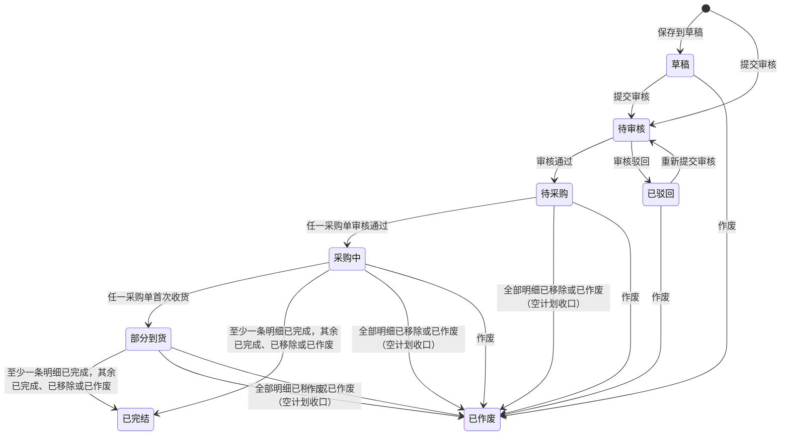
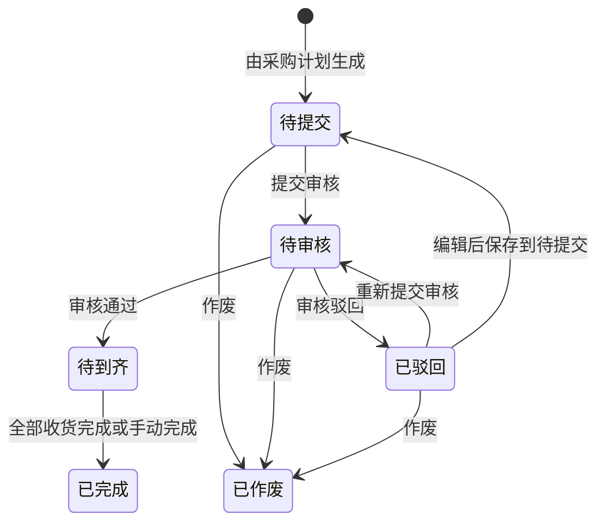
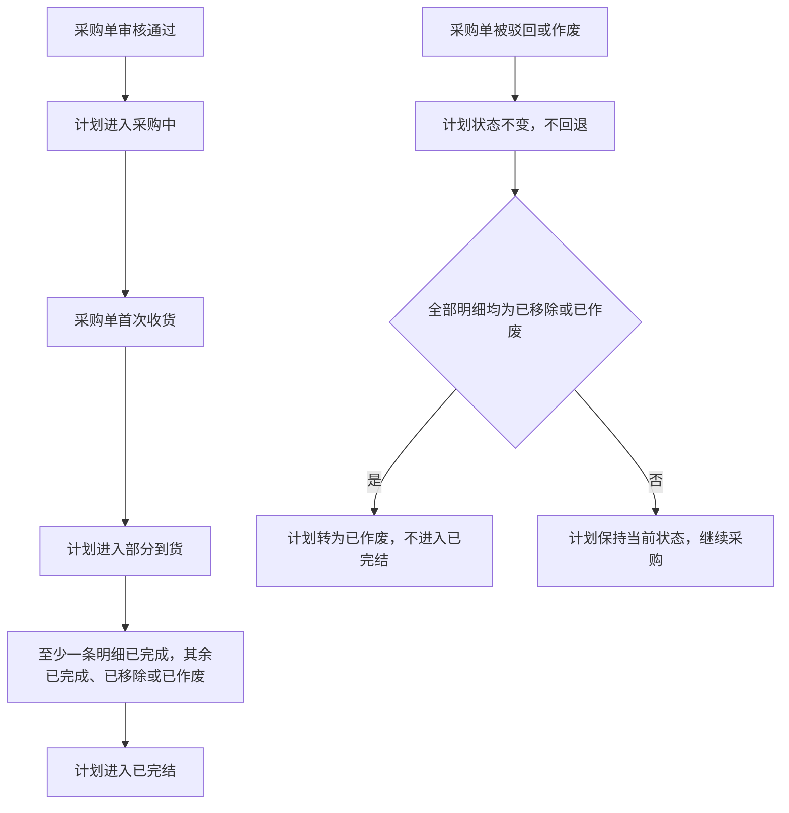

# 采购计划&采购单改造 PRD

| 项目 | 内容 |
|---|---|
| 需求名称 | 采购计划&采购单改造 |
| 文档状态 | 草稿，供业务、产品、研发、测试评审 |
| 编写日期 | 2026-10-23（2026-10-24 重排结构并补充状态机） |
| 适用范围 | 供应链中台「采购计划」页面及其与采购单的关联；采购单审核、状态页签与按钮联动、在途数量的团队货权调整 |
| 原型 | `pages/purchase-plan-2/index.html`（采购计划，业务方选定的唯一方案；目录名沿用历史路径）；`pages/purchase-orders/index.html`（采购单审核、在途货权调整） |
| 依据 | 本轮产品确认记录、当前采购计划原型、采购单审核及货权调整原型、`docs/BUSINESS_LOGIC.md` 的采购单业务说明 |

> **阅读约定**：标注“已确认”的内容来自本轮产品确认；“原型现状”只说明当前可点击样稿，不自动成为正式业务规则；“待确认”不得直接作为研发实现或验收依据。本文覆盖采购计划改造与采购单改造两部分，不替发货计划制定未确认的完整规则。

## 1. 文档说明

### 1.1 背景与目标

原型曾同时展示“按批次、一条 SKU 一个计划号”和“一个计划号包含多个 SKU”两种方案。业务方已选择后者，前者的页面和入口已移除。目标是使采购计划成为组织多 SKU 采购需求的单据，同时在明细层保留团队、采购执行和收货跟踪信息。

业务价值：减少逐 SKU 建计划的重复操作；允许不同团队需求在同一计划中管理；使计划数量、采购数量、收货数量与在途数量在 SKU 维度可追溯。

### 1.2 本次范围

- **采购计划**：创建（草稿/提交审核）、导入入口、查询、一级列表、SKU 明细、审核、生成采购单与发货计划入口、状态展示、批量操作。
- **采购单**：审核与已驳回、状态页签调整、顶部按钮联动、待提交移除 SKU、在途数量的团队货权调整。
- **不在本次范围**：采购单在外部 ERP 的收货与结算细则；发货计划的生成规则。

### 1.3 一页速读

1. 采购计划从“一个 SKU 一张单”改为**一个计划号管多个 SKU**，明细可跨团队。
2. 新建采购计划**可选“保存到草稿”或“提交审核”**；审核通过进入待采购。
3. 计划状态由采购单**自动归集**：出现第一张审核通过的采购单，整张计划才进入采购中。
4. 采购单新增**审核**（待审核 → 待到齐 / 已驳回），并把“待收货”“部分收货”合并为“待到齐”。
5. 采购单在**待提交**时可移除 SKU，回写计划打「已移除」标签，终态不可恢复；计划全部明细已收口（已移除或已作废）且无已完成时，计划转为已作废，需继续采购只能新建计划。
6. 货权调整只调在途数量的团队归属，不再填写平台、店铺、SellerSKU/ASIN。

### 1.4 阅读路径

| 角色 | 建议阅读顺序 |
|---|---|
| 研发 | 第 2 章（改什么）→ 第 3 章（状态机）→ 第 4、5 章（功能细节） |
| 业务 / 评审 | 第 1.3 节 → 第 3 章 → 第 9 章（待确认问题） |
| 测试 | 第 3 章 → 第 8 章（验收标准）→ 第 7 章（异常场景） |

## 2. 改造范围总览

### 2.1 模块分工

| 模块 | 改造性质 | 涉及页面 | 核心改动 | 详情 |
|---|---|---|---|---|
| 采购计划 | 重构 | 采购计划列表、新建/查看/编辑弹窗 | 多 SKU 单据化、草稿与审核、明细多团队、状态自动归集、已移除标识 | 第 4 章 |
| 采购单 | 新增 + 修改 | 采购单列表、详情、货权调整弹窗 | 新增审核与已驳回、合并待到齐、待提交移除 SKU、货权调整简化 | 第 5 章 |
| 跨模块联动 | 新增 | — | 采购单审核通过触发计划采购中、移除 SKU 回写计划、货权调整回链计划号 | 3.3 |

### 2.2 改造点清单

| # | 模块 | 改造点 | 类型 | 影响页面 | 确认状态 |
|---|---|---|---|---|---|
| 1 | 采购计划 | 一个计划号包含多个 SKU，取消“采购计划批次”层级 | 重构 | 列表、弹窗 | 已确认 |
| 2 | 采购计划 | 新建可选「保存到草稿」或「提交审核」 | 新增 | 新建弹窗 | 已确认 |
| 3 | 采购计划 | 计划级 8 个状态及自动归集规则 | 新增 | 列表 | 已确认 |
| 4 | 采购计划 | 明细「已移除」标识与口径 | 新增 | 二级列表 | 已确认 |
| 5 | 采购计划 | 按默认供应商拆分生成采购单 | 修改 | 列表操作区 | 已确认（仓库维度待确认） |
| 6 | 采购计划 | 新增 SKU 子弹窗、导入新建内嵌 | 修改 | 新建弹窗 | 已确认 |
| 7 | 采购计划 | 列配置分一级/二级列表 | 修改 | 列表 | 已确认 |
| 8 | 采购单 | 新增审核：待审核 → 待到齐 / 已驳回 | 新增 | 列表、详情 | 已确认（ERP 衔接待确认） |
| 9 | 采购单 | 状态页签新增「已驳回」，合并「待到齐」 | 修改 | 列表 | 已确认 |
| 10 | 采购单 | 顶部按钮随状态页签联动 | 修改 | 列表 | 已确认 |
| 11 | 采购单 | 待提交移除 SKU 并回写采购计划 | 新增 | 列表、详情 | 已确认 |
| 12 | 采购单 | 货权调整简化为调入团队 + 调入数量 | 修改 | 货权调整弹窗 | 已确认 |
| 13 | 采购计划 | 「更多 → 复制」把勾选明细带入新建采购计划弹窗 | 新增 | 列表、新建弹窗 | 已确认 |

## 3. 核心状态机

### 3.1 采购计划状态流转

状态定义：

| 状态 | 业务含义 | 确认状态 |
|---|---|---|
| 草稿 | 新建时点「保存到草稿」，未提交审核；可从列表重新打开编辑、补全明细后再提交 | 已确认 |
| 待审核 | 新建时点「提交审核」，通过 SKU、团队、计划交货日期、计划采购量校验后进入 | 已确认 |
| 待采购 | 审核通过，且该计划下尚无「审核通过」的采购单 | 已确认 |
| 采购中 | 计划下任一 SKU 对应的采购单审核通过后，整张计划进入采购中 | 已确认 |
| 部分到货 | 计划下任一采购单首次产生收货数量（收货数量 > 0）后，整张计划进入部分到货 | 已确认 |
| 已完结 | 至少一条明细为「已完成」，其余明细均为「已完成」「已移除」或「已作废」；全部明细为已移除或已作废、无一条已完成时，不进入已完结，转为已作废 | 已确认 |
| 已驳回 | 审核驳回，必须填写审核意见；可重新提交审核或作废 | 已确认；驳回后可编辑字段待确认 |
| 已作废 | 业务作废，或计划下全部明细已收口（已移除／已作废）且无一条已完成时的系统自动收口 | 已确认；作废前置条件待确认 |

流转规则：

| 当前状态 | 流转后状态 | 触发条件 |
|---|---|---|
| 新建 | 草稿 | 新建时点「保存到草稿」 |
| 新建 | 待审核 | 新建时点「提交审核」，并通过 SKU、团队、计划交货日期、计划采购量校验 |
| 待审核 | 待采购 | 审核通过 |
| 待审核 | 已驳回 | 审核驳回，必须填写审核意见 |
| 已驳回 | 待审核 | 重新提交审核 |
| 待采购 | 采购中 | 计划下出现第一张「审核通过」的采购单（任一 SKU） |
| 采购中 | 部分到货 | 计划下任一采购单首次产生收货数量（收货数量 > 0） |
| 采购中 / 部分到货 | 已完结 | 至少一条明细已完成，且其余明细均为已完成、已移除或已作废 |
| 待采购 / 采购中 / 部分到货 | 已作废 | 计划下全部明细均为「已移除」或「已作废」，空计划自动收口，不得停留在待采购、采购中或部分到货 |
| 草稿、待采购、采购中、部分到货、已驳回 | 已作废 | 业务作废（前置条件见第 9 章） |

不设置“待生成”状态。原型中单据状态与 SKU 状态的自动同步仅用于展示，正式实现必须由采购单、收货等真实业务事件驱动。

### 3.2 采购单状态流转

说明：

- 「待到齐」内部保留收货进度：**待收货**（尚未收货）与**部分收货**（已收一部分）。页面上显示为「待到齐」+ 收货进度两个标签。
- 「已驳回」为本次新增页签，位于「已作废」之后；已驳回单据编辑后可「保存到待提交」（进入待提交、不自动重提）、「提交审核」（进入待审核）或作废（进入已作废）。
- 「待审核」状态支持作废：单据在待审核阶段被作废后进入「已作废」，此后不可再审核；已作废单据不参与审核流程，也不回写为「待到齐」。
- 采购单的审核与状态细则见 5.2。

### 3.3 采购单状态 → 采购计划状态对照

| 采购单侧事件 | 采购计划状态变化 | 说明 |
|---|---|---|
| 生成采购单 | 不变（仍为待采购） | 仅生成不改变计划状态 |
| 提交采购单审核 | 不变（仍为待采购） | 待提交、待审核都不触发 |
| 任一采购单审核通过 | 待采购 → 采购中 | 整张计划立即流转，不要求全部采购单通过 |
| 任一采购单首次产生收货数量 | 采购中 → 部分到货 | 收货数量 > 0 即触发 |
| 至少一条明细已完成，其余已完成、已移除或已作废 | 采购中 / 部分到货 → 已完结 | 见 3.5 完结判定规则 |
| 采购单被驳回 | 不变 | 不触发、不回退 |
| 采购单被作废 | 不变；若因此使全部明细均为已移除/已作废且无已完成，则 → 已作废 | 计划状态不回退；对应明细的采购状态回写为「已作废」，原采购单号保留、不清空；已作废明细视为已收口，不阻碍完结，但不计为完成 |
| 采购单完成（全部收货或手动完成） | 不变（计划状态由其明细状态决定） | 对应计划明细的采购状态置「已完成」，并参与计划完结判定 |
| 待提交状态移除 SKU | 明细打「已移除」；其余明细未清空时计划状态不变 | 终态，不参与完结判定 |
| 计划全部明细已收口（已移除或已作废） | 计划由待采购/采购中/部分到货 → 已作废 | 空计划收口，不得进入已完结 |
| 一张采购单的明细被全部移除 | 该采购单自动作废 | 正常编辑流程下不允许清空（待提交编辑至少保留 1 个 SKU），此规则仅作数据异常兜底 |

### 3.4 采购计划状态 → SKU 采购状态对照

| 计划状态 | 允许的 SKU 采购状态 |
|---|---|
| 待采购 | 尚无审核通过的采购单：未生成采购单的 SKU 为待提交，已生成的可能为待提交、待审核或已驳回 |
| 采购中 | 可出现待提交、待审核、待收货、部分收货、已完成；取决于该 SKU 的采购与收货进度 |
| 部分到货 | 至少一个 SKU 已产生收货数量，其余 SKU 可处于待提交、待审核、待收货或部分收货 |
| 已完结 | 明细均为已完成、已移除或已作废，且至少一条已完成 |

明细的采购状态取值：待提交、待审核、待收货、部分收货、已完成、已作废、已驳回。其中「已作废」「已驳回」来自采购单状态回写：采购单被作废后，对应明细的采购状态置「已作废」，**原采购单号保留不清空**，便于追溯；采购单被驳回后，对应明细的采购状态置「已驳回」。

明细另有一个独立的「已移除」标识，以常驻灰色小标签形式展示在 **SKU 编码右侧**（不放入采购状态列）：仅当采购单在待提交状态移除 SKU 时置为该标识，终态不可恢复；点击标签弹气泡查看移除原因、移除人、移除时间、来源采购单号。已移除明细不参与计划完结判定，也不计入实际采购量、收货数量和采购在途合计，采购单号与采购状态显示「—」。计划下全部明细均为「已移除」时，计划转为已作废，不得进入已完结。

与「已移除」并列，「已作废」明细同样视为**已收口**：不阻碍计划完结，但不计为完成；其实际采购量按 0 计（采购单仅在待提交／待审核／已驳回状态可作废，从未审核通过，因此不进入实际采购量统计），收货数量与采购在途按 0 计，原采购单号保留用于追溯。计划下全部明细均为已移除或已作废、且无一条已完成时，计划转为已作废，不得进入已完结。

采购单状态查询中另有待审核、已作废、已驳回。采购单驳回与作废回写明细采购状态已确认（驳回→已驳回、作废→已作废、完成→已完成，采购单号均保留）；采购单其余状态与明细状态的映射见 3.3。

### 3.5 状态判定硬规则

1. **结果导向判定**：计划处于「待采购」，等价于该计划下不存在任何一张「审核通过」的采购单；与采购单当前处于待提交、待审核、已驳回还是已作废无关。采购单仅生成或仅提交审核，不改变计划状态。
2. **状态单向，不回退**：采购单后续被驳回、作废或状态继续变化，不使计划退回前一状态。已进入采购中、部分到货的计划不会退回待采购；但明细自身状态必须如实回写（驳回→已驳回、作废→已作废、完成→已完成），且采购单号保留不清空。
3. **完结判定**：计划下至少一条明细为「已完成」，且其余明细均为「已完成」「已移除」或「已作废」时，计划才进入已完结。已移除与已作废明细均视为已收口、不阻碍完结，但不计为完成；存在任一未生成采购单、未采购完成且未被收口的明细，计划不得进入已完结，保持当前状态，由采购人员继续生成采购单。
4. **明细移除**：仅采购单「待提交」状态允许移除 SKU，入口在「编辑采购单」弹窗的明细行；点「移除」在按钮旁弹小气泡填写移除原因（必填文本，≤200 字，无预设原因选项），点「确定移除」立即生效且不回退。移除后回写采购计划，对应明细在 SKU 编码右侧打常驻「已移除」标签并记录移除人、移除时间、来源采购单号和原因（点击标签以气泡查看）。采购单至少保留 1 个 SKU。已移除为终态，不可恢复，不参与完结判定；如需重新采购，只能新建采购计划，不提供恢复、回流或重新生成采购单的入口。
5. **全部收口**：计划下全部明细均已收口（「已移除」或采购状态为「已作废」）且无一条「已完成」时，计划由待采购／采购中／部分到货自动转为**已作废**（空计划不得停留在上述任一状态，更不得进入已完结）；此时计划采购量保留原值作留痕，实际采购量、收货数量、采购在途均为 0。该自动作废不通知计划负责人。
6. **空采购单**：正常编辑流程下，待提交采购单至少保留 1 个 SKU，不允许清空；「明细全部移除后自动作废」仅作为数据异常兜底规则保留，不应通过任何产品入口触发。
7. **计划状态自动归集**：不提供人工切换状态；原型中的状态同步仅用于展示。

## 4. 采购计划改造

### 4.1 页面结构

#### 4.1.1 查询区

- 编码类型单选：SKU、供应商料号、领星 SKU、FNSKU；编码输入支持多个。
- 单号类型单选：采购计划号、采购单号；相邻输入框支持多个单号。
- 其他查询项：采购仓、采购员（多选）、供应商、品名、是否加急（单选：是/否）、平台、国家、店铺、团队、计划负责人、时间范围；展开区含发货单号和计划备注。多选下拉的占位文案不出现“可多选”。计划负责人沿用原“创建人”口径，人员取值为计划创建账号。
- 查询区默认（含“展开/查询/重置”按钮行）最多展示两行，按钮组必须落在第二行内；第三行起的查询项收进“展开”，点击后才显示，规则详见 UI_SPEC 3.9.5/3.9.6。
- 查询、重置、展开/收起的具体组合逻辑以页面原型为交互参考；多值最大数量、模糊匹配范围及时间口径待确认。

#### 4.1.2 一级列表：采购计划

一级列表展示采购计划号、计划负责人、备注、创建时间和计划状态；不设置操作列。计划号以蓝色链接样式展示但**不加粗**，点击后：草稿状态进入「编辑采购计划」弹窗继续补全明细，其他状态进入「查看采购计划」弹窗；明细内容也可直接展开二级列表浏览。备注显示内容及编辑图标，点击图标在附近弹出小型输入区并提供取消、确定。状态页签包括全部、草稿、待审核、待采购、采购中、部分到货、已完结、已驳回、已作废；不设待生成。计划状态由采购单审核通过、收货、采购单完成等业务事件自动归集，页面不提供人工改状态的操作，规则见 3.5。

勾选一级计划代表选中其下全部明细；展开按钮与勾选框对齐。若只勾选部分二级明细，一级勾选框呈半选。一级列表高度保持紧凑，不在表头或单元格展示冗余的数量、金额合计。

#### 4.1.3 二级列表：SKU 明细

默认字段及顺序以当前列配置为基准：SKU、领星 SKU、品名、团队、计划采购量、实际采购量、差异数量、收货数量、采购在途、采购单、采购状态、SKU 备注、期望到货日期、平台、店铺、FNSKU、国家、运营负责人、采购仓库、采购员、供应商、供应商料号、最小起订量、交期、箱数。

- 二级明细可逐行勾选；表头不设置二级“全选”勾选框。勾选框须与一级左对齐。
- 二级列表前部的 SKU、领星 SKU、品名、团队固定，不参与横向滚动；无二级操作列。
- 二级明细不做行内合计行；数量类合计统一在列表底部汇总条展示（见 4.1.4），按当前查询结果的全部明细计算，不受分页影响。
- 差异数量在明细行保留方向：每行显示「实际采购量－计划采购量」，负数为欠采、正数为超采，负数沿用红色普通字重；实际采购量为空的明细显示「—」。
- 底部汇总条中的差异数量取各明细差值的绝对值之和；已移除明细不计入差异数量合计。
- 组合品的共享字段和成员独立字段按 4.5 呈现；合计时不得重复计入组合品父项及子项。
- 「采购员」为采购单维度字段：明细展示其生成的采购单上的采购员，同一采购单对应同一采购员；未生成采购单的明细采购员显示「—」。采购员查询项按明细关联的采购单采购员过滤。
- 明细的「已移除」展示口径见 4.3。

#### 4.1.4 底部汇总条与分页

- 列表底部为汇总条与分页区：左侧为汇总，右侧为分页（每页条数、页码、上下翻页）。
- 汇总条按**当前查询结果的全部采购计划及其明细**计算，跨页合计，不受当前页码影响；查询、筛选、重置后实时更新。
- 汇总内容：计划数、SKU 数、计划采购量、实际采购量、差异数量、收货数量、采购在途；差异数量取各明细差值的绝对值之和，已移除明细不计入。
- 已移除明细：计划采购量仍计入汇总，实际采购量、收货数量、采购在途按 0 计入。

### 4.2 新建、查看与编辑弹窗

- 弹窗约 1200px 宽，随视口缩放；顶部展示不可修改的计划负责人和可输入的计划备注。
- 明细表前四列（SKU、领星 SKU、品名、团队）固定在左侧，横向滚动时不移动；新建、复制、编辑、查看共用同一弹窗组件，四列固定规则一致生效。
- 明细表格左上方依次放置“添加 SKU”“导入新建”。“添加 SKU”打开独立小弹窗，仅按 SKU、品名检索并勾选加入；结果列为 SKU、带小图的品名，不展示团队和在库量，行高采用紧凑样式。加入后在主弹窗明细中编辑。明细表头在未选 SKU 时仍应可见。“导入新建”在不关闭、不清空新建采购计划弹窗的前提下，叠加打开现有较小的导入弹窗；关闭导入弹窗后返回原新建内容。列表上方不再保留导入按钮。
- 新建弹窗明细字段顺序：SKU、领星 SKU、品名（含小图）、团队、计划采购量、计划交货日期、平台、店铺、FNSKU、国家、运营负责人、箱规数量、箱数、采购单价、采购计划备注、默认供应商、供应商料号、操作（移除）。其中“采购计划备注”是每个 SKU 独立填写的明细备注，与弹窗顶部整张计划的“备注”不同。
- FNSKU 从当前 SKU 对应的选项中单选；箱规数量、采购单价从商品资料自动带出，在新建弹窗中只读。底部“保存到草稿”允许稍后补全明细；“提交审核”须校验 SKU、团队、计划交货日期和计划采购量，成功后进入待审核。草稿可从列表中的采购计划号重新打开编辑。
- 主弹窗明细按商品识别、计划填写、销售归属、采购信息组织，操作列固定在右侧；保存与取消按钮放在弹窗右下角。
- SKU、领星 SKU、供应商料号应由商品数据带出，后两者在新建明细中不要求手动输入；不在新建时要求填写供应商，由 SKU 默认供应商规则处理。
- 计划负责人默认登录账号。必填字段目前原型校验团队、计划交货日期、计划采购数量；正式必填、数值范围、日期限制、保存后可编辑字段见第 9 章。
- 可编辑范围：仅「草稿」可编辑（含明细增删与计划采购量修改）；采购计划一经审核通过（待采购、采购中、部分到货、已完结、已作废）不再提供编辑入口，计划采购量不可修改；「已驳回」可重新提交审核，是否允许修改字段见第 9 章。

### 4.3 明细「已移除」标识

**触发方式**：仅当采购单处于「待提交」状态时，在「编辑采购单」弹窗的采购明细行点「移除」，于按钮旁的小气泡中填写「移除原因」并确定，即立即生效（不回退）并回写本计划明细。移除原因为必填文本（上限 200 字，不设预设原因选项），未填写不得提交；采购单至少保留 1 个 SKU。计划侧不提供“移除明细”入口，系统管理员也不得手工置为已移除。

**展示要求**：

| 项 | 规则 |
|---|---|
| 标签 | 「已移除」灰色小标签展示在二级明细的 **SKU 编码右侧**（不放入采购状态列），常驻可见 |
| 详情 | 点击标签弹出气泡，展示移除原因、移除人、移除时间、来源采购单号；再点空白处或按 Esc 关闭 |
| 计划采购量 | 保留原值，作为原始需求留痕 |
| 实际采购量 / 收货数量 / 采购在途 | 均为 0 |
| 差异数量 | 显示「—」，不显示负数红字 |
| 采购单号 / 采购状态 | 显示「—」 |
| 底部汇总条 | 计划采购量仍计入；执行类合计按 0 计 |
| 恢复 / 重新采购 | 终态，不提供恢复入口，也不提供重新生成采购单的入口；需继续采购只能新建采购计划 |
| 状态影响 | 不参与计划完结判定；计划下全部明细均已收口（已移除或已作废）且无已完成时，计划转为已作废，见 3.5；该自动作废**不发送通知**给计划负责人 |

**「已作废」明细的同类规则**：采购单在待提交／待审核／已驳回状态被作废后，对应计划明细的采购状态回写为「已作废」，原采购单号保留不清空（区别于已移除的「—」）。已作废明细与已移除同属**已收口**：不阻碍计划完结但不计为完成；实际采购量、收货数量、采购在途按 0 计；不提供恢复入口，亦不提供重新生成采购单的入口。

### 4.4 采购单生成与关联

已确认：采购单拆分依据 SKU 的默认供应商，不以明细团队作为拆分依据；一张采购计划可以关联多张采购单，采购单明细必须反向保留计划号、SKU 及团队来源。团队可能影响后续 ERP 路由或权限，但不能被误写成采购单的拆单依据。

现有采购单业务说明还提出“相同供应商＋相同采购仓库合并、任一不同则拆分”。该规则与“按默认供应商拆单”可以兼容，但用户只明确确认了供应商维度，因此采购仓库是否也作为拆单键仍待业务确认。组合品成员若对应不同供应商，生成采购单时的父子关联方式也待确认。

采购计划与发货计划、采购单、收货结果的关联应采用稳定 ID 与明细 ID，不仅凭 SKU 文本匹配；同一计划中重复 SKU 或同一 SKU 不同团队不得相互覆盖。

关于「一条计划明细关联多张采购单」：当前业务场景下，一个计划明细的 SKU 只向一个供应商采购，即一条明细只对应一张有效采购单；本轮不额外增加唯一性约束，但换供应商、移除 SKU 等操作必须保证不产生同一明细同时挂两张有效采购单。若未来出现一条明细分多供应商采购的场景，需另补拆单与数量校验规则。

采购单在途数量的团队归属调整属于采购单侧动作，不改变采购计划的计划采购量、实际采购量、收货数量，也不改变采购在途总量；调整记录必须保留采购计划号。调整后的团队拆分如何回显到计划明细，见 5.7 及第 9 章。

### 4.5 字段与数据规则

计划级公共字段：

| 字段 | 已确认口径 | 待确认点 |
|---|---|---|
| 采购计划号 | `PP`＋年月日 6 位＋4 位流水号，例如 `PP2610230001`，不带横杠；同一天顺延，换日重新计数 | 并发唯一性、跨时区、删除后是否复用 |
| 计划负责人 | 新建默认当前登录账号，界面置灰不可修改 | 历史数据缺失时的回填方式 |
| 计划备注 | 单据公共字段，列表内小弹层编辑 | 长度、修改权限、审核后可否修改 |

明细字段：

| 字段 / 指标 | 已确认口径或来源 | 待确认点 |
|---|---|---|
| SKU / 品名 / 领星 SKU | 选 SKU 后从商品资料带出 | 商品资料更新后是否同步历史计划 |
| 团队 | 一张计划可含多个团队；明细必填 | 可选团队的数据权限与失效团队处理 |
| 计划采购量 | 用户填写、数值型；底部汇总条合计 | 单位、小数精度、组合品父子数量关系 |
| 实际采购量、收货数量、采购在途 | 来源采购执行与收货结果；底部汇总条分别合计 | 回写源、更新时间、超收和负数处理 |
| 实际采购量口径 | **只计已审核通过的采购单的采购数量**；采购单处于待提交、待审核、已驳回、已作废时不计入实际采购量（明细显示「—」或 0），因此差异数量随之计算 | 无 |
| 差异数量 | 明细行取「实际采购量－计划采购量」并保留正负（负数标红）；合计取各明细差值的绝对值之和；未采购显示「—」，已移除不计入 | 无 |
| 明细状态 | 正常 / 已移除。仅采购单在待提交状态移除 SKU 时置为已移除，并记录移除人、移除时间、来源采购单号和原因；终态不可恢复，不参与计划完结判定 | 无 |
| 加急标识 | 明细级布尔值。由「更多 → 加急」设置，随明细传递到采购单并在采购单明细行展示；不改变采购单状态、排序与拆单 | 能否取消、操作权限、是否影响排序 |
| 期望到货日期 | 逐 SKU 维护 | 是否允许早于创建日期、与采购单日期冲突处理 |
| 平台、店铺、FNSKU、国家、运营负责人 | 销售归属与运营属性 | 字段来源、级联关系、变更历史 |
| 采购仓库 | 逐 SKU 维护 | 是否参与拆单、跨仓同供应商能否合并 |
| 默认供应商、供应商料号、最小起订量、交期 | 商品/供应商资料带出；生成采购单需用默认供应商 | 无默认供应商、多个默认供应商、资料失效处理 |
| 采购单号、采购状态、采购计划备注（SKU 级） | 采购单关联及每个 SKU 独立填写的备注；不同于计划级备注 | 一明细多采购单、备注写入权限与状态回写规则 |
| 箱数 | 页面展示及汇总 | 箱规缺失、非整箱、组合品计算口径 |

组合品规则：明细中采购计划关联、SKU、领星 SKU 按组合品合并展示；成员行展示独立的采购与收货数据。团队、期望到货日期、平台、店铺、FNSKU、国家、运营负责人在成员行可分行显示，但同一组合品的值保持一致。

采购金额、单价若参与采购计划保存或后续汇总，币种、税别、精度、汇率及与采购单金额的关系必须另行确认；不得以原型中的 `¥` 展示值作为财务结算口径。

### 4.6 操作区与列配置

页面列表上方操作区包含新建采购计划、生成采购单、审核、作废、导出和“更多”；“导入新建”移至新建弹窗内。“更多”显示复制、加急、删除；复制规则见 4.8，加急规则见 4.7。

删除规则：仅「草稿」和「待审核」状态的采购计划支持删除明细；勾选的明细中只要有一条所属计划不在这两个状态，整批拒绝并提示，不删除任何明细。采购计划审核通过（待采购及之后的所有状态）后不得删除任何明细，也不提供删除入口。删除作用于选中的二级 SKU 明细，必须二次确认，不能误删一级计划。

列配置入口位于列表上方按钮区右侧。配置面板分“一级列表”“二级列表”，支持选择显示字段、调整已选列顺序、恢复默认和保存应用；无模板功能。锁定列的范围与跨设备持久化方式待确认。

导入创建目前仅有原型入口与说明，不代表导入模板、字段映射、部分成功策略已经确定。

### 4.7 加急标识

| 项 | 规则 |
|---|---|
| 标识层级 | SKU 明细级，不作用于一级采购计划 |
| 打标入口 | 列表上方「更多 → 加急」，作用于已勾选的二级 SKU 明细，支持批量 |
| 计划侧展示 | 二级明细行的 SKU 后展示红色「加急」标签 |
| 生成采购单 | 加急标识随明细带入采购单：由加急明细生成的采购单明细行，在 SKU 后同样展示「加急」标签；未加急明细不展示 |
| 采购单影响范围 | 不改变采购单状态、状态页签、排序及拆单规则（仍按默认供应商拆分）；采购单本身不显示整单加急标识，也不因加急改变审核或收货流程 |
| 取消加急 | 待确认，见第 9 章 |
| 操作权限与留痕 | 待确认，见第 9 章 |

加急标识属于采购计划的明细属性，与「已移除」标识相互独立：已移除明细不再参与采购单生成，因此不产生加急传递。

### 4.8 复制明细新建计划

复制用于“不想点新建、也不想走导入，直接从已有计划里挑几行明细再建一张新计划”的场景。

| 项 | 规则 |
|---|---|
| 入口 | 列表上方「更多 → 复制」 |
| 前置条件 | 至少勾选 1 条二级 SKU 明细；勾选一级计划等价于选中其下全部明细；未勾选时提示且不打开弹窗 |
| 勾选范围 | 支持跨多张采购计划勾选明细，合并带入同一张新计划 |
| 组合品处理 | 组合品按一条明细处理：勾选组合品即把整条组合 SKU 带入新计划并保留其成员组成，不拆成成员行，避免父子重复计入 |
| 弹窗 | 复用「新建采购计划」弹窗，不另做复制弹窗；带入后用户可继续修改、删除明细或再添加 SKU |
| 带入字段 | 按明细逐行带入：SKU、领星 SKU、品名、团队、计划采购量、计划交货日期、平台、店铺、FNSKU、国家、运营负责人、箱规数量、箱数、采购单价、采购计划备注、默认供应商、供应商料号。团队与默认供应商取各自原明细的值，不统一覆盖 |
| 不带入 | 实际采购量、差异数量、收货数量、采购在途、采购单号、采购状态、已移除标识、加急标识 |
| 计划级字段 | 计划负责人取当前登录账号，不继承原计划负责人；计划备注留空，由用户重新填写 |
| 提交方式 | 底部「保存到草稿」「提交审核」与新建流程完全一致，校验规则相同（SKU、团队、计划交货日期、计划采购量） |
| 计划号 | 生成新的采购计划号，与原计划无关联，不继承原计划号 |
| 原计划影响 | 只读复制，不改变原计划任何数据 |

## 5. 采购单改造

### 5.1 列表与状态页签

- 状态页签：全部、待提交、待审核、待到齐、已完成、已作废、已驳回；其中「待到齐」同时归集收货进度为「待收货」和「部分收货」的采购单，不再单列这两个页签。
- 状态页签和查询枚举在「已作废」之后增加「已驳回」。
- 二级列表（采购明细）的前三列固定在左侧，不参与横向滚动；默认列顺序下为 SKU、采购计划、品名。列配置调整顺序后，固定范围随之变为新的前三列；其余列正常横向滚动。
- 采购单明细行在 SKU 后展示「加急」标签，来源为采购计划明细的加急标识，规则见 4.7；未加急明细不展示。
- 行内操作列按状态展示：全部状态展示「查看」「日志」；「编辑」仅在待提交、已驳回状态展示（原「修改」按钮统一更名「编辑」，弹窗标题为「编辑采购单」）；「提交审核」仅在待提交状态展示；「收货」在待收货、部分收货状态展示。
- 已驳回采购单支持编辑：编辑弹窗与待提交编辑一致，底部提供「保存到待提交」（保存后状态回到待审核前的待提交）与「提交审核」（保存并进入待审核）两个出口；待提交状态编辑保存后状态不变。可修改字段范围见第 9 章待确认。
- 查询区沿用单据清单的通用查询结构，具体查询项以采购单原型为准。

### 5.2 审核与驳回

采购单在「待审核」状态支持审核，入口为采购单页面操作区的「审核」。审核仅对选中的待审核采购单生效，其他状态不进入审核流程。

| 审核结果 | 流转后状态 | 规则 |
|---|---|---|
| 通过 | 待到齐（收货进度：待收货） | 支持单张或批量审核；审核意见可留空 |
| 驳回 | 已驳回 | 必须填写审核意见；记录驳回原因、审核人和审核时间 |

- 审核通过后进入待到齐，初始收货进度为待收货，不再停留在待审核。
- 审核动作须记录审核人、审核时间、审核结果和审核意见，供列表和详情追溯。
- 审核仅允许待审核状态；非待审核采购单不得提交审核。
- 已驳回单据支持编辑，编辑后可「保存到待提交」（回到待提交）或「提交审核」（进入待审核），也可作废（进入已作废）。
- 待审核单据支持直接作废（进入已作废），作废后不得再审核；作废须二次确认并记录操作人与时间。
- 中台审核与外部 ERP 审批的关系、已驳回后具体可修改字段待确认，见第 9 章。

### 5.3 顶部按钮与状态页签联动

切换采购单状态页签时，仅改变顶部操作按钮的显示范围。显示的按钮始终保持可点击，不因当前未勾选单据而置灰；点击需要选中单据的按钮时，校验选择数量及每张单据的状态，不符合条件则给出明确提示且不执行操作。切换至「全部」时展示全部七个按钮。

| 状态页签 | 顶部展示按钮 |
|---|---|
| 全部 | 新建采购单、批量收货、审核、作废、提交审核、采购运费分摊、货权调整 |
| 待提交 | 新建采购单、作废、提交审核 |
| 待审核 | 新建采购单、审核、作废 |
| 待到齐 | 新建采购单、批量收货、采购运费分摊、货权调整 |
| 已完成 | 新建采购单、采购运费分摊 |
| 已作废 | 新建采购单 |
| 已驳回 | 新建采购单、作废、提交审核 |

「审核」仅接受待审核采购单；「作废」接受待提交、待审核或已驳回采购单；「提交审核」接受待提交或已驳回采购单。混选不符合条件的单据时整批拒绝，不跳过个别单据。已驳回采购单重新提交审核后进入待审核；待提交、待审核、已驳回单据作废后均进入已作废。批量收货及其他操作仍须按各自业务规则校验，按钮可见不代表所选单据一定可执行。

### 5.4 待提交移除 SKU

| 项 | 规则 |
|---|---|
| 入口 | 「编辑采购单」弹窗（待提交状态）采购明细行操作列的「移除」；二级列表不新增操作列 |
| 允许状态 | 仅待提交；待审核、待到齐、已完成、已驳回、已作废均不可移除（已驳回的「编辑」弹窗中移除会被拦截并提示） |
| 移除原因 | **必填**文本，≤200 字，不设预设原因选项；点击「移除」在按钮旁弹出小气泡（与编辑备注同款），填写后点「确定移除」；未填写不得提交 |
| 生效时机 | 气泡点「确定移除」**立即生效**，不可撤销：该 SKU 从采购单移除、重算采购单数量与金额、回写采购计划明细为「已移除」，并即时刷新列表 |
| 至少保留 | 采购单至少保留 1 个 SKU；只剩 1 条时点移除提示「采购单至少保留 1 个 SKU，如需整单取消请使用作废」，不做移除 |
| 回写计划 | 对应采购计划明细在 SKU 编码右侧打常驻「已移除」标签，记录移除人、移除时间、来源采购单号和原因，点击标签以气泡查看；计划采购量保留，执行类数据置 0，详见 4.3 |
| 计划状态 | 其余明细未清空时计划状态不变、不回退；计划下全部明细均被移除时，计划由待采购转为已作废，且不通知计划负责人 |
| 恢复 | 已移除为终态，不提供恢复入口，也不提供重新生成采购单的入口；如需继续采购需新建采购计划 |

### 5.4.1 更换供应商（修改 SKU 的供应商）

采购单按供应商拆单，一张采购单只对应一个供应商，因此“更换某个 SKU 的供应商”本质是把该 SKU 转移到新供应商的单据，不允许在原单上直接改供应商字段。

| 项 | 规则 |
|---|---|
| 入口 | 「编辑采购单」弹窗（待提交状态）采购明细每行的「操作」列新增「更换供应商」，位于「移除」左侧；明细表不做勾选列，二级列表不新增工具栏按钮，已驳回、待到齐等其他状态不展示该入口 |
| 表单头供应商 | 编辑态「采购单资料」的供应商字段为**只读**，不可直接修改，避免绕过拆单规则；如需更换供应商只能在明细行使用「更换供应商」 |
| 气泡交互 | 点行内「更换供应商」在该行旁弹出小气泡：展示该 SKU、新供应商下拉（默认带出原单供应商）、落单预览；**采购仓沿用原单**；点「确定」立即生效 |
| 落单预览 | 实时提示结果：「该 SKU 将并入 XX 单（供应商 · 采购仓）」或「将新建采购单（供应商 · 采购仓），转入该 SKU」；用户在确认前即可知道结果 |
| 落单规则 | 按「同供应商 + 同采购仓 + 待提交」匹配唯一目标单；命中则并入，未命中则新建 |
| 并入场景 | 目标单已有相同 SKU 时合并采购数量，否则在目标单逐条追加明细；随后重算目标单数量与金额 |
| 新建场景 | 无匹配目标单时，新建一张待提交采购单，继承原单的采购仓、采购员、采购主体、结算方式、税率，运费/优惠金额/其他费用置 0，仅替换供应商并带入该 SKU |
| 原单处理 | 该 SKU 从原单移除并重算数量金额；若原单仅剩这一个 SKU（更换后原单将无 SKU），禁止更换并提示「更换后本单将无 SKU，如需整单取消请使用作废」 |
| 单价 | 沿用原采购单价，不自动取新供应商报价，可在新单内手动修改 |
| 计划影响 | 采购计划明细的采购单号、采购员指向新单；计划状态不回退（待采购/采购中保持） |
| 留痕 | 操作日志记录「SKU：原供应商 → 新供应商」、操作人与时间 |
| 不做的事 | 不修改采购仓、不自动合并两张采购单、不连带改动收货与在途数据 |

### 5.5 批量编辑

> **当前状态：本期暂不开放**。页面已隐藏「批量编辑」入口，功能逻辑保留在原型中，后续开放时仅需恢复入口按钮。以下规则作为后续开放的实现依据。

- 入口与范围：顶部「提交审核」右侧新增「批量编辑」按钮，仅「待提交」状态页签展示；勾选一张或多张待提交采购单后点击打开「批量编辑采购单」弹窗；勾选中含非待提交采购单时整批拦截并提示对应单号，未勾选时提示先勾选。
- 弹窗布局：左侧为采购单导航，逐项显示采购单号、供应商名称、采购员，点击切换右侧编辑区；右侧编辑区与单张「编辑采购单」弹窗同构（采购单资料 + 采购明细），顶部标明当前编辑单号；左侧导航每一项提供「移除」按钮。
- 暂存机制：右侧修改实时暂存，切换导航不丢失；导航项副标题随供应商、采购员的修改同步刷新。
- 移除语义：「移除」仅将该采购单从本次批量编辑中移除，单据本身状态不变、不保存不提交；移除当前编辑单时自动切换到导航第一张；全部移除后弹窗关闭并提示，本次编辑不生效。
- 底部操作：底部提供「取消」「保存到待提交」「提交审核」——「保存到待提交」把导航剩余全部采购单保存且状态保持待提交；「提交审核」把剩余全部采购单保存并进入待审核；「取消」关闭弹窗，本次修改全部丢弃。
- 校验：点「保存到待提交」或「提交审核」时逐张校验必填项（供应商、采购仓、采购员、采购主体、结算方式）；存在缺失时整体拦截，提示对应单号，弹窗自动定位到该单，补全后可再次提交。
- 生效范围：批量保存/提交仅作用于点击时导航中剩余的采购单；保存内容与单张「编辑采购单」一致（基础信息 + 明细的采购数量、采购单价、备注）。

### 5.6 待到齐与收货进度展示

- 一级列表的采购单状态标签显示「待到齐」，其后另显示收货进度标签「待收货」或「部分收货」，让用户仍能辨认是否已有部分收货。其他状态维持原有单标签展示。
- 兜底规则：页签气泡数量为两类采购单数量之和；点击「待到齐」后，列表同时展示这两类采购单，不遗漏其中任一类。
- 本次合并的是页面展示与筛选口径，不抹除原有收货进度信息。是否允许收货、收货数量校验及收货后的进度变化继续依据实际收货数据判断；全部收货后的完成流转沿用原规则。
- 采购单完成（全部收货完成或手动完成）后，对应采购计划明细的采购状态回写为「已完成」，并参与计划完结判定；采购单号保留。手动完成时未收货差额的处理方式见第 9 章。

### 5.7 在途货权调整

#### 5.7.1 定位与边界

- 入口：采购单页面操作区的「货权调整」。
- 调整对象：采购单下 SKU 的**采购在途数量**，即把在途数量从来源团队调整到调入团队。
- 不改变：采购数量、计划采购量、实际采购量、收货数量、仓库位置、采购价格及金额；不生成采购单或发货单。
- 只有当前可调整在途数量大于 0 的 SKU 可进入查询结果；在途为 0 的 SKU 不允许调整。
- 采购计划号作为来源追溯字段展示并写入调整记录，不因调整修改原采购计划单据。

#### 5.7.2 弹窗结构

弹窗标题为「采购单（在途数量）货权调整」，包含「在途货权调整」「调整记录」两个页签。

**在途货权调整**

| 查询项 | 规则 |
|---|---|
| 中台采购单号 | 单值模糊查询 |
| SKU | 支持输入多个，按空格、逗号、中文逗号或分号分隔 |
| 团队 | 多选，按来源团队过滤 |
| 查询 / 重置 | 查询仅返回可调整数大于 0 的行；重置清空查询条件和调整列表 |

明细表字段：

| 列 | 说明 |
|---|---|
| 来源 SKU | 固定在左侧 |
| 采购单号 | 展示中台采购单号，并附领星采购单号 |
| 采购计划 | 采购计划号，用于追溯 |
| 品名 | 商品名称 |
| 来源团队 | 调整前的团队归属 |
| 采购数 / 在途数 / 可调整数 | 采购数量、当前在途数量、本次可调整上限；可调整数等于当前可用在途数量 |
| 调入团队 | 目标团队，逐行选择 |
| 调入数量 | 逐行填写，固定在右侧 |
| 操作 | 固定在右侧，仅提供移除当前行 |

批量工具栏：

| 操作 | 规则 |
|---|---|
| 调入团队 + 应用到勾选 SKU | 将目标团队应用到已勾选行；未勾选时提示且不执行 |
| 按可调整数填充勾选行 | 将已勾选行的调入数量填充为可调整数；未勾选时提示 |

底部与提交：

- 底部展示已选 SKU 数、计划调入总数，并提供重置、取消、确认调整。
- 点击确认调整后先校验全部明细，再弹出二次确认；确认内容展示 SKU 数、调入总数量和调入团队。
- 提交成功后更新在途数量的团队归属并生成调整记录；原型提交后自动切换到「调整记录」页签。
- 提交失败时保留弹窗内容和已填写数据，提示失败原因并允许重试。
- 调整页存在未保存内容时关闭弹窗需二次确认；「调整记录」页签关闭不提示。

**调整记录**

| 查询项 | 规则 |
|---|---|
| 中台采购单号 | 单值模糊查询 |
| SKU | 支持多个 |
| 调出团队 | 多选 |
| 调入团队 | 多选 |

记录列表字段：采购单号（固定左侧）、采购计划、SKU、品名、来源团队、调整方向、调入团队、调整数量、操作人、调整时间。列表按 8 条/页分页并展示总条数。调整记录为只读，不提供编辑或撤销入口。

#### 5.7.3 与旧版货权调整的差异

- 删除调入平台、调入店铺、调入 SellerSKU/ASIN；调入团队成为唯一目标归属字段，不再有公共库存的特殊分支。
- 查询单号收敛为「中台采购单号」，不再提供易仓单号、领星单号、采购跟踪号的类型切换。
- 新增「调整记录」页签及按单号、SKU、调出团队、调入团队查询。
- 新增批量设置调入团队、按可调整数填充勾选行、关闭前未保存提示。
- 保留来源 SKU、采购单号、采购计划、品名、来源团队、采购数、在途数、可调整数等原有信息列。

> 本节所述字段简化以本轮原型为准。既有《采购单货权调整弹窗 PRD》中的平台、店铺、SellerSKU/ASIN 规则已不再适用，正式评审后应同步修订该文档。

#### 5.7.4 校验与提交规则

| 场景 | 规则 |
|---|---|
| 调入团队 | 必填；不得与来源团队相同 |
| 调入数量 | 正整数；1 ≤ 调入数量 ≤ 可调整数 |
| 批量应用 | 未勾选 SKU 时提示，不修改任何行 |
| 按可调整数填充 | 未勾选 SKU 时提示；勾选行的数量置为各自可调整数 |
| 二次确认 | 提交前展示 SKU 数、调入总数、调入团队 |
| 提交成功 | 来源团队在途减少 N，调入团队在途增加 N；生成调整记录并提示成功 |
| 提交失败 | 保留弹窗内容，提示原因并允许重试 |
| 并发 | 提交时以服务端最新在途数量校验，避免超调 |

#### 5.7.5 与采购计划的关系

- 调整记录必须保存采购计划号，可从记录追溯到对应采购计划。
- 调整不改变计划的计划采购量、实际采购量、收货数量，也不改变采购在途总量；仅改变在途数量的团队归属。
- 同一计划明细发生跨团队调整后，计划明细如何展示团队拆分（原行拆分或新增团队子行）待确认。
- 计划列表按团队筛选、按团队统计时，是否使用调整后的团队归属待确认。
- 计划状态（采购中、部分到货、已完结）不因货权调整自动变化；如需联动须另行确认。

#### 5.7.6 权限与审计

- 服务端须校验操作权限、采购单状态、SKU 是否属于该采购单及最新可调整在途数量；前端隐藏按钮不作为权限控制。
- 调整记录至少包含：采购单号、采购计划号、SKU、来源团队、调入团队、调整数量、操作人、操作时间。
- 调整记录的保留期限、是否允许撤销或反向调整、是否支持导出待确认。

#### 5.7.7 原型现状提醒

- 弹窗使用模拟采购单、采购计划号和在途数据；提交仅生成本地调整记录，不写回采购单或供应商库存。
- 原型底部「已选」当前按查询结果行数展示，正式实现应按实际勾选行数统计。
- 原型调入团队选项中仍包含「公共库存」；是否允许调入公共团队需结合库存中心 2.0 方向确认，见第 9 章。

## 6. 角色与权限

| 角色 | 预期能力 | 状态 |
|---|---|---|
| 计划创建人 / 计划负责人 | 创建、查看本人计划及明细；新建时负责人取当前账号。 | 默认值已确认；可编辑范围、数据范围待确认。 |
| 审核人 | 审核、驳回待审核计划。 | 页面入口已存在；岗位、审核链、是否可审核本人单据待确认。 |
| 采购单审核人 | 审核、驳回待审核采购单。 | 入口已具备；岗位、权限、是否可审核本人单据待确认。 |
| 采购人员 | 生成采购单并查看关联与执行数据。 | 业务方向已确认；操作权限与范围待确认。 |
| 系统管理员 | 导入、导出、删除、作废、列配置等。 | 页面有入口；各操作权限待确认。 |

权限必须区分“能看到按钮”和“服务端允许执行”。正式实现需校验团队、仓库及单据归属的数据范围，并记录越权失败，不得只依赖前端隐藏按钮。

## 7. 异常、审计与系统影响

| 场景 | 应关注的处理要求 | 当前结论 |
|---|---|---|
| SKU 无默认供应商 | 不得悄悄生成错误采购单；需指出具体 SKU。 | 提示方式及是否允许跳过待确认。 |
| 同一计划重复 SKU / 不同团队同 SKU | 保持明细唯一身份与团队归属，不能按 SKU 合并覆盖。 | 是否允许重复录入待确认。 |
| 组合品成员不同供应商 | 拆单后仍能追溯组合品父项。 | 拆分与数量规则待确认。 |
| 部分明细生成成功、部分失败 | 保留成功关联及失败原因，避免重复生成。 | 事务与重试策略待确认。 |
| 删除二级明细 | 二次确认，不误删一级计划；仅「草稿」「待审核」可删除明细，采购计划审核通过后不得删除、也不提供删除入口。 | 已确认。 |
| 采购单待提交移除 SKU | 移除时必填原因（≤200 字），回写采购计划对应明细为「已移除」，记录移除人、移除时间、来源采购单号和原因；计划侧在 SKU 编码右侧常驻「已移除」标签，点击弹气泡查看记录。计划采购量保留，实际采购量、收货数量、采购在途置 0，采购单号与采购状态显示「—」，不参与完结判定。计划下全部明细均被移除时，计划由待采购转为已作废且不通知计划负责人。 | 已确认；待提交之外的状态不得移除，已移除不可恢复，需重新采购时新建采购计划。 |
| 采购单明细被全部移除 | 该采购单自动作废，避免空单继续流转。 | 已确认；正常编辑流程下待提交采购单至少保留 1 个 SKU，该规则仅作数据异常兜底。 |
| 审核、作废、备注修改、数量变更 | 记录操作者、时间、旧值、新值及原因；敏感动作需权限校验。 | 日志字段与保留期限待确认。 |
| 导入失败或部分成功 | 应返回行级错误，不生成无法追溯的半张计划。 | 模板、失败策略待确认。 |
| 采购单在途货权调整 | 仅允许在途数量大于 0 的 SKU；调入团队必填且不得等于来源团队；调整数量为正整数且不超过可调整数；提交后生成调整记录并保留采购计划号。 | 允许调整的采购单状态、并发校验、公共团队是否可选待确认。 |
| 跨团队调整后的计划展示 | 采购在途总量不变，计划采购量、实际采购量和收货数量不变。 | 计划明细是否按团队拆行、团队筛选与合计是否随调整变化待确认。 |
| 采购单审核 | 仅「待审核」可审核；通过进入「待到齐」（收货进度为「待收货」），驳回流转「已驳回」；驳回必须填写审核意见；记录审核人、审核时间、审核结果和意见。 | 中台审核与外部 ERP 审批的关系、已驳回单据可修改字段待确认；重新提交进入待审核已确认。 |

采购计划会影响采购单生成、ERP 路由、收货回写、发货计划关联及导出。正式系统中须明确数据源和幂等键。采购金额如果用于财务或经营报表，应有币种、税别、汇率及权限控制；本稿不定义税务或结算公式。

## 8. 验收标准

以下仅覆盖**已确认或可在原型直接验证**的部分，不把待确认规则伪装成验收条件：

1. 页面导航仅有一个“采购计划”入口；打开的是选定的多 SKU、明细多团队方案，不再出现方案（1）或“采购计划批次”。
2. 新建一张含多个 SKU、不同团队的采购计划后，一级仅有一个计划号，二级逐 SKU 展示团队；计划负责人默认当前账号且不可修改。
3. 新建 SKU 通过独立弹窗勾选加入；未加入 SKU 时主弹窗仍展示明细表头。计划备注与 SKU 备注分开保存与展示。
4. 计划号符合 `PPYYMMDD####` 格式（4 位流水号），不含横杠；同日期多张计划流水号不重复。
5. 勾选一级计划时全部二级明细被选中；只勾部分二级明细时一级为半选。
6. 二级列表的前部固定列和横向滚动正常；二级明细无行内合计行；底部汇总条按当前查询结果的全部明细合计，跨页一致，在计划采购量、实际采购量、差异数量、收货数量、采购在途项展示对应合计，其中差异数量按各明细差值的绝对值求和。
7. 待采购计划下的 SKU 显示待提交；采购中允许混合显示待提交、待审核、待收货、部分收货；已完结计划下 SKU 均显示已完成、已移除或已作废。
8. 当勾选草稿或待审核计划下的二级明细并删除时，系统应二次确认，确认后仅删除所选明细且保留一级计划；当勾选的明细中存在所属计划不在这两个状态的情况时，系统应整批拒绝并提示，不删除任何明细。
9. 新建、复制、编辑、查看采购计划时，弹窗明细表的前四列（SKU、领星 SKU、品名、团队）应固定在左侧，横向滚动时保持可见。
10. 列配置只有“一级列表”“二级列表”，无模板相关入口；保存后所选显示列和顺序在当前页面生效。
11. 新建采购计划时点「保存到草稿」生成草稿，草稿可重新打开编辑并补全明细；点「提交审核」并通过 SKU、团队、计划交货日期、计划采购量校验后进入待审核，审核通过后进入待采购。
12. 待采购计划下，采购单仅生成或仅提交审核时，计划仍显示待采购；任一 SKU 的采购单审核通过后，整张计划进入采购中。
13. 计划下任一采购单首次产生收货数量后，计划进入部分到货；至少一条明细已完成且其余明细均为已完成、已移除或已作废时，计划进入已完结，自动完成与人工完成不作区分。
14. 采购单被驳回、作废或后续状态变化，不导致计划状态回退到前一状态。
15. 在待提交采购单的「编辑采购单」弹窗明细行点「移除」，应在按钮旁弹出小气泡填写移除原因（必填文本，≤200 字，无预设原因选项；未填写时点确定给出提示且不关闭）；点「确定移除」立即生效：该 SKU 从采购单移除并重算数量金额，对应采购计划明细在 SKU 编码右侧显示常驻「已移除」标签，点击标签弹出气泡展示移除原因、移除人、移除时间和来源采购单号；计划采购量保留原值，实际采购量、收货数量、采购在途为 0，差异数量与采购单号、采购状态显示「—」。明细仅剩 1 条时点移除应提示至少保留 1 个 SKU 且不做移除。
16. 计划下至少一条明细已完成、且其余明细均为已完成、已移除或已作废时，计划进入已完结；全部明细已收口（已移除或已作废）且无已完成时计划进入已作废，不得进入已完结。
17. 计划下存在未生成采购单且未被收口的明细时，计划不进入已完结，保持当前状态；已移除与已作废明细均不提供恢复入口，也不提供重新生成采购单的入口，需继续采购时新建采购计划。
18. 待提交采购单在「编辑采购单」弹窗中至少保留 1 个 SKU，明细仅剩 1 条时不可继续移除（提示改用整单作废）；「明细全部移除后自动作废」仅作数据异常兜底，不作为正常操作路径。
19. 采购单状态页签和查询枚举在「已作废」之后展示「已驳回」。
20. 仅「待审核」采购单可审核；审核通过后列表显示「待到齐」与「待收货」两个标签。
21. 审核驳回必须填写审核意见，驳回后状态变为「已驳回」，并记录审核人、审核时间、审核结果和审核意见。
22. 切换采购单状态页签时，顶部按钮按 5.3 的对应表展示；「全部」展示七个按钮，显示按钮均不置灰。
23. 未勾选采购单时点击审核、作废或提交审核，应提示先选择；混选不符合条件的单据时不得部分执行。已驳回单据可重新提交至待审核或作废至已作废；待审核单据可直接作废至已作废，作废后不可再审核。
24. 采购单状态页签仅保留一个「待到齐」，不再单列「待收货」「部分收货」；该页签气泡数等于两类进度单据数之和，点击后两类单据均可见。
25. 两类单据在一级列表分别显示「待到齐」＋「待收货」或「待到齐」＋「部分收货」；切换到「待到齐」后，顶部按钮展示及收货校验符合 5.3、5.6。
26. 采购单页「货权调整」入口打开的弹窗包含「在途货权调整」「调整记录」两个页签。
27. 在途货权调整仅返回在途数量大于 0 的 SKU，支持按中台采购单号、多个 SKU 和团队查询。
28. 支持批量设置调入团队、按可调整数填充勾选行；调入团队必填且不能与来源团队相同。
29. 调入数量必须为正整数且不超过可调整数，校验不通过不得提交。
30. 提交成功后生成调整记录，记录包含采购单号、采购计划号、SKU、来源团队、调入团队、调整数量、操作人和调整时间；记录页支持按单号、SKU、来源/调入团队查询。
31. 货权调整不改变采购计划的计划采购量、实际采购量、收货数量及采购在途总量。
32. 当采购计划的二级明细被标记加急时，该明细行的 SKU 后展示红色「加急」标签；未加急明细不展示。
33. 当从含加急明细的采购计划生成采购单时，对应采购单明细行在 SKU 后展示「加急」标签，未加急明细不展示，加急标识与来源计划明细一一对应。
34. 当采购单明细带加急标识时，采购单的状态、状态页签、排序、拆单结果与审核收货流程均不因加急发生变化。
35. 当用户在采购计划列表勾选二级明细并点「更多 → 复制」时，系统应打开新建采购计划弹窗并按行带入所勾选的明细，团队与默认供应商取各自原明细的值。
36. 当用户跨多张采购计划勾选明细并复制时，系统应把明细合并带入同一张新计划，且原计划的任何数据不被修改。
37. 当被复制的明细带加急或已移除标识时，新计划明细不得继承这两个标识；新计划状态由用户点击「保存到草稿」或「提交审核」决定，校验规则与新建流程一致。
38. 当复制的明细包含组合品时，系统应把整条组合 SKU 连同成员组成带入新计划，不拆分为成员行，父子数量不重复计入；组合品成员的实际采购量、收货数量、采购单号等执行数据不得带入。
39. 当用户查看采购单行内操作列时，待提交与已驳回状态的采购单应展示「编辑」按钮（不显示「修改」字样），待审核、待到齐、已完成、已作废状态不展示；点击已驳回采购单的「编辑」应打开编辑弹窗，底部提供「保存到待提交」和「提交审核」按钮——点「保存到待提交」该单进入待提交，点「提交审核」该单进入待审核。
40. 当用户勾选多张待提交采购单并点击「批量编辑」时，系统应打开批量编辑弹窗，左侧导航显示各单的采购单号、供应商名称与采购员；在 A 单修改内容后切换到 B 单再切回，A 单的修改应保留；点导航项「移除」仅将该单移出本次编辑且单据状态不变；点「提交审核」时导航剩余全部采购单应进入待审核，存在必填缺失时系统应拦截提交并自动定位到第一个缺失的单。
41. 待提交采购单的「编辑采购单」弹窗中，「采购单资料」的供应商字段应为只读、不可直接修改；采购明细表不设勾选列，每行「操作」列展示「更换供应商」与「移除」。点某行的「更换供应商」应弹出小气泡展示该 SKU、新供应商下拉与落单预览（「该 SKU 将并入 XX 单」或「将新建采购单」）；点「确定」后该 SKU 从原单移除并重算金额，若存在「同供应商+同采购仓+待提交」的单则并入（同 SKU 合并数量），否则新建一张待提交单并继承原单采购仓、采购员、采购主体、结算方式与税率；原单仅剩该 SKU 时不得更换；操作日志逐条记录「SKU：原供应商 → 新供应商」。
42. 采购单被作废后，对应采购计划明细的采购状态回写为「已作废」且原采购单号保留不清空；采购单被驳回回写「已驳回」；采购单完成（全部收货或手动完成）回写「已完成」，并据此参与计划完结判定。计划自身状态不回退。
43. 采购计划明细的实际采购量只统计已审核通过采购单的采购数量；采购单处于待提交、待审核、已驳回、已作废时不计入实际采购量，差异数量按此口径计算。
44. 采购计划仅在「草稿」可编辑（含增删明细与修改计划采购量），「草稿」「待审核」可删除明细；审核通过后（待采购及之后所有状态）不提供编辑与删除入口，计划采购量不可修改。
45. 当采购计划下全部明细均已收口（明细为「已移除」，或采购状态为「已作废」）且无任何一条「已完成」时，计划应由待采购／采购中／部分到货自动转为「已作废」，不得停留在原状态，也不得进入「已完结」。
46. 当计划下存在已作废明细时，该明细不阻碍其它明细触发的完结判定：只要至少一条明细为「已完成」，且其余明细均为「已完成」「已移除」或「已作废」，计划应正常进入「已完结」。
47. 当已驳回的采购单在「编辑采购单」弹窗点击「保存到待提交」时，该单状态应变为「待提交」而非直接回到「待审核」；只有点击「提交审核」才进入「待审核」。状态流转图中「已驳回 → 待提交」这条边可被测试覆盖。
48. 采购单「待审核」页签应展示「作废」按钮；勾选待审核单据点作废并二次确认后，单据流转为「已作废」，回写采购计划明细采购状态为「已作废」，且该单不再出现在「待审核」列表、不可再执行审核。
49. 采购单二级列表的**前三列**（默认顺序下为 SKU、采购计划、品名）应固定在左侧，横向滚动时保持可见且不随内容移动，其余列正常横向滚动；列配置调整顺序后，固定范围随之变为新的前三列。

## 9. 待确认问题（评审清单）

| 优先级 | 问题 | 为什么必须确认 | 建议确认对象 |
|---|---|---|---|
| P0 | 相同默认供应商但不同采购仓库，生成一张还是多张采购单？ | 决定拆单键；现有采购单说明提到“供应商＋仓库”。注：5.4.1 换供应商已按「同供应商＋同采购仓」匹配目标单，实质上已把采购仓作为拆单键，需正式确认后回填 4.4。 | 采购业务负责人、采购单产品负责人 |
| P0 | SKU 无默认供应商或默认供应商失效时，整张计划阻断、仅阻断该 SKU，还是允许人工指定？ | 决定生成采购单的异常处理。 | 采购业务负责人、商品资料负责人 |
| P0 | 组合品父子数量、供应商拆单、采购单关联和合计的正式规则是什么？ | 防止重复采购或重复统计。 | 商品、采购业务负责人 |
| P0 | 跨团队调整后，采购计划明细如何展示团队拆分？计划列表的团队筛选和采购在途合计是否随调整变化？ | 直接影响计划页面口径、报表与对账。 | 采购业务负责人、研发 |
| P0 | 中台采购单审核通过后，是否仍需外部 ERP（易仓/领星）审批？两套审核如何衔接？ | 决定「待审核→待到齐」是否以中台审核为唯一前置。 | 采购业务负责人、采购单产品负责人 |
| P1 | 采购计划「已驳回」后允许修改哪些字段？修改后重新提交审核前是否还需额外校验？ | 新建时可选草稿或提交审核已确认；驳回后的编辑范围仍待确认。 | 审核负责人 |
| P1 | 采购计划与采购单各状态的作废前置条件是什么？ | 3.1 标注待确认；直接决定哪些单据能作废，也决定「全部明细已作废」的收口规则能否被触发。 | 采购业务负责人 |
| P1 | 已作废的采购单明细是否允许重新生成采购单？ | 本轮已确认已作废按「收口」处理、不阻碍计划完结；若业务希望作废后重新下单，需补充「已作废 → 待提交」的状态回流规则，否则只能新建采购计划。 | 采购业务负责人、采购单产品负责人 |
| P1 | 审核、删除、作废、加急、导入、导出、备注编辑分别由谁操作？是否允许审核本人计划？ | 决定服务端权限与审计。 | 业务负责人、权限负责人 |
| P1 | “复制”复制计划还是明细、复制哪些字段、生成何种状态？ | 当前仅有入口，不能实现业务动作。 | 产品、采购业务负责人 |
| P1 | 导入模板字段、校验、重复数据处理及部分成功策略是什么？ | 当前只有演示入口。 | 采购业务负责人、研发 |
| P1 | 采购在途的计算口径与回写源是什么？ | 实际采购量口径已确认（只统计已审核通过的采购单）；采购在途仍需定义（当前按采购数减收货数），影响合计与报表。 | 采购、收货业务负责人 |
| P1 | 已驳回的采购单允许修改哪些字段？修改后重新提交审核前是否还需额外校验？ | 影响驳回后的编辑权限与校验范围；重新提交后进入待审核已确认。 | 采购业务负责人、采购单产品负责人 |
| P1 | 采购单审核权限、是否允许批量审核、是否允许审核本人采购单？ | 影响服务端权限与审计。 | 权限负责人 |
| P1 | 哪些采购单状态允许货权调整？「待到齐」下收货进度为「部分收货」的单据、以及已完成单据是否禁止？ | 影响可调整范围和已收货数据的一致性。 | 采购业务负责人 |
| P1 | 调入团队是否仍允许选择公共库存？库存中心 2.0 方向为取消公共团队库存。 | 影响库存归属和后续清理。 | 采购业务负责人、库存中心负责人 |
| P1 | 本轮移除调入平台、店铺、SellerSKU/ASIN 是否为最终口径？ | 影响与平台、店铺货权的衔接。 | 采购业务负责人、运营 |
| P1 | 货权调整是否同步供应商库存团队在途？沿用既有采购单货权调整 PRD 还是只改采购单？ | 影响跨页面数据一致性。 | 采购业务负责人、供应商库存负责人 |
| P1 | 调整记录是否允许撤销或反向调整？保留期限和导出要求是什么？ | 影响审计、纠错与数据留存。 | 采购业务负责人、审计/财务 |
| P1 | 货权调整的操作权限、数据范围是什么？是否允许跨采购单批量提交？ | 影响服务端权限和事务边界。 | 权限负责人、研发 |
| P1 | 加急标识是否允许取消？取消后，已生成采购单明细上的「加急」标签是否同步移除？ | 涉及计划与采购单之间的双向同步，不同步会出现两处标识不一致。 | 采购业务负责人、采购单产品负责人 |
| P1 | 谁有权给采购计划明细打加急？是否需要记录操作日志（操作人、时间、加急/取消）？ | 影响权限配置与审计留痕；加急会改变执行优先级，需可追溯。 | 采购业务负责人、权限负责人 |
| P2 | 加急是否需要在采购单列表排序、待办提醒或导出中体现？ | 当前仅定义标签展示；若用于优先级调度需补充排序与提醒规则。 | 采购业务负责人 |
| P2 | 计划下存在长期未生成采购单的明细时，是否需要超期提醒或运营看板？ | 当前口径为不进入已完结、保持原状态，仅能继续生成采购单或整张作废，存在长期停留风险。 | 采购业务负责人 |
| P2 | 计划号并发生成、最大流水、历史号迁移规则是什么？ | 影响唯一性和上线兼容。 | 研发、数据负责人 |

## 10. 原型与 PRD 差异提醒

当前 HTML 为可点击原型，使用模拟 SKU、供应商、采购单和收货数据；其中生成采购单号、状态回写、导入、发货计划、复制等交互并非真实接口实现。研发评审时应以本稿“已确认”规则为准，并在第 9 章问题解决后更新评审版 PRD，不能仅按原型代码推断正式业务逻辑。

采购单货权调整弹窗同样使用模拟采购单、采购计划号和在途数据；提交只生成本地调整记录，不写回采购单或供应商库存。原型底部「已选」按查询结果行数展示，不能作为正式勾选口径。正式实现还须补齐服务端权限、状态校验、并发校验和真实回写。

采购单审核原型已按 5.2 调整：仅待审核可审核，审核通过后列表归入「待到齐」，收货进度标为「待收货」；驳回流转「已驳回」。待收货和部分收货的页签合并后，两类进度仍保留在列表标签及原型内部判断中；审核结果仍为本地模拟，未接入真实接口。

移除 SKU 与更换供应商的原型仅在同一浏览器内生效（移除记录写入本地存储，计划页据此展示「已移除」标签）；采购单作废、驳回、完成回写计划明细采购状态、实际采购量只统计已审核通过采购单等规则，原型尚未逐一模拟，研发实现时须按第 3 章与第 5 章规则回写。
