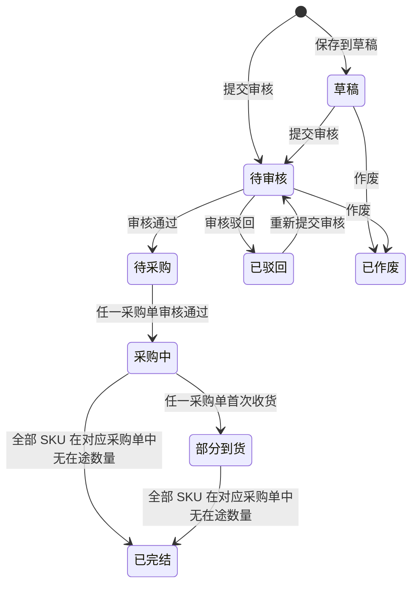
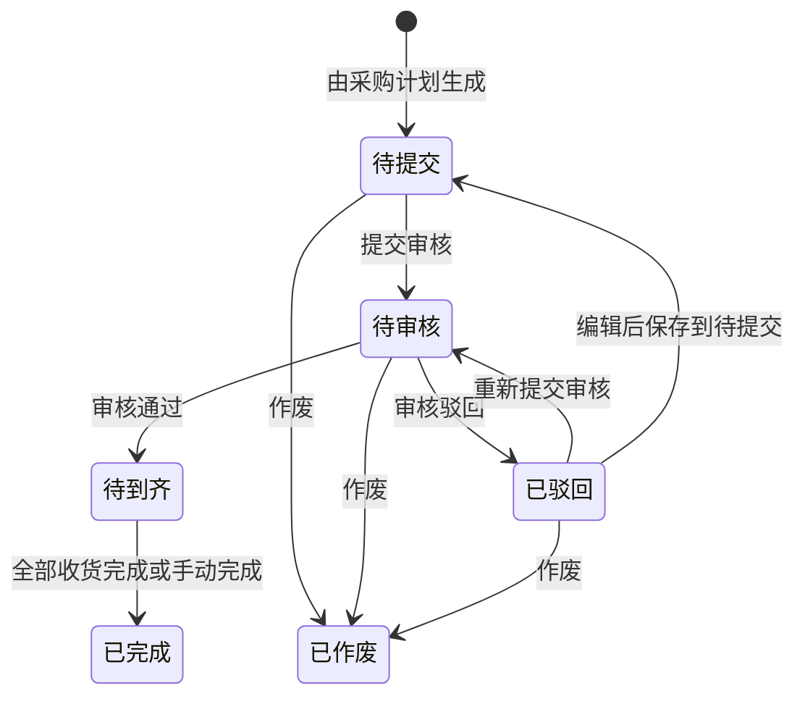

# 采购计划&采购单改造 PRD

## 1. 文档说明

### 1.1 背景与目标

原型曾同时展示“按批次、一条 SKU 一个计划号”和“一个计划号包含多个 SKU”两种方案。业务方已选择后者，前者的页面和入口已移除。目标是使采购计划成为组织多 SKU 采购需求的单据，同时在明细层保留团队、采购执行和收货跟踪信息。

业务价值：减少逐 SKU 建计划的重复操作；允许不同团队需求在同一计划中管理；使计划数量、采购数量、收货数量与在途数量在 SKU 维度可追溯。

### 1.2 本次范围

- **采购计划**：创建（草稿/提交审核）、导入入口、查询、一级列表、SKU 明细、审核、审核通过后自动生成采购单与发货计划入口、状态展示、批量操作。
- **采购单**：审核与已驳回、状态页签调整、顶部按钮联动、待提交移除 SKU、合并采购、收起一级列表、列表统计栏、结束到货、在途数量的团队货权调整。
- **不在本次范围**：采购单在外部 ERP 的收货与结算细则；发货计划的生成规则。

### 1.3 评审后改动清单

2026-10-28 16:00 开发评审会完成后至 2026-10-29 产生的改动如下（按发生时间排序）：

| 序号 | 改动内容 | 对应章节 |
|---|---|---|
| 1 | 新建采购计划明细新增「批量」填充：团队、计划采购量、计划交货日期、平台、店铺、国家、运营负责人 7 个字段列头提供「批量」按钮，弹出小气泡确认后覆盖全部明细行 | 4.2；6 验收 4 |
| 2 | 运营负责人后新增「采购仓库」明细字段（仓库清单下拉单选），并支持批量填充 | 4.2、4.5；6 验收 4 |
| 3 | 新建采购计划弹窗整体放大，缓解明细列横向拥挤 | 4.2 |
| 4 | 复制口径收紧：复制明细仅保留团队，其余字段一律置空，不填充任何默认值（覆盖原「保留 SKU 与团队」口径） | 4.8；6 验收 39–42 |
| 5 | 新建/编辑采购计划新增「计划采购金额」列：＝计划采购量 × 上次采购价，实时计算、只读；纯数字两位小数，无货币符号与千位分隔符；因子为空或 ≤0 时显示空；整数化运算避免浮点误差 | 4.2；6 验收 5 |
| 6 | 首单「首」标记：SKU 历史从未生成采购单时，在 SKU 编码右侧显示蓝色「首」标签；保存草稿与提交审核均展示并随明细保存，生成采购单时保留带入 | 4.2、4.4；6 验收 6、18 |
| 7 | 「上次采购价」含税标签：含税价在数值右侧显示「含税」标签，不含税或价格为空时不显示，同一价格只出现一个标签 | 4.2、4.5；6 验收 62 |
| 8 | 采购单二级列表在「采购单价」右侧新增「上次采购价」列，沿用同一含税标签规则，并支持列配置调整 | 5.1；6 验收 63 |
| 9 | 采购计划「草稿」页签新增「提交审核」按钮：仅草稿页签可见、受操作权限控制、仅支持整单勾选；未勾选/仅勾明细给出提示，二次确认后流转待审核并刷新列表与提示，提交前校验明细必填项 | 4.1.2；6 验收 64 |
| 10 | 「上次采购价」列加宽，价格与「含税」标签强制同行展示，避免标签折行 | 4.2 |
| 11 | 移除新建采购计划明细表底部「合计」行，合计信息统一在弹窗底部汇总条展示 | 4.2；6 验收 5 |
| 12 | 采购计划二级列表末列新增「计划采购金额」，口径同弹窗（组合品按成员行分别计算），历史列配置自动补入一次 | 4.1.3；6 验收 65 |
| 13 | 采购计划二级列表组合品成员行的「采购单」列补充子件信息：展示为「采购单号 (子件 SKU * 配比)」，配比取组合品定义固定值，多个子件各自一行；无采购单或已移除仍显示「—」 | 4.1.3、4.5；6 验收 66 |
| 14 | 审核通过自动拆单口径确认：按「默认供应商 + 采购仓库」拆分；自动生成的采购单始终新建，不并入已有同供应商+同仓库待提交单；组合品成员各自拆；SKU 无有效默认供应商时审核拦截并列出异常明细（其中「采购仓库提交审核必填」口径已由第 17 条调整） | 3.1、4.1.2、4.2、4.4、4.5；6 验收 67 |
| 15 | 「更换供应商」统一为永远新建：不再并入同供应商+同采购仓的待提交单，改为将该 SKU 移出原单后新建待提交单 | 5.4.1；6 验收 45 |
| 16 | 采购计划与采购单查询区最后一个查询项新增「是否首次采购」下拉单选（是/否），按「首」标记口径过滤 | 4.1.1、5.1；6 验收 68 |
| 17 | 采购仓库必填时点调整：采购计划不校验采购仓库；审核通过仍按默认供应商+采购仓库拆单，空仓库单独成组；采购员在待提交采购单中补全（支持批量编辑）；采购单提交审核校验采购仓库、供应商、采购主体、采购员 | 4.1.2、4.2、4.4、4.5、5.3、5.5；6 验收 67、69 |
| 18 | 采购单合并交互与单号规则调整：仅保留「可合并 N 张」入口，点击打开自动分组弹窗，支持逐单、整组及跨组勾选，每个参与合并的分组至少勾选 2 张，确定后按组分别合并；每组保留实际勾选单中创建时间最早的采购单号，不生成新号，并在主单记录合并来源及操作日志 | 5.3、5.4.2；6 验收 55–56 |
| 19 | 合并采购弹窗调整为**左右分栏**大尺寸布局：左侧为可合并分组列表（逐组展示供应商、采购员、采购仓库、采购主体与张数，支持勾选整组、点击切换右侧明细，标题提供「全选」一键勾选全部分组），右侧仅展示当前分组的表格明细（采购单号、金额、结算信息、明细信息、备注、创建/更新信息）；底部按钮为「合并采购单」，成功提示展示各组保留的采购单号，合并规则不变 | 5.4.2 |

## 2. 改造范围总览

### 2.1 改造点清单

| # | 模块 | 改造点 | 类型 | 影响页面 | 确认状态 |
|---|---|---|---|---|---|
| 1 | 采购计划 | 一个计划号包含多个 SKU，取消“采购计划批次”层级 | 重构 | 列表、弹窗 | 已确认 |
| 2 | 采购计划 | 新建可选「保存到草稿」或「提交审核」 | 新增 | 新建弹窗 | 已确认 |
| 3 | 采购计划 | 计划级 8 个状态及自动归集规则 | 新增 | 列表 | 已确认 |
| 4 | 采购计划 | 明细「已移除」标识与口径 | 新增 | 二级列表 | 已确认 |
| 5 | 采购计划 | 审核通过后按默认供应商＋采购仓库自动拆分生成待提交采购单，始终新建、不并入已有待提交单 | 修改 | 审核、采购单列表 | 已确认 |
| 6 | 采购计划 | 新增 SKU 子弹窗、导入新建内嵌 | 修改 | 新建弹窗 | 已确认 |
| 7 | 采购计划 | 列配置分一级/二级列表 | 修改 | 列表 | 已确认 |
| 8 | 采购单 | 新增审核：待审核 → 待到齐 / 已驳回 | 新增 | 列表、详情 | 已确认 |
| 9 | 采购单 | 状态页签新增「已驳回」，合并「待到齐」 | 修改 | 列表 | 已确认 |
| 10 | 采购单 | 顶部按钮随状态页签联动 | 修改 | 列表 | 已确认 |
| 11 | 采购单 | 待提交移除 SKU 并回写采购计划 | 新增 | 列表、详情 | 已确认 |
| 12 | 采购单 | 货权调整简化为调入团队 + 调入数量 | 修改 | 货权调整弹窗 | 已确认 |
| 13 | 采购计划 | 「更多 → 复制」把勾选明细带入新建采购计划弹窗，仅保留 SKU 与团队 | 新增 | 列表、新建弹窗 | 已确认 |
| 14 | 采购单 | 合并采购：仅保留「可合并 N 张」入口，自动分组弹窗内支持逐单、整组及跨组勾选，确定后按组分别合并 | 修改 | 列表、合并弹窗 | 已确认 |
| 15 | 采购单 | 合并单号：每组保留实际勾选单中创建时间最早的采购单号，不生成新号；主单记录合并来源及操作日志 | 修改 | 合并弹窗、详情、日志 | 已确认 |
| 16 | 采购单 | 收起一级列表：单据压缩为摘要行，明细全部常驻展示 | 新增 | 列表 | 已确认 |
| 17 | 采购单 | 底部统计栏 6 项合计，移除「已选」计数 | 新增 | 列表 | 已确认 |
| 18 | 采购单 | 结束到货：待到齐页签勾选未收完 SKU 后在途清零 | 新增 | 列表 | 已确认 |
| 19 | 采购单 | 明细与详情移除「批次成本价」字段 | 修改 | 列表、详情 | 已确认 |
| 20 | 采购单 | 移除「采购运费分摊」入口 | 修改 | 列表操作区 | 已确认 |

## 3. 核心状态机

### 3.1 采购计划状态流转

状态定义：

| 状态 | 业务含义 | 案例说明 |
|---|---|---|
| 草稿 | 新建时点「保存到草稿」，未提交审核；可从列表重新打开编辑、补全明细后再提交 | — |
| 待审核 | 新建时点「提交审核」，通过 SKU、团队、计划交货日期、计划采购量校验后进入 | — |
| 待采购 | 采购计划审核通过后即进入；审核以**采购计划为维度**，不按 SKU 或采购单逐个审核。审核通过时系统按明细 SKU 的默认供应商＋采购仓库自动拆分生成采购单（始终新建，不并入已有待提交单），新生成的采购单均为**待提交**；该状态下计划下尚无「审核通过」的采购单 | 计划 P 审核通过，系统按默认供应商＋采购仓库自动生成 2 张待提交采购单，均未提交审核，计划状态为待采购 |
| 采购中 | 计划下任一 SKU 对应的采购单审核通过后，整张计划进入采购中 | 计划含 10 个 SKU，其中 1 个 SKU 生成采购单并通过审核，整张计划即为采购中，其余 9 个 SKU 仍可为待提交 |
| 部分到货 | 计划下任一采购单首次产生收货数量（收货数量 > 0）后，整张计划进入部分到货 | 上述采购单到货 3 件，计划由采购中转为部分到货，与其余 SKU 的采购单进度无关 |
| 已完结 | 计划下**全部 SKU 在其对应采购单中都不再有在途数量**即整张计划完结：每个 SKU 的采购单均已审核通过且已收完／已结束到货，或该 SKU 已移除／已作废。不按「至少一条已完成」判断，也不要求采购单已手动点「完成」 | 计划含 10 个 SKU、拆成 3 张采购单：只要这 10 个 SKU 的在途数量全部为 0（含结束到货清零、已移除、已作废），计划即已完结；若其中有 SKU 的采购单仍是待提交／待审核，即使该 SKU 在途为 0，计划也不得完结 |
| 已驳回 | 审核驳回，必须填写审核意见；可修改后重新提交审核；**不可作废** | 计划 P 审核被驳回并填写「交货日期晚于活动档期」，状态为已驳回，可修改后重新提交审核 |
| 已作废 | **仅由采购计划作废触发**：只有草稿、待审核两个状态可按业务作废进入；待采购及之后的状态、以及已驳回均不可作废。与明细是否移除、采购单是否作废无关，不存在任何自动收口路径 | 计划 P 在「待审核」被审核人作废，整张计划转为已作废，其下未完成的明细随之终止，不再继续采购 |

状态之间的流转边见上方状态图，补充规则：

- **完结与采购单状态解耦**：计划只按在途数量判定完结，不要求采购单已点「完成」。允许出现计划已完结、个别采购单仍显示「待到齐」的情况；该采购单后续完成只影响自身状态，不再改变计划状态。
- **业务作废**：已作废是计划状态中唯一的「人工终止」路径，**仅草稿、待审核可作废**，待采购及之后的状态与已驳回不可作废；作废须填写作废原因并二次确认；明细被移除或采购单被作废都不会使计划进入已作废。
- 不设置“待生成”状态。原型中单据状态与 SKU 状态的自动同步仅用于展示，正式实现必须由采购单、收货等真实业务事件驱动。

### 3.2 采购单状态流转

说明：

- 「待到齐」内部保留收货进度：**待收货**（尚未收货）与**部分收货**（已收一部分）。页面上显示为「待到齐」+ 收货进度两个标签。
- 「已驳回」为本次新增页签，位于「已作废」之后；已驳回单据编辑后可「保存到待提交」（进入待提交、不自动重提）、「提交审核」（进入待审核）或作废（进入已作废）。
- 「待审核」状态支持作废：单据在待审核阶段被作废后进入「已作废」，此后不可再审核；已作废单据不参与审核流程，也不回写为「待到齐」。
- 采购单的审核与状态细则见 5.2。

### 3.3 采购单状态 → 采购计划状态对照

| 采购单侧事件 | 采购计划状态变化 | 说明 |
|---|---|---|
| 自动生成采购单（审核通过时）／提交采购单审核 | 不变（仍为待采购） | 计划审核通过时同时生成待提交采购单并进入待采购；采购单被提交审核也不触发状态变化 |
| 任一采购单审核通过 | 待采购 → 采购中 | 整张计划立即流转，不要求全部采购单通过 |
| 任一采购单首次产生收货数量 | 采购中 → 部分到货 | 收货数量 > 0 即触发 |
| 全部 SKU 在对应采购单中无在途数量（已审核通过的已收完／已结束到货，或已移除／已作废） | 采购中 / 部分到货 → 已完结 | 见 3.4；未生成采购单、待提交、待审核的 SKU 不计为已收口，计划不得完结 |
| 采购单被驳回 | 不变 | 不触发、不回退；对应明细采购状态回写「已驳回」 |
| 采购单被作废 | 不变（计划不会因此进入已作废） | 计划状态不回退；明细回写「已作废」且原采购单号保留不清空；已作废明细在途按 0 计，计入完结判定 |
| 采购单完成（全部收货或手动完成） | 不变 | 明细回写「已完成」；计划完结只看在途，不依赖该动作 |
| 待提交状态移除 SKU | 明细打「已移除」；其余明细未清空时计划状态不变 | 终态，在途按 0 计 |

### 3.4 状态判定硬规则

1. **结果导向判定**：计划处于「待采购」，等价于该计划下不存在任何一张「审核通过」的采购单；与采购单当前处于待提交、待审核、已驳回还是已作废无关。采购单仅生成或仅提交审核，不改变计划状态。
2. **状态单向，不回退**：采购单后续被驳回、作废或状态继续变化，不使计划退回前一状态。已进入采购中、部分到货的计划不会退回待采购；但明细自身状态必须如实回写（驳回→已驳回、作废→已作废、完成→已完成），且采购单号保留不清空。
3. **完结判定**：以**在途数量**为唯一口径——计划下全部 SKU 在各自对应采购单中的在途数量均为 0 时，计划进入已完结，与采购单张数、是否拆单无关。
   - **在途归零方式**：采购单已审核通过且已全部收货、被「结束到货」清零、SKU 已移除、明细已作废。
   - 未生成采购单、待提交、待审核的 SKU 在途虽为 0，也不视为已收口；存在此类明细时**计划不得完结**，需将对应采购单提交并审核完成。
   - 审核通过时系统已为全部明细生成采购单，正常流程不会出现未生成采购单的明细。
   - 完结不要求采购单已点「完成」；允许计划已完结而采购单仍为「待到齐」，该采购单后续完成不改变计划状态。
4. **明细移除**：仅采购单「待提交」可移除 SKU，入口、必填原因、立即生效与回写展示见 5.4、4.3；采购单至少保留 1 个 SKU，已移除为终态不可恢复，需重新采购只能新建采购计划。
5. **已作废只由业务作废触发**：仅草稿、待审核可按业务作废；明细被移除、采购单被作废都不会使计划转为已作废。即使全部明细都被移除或作废，计划也按在途口径（全部为 0）进入已完结，不会自动作废。
6. **空采购单**：正常编辑流程下，待提交采购单至少保留 1 个 SKU，不允许清空；「明细全部移除后自动作废」仅作为采购单侧数据异常兜底规则保留，不应通过任何产品入口触发，且该作废只影响采购单，不影响采购计划状态。
7. **计划状态自动归集**：不提供人工切换状态；原型中的状态同步仅用于展示。

## 4. 采购计划改造

### 4.1 页面结构

#### 4.1.1 查询区

- 编码类型单选：SKU、供应商料号、领星 SKU、FNSKU；编码输入支持多个。
- 单号类型单选：采购计划号、采购单号；相邻输入框支持多个单号。
- 其他查询项：采购仓、采购员（多选）、品名、是否加急（单选：是/否）、平台、国家、店铺、团队、计划负责人、时间范围（口径仅「创建时间」「计划交货日期」两种）；展开区仅保留计划备注，不再提供发货单号与供应商查询；**「是否首次采购」（单选：是/否）位于全部查询项最后**。计划负责人沿用原「创建人」口径，取值为计划创建账号。
- 数量范围查询：下拉单选口径（计划采购量、实际采购量、差异数量、收货数量、采购在途）＋最小/最大值输入，交互与采购单一致。支持最小值～最大值（含边界）、仅填最小值（大于等于）、仅填最大值（小于等于）三种填法；最小值大于最大值时拦截并提示。输入框只接受非负整数，负号、小数点及其他字符输入时即被过滤。数量条件按**明细行**匹配，任一明细（含组合品成员行）满足即保留该采购计划；已移除明细按各口径的展示值参与（计划采购量保留原值，其余为 0）。
- 多值最大数量、模糊匹配范围及时间口径待确认。
- 回车触发查询：所有文本类查询项（编码、采购计划号/采购单号、品名、备注、数量范围最小值/最大值等）按 Enter 等价于点「查询」；日期范围起止框选值后按 Enter 亦触发；「重置」仅点击触发，不响应 Enter。

#### 4.1.2 一级列表：采购计划

**一级列表**

- 字段与样式见原型；备注可就地编辑。
- **计划号**可点击：**草稿**进入「编辑采购计划」补全明细，其他状态进入「查看采购计划」；明细也可直接展开二级列表浏览。
- **状态页签**：全部、草稿、待审核、待采购、采购中、部分到货、已完结、已驳回、已作废（不设待生成）。
- 状态由业务事件自动归集，不提供人工改状态（见 3.4）。

「采购计划号」表头右侧提供复制图标，点击一次性复制**当前页**全部采购计划号，按行分隔、自动去重，提示「已复制 N 个采购计划号」，与采购单号表头复制交互一致；图标仅出现在当前可见的采购计划号列，不随列配置顺序变化。

顶部操作区按钮随当前状态页签联动显示：**审核**仅在「待审核」页签显示；**作废**仅在「草稿」「待审核」页签显示；其余页签（含「全部」）不显示这两个按钮。未勾选符合状态条件的单据时按钮置灰不可点击。

**提交审核（草稿页签）**

| 项 | 规则 |
|---|---|
| 展示位置 | 仅「草稿」页签、紧跟「新建采购计划」右侧；其他页签（含「全部」）隐藏 |
| 操作权限 | 仅拥有采购计划提交审核权限的账号可见 |
| 勾选范围 | 只支持按**整张采购计划（单据行）**勾选批量提交；不支持只勾选单据内的二级明细 |
| 未选提示 | 未勾选任何单据：「请先勾选需要提交审核的采购计划」；仅勾明细未勾整单：「提交审核仅支持按整张采购计划勾选」 |
| 二次确认 | 点击后弹窗确认，说明所选单据将提交至审核流程 |
| 提交结果 | 确认后所选草稿统一流转**待审核**、移出草稿页签、页签计数实时刷新，并提示「已提交 N 张采购计划，等待审核」 |
| 提交校验 | 逐单校验至少 1 条 SKU 明细，且团队、计划交货日期、计划采购量完整；采购仓库不作必填校验（由采购员在待提交采购单中补全）；不通过时提示具体计划号与原因且不执行提交 |

- 勾选一级＝选中其下全部明细；只勾部分二级时一级半选。
- 一级列表不展示数量、金额合计。

#### 4.1.3 二级列表：SKU 明细

默认字段与顺序见原型及列配置。

- 二级可逐行勾选，表头不设全选；前部固定列不参与横向滚动。
- 不做行内合计，数量类合计统一在底部汇总条（见 4.1.4），按当前查询结果的全部明细计算，不受分页影响。
- 差异数量＝实际采购量－计划采购量：负数为欠采（红色普通字重）、正数为超采；实际采购量为空显示「—」。
- 底部汇总条的差异数量取各明细差值的绝对值之和，已移除明细不计入。
- 组合品共享字段与成员独立字段按 4.5 呈现；合计时不得重复计入父项及子项。
- 「采购员」为采购单维度字段：明细展示其采购单上的采购员，同一采购单对应同一采购员，未生成采购单显示「—」；查询按关联采购单的采购员过滤。
- 组合品成员行的「采购单」列展示为「采购单号 (子件 SKU * 配比)」：单号后括号内为该行子件 SKU 与组合品定义中的固定配比；多个子件对应多张采购单时每个单号独立一行展示；非组合品明细仅展示采购单号；子件未生成采购单或明细已移除时仍显示「—」，不输出括号内容。
- 二级列表末列展示「计划采购金额」：按明细行计算，金额＝计划采购量 × 上次采购价，口径与新建/编辑弹窗一致（纯数字、保留两位小数，不加货币符号与千位分隔符；任一因子为空或 ≤0 时为空）；组合品按成员行分别计算，不重复计入父项。列配置中可调整该列的显示与顺序，默认位于最后一列。
- 明细「已移除」口径见 4.3。

#### 4.1.4 底部汇总条与分页

- 列表底部为汇总条与分页区。
- 汇总条按**当前查询结果的全部采购计划及其明细**计算，跨页合计，不受当前页码影响；查询、筛选、重置后实时更新。
- 汇总内容：计划数、SKU 数、计划采购量、实际采购量、差异数量、收货数量、采购在途；差异数量取各明细差值的绝对值之和，已移除明细不计入。
- 已移除明细：计划采购量仍计入汇总，实际采购量、收货数量、采购在途按 0 计入。

### 4.2 新建、查看与编辑弹窗

- 弹窗顶部为计划负责人（默认当前登录账号、不可修改）与可输入的计划备注；新建、复制、编辑、查看共用同一弹窗与校验规则。
- 明细表格上方为「添加 SKU」「导入新建」。「添加 SKU」打开独立小弹窗，按 SKU、品名检索勾选加入，加入后在主弹窗编辑，未选 SKU 时主弹窗仍显示明细表头；「导入新建」叠加打开导入弹窗，不关闭、不清空原新建内容，关闭后返回。列表上方不再保留导入按钮。
- 明细字段：SKU、领星 SKU、品名、团队、计划采购量、计划交货日期、平台、店铺、FNSKU、国家、运营负责人、采购仓库、箱规数量、箱数、上次采购价、计划采购金额、采购计划备注、默认供应商、供应商料号。「采购计划备注」为每个 SKU 独立的明细备注，与弹窗顶部整张计划的备注不同。
- **字段批量填充**：团队、计划采购量、计划交货日期、平台、店铺、国家、运营负责人、采购仓库 8 个明细字段的列头文字右侧提供「批量」文字按钮（仅新建、编辑、复制带入等可编辑弹窗显示，「查看采购计划」不显示）。点击弹出锚定在按钮上方的小气泡，内含该字段与单行编辑一致的输入控件（下拉或日期、数字输入）及「取消」「确认」；确认后所填值一次性应用到**弹窗内全部明细行**（已有值的行同样被覆盖），并提示应用数量。未填值点确认提示「请先填写×字段」、不应用；取消则关闭气泡且明细不变。批量应用后仍可逐行修改单条明细。「采购仓库」取值与单行编辑一致，为仓库清单下拉单选。
- FNSKU 从该 SKU 的候选中单选；箱规数量、上次采购价由商品资料带出且只读。**上次采购价标签**：该价格含税时，在数值右侧展示「含税」标签；不含税时不展示任何标签，同一价格只出现一个标签，标签与价格的含税状态一一对应。**计划采购金额＝计划采购量 × 上次采购价**，系统实时自动计算、只读不可编辑；展示为纯数字、保留两位小数，不加货币符号、不加千位分隔符；计划采购量或上次采购价为空（或 ≤0）时金额显示为空；计算采用整数化运算避免浮点误差；计划采购量修改后金额即时联动更新，弹窗底部汇总条实时同步汇总；明细表不设独立合计行（合计信息统一在弹窗底部汇总条展示）。底部「保存到草稿」允许稍后补全；「提交审核」须校验 SKU、团队、计划交货日期、计划采购量，通过后进入待审核；草稿可从列表的计划号重新打开编辑。
- SKU、领星 SKU、供应商料号由商品数据带出，新建时不要求手动输入；不在新建时要求填写供应商，由 SKU 默认供应商规则处理。
- **首单标记**：某 SKU 历史从未生成过任何采购单时，其明细行的 SKU 编码右侧展示蓝色「首」标签；新建、编辑、复制带入的明细在「保存到草稿」「提交审核」两种结果下均展示该标记，并随明细一并保存。标记按 SKU 维度判定（同一 SKU 任意一张采购单曾生成过即不再判定为首单），已写入的标记不因后续生成采购单而清除。
- 原型与正式校验均为团队、计划交货日期、计划采购数量；采购仓库不作必填校验，由采购员在待提交采购单中补全。
- 可编辑范围：仅「草稿」可编辑（含明细增删与计划采购量修改）；审核通过后（待采购、采购中、部分到货、已完结、已作废）不提供编辑入口，计划采购量不可修改；「已驳回」可修改后重新提交审核，可改字段与草稿编辑一致。

### 4.3 明细「已移除」标识

**触发方式**

- 入口：仅当采购单处于「待提交」状态时，在「编辑采购单」弹窗的采购明细行点「移除」。
- 操作：在按钮旁小气泡填写「移除原因」并确定，**立即生效**（不回退）并回写本计划明细。
- 原因：必填文本，上限 200 字，不设预设原因选项；未填写不得提交。
- 保留限制：采购单至少保留 1 个 SKU。
- 计划侧：不提供「移除明细」入口，系统管理员也不得手工置为已移除。

**展示要求**：

| 项 | 规则 |
|---|---|
| 标签 | 「已移除」灰色标签常驻展示在 SKU 编码右侧，不放入采购状态列 |
| 详情 | 点击标签弹出气泡，展示移除原因、移除人、移除时间、来源采购单号 |
| 计划采购量 | 保留原值，作为原始需求留痕 |
| 实际采购量 / 收货数量 / 采购在途 | 均为 0 |
| 差异数量 | 显示「—」，不显示负数红字 |
| 采购单号 / 采购状态 | 显示「—」 |
| 底部汇总条 | 计划采购量仍计入；执行类合计按 0 计 |
| 恢复 / 重新采购 | 终态，不提供恢复入口，也不提供重新生成采购单的入口；需继续采购只能新建采购计划 |
| 状态影响 | 已移除视为已收口，采购在途按 0 计、直接满足「无在途」，但不计为完成；计划不会因明细被移除而转为已作废（已作废只能由计划业务作废进入） |

**「已作废」明细的同类规则**

- 触发：采购单在**待提交／待审核／已驳回**状态被作废后，对应计划明细的采购状态回写为「已作废」。
- 单号：原采购单号**保留不清空**（区别于已移除显示「—」）。
- 口径：与已移除同属**已收口**——采购在途按 0 计、直接满足「无在途」，但不计为完成；实际采购量、收货数量按 0 计。
- 恢复：不提供恢复入口，亦不提供重新生成采购单的入口。

### 4.4 采购单生成与关联

**生成与拆单规则**

| 项 | 规则 |
|---|---|
| 生成时机 | 采购计划**审核通过时自动生成**，无需人工点击 |
| 拆单键 | **默认供应商 + 采购仓库**；同供应商且同仓库的明细归入同一张，任一不同即拆成多张 |
| 团队 | **不参与拆单**；仅作为明细归属与后续 ERP 路由／权限依据，不得误写为拆单依据 |
| 采购仓库 | 采购计划新建/编辑/提交审核均不作必填校验；为空时按空仓库单独成组（同供应商且仓库均为空的明细归入同一张待提交采购单），由采购员在采购单中补全后再提交审核 |
| 生成后状态 | 所有新单初始为**待提交**，由采购员补充/确认后提交审核 |
| 与已有待提交单 | 始终新建，不并入已有同供应商+同采购仓库的待提交单；需要整合时用「合并采购」（5.4.2）人工合并 |
| 单据关联 | 一张计划可关联多张采购单；采购单明细反向保留计划号、SKU 与团队来源 |
| 组合品 | 成员按**各自的默认供应商与采购仓库**独立拆单，父项可关联多张采购单 |
| 无默认供应商 | 审核被拦截并列出异常明细；补全后可再次提交审核 |

**关联与唯一性**

- 计划、发货计划、采购单、收货结果按**稳定 ID 与明细 ID** 关联，不凭 SKU 文本匹配；同一计划中重复 SKU 或同 SKU 不同团队不得相互覆盖。
- **非组合品**：一条计划明细只对应一张有效采购单。
- **组合品**：成员按各自供应商／仓库拆分，父项可关联多张有效采购单；成员与采购单按成员明细 ID 一一关联，合计时不得重复计入父项。
- 换供应商、移除 SKU 等操作必须保证同一成员明细不产生两张有效采购单。

**首单标记流转**

- 计划明细带「首」标记时，审核通过生成的采购单明细必须保留，展示在采购单明细 SKU 编码右侧。
- 提交审核、审核通过、生成采购单等动作均不得丢失或自动清除标记。

**货权调整影响**

- 采购单在途数量的团队归属调整属采购单侧动作。
- 不改变计划的计划采购量、实际采购量、收货数量与采购在途总量。
- 调整记录必须保留采购计划号，详见 5.7.5。

### 4.5 字段与数据规则

计划级公共字段：

| 字段 | 已确认口径 | 待确认点 |
|---|---|---|
| 采购计划号 | `PP`＋年月日 6 位＋4 位流水号，例如 `PP2610230001`，不带横杠；同一天顺延，换日重新计数 | 并发唯一性、跨时区、删除后是否复用 |
| 计划负责人 | 新建默认当前登录账号，界面置灰不可修改 | 历史数据缺失时的回填方式 |
| 计划备注 | 单据公共字段，列表内小弹层编辑 | 长度、修改权限、审核后可否修改 |

明细字段：

| 字段 / 指标 | 已确认口径或来源 | 待确认点 |
|---|---|---|
| SKU / 品名 / 领星 SKU | 选 SKU 后从商品资料带出 | 商品资料更新后是否同步历史计划 |
| 团队 | 一张计划可含多个团队；明细必填 | 可选团队的数据权限与失效团队处理 |
| 计划采购量 | 用户填写、数值型；底部汇总条合计 | 单位、小数精度、组合品父子数量关系 |
| 实际采购量、收货数量、采购在途 | 来源采购执行与收货结果；底部汇总条分别合计 | 回写源、更新时间、超收和负数处理 |
| 实际采购量口径 | **只计已审核通过的采购单的采购数量**；采购单处于待提交、待审核、已驳回、已作废时不计入实际采购量（明细显示「—」或 0），因此差异数量随之计算 | 无 |
| 差异数量 | 明细行取「实际采购量－计划采购量」并保留正负（负数标红）；合计取各明细差值的绝对值之和；未采购显示「—」，已移除不计入 | 无 |
| 明细状态 | 正常 / 已移除。仅采购单在待提交状态移除 SKU 时置为已移除，并记录移除人、移除时间、来源采购单号和原因；终态不可恢复，在途按 0 计、直接满足完结条件 | 无 |
| 加急标识 | 明细级布尔值。由「更多 → 加急」设置，随明细传递到采购单并在采购单明细行展示；不改变采购单状态、排序与拆单 | 能否取消、操作权限、是否影响排序 |
| 期望到货日期 | 逐 SKU 维护 | 是否允许早于创建日期、与采购单日期冲突处理 |
| 平台、店铺、FNSKU、国家、运营负责人 | 销售归属与运营属性 | 字段来源、级联关系、变更历史 |
| 采购仓库 | 采购计划不设必填；与默认供应商共同构成自动拆单键，同供应商同仓库的明细归入同一张采购单，空仓库单独成组；由采购员在待提交采购单中补全（支持批量编辑），采购单提交审核时必填 | 仓库字典维护与失效仓处理 |
| 默认供应商、供应商料号、最小起订量、交期 | 商品/供应商资料带出；生成采购单需用默认供应商；任一明细无有效默认供应商时采购计划审核被拦截并列出异常明细 | 多个默认供应商、资料失效处理 |
| 采购单号、采购状态、采购计划备注（SKU 级） | 采购单关联及每个 SKU 独立填写的备注；不同于计划级备注 | 一明细多采购单、备注写入权限与状态回写规则 |
| 箱数 | 页面展示及汇总 | 箱规缺失、非整箱、组合品计算口径 |
| 上次采购价 | 商品资料带出的只读金额（SKU 维度）；价格为含税时在数值右侧展示「含税」标签，不含税或价格为空时不展示任何标签，同一价格只出现一个标签 | 税别来源与含税／不含税口径 |

**组合品规则**

- 合并展示：采购计划关联、SKU、领星 SKU 按组合品合并展示。
- 成员数据：成员行展示独立的采购与收货数据；团队、期望到货日期、平台、店铺、FNSKU、国家、运营负责人在成员行可分行显示，但同一组合品的值保持一致。
- 采购单列：成员行「采购单」列在单号后括号标注**子件 SKU 与组合品定义固定配比**，规则见 4.1.3。
- 合计口径：不得重复计入父项及子项。

采购金额、单价若参与采购计划保存或后续汇总，币种、税别、精度、汇率及与采购单金额的关系必须另行确认；不得以原型中的 `¥` 展示值作为财务结算口径。

### 4.6 操作区与列配置

**顶部操作区**

- 按钮：新建采购计划、审核、作废、导出、「更多」（复制／加急／删除，规则见 4.8、4.7）；「导入新建」在新建弹窗内。
- 页面不提供「生成采购单」按钮：采购单在审核通过时由系统自动生成。

**按钮联动**

- 审核、作废按状态页签显示，规则见 4.1.2。
- 作废仅接受「草稿」「待审核」状态的采购计划；混入其他状态整批拒绝并提示。
- 「更多」中的加急、删除同样受状态限制：已完结、已驳回、已作废页签下两项均置灰不可点。
- 在「全部」页签勾选了这些状态的明细时，点加急或删除整批拒绝且不执行任何操作。

**删除规则**

- 适用范围：仅「草稿」「待审核」状态的采购计划支持删除明细。
- 混选处理：勾选明细中只要有一条所属计划不在这两个状态，整批拒绝，不删除任何明细。
- 不可删除：待采购及之后的所有状态、已驳回、已作废均不提供删除入口。
- 操作对象：仅删除选中的二级 SKU 明细，必须二次确认，不能误删一级计划。

列配置面板分「一级列表」「二级列表」，支持选择显示字段、调整已选列顺序、恢复默认与保存应用；无模板功能。锁定列的范围与跨设备持久化方式待确认。

导入创建目前仅有原型入口与说明，不代表导入模板、字段映射、部分成功策略已经确定。

### 4.7 加急标识

| 项 | 规则 |
|---|---|
| 标识层级 | SKU 明细级，不作用于一级采购计划 |
| 打标入口 | 列表上方「更多 → 加急」，作用于已勾选的二级 SKU 明细，支持批量 |
| 可用状态 | 草稿、待审核、待采购、采购中、部分到货可加急；已完结、已驳回、已作废不支持加急，对应页签下「加急」置灰不可点 |
| 计划侧展示 | 二级明细行的 SKU 后展示红色「加急」标签 |
| 生成采购单 | 加急标识随明细带入采购单：由加急明细生成的采购单明细行，在 SKU 后同样展示「加急」标签；未加急明细不展示 |
| 采购单影响范围 | 不改变采购单状态、状态页签、排序及拆单规则（仍按默认供应商＋采购仓库拆分）；采购单本身不显示整单加急标识，也不因加急改变审核或收货流程 |
| 取消加急 | 待确认，见第 7 章 |
| 操作权限与留痕 | 按服务端权限校验执行；记录操作人、时间与加急/取消动作 |

加急标识属于采购计划的明细属性，与「已移除」标识相互独立：已移除明细不再参与采购单生成，因此不产生加急传递。

### 4.8 复制明细新建计划

复制用于“不想点新建、也不想走导入，直接从已有计划里挑几行明细再建一张新计划”的场景。

| 项 | 规则 |
|---|---|
| 入口 | 列表上方「更多 → 复制」 |
| 前置条件 | 至少勾选 1 条二级 SKU 明细；勾选一级计划等价于选中其下全部明细；未勾选时提示且不打开弹窗 |
| 勾选范围 | 支持跨多张采购计划勾选明细，合并带入同一张新计划 |
| 组合品处理 | 组合品按一条明细处理：勾选组合品即把整条组合 SKU 带入新计划并保留其成员组成，不拆成成员行，避免父子重复计入 |
| 弹窗 | 复用「新建采购计划」弹窗，不另做复制弹窗；带入后用户可继续修改、删除明细或再添加 SKU |
| 带入字段 | 按明细逐行带入，**仅保留团队**；其余可编辑字段（计划采购量、计划交货日期、平台、店铺、国家、采购仓库、运营负责人、备注、FNSKU 等）一律置空，不得填充任何默认值（包括新建行默认的交货日期、采购仓库、默认数量），避免用户未察觉自动填充而提交错误数据。SKU 名称、领星 SKU、上次采购价等商品资料只读属性随 SKU 展示 |
| 不带入 | 原明细的全部可编辑字段值（见上），以及实际采购量、差异数量、收货数量、采购在途、采购单号、采购状态、已移除标识、加急标识 |
| 计划级字段 | 计划负责人取当前登录账号，不继承原计划负责人；计划备注留空，由用户重新填写 |
| 提交方式 | 底部「保存到草稿」「提交审核」与新建流程完全一致，校验规则相同（SKU、团队、计划交货日期、计划采购量；采购仓库不作必填） |
| 计划号 | 生成新的采购计划号，与原计划无关联，不继承原计划号 |
| 原计划影响 | 只读复制，不改变原计划任何数据 |

## 5. 采购单改造

### 5.1 列表与状态页签

- 状态页签：全部、待提交、待审核、待到齐、已完成、已作废、已驳回，查询枚举同步；「待到齐」归集收货进度为「待收货」「部分收货」的单据，不再单列这两个页签。
- 明细前三列固定不参与横向滚动；列配置调整顺序后，固定范围变为新的前三列，其余列正常滚动。
- 采购单明细行在 SKU 后展示「加急」标签，来源为采购计划明细的加急标识（见 4.7），未加急不展示。
- 二级明细列在「采购单价」右侧新增「上次采购价」列：取值与采购计划明细一致（商品资料带出的该 SKU 上次采购价）；价格为含税时在数值右侧展示「含税」标签，不含税或价格为空时不展示任何标签，标签规则与采购计划明细完全相同，同一价格只出现一个标签。列配置可调整该列的显示与顺序，默认顺序紧跟「采购单价」；新增列不改变原有列的固定范围、横向滚动与对齐规则。
- 行内操作按状态展示：「查看」「日志」全部状态；「编辑」仅待提交、已驳回（原「修改」统一更名，弹窗标题为「编辑采购单」）；「提交审核」仅待提交；「收货」仅待收货、部分收货。
- 已驳回采购单支持编辑：编辑弹窗与待提交编辑一致，底部提供「保存到待提交」（保存后状态回到待审核前的待提交）与「提交审核」（保存并进入待审核）两个出口；待提交状态编辑保存后状态不变。
- 查询区沿用单据清单的通用查询结构，查询项依次为：单号（采购单号／采购计划／物流单号）、SKU 编码、品名（文本，支持模糊查询，与采购计划口径一致）、团队、供应商、收货批次、采购仓库、平台、店铺、时间范围（口径可选收货时间／创建时间／更新时间）、创建人、数量范围、是否首次采购（单选：是/否，位于全部查询项最后）。

### 5.2 审核与驳回

采购单在「待审核」状态支持审核，入口为采购单页面操作区的「审核」，仅对选中的待审核采购单生效；非待审核采购单不得提交审核。

| 审核结果 | 流转后状态 | 规则 |
|---|---|---|
| 通过 | 待到齐（收货进度：待收货） | 支持单张或批量审核；审核意见可留空 |
| 驳回 | 已驳回 | 必须填写审核意见；记录驳回原因、审核人和审核时间 |

- 审核动作须记录审核人、审核时间、审核结果和审核意见，供列表和详情追溯。
- 待审核单据可直接作废（进入已作废），作废后不得再审核；作废须二次确认并记录操作人与时间。

### 5.3 顶部按钮与状态页签联动

切换采购单状态页签时，仅改变顶部操作按钮的显示范围：

- 显示的按钮始终保持可点击，不因当前未勾选单据而置灰。
- 点击需要选中单据的按钮时，校验选择数量及每张单据状态；不符合条件给出明确提示且不执行操作。
- 切换至「全部」时展示下表全部按钮。

采购单全部由采购计划的明细流转生成，采购单页面不提供「新建采购单」入口，顶部操作区不再展示该按钮。

| 状态页签 | 顶部展示按钮 |
|---|---|
| 全部 | 批量收货、审核、作废、提交审核、可合并 N 张（存在可合并单时）、货权调整 |
| 待提交 | 可合并 N 张（存在可合并单时）、作废、提交审核 |
| 待审核 | 审核、作废 |
| 待到齐 | 批量收货、货权调整 |
| 已完成 | — |
| 已作废 | — |
| 已驳回 | 作废、提交审核 |

- **审核**：仅接受待审核采购单。
- **作废**：接受待提交、待审核或已驳回采购单。
- **提交审核**：接受待提交或已驳回采购单。
- **可合并 N 张**：仅统计待提交采购单，存在可合并分组时显示；点击打开自动分组弹窗，不依赖列表勾选（见 5.4.2）。
- 采购单提交审核（单张或批量）前逐张校验采购仓库、供应商、采购主体、采购员必填；存在缺失时整批拦截，提示对应单号并定位待补全单据，补全后可再次提交。
- 混选不符合条件的单据时整批拒绝，不跳过个别单据。
- 批量收货及其他操作按各自业务规则校验；按钮可见不代表所选单据一定可执行。
- 原「采购运费分摊」入口已从页面移除。

### 5.4 待提交移除 SKU

| 项 | 规则 |
|---|---|
| 入口 | 「编辑采购单」弹窗（仅待提交）明细行的「移除」；二级列表不加操作列 |
| 允许状态 | 仅待提交；待审核、待到齐、已完成、已驳回、已作废均不可移除（已驳回的「编辑」弹窗中移除会被拦截并提示） |
| 移除原因 | **必填**文本，≤200 字，不设预设原因选项；点「移除」在按钮旁弹小气泡，填写后点「确定移除」；未填写不得提交 |
| 生效时机 | 气泡点「确定移除」**立即生效**，不可撤销：该 SKU 从采购单移除、重算采购单数量与金额、回写采购计划明细为「已移除」，并即时刷新列表 |
| 至少保留 | 采购单至少保留 1 个 SKU；只剩 1 条时点移除提示「采购单至少保留 1 个 SKU，如需整单取消请使用作废」，不做移除 |
| 回写计划 | 对应计划明细打常驻「已移除」标签，记录移除人、移除时间、来源采购单号和原因（点击标签以气泡查看）；计划采购量保留、执行类数据置 0，展示口径见 4.3 |
| 计划状态 | 计划状态不变、不回退；即使全部明细都被移除，也只会让计划在在途为 0 时进入已完结，**不会**转为已作废（已作废只能由计划业务作废进入），且不通知计划负责人 |
| 恢复 | 已移除为终态，不提供恢复或重新生成采购单的入口，需继续采购只能新建采购计划 |

### 5.4.1 更换供应商（修改 SKU 的供应商）

采购单按供应商拆单，一张采购单只对应一个供应商，因此“更换某个 SKU 的供应商”本质是把该 SKU 转移到新供应商的单据，不允许在原单上直接改供应商字段。

| 项 | 规则 |
|---|---|
| 入口 | 「编辑采购单」弹窗（仅待提交）明细行「操作」列的「更换供应商」；其他状态不展示该入口，二级列表不加工具栏按钮 |
| 表单头供应商 | 编辑态「采购单资料」的供应商字段为**只读**，不可直接修改，避免绕过拆单规则；如需更换只能在明细行操作 |
| 气泡交互 | 行内弹出小气泡：展示该 SKU、新供应商下拉（默认带出原单供应商）与落单预览；**采购仓沿用原单**；点「确定」立即生效 |
| 落单预览 | 实时提示结果：「将新建采购单（供应商 · 采购仓），转入该 SKU」 |
| 落单规则 | **统一新建**：该 SKU 从原单移出后新建一张待提交采购单，不并入已有同供应商+同采购仓的待提交单 |
| 新建单据 | 新建的待提交采购单继承原单的采购仓、采购员、采购主体、结算方式、税率，运费/优惠金额/其他费用置 0，仅替换供应商并带入该 SKU |
| 原单处理 | 该 SKU 从原单移除并重算数量金额；若原单仅剩这一个 SKU（更换后原单将无 SKU），禁止更换并提示「更换后本单将无 SKU，如需整单取消请使用作废」 |
| 单价 | 沿用原采购单价，不自动取新供应商报价，可在新单内手动修改 |
| 计划影响 | 采购计划明细的采购单号、采购员指向新单；计划状态不回退（待采购/采购中保持） |
| 留痕 | 操作日志记录「SKU：原供应商 → 新供应商」、操作人与时间 |
| 不做的事 | 不修改采购仓、不自动合并两张采购单、不连带改动收货与在途数据 |

### 5.4.2 合并采购

| 项 | 规则 |
|---|---|
| 定位 | 多张零散的待提交采购单可按一致信息分组整理，减少向同一供应商的重复下单；常规模式与收起一级列表模式均可使用 |
| 唯一入口 | 顶部仅保留**「可合并 N 张」**按钮，不再提供独立「合并采购」按钮；N 为当前查询范围及状态页签下、所有可合并分组中的单据总数 |
| 分组口径 | 仅将**待提交**采购单按「供应商 + 采购员 + 采购仓库 + 采购主体」四项完全一致自动聚类，每组至少 2 张；无可合并组或切换到其他状态页签时按钮自动隐藏 |
| 分组弹窗 | 点击「可合并 N 张」打开**大尺寸弹窗**（约与主列表区域相当），采用**左右分栏**布局：**左侧为可合并分组列表**，逐组展示供应商、采购员、采购仓库、采购主体及张数/已选张数，每组提供整组勾选框，点击分组即切换右侧明细；**右侧仅展示当前分组**的四项一致信息、张数与合计金额，并以表格逐单展示采购单号、金额（采购金额/货款/运费/其他费用/优惠金额）、结算信息（结算方式/币种/含税/预付比例）、明细信息（SKU 数/关联计划数）、备注、创建人及创建时间、更新人及更新时间 |
| 勾选方式 | 单据默认不勾选；可通过左侧分组勾选框或右侧「全选本组」一键勾选整组，也可逐单勾选；左侧标题提供「全选」一键勾选全部分组；勾选整组后**切换到其他分组继续勾选**即可实现跨组同时合并，底部实时显示已选组数与单据数 |
| 分组校验 | 未勾选时提示「请勾选需要合并的采购单」；每个参与合并的分组至少勾选 2 张，仅选 1 张的分组会拦截并提示，不执行任何合并 |
| 多组处理 | 点击弹窗底部「**合并采购单**」按钮并通过二次确认后，按各分组分别合并，不跨组并成一张；未勾选的分组不参与合并 |
| 单号规则 | 每组以**实际勾选单据中创建时间最早**的采购单为主单，保留其采购单号，不生成全新单号；主单与勾选顺序无关，弹窗在勾选达到 2 张后标识预计保留的单号 |
| 二次确认 | 确认内容包含本次参与合并的组数、单据总数、合并后保留的单据数与各组保留单号 |
| 成功提示 | 合并完成后提示**已合并组数、单据总数及各组保留的采购单号**（如「合并成功：2 组共 4 张采购单已分别合并，保留采购单号 PO…、PO…」），便于直接核对结果 |
| 合并结果 | 同组其余单据的 SKU 明细及其采购计划关联、运费、其他费用、优惠金额并入主单，数量与采购单金额重新计算；被合并单据从列表移除，主单仍为待提交，后续走正常提交审核流程 |
| 来源留痕 | 主单记录全部被合并来源单号；操作日志记录合并来源、保留单号、操作人与时间，支持后续追溯 |
| 实时刷新 | 合并、提交审核、查询、切页签后分组与按钮计数实时更新；合并后同步刷新状态页签计数、可合并数量和底部统计栏，全部合并完成后按钮消失 |

**合并不是新采购行为：当前只有「待提交」采购单可合并，本质上只是整理单据，没有产生新的采购需求，因此没必要生成新单号。** 保留实际勾选单中创建时间最早的单号，同时可保持业务连续性、减少关联换绑，并避免勾选顺序影响合并结果。

### 5.4.3 收起一级列表

| 项 | 规则 |
|---|---|
| 入口 | 「收起一级列表」切换按钮；再次点击恢复常规模式 |
| 一级摘要行 | 收起后无一级表头，每单压缩为一行摘要：勾选、采购单号+复制、状态、供应商、采购仓库、采购员、采购主体、采购金额、到货数量（已到/总量）、操作下拉（查看/编辑/收货/结束到货/日志，按状态显示） |
| 明细常驻 | 每张采购单的 SKU 明细全部直接展示，不再有展开/收起箭头；进入收起模式即默认需要看到全部明细 |
| 共用二级表头 | 二级表头不再逐单重复，改为列表顶部一条共用吸顶表头（含 SKU、领星 SKU 批量复制），横向滚动时与明细列严格对齐 |
| 横向滚动与固定列 | 表头、摘要行、明细作为一个整体横向滚动；前部摘要列与明细前 3 列（SKU、采购计划、品名）固定不参与滚动 |
| 勾选与批量 | 收起模式下的勾选、全选与批量操作（提交审核、作废等）与常规模式一致；「可合并 N 张」入口与分组弹窗规则不变；批量复制按当前展示的全部行取数 |

### 5.4.4 底部统计栏与字段调整

| 项 | 规则 |
|---|---|
| 统计项 | 底部分页栏左侧展示 6 项：采购单张数、SKU 数（去重）、采购金额合计、采购数量、收货数量、采购在途 |
| 统计口径 | 与列表完全一致：跟随当前查询条件与状态页签，跨页合计；查询、切页签、合并、收货、结束到货后实时刷新 |
| 移除「已选」 | 底部不再显示「已选 N 条结果」计数 |
| 移除批次成本价 | 采购单明细、采购单详情不再展示「批次成本价」列及其计算公式提示；列配置中不保留该列，用户本地已存的列配置自动过滤 |

### 5.4.5 结束到货

| 项 | 规则 |
|---|---|
| 定位 | 供应商不再补发、剩余数量不再等待到货时，将未收完 SKU 的在途数量清零，单据不再悬挂在待到齐 |
| 入口 | 仅「待到齐」页签下，待收货、部分收货采购单的操作列提供「结束到货」文字按钮（橙色、不加粗、无背景描边）；收起模式的「操作」下拉同步提供 |
| 弹窗结构 | 与收货弹窗同构，仅列出「累计收货 < 采购数」的未收完 SKU，展示计划号、采购数、累计收货、未收数量、在途数量 |
| 勾选规则 | SKU 默认**不勾选**，由用户自行勾选；底部实时显示「已选 N 个 SKU · 确认后在途清零 N 件」 |
| 提交校验 | 未勾选任何 SKU 时提示「请至少勾选一个 SKU」；全部 SKU 已收齐时点击入口提示「该采购单所有 SKU 均已收齐，无需结束到货」 |
| 确认交互 | 二次确认框说明「选中的 N 个 SKU 在途数量将清零，后续不再等待到货」 |
| 数据结果 | 选中 SKU 的在途数量置 0，采购单在途总数量同步重算并刷新列表、统计栏与页签计数；单据状态、收货数量、待收数量不变 |

### 5.5 批量编辑

> **用途：待提交采购单可由采购员批量补全采购仓库、供应商、采购主体、采购员等资料，再统一提交审核。**

- 入口与范围：顶部「提交审核」右侧新增「批量编辑」按钮，仅「待提交」状态页签展示；勾选一张或多张待提交采购单后点击打开「批量编辑采购单」弹窗；勾选中含非待提交采购单时整批拦截并提示对应单号，未勾选时提示先勾选。
- 弹窗布局：左侧为采购单导航（逐单显示采购单号、供应商、采购员，可切换与移除），右侧编辑区与单张「编辑采购单」同构（采购单资料 + 采购明细）。
- 暂存机制：右侧修改实时暂存，切换导航不丢失；导航项副标题随供应商、采购员的修改同步刷新。
- 移除语义：「移除」仅将该采购单从本次批量编辑中移除，单据本身状态不变、不保存不提交；移除当前编辑单时自动切换到导航第一张；全部移除后弹窗关闭并提示，本次编辑不生效。
- 底部操作：底部提供「取消」「保存到待提交」「提交审核」——「保存到待提交」把导航剩余全部采购单保存且状态保持待提交；「提交审核」把剩余全部采购单保存并进入待审核；「取消」关闭弹窗，本次修改全部丢弃。
- 校验：点「保存到待提交」或「提交审核」时逐张校验必填项（供应商、采购仓库、采购员、采购主体、结算方式）；其中「提交审核」必须校验采购仓库、供应商、采购主体、采购员；存在缺失时整体拦截，提示对应单号，弹窗自动定位到该单，补全后可再次提交。
- 生效范围：批量保存/提交仅作用于点击时导航中剩余的采购单；保存内容与单张「编辑采购单」一致（基础信息 + 明细的采购数量、采购单价、备注）。

### 5.6 待到齐与收货进度展示

- 一级列表的采购单状态标签显示「待到齐」，其后另显示收货进度标签「待收货」或「部分收货」，让用户仍能辨认是否已有部分收货。其他状态维持原有单标签展示。
- 兜底规则：页签气泡数量为两类采购单数量之和；点击「待到齐」后，列表同时展示这两类采购单，不遗漏其中任一类。
- 本次合并的是页面展示与筛选口径，不抹除原有收货进度信息。是否允许收货、收货数量校验及收货后的进度变化继续依据实际收货数据判断；全部收货后的完成流转沿用原规则。
- 采购单完成（全部收货完成或手动完成）后，对应计划明细采购状态回写「已完成」；计划完结只看在途数量（见 3.4），不依赖该动作。
- 「待到齐」页签下的「结束到货」见 5.4.5。

### 5.7 在途货权调整

#### 5.7.1 定位与边界

- 入口：采购单页面操作区的「货权调整」。
- 调整对象：采购单下 SKU 的**采购在途数量**，即把在途数量从来源团队调整到调入团队。
- 不改变：采购数量、计划采购量、实际采购量、收货数量、仓库位置、采购价格及金额；不生成采购单或发货单。
- 只有当前可调整在途数量大于 0 的 SKU 可进入查询结果；在途为 0 的 SKU 不允许调整。
- 采购计划号作为来源追溯字段展示并写入调整记录，不因调整修改原采购计划单据。

#### 5.7.2 弹窗结构

弹窗标题为「采购单（在途数量）货权调整」，包含「在途货权调整」「调整记录」两个页签。

**在途货权调整**

**查询项**：中台采购单号（单值模糊）、SKU（可多个，空格、逗号、中文逗号或分号分隔）、团队（多选，按来源团队过滤）。查询仅返回可调整数 > 0 的行；重置清空查询条件与调整列表。

**明细列**：来源 SKU、采购单号（含领星采购单号）、采购计划（用于追溯）、品名、来源团队（调整前归属）、采购数/在途数/可调整数（可调整数＝当前可用在途数量）、调入团队（逐行选择）、调入数量（逐行填写）、操作（仅移除当前行）。

**批量工具栏**：「调入团队 + 应用到勾选 SKU」把目标团队应用到已勾选行、「按可调整数填充勾选行」把勾选行数量填为可调整数；未勾选时均提示且不执行。

**底部与提交**：底部展示已选 SKU 数、计划调入总数，提供重置、取消、确认调整。

- 点击确认调整后先校验全部明细，再弹出二次确认；确认内容展示 SKU 数、调入总数量和调入团队。
- 提交成功后更新在途数量的团队归属（来源团队在途减少 N、调入团队在途增加 N）并生成调整记录；原型提交后自动切换到「调整记录」页签。
- 提交失败时保留弹窗内容和已填写数据，提示失败原因并允许重试。
- 调整页存在未保存内容时关闭弹窗需二次确认；「调整记录」页签关闭不提示。

**调整记录**

**调整记录查询项**：中台采购单号（单值模糊）、SKU（多个）、调出团队、调入团队（多选）。

记录列：采购单号、采购计划、SKU、品名、来源团队、调整方向、调入团队、调整数量、操作人、调整时间；记录只读，不提供编辑或撤销入口。

#### 5.7.3 与旧版货权调整的差异

- 删除调入平台、调入店铺、调入 SellerSKU/ASIN；调入团队成为唯一目标归属字段，不再有公共库存的特殊分支。
- 查询单号收敛为「中台采购单号」，不再提供易仓单号、领星单号、采购跟踪号的类型切换。
- 新增「调整记录」页签及按单号、SKU、调出团队、调入团队查询。
- 新增批量设置调入团队、按可调整数填充勾选行、关闭前未保存提示。
- 保留来源 SKU、采购单号、采购计划、品名、来源团队、采购数、在途数、可调整数等原有信息列。

> 本节所述字段简化以本轮原型为准。既有《采购单货权调整弹窗 PRD》中的平台、店铺、SellerSKU/ASIN 规则已不再适用，正式评审后应同步修订该文档。

#### 5.7.4 校验与提交规则

| 场景 | 规则 |
|---|---|
| 调入团队 | 必填；不得与来源团队相同 |
| 调入数量 | 正整数；1 ≤ 调入数量 ≤ 可调整数 |
| 批量应用 | 未勾选 SKU 时提示，不修改任何行 |
| 按可调整数填充 | 未勾选 SKU 时提示；勾选行的数量置为各自可调整数 |
| 并发 | 提交时以服务端最新在途数量校验，避免超调 |

#### 5.7.5 与采购计划的关系

- 调整记录必须保存采购计划号，可从记录追溯到对应采购计划。
- 调整不改变计划的计划采购量、实际采购量、收货数量，也不改变采购在途总量；仅改变在途数量的团队归属。
- 同一计划明细发生跨团队调整后，计划明细如何展示团队拆分（原行拆分或新增团队子行）待确认。
- 计划列表按团队筛选、按团队统计时，是否使用调整后的团队归属待确认。
- 计划状态（采购中、部分到货、已完结）不因货权调整自动变化；如需联动须另行确认。

## 6. 验收标准（摘要）

以下仅覆盖**已确认或可在原型直接验证**的部分，不把待确认规则伪装成验收条件。表内编号与上一版一一对应，判定点不变；「范围」列仅在分组切换时标注。

| # | 范围 | 验收判定 |
|---|---|---|
| 1 | 全局 | 导航仅有「采购计划」一个入口，打开多 SKU、明细多团队方案，无方案（1）、无「采购计划批次」 |
| 2 | 计划-新建 | 含多 SKU、多团队的新计划：一级仅一个计划号，二级逐 SKU 显示团队；计划负责人默认当前账号且不可改 |
| 3 | | 「添加 SKU」为独立弹窗勾选加入；未加入时主弹窗仍显示明细表头；计划备注与 SKU 备注分开保存展示 |
| 4 | | 8 个字段（团队、计划采购量、计划交货日期、平台、店铺、国家、运营负责人、采购仓库）列头有「批量」按钮，其余列头没有；确认后值覆盖全部明细行并提示应用数量；未填值确认提示「请先填写×字段」；取消不改值；查看模式无批量按钮 |
| 5 | | 「计划采购金额」列位于「上次采购价」右侧：金额＝计划采购量 × 上次采购价，实时计算、只读；纯数字两位小数，无货币符号、无千位分隔符；任一因子为空或 ≤0 时显示空；改量即联动重算；明细表不显示合计行，合计只在弹窗底部汇总条展示 |
| 6 | | 「首」标记：SKU 历史从未生成过采购单的明细行，在 SKU 编码右侧显示蓝色「首」标签；保存草稿与提交审核两种结果下均展示并随明细保存；已有采购单的 SKU 不显示；标记写入后不因后续生成采购单而清除 |
| 7 | 计划-单据 | 计划号符合 `PPYYMMDD####`（4 位流水号）、无横杠，同日多张不重复 |
| 8 | 计划-列表 | 勾一级＝全选其明细；仅勾部分二级时一级半选 |
| 9 | | 前部固定列与横向滚动正常；明细无行内合计；底部汇总按当前查询结果全部明细跨页合计，含计划采购量、实际采购量、差异数量、收货数量、采购在途，差异取各明细差值的绝对值之和；「采购计划号」表头复制图标可复制当前页计划号（分行、去重）并提示数量 |
| 10 | | 待采购下 SKU 显示待提交；采购中可混合待提交/待审核/待收货/部分收货；已完结下明细均已无在途（可能仍显示待到齐，或已完成/已移除/已作废） |
| 11 | 计划-删除 | 勾选草稿或待审核明细删除：二次确认后仅删所选明细、保留一级；混入其他状态整批拒绝且不删任何明细 |
| 12 | 计划-弹窗 | 新建/复制/编辑/查看的明细表前四列（SKU、领星 SKU、品名、团队）固定在左，横向滚动保持可见 |
| 13 | 计划-列配置 | 仅有「一级列表」「二级列表」，无模板入口；保存后显示列与顺序在当前页面生效 |
| 14 | 计划-新建 | 「保存到草稿」生成草稿、可重开补全；「提交审核」通过 SKU、团队、计划交货日期、计划采购量校验后进入待审核（采购仓库不作必填），审核通过进入待采购，同时按 SKU 默认供应商＋采购仓库自动生成待提交采购单 |
| 15 | 计划-状态 | 采购单处于待提交或待审核时计划仍为待采购；任一 SKU 的采购单审核通过后整张计划进入采购中 |
| 16 | | 任一采购单首次收货（>0）后进入部分到货；全部 SKU 在对应采购单中无在途数量（已收完、结束到货、已移除或已作废）时进入已完结，与采购单张数无关 |
| 17 | | 采购单被驳回、作废或后续变化不使计划回退 |
| 18 | 采购单-首单标记 | 采购计划明细带「首」标记时，审核通过自动生成的采购单明细保留该标记并展示在 SKU 编码右侧；提交审核、审核通过、生成采购单均不丢失或清除标记；不带标记的明细不得凭空出现「首」 |
| 19 | 采购单-移除SKU | 待提交「编辑采购单」点「移除」→气泡填原因（必填，≤200 字，无预设选项；为空时提示且不关闭）→「确定移除」立即生效：SKU 移出并重算数量金额，计划明细 SKU 右侧常驻「已移除」标签（点击看原因、移除人、时间、来源单号），计划采购量保留、执行类为 0、差异与单号及状态显示「—」；仅剩 1 条时提示至少保留 1 个 SKU 且不移除 |
| 20 | 计划-完结 | 全部 SKU 在对应采购单中无在途→已完结，不要求至少一条已完成、也不要求采购单已点完成（可出现计划已完结而采购单仍为待到齐）；全部明细被移除或作废时同样按在途为 0 进入已完结，不会自动转「已作废」 |
| 21 | | 未生成采购单、待提交、待审核的 SKU 不计为已收口，即使其在途为 0 计划也不得完结；已移除与已作废不提供恢复或重新生成采购单入口，需继续采购时新建计划 |
| 22 | 采购单-移除SKU | 编辑弹窗至少保留 1 个 SKU，仅剩 1 条时不可移除并提示改用整单作废；「明细全部移除后自动作废」仅作数据异常兜底 |
| 23 | 采购单-页签 | 状态页签与查询枚举在「已作废」后展示「已驳回」 |
| 24 | 采购单-审核 | 仅「待审核」可审核；通过后列表显示「待到齐」与「待收货」两个标签 |
| 25 | | 驳回必填审核意见；驳回后为「已驳回」，记录审核人、审核时间、审核结果与意见 |
| 26 | 采购单-页签 | 切换页签时顶部按钮按 5.3 对应表展示；「全部」展示七个按钮，均不置灰 |
| 27 | 采购单-按钮 | 未勾选点审核、作废或提交审核提示先选择；混选不符合条件不得部分执行；已驳回可重提至待审核或作废至已作废；待审核可直接作废且作废后不可再审核 |
| 28 | 采购单-页签 | 仅保留一个「待到齐」页签，不再单列「待收货」「部分收货」；气泡数＝两类进度单据数之和，点击后两类均可见 |
| 29 | | 两类单据分别显示「待到齐＋待收货」「待到齐＋部分收货」；切到「待到齐」后按钮展示与收货校验符合 5.3、5.6 |
| 30 | 货权调整 | 「货权调整」弹窗含「在途货权调整」「调整记录」两个页签 |
| 31 | | 调整页仅返回在途数量 > 0 的 SKU，支持按中台采购单号、多个 SKU、团队查询 |
| 32 | | 支持批量设置调入团队、按可调整数填充勾选行；调入团队必填且不能与来源团队相同 |
| 33 | | 调入数量为正整数且不超过可调整数，校验不通过不得提交 |
| 34 | | 提交成功生成调整记录（采购单号、采购计划号、SKU、来源团队、调入团队、调整数量、操作人、调整时间）；记录页支持按单号、SKU、来源/调入团队查询 |
| 35 | | 不改变计划的计划采购量、实际采购量、收货数量与采购在途总量 |
| 36 | 计划-加急 | 明细加急时该行 SKU 后显示红色「加急」标签，未加急不显示；已完结、已驳回、已作废的采购计划不支持加急（「更多 → 加急」置灰） |
| 37 | 采购单-加急 | 由含加急明细生成采购单时，对应明细行 SKU 后显示「加急」，与来源计划明细一一对应，未加急不显示 |
| 38 | | 加急不改变采购单状态、状态页签、排序、拆单结果与审核收货流程 |
| 39 | 计划-复制 | 勾选二级明细点「更多 → 复制」打开新建计划弹窗并按行带入；每行仅保留团队，其余可编辑字段全部为空且无任何默认值（不得带入原行值，也不得填新建行默认的日期/仓库/数量） |
| 40 | | 跨多张计划勾选复制时合并带入同一张新计划，原计划数据不被修改 |
| 41 | | 被复制明细的加急或已移除标识不继承；新计划状态由「保存到草稿」或「提交审核」决定，校验同新建流程 |
| 42 | | 复制含组合品明细时整条组合 SKU 连同成员组成带入、不拆成员行、父子数量不重复计入；成员的实际采购量、收货数量、采购单号等执行数据不带入 |
| 43 | 采购单-操作列 | 待提交与已驳回显示「编辑」（不出现「修改」字样），待审核/待到齐/已完成/已作废不显示；已驳回点「编辑」打开弹窗，底部「保存到待提交」→待提交、「提交审核」→待审核 |
| 44 | 采购单-批量编辑 | 勾选多张待提交点「批量编辑」打开弹窗，左侧导航显示采购单号、供应商名称与采购员；A 单修改后切 B 再切回，A 单修改保留；导航「移除」仅移出本次编辑且单据状态不变；「提交审核」使剩余全部进入待审核，必填缺失时拦截并自动定位第一个缺失单 |
| 45 | 采购单-换供应商 | 编辑弹窗供应商字段只读；明细不设勾选列，每行「操作」列含「更换供应商」与「移除」；点「更换供应商」弹气泡显示该 SKU、新供应商下拉与落单预览（「将新建采购单（供应商 · 采购仓）」）；确定后该 SKU 从原单移出并重算金额，统一新建一张待提交单（继承采购仓、采购员、采购主体、结算方式与税率），不再并入已有同供应商+同采购仓的待提交单；原单仅剩该 SKU 时不得更换；操作日志逐条记录「SKU：原供应商 → 新供应商」 |
| 46 | 计划-回写 | 采购单作废→明细「已作废」且原采购单号保留不清空；驳回→「已驳回」；完成（全部收货或手动完成）→「已完成」；计划完结只看在途数量（见 3.4），计划自身状态不回退 |
| 47 | 计划-口径 | 实际采购量只统计已审核通过采购单的采购数量；待提交、待审核、已驳回、已作废不计入，差异数量按此口径计算 |
| 48 | 计划-权限 | 仅「草稿」可编辑（增删明细、改计划采购量）；「草稿」「待审核」可删除明细；审核通过后（待采购及之后）不提供编辑与删除入口，已驳回、已作废同样不提供；已完结、已驳回、已作废的「更多」中加急与删除均置灰，计划采购量不可改 |
| 49 | 计划-已作废 | 顶部按钮随状态页签联动：审核仅「待审核」页签显示，作废仅「草稿」「待审核」页签显示，其余页签（含「全部」）均不显示；未勾选时置灰。仅草稿、待审核可作废（填原因并二次确认），待采购及之后的状态与已驳回均不可作废；不存在任何自动收口路径，计划不会因明细移除或采购单作废而进入已作废 |
| 50 | | 存在已移除/已作废明细时不阻碍完结：其在途按 0 计，全部 SKU 在途为 0 即进入「已完结」，不要求至少一条「已完成」；全部明细都被移除或作废时同样进入「已完结」而非「已作废」 |
| 51 | 采购单-已驳回 | 已驳回点「保存到待提交」→待提交（不直接回待审核）；仅「提交审核」→待审核；状态图「已驳回 → 待提交」边可被覆盖 |
| 52 | 采购单-作废 | 「待审核」页签显示「作废」；勾选待审核单点作废并二次确认→「已作废」，回写计划明细「已作废」，不再出现在「待审核」且不可再审核 |
| 53 | 采购单-明细列 | 明细前三列（默认 SKU、采购计划、品名）固定左侧，横向滚动可见且不移动，其余列正常滚动；列配置调序后固定范围变为新的前三列 |
| 54 | 计划-查询 | 文本类查询项（编码、采购计划号/采购单号、品名、备注）按 Enter 等同点「查询」，结果一致；日期范围起止框选值后 Enter 同样触发；Enter 不得触发「重置」 |
| 55 | 采购单-合并 | 操作区仅保留「可合并 N 张」按钮，不再有独立「合并采购」按钮；点击后打开自动分组弹窗，按待提交及供应商、采购员、采购仓库、采购主体四项一致分组；支持逐单、整组和跨组勾选；未勾选或任一参与分组仅选 1 张时拦截且不执行 |
| 56 | | 同时勾选两个分组并确定后，各组分别合并、不跨组并单；每组保留实际勾选单中创建时间最早的采购单号，不受勾选顺序影响且不生成新号；其余明细、采购计划关联与费用并入主单，主单记录来源单号及合并日志，列表、页签计数、可合并数量与底部统计同步刷新 |
| 57 | 采购单-收起 | 点「收起一级列表」后：一级表头隐藏，每单一行摘要（勾选框、采购单号+复制、状态标签、供应商、采购仓库、采购员、采购主体、采购金额、到货数量「已到/总量」、最右「操作」下拉）；明细全部常驻且无展开箭头；二级表头以顶部共用吸顶行展示并与明细列对齐；表头、摘要行、明细整体横向滚动，前部固定列不移动；再次点击恢复常规 |
| 58 | 采购单-统计 | 底部统计栏显示采购单张数、去重 SKU 数、采购金额合计、采购数量、收货数量、采购在途 6 项，口径随当前查询结果（含状态页签）且跨页合计；查询、切页签、合并、收货、结束到货后实时刷新；底部不显示「已选 N 条结果」 |
| 59 | | 明细、详情及列配置均无「批次成本价」列及公式提示；本地已保存的历史列配置不影响该列被移除 |
| 60 | 采购单-结束到货 | 仅「待到齐」页签下待收货、部分收货的操作列显示橙色文字按钮「结束到货」（不加粗、无背景描边），其他页签不显示；弹窗与收货弹窗同构，仅列未收完 SKU 且默认不勾选；未勾选点确认提示至少勾选一个；确认并二次确认后选中 SKU 在途清零，列表「在途总数量」、底部统计与页签计数同步刷新，单据状态不变 |
| 61 | 计划-查询 | 数量范围支持计划采购量、实际采购量、差异数量、收货数量、采购在途五个口径；最小值～最大值含边界、仅填最小值取≥、仅填最大值取≤；输入仅接受非负整数（负号、小数点等被过滤），最小值大于最大值时拦截并提示；按明细行匹配，任一明细满足即保留计划；查询区不再出现发货单号查询项 |
| 62 | 计划-含税标签 | 「上次采购价」为含税价时，在价格数值右侧显示「含税」标签；不含税或价格为空时不显示任何标签；同一价格只出现一个标签，标签与含税状态一一对应。分别用含税行与不含税行验证：含税行显示、不含税行不显示，无遗漏、无重复 |
| 63 | 采购单-明细列 | 采购单二级明细在「采购单价」右侧紧邻新增「上次采购价」列，默认显示且顺序位于「采购单价」与「SKU金额」之间；该价格含税时数值右侧显示「含税」标签，不含税时不显示，标签规则与采购计划一致；新增列不影响原有三列固定、横向滚动、表头对齐与已有列的交互；含税行与不含税行分别验证通过 |
| 64 | 计划-提交审核 | 仅「草稿」页签在「新建采购计划」右侧显示「提交审核」，其他页签（含「全部」）隐藏；无提交审核权限的账号不可见；未勾选点击提示先勾选采购计划，仅勾明细未勾整单时提示仅支持按整张采购计划勾选；勾选整单点击后弹二次确认（说明将提交至审核流程），确认后所选单据流转为待审核、移出草稿页签、页签计数刷新并提示已提交数量；缺 SKU 明细或团队／计划交货日期／计划采购量不完整时拦截并提示具体计划号，采购仓库不作必填 |
| 65 | 计划-明细列 | 二级列表最后一列为「计划采购金额」，按明细行展示计划采购量 × 上次采购价，口径同弹窗（纯数字两位小数、无货币符号和千位分隔符，任一因子为空或 ≤0 时为空）；组合品成员行各自计算、不重复计入父项；列配置可勾选与拖动该列，历史配置自动补入一次且默认位于最后；新增列不影响前部固定列与横向滚动 |
| 66 | 计划-组合品 | 组合品成员行的「采购单」列展示「采购单号 (子件 SKU * 配比)」，配比取组合品定义固定值；多个子件对应多张采购单时每个单号独立一行；非组合品行仅显示采购单号；子件未生成采购单或明细已移除时显示「—」，不出现括号内容 |
| 67 | 计划-自动拆单 | 审核通过按「默认供应商 + 采购仓库」拆分：同供应商同仓库合成一张，任一不同拆成多张，团队不影响拆单；采购计划不校验采购仓库必填，仓库为空时按空仓库单独成组生成待提交单，由采购员在采购单中补全；自动生成的采购单始终新建，不并入已有同供应商+同采购仓的待提交单；组合品成员按各自供应商/仓库独立拆单，父项可关联多张单；任一 SKU 无有效默认供应商时审核被拦截并列出异常明细，补全后可再次审核 |
| 68 | 计划&采购单-查询 | 采购计划与采购单查询区均以「是否首次采购」下拉单选作为最后一个查询项，枚举为「是」「否」，与「首」标记口径一致：采购计划按明细行匹配（选「是」仅保留首单明细、选「否」仅保留非首单明细），采购单在单据下任一明细带「首」时视为「是」；两页均支持重置后恢复全部数据 |
| 69 | 采购单-提交校验 | 采购单提交审核（单张或批量）前逐张校验采购仓库、供应商、采购主体、采购员必填；缺失时整批拦截并提示对应单号、定位待补全单据，补全后可再次提交；待提交采购单支持批量编辑补全采购仓库等资料；采购计划提交审核不校验采购仓库 |

## 7. 待确认问题（评审清单）

| 优先级 | 问题 | 为什么必须确认 | 建议确认对象 |
|---|---|---|---|
| P1 | SKU 存在多个默认供应商或默认供应商资料失效时如何处理？ | 无默认供应商已按「审核拦截并列出异常明细」确认；多个默认供应商与资料失效仍缺规则。 | 采购业务负责人、商品资料负责人 |
| P1 | 组合品父子数量关系与合计口径的正式规则是什么？ | 供应商拆单已按「成员各自拆」确认；父子数量与合计口径仍需明确，防止重复采购或重复统计。 | 商品、采购业务负责人 |
| P0 | 跨团队调整后，采购计划明细如何展示团队拆分？计划列表的团队筛选和采购在途合计是否随调整变化？ | 直接影响计划页面口径、报表与对账。 | 采购业务负责人、研发 |
| P1 | “复制”复制计划还是明细、复制哪些字段、生成何种状态？ | 当前仅有入口，不能实现业务动作。 | 产品、采购业务负责人 |
| P1 | 加急标识是否允许取消？取消后，已生成采购单明细上的「加急」标签是否同步移除？ | 涉及计划与采购单之间的双向同步，不同步会出现两处标识不一致。 | 采购业务负责人、采购单产品负责人 |

