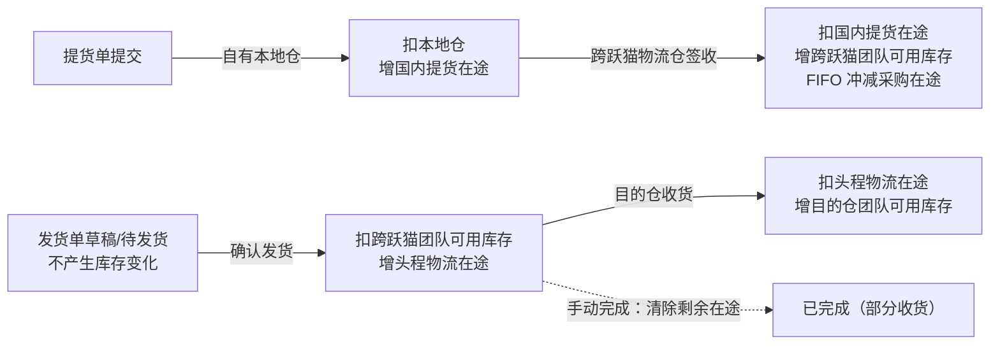
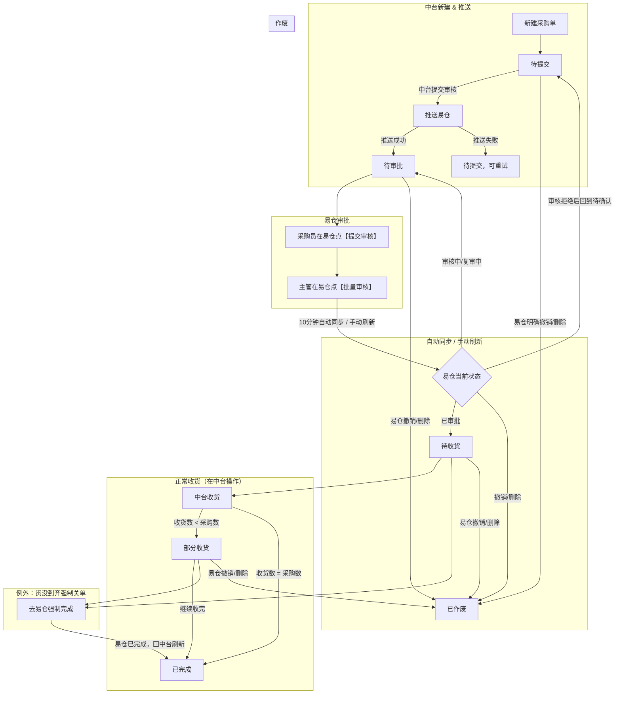
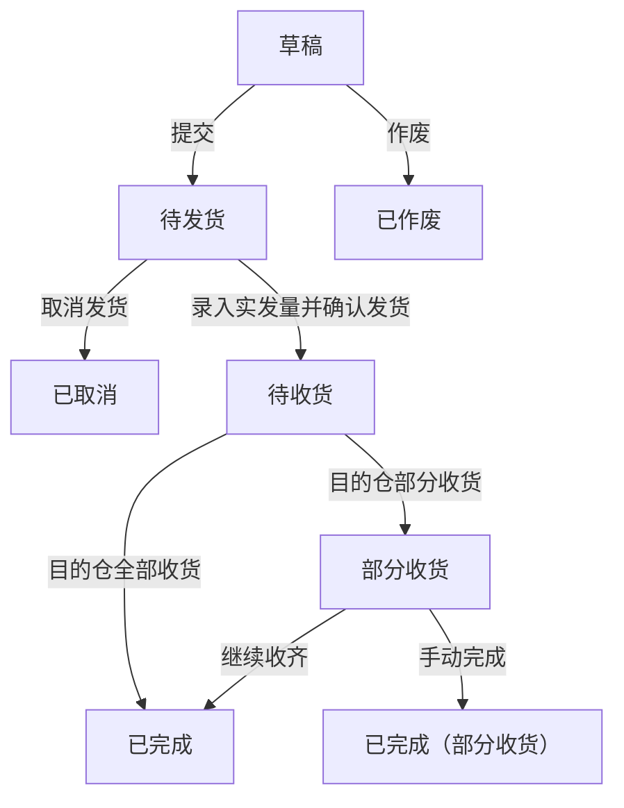

# 供应链中台 · 业务逻辑知识库

> **用途**：一份结构化的业务知识沉淀文档。写新 PRD 时查影响面、了解某个模块的业务规则、追溯上下游依赖，都从这里查，不需要去 CHANGELOG.md 翻版本记录。
>
> **更新规则**：业务规则、状态流转、数据字段、模块间关系发生变更时，**同步更新对应章节**。不要等攒多了再改。
>
> **与 CHANGELOG.md 的关系**：CHANGELOG 记录「什么时候改了什么」，本文档记录「系统现在是怎么运转的」。
>
> **维护边界（必须遵守）**：本文档只记录项目长期有效的业务规则、流程规则、状态流转、数据生成/计算/回写规则、库存流转、模块上下游关系、系统边界、异常处理和幂等约束。不得记录页面字段排列、表格列、弹窗布局、按钮名称、提示文案、视觉样式、局部页面交互或单次原型改动；这些内容统一写入对应 PRD。准备同步内容时，必须先判断该内容是否会改变业务结果或被多个页面/模块长期共同遵守。若只是页面展示或交互细节，即使用户要求同步，也不得写入本文档。数量调整、履约批次等内容只记录其业务和数据规则，不记录批次列在弹窗中的展示位置。
>
> **同步决策规则**：只有当规则会影响状态、库存、数量、数据关联、数据回写、模块依赖、异常处理或系统一致性时，才同步更新本文档；否则只更新 PRD。无法判断时，优先不写入本文档，并向需求方确认。

---

## 目录

- [一、系统全景](#一系统全景)
- [二、需求预测（demand-forecast）](#二需求预测demand-forecast)
- [三、备货计划（stock-plan）](#三备货计划stock-plan)
- [四、采购计划（purchase-plan-2）](#四采购计划purchase-plan-2)
- [五、发货计划（shipment-plan-v2）](#五发货计划shipment-plan-v2)
- [六、采购单（purchase-orders）与采购变更（purchase-changes）](#六采购单purchase-orders与采购变更purchase-changes)
- [七、发货单（shipment-orders）、FBA 货件与提货单](#七发货单shipment-ordersfba-货件与提货单)
- [八、全局导出中心与基础主数据](#八全局导出中心与基础主数据)
- [九、模块间关联矩阵](#九模块间关联矩阵)
- [十、跨模块共享数据](#十跨模块共享数据)
- [十一、设计决策记录](#十一设计决策记录)
- [十二、调拨单与同仓货权转移（transfer-orders）](#十二调拨单与同仓货权转移transfer-orders)
- [十三、库存中心 2.0（inventory-query / batch-inventory / inventory-flow）](#十三库存中心-20inventory-query--batch-inventory--inventory-flow)
- [十四、库内作业：加工单（processing-orders）与损益单（inventory-adjustments）](#十四库内作业加工单processing-orders与损益单inventory-adjustments)
- [十五、财务与成本核算（移动加权平均价 / 头程费用 / 采购价分析）](#十五财务与成本核算移动加权平均价--头程费用--采购价分析)
- [十六、产品主数据与 SKU 映射（product-list / overseas-sku-mapping）](#十六产品主数据与-sku-映射product-list--overseas-sku-mapping)
- [十七、权限、审批流与全局协同规范](#十七权限审批流与全局协同规范)

---

## 一、系统全景

### 1.1 业务链路

```
需求预测 → 备货计划 → 采购计划 → 采购单（+ 采购变更）
                        ↓
                     发货计划 → [亚马逊] FBA 货件 ──┐
                        │                           ↓
                        └──────→ 提货单 ────→ 发货单（待发货 → 待收货 → 已完成）
                                                    ↓
                                         库存中心 2.0 + 财务成本核算
```

| 业务域 | 页面 | 定位 | 核心状态数 |
|---|---|---|---|
| 计划层 | 需求预测 (`demand-forecast`) | 按业务范围维护 SKU 月度销量预测 | 4 |
| 计划层 | 备货计划 (`stock-plan`) | 需求驱动，制定备货安排 | 7 |
| 计划层 | 采购计划 (`purchase-plan-2`) | 备货转采购方案，审核后自动拆单生成采购单 | 8 |
| 计划层 | 发货计划 (`shipment-plan-v2`) | 物流安排、多仓提货分配与 FBA 货件关联复核 | 8 |
| 采购执行 | 采购单 (`purchase-orders`) | 采购执行主单，审核、提货自动冲减、在途货权调整 | 6 |
| 采购执行 | 采购变更 (`purchase-changes`) | 针对待到齐采购单的数量/单价/财务字段变更与回写 | 4 |
| 发货执行 | FBA 货件 (`fba-shipment`) | 领星 FBA 货件台账，整单齐套自动生成草稿发货单 | 12（领星态） |
| 发货执行 | 提货单 (`pickup-orders`) | 承接计划提货与跨跃猫物流仓签收，FIFO 自动冲减采购在途 | 5 |
| 发货执行 | 发货单 (`shipment-orders`) | 发货执行单据，待发货确认出库、易仓 RPA 与自动/人工收货 | 7 |
| 库存中心 | 库存查询 / 批次库存 / 库存流水 / 供应商库存 | 统一库存变动引擎，按 `SKU + 仓库 + 团队` 维护唯一余额、批次库龄与流水 | — |
| 库内作业 | 加工单 (`processing-orders`) | 组合品即时加工过账与按行冲销 | 1（单据）/ 3（冲销） |
| 库内作业 | 调拨单 (`transfer-orders`) | 仓间实物调拨与同仓货权转移 | 4 / 2 |
| 库内作业 | 损益单 (`inventory-adjustments`) | 报溢/报损唯一合规调整入口 | 4 |
| 财务核算 | 移动加权平均价 (`moving-weighted-avg-cost`) | 按 `SKU + 仓库` 双线滚动核算货物与头程未税 CNY 成本 | — |
| 财务核算 | 头程费用 (`sku-first-leg-cost`) | 物流按计费重、清关按单价×税率权重独立分摊与阻断 | — |
| 财务核算 | 采购价分析 (`historical-purchase-price`) | 有效采购单 SKU 价格链条、价差及采购变更级联重算 | — |
| 产品管理 | 产品列表 (`product-list`) / SKU 映射 (`overseas-sku-mapping`) | SKU 主数据统一维护、多供应商绑定、异步推送双 ERP 与四类编码映射 | — |
| 基础配置 | 角色管理 / 流程管理 / 供应商列表 / 仓库管理 / 导出中心 | 权限矩阵、敏感字段、审批流引擎、基础主档与全局 `.xlsx` 导出 | — |

### 1.2 供应链数据流转

供应链中台按「计划与单据流、库存状态流、外部数据同步流」协同运转。该图用于理解系统边界和数据关系，不替代具体页面的字段、接口及状态规则。

| 数据流 | 主链路 | 作用 |
|---|---|---|
| 计划与单据流 | 需求预测 → 备货计划 → 采购计划 / 发货计划 → 采购单 / 发货单 | 将销售需求转化为采购与发货执行单据。计划侧读取库存、在途和货权；生成或变更单据后，反向影响库存占用、在途和收货状态。 |
| 库存状态流 | 采购在途 → 供应商仓库存；中转仓提货 → 加工货件 → 发货单出库 → 头程在途；发货单收货 → 团队库存增加 → 货权调整 → 库存扣减 / ERP 校准 → 中台现有库存 | 记录货物所处位置、物流状态及货权归属。各链路为不同业务场景的状态集合，并非每一件货都必须依次经过全部节点。 |
| 外部数据同步流 | 易仓 / 领星 → API → 中台库存与单据 | 同步多平台销售订单、海外仓 / 平台仓 / FBA 仓库存，以及采购、货件、收货等相关状态；中台以同步结果校准库存并驱动自动收货等后续处理。 |

#### 发货全链路库存流（V5.0 当前确认口径）

以下属于**库存流**，不等同于单据的业务状态流。当前全链路协同下，提货与跨跃猫物流仓签收由**提货单（pickup-orders）**独立承接，发货单（shipment-orders）已移除「待提货」与「待加工」节点：

1. **发货计划确认与提货单提交**：发货计划确认后推送提货需求至提货单；提货单提交时（若提货仓为自有本地仓）扣减对应仓可用/占用，`国内提货在途 += 计划提货量`。
2. **提货签收与采购冲减**：货物到达唯一目标入库仓「跨跃猫物流仓」并签收时，在同一事务内扣减 `国内提货在途`，增加跨跃猫物流仓对应归属团队可用库存，并按「同团队优先 FIFO → 跨团队兜底」自动冲减采购单在途、累加已入库数量。
3. **创建发货单**：仅建立与发货计划/FBA 货件的关联，不产生库存变化。
4. **发货单确认发货**：在「待发货」确认发货并录入实际发货数量时，校验并扣减「跨跃猫物流仓」对应团队可用库存（不足拦截），同时 `头程物流在途 += 实际发货量`；发货前作废/取消不扣减中转仓库存，并将关联发货计划回退至「待生成发货单」。
5. **发货单收货**：目的仓收货（自动同步或人工录入）时，扣减 `头程物流在途`，增加目的仓对应团队可用库存。
6. **部分收货后手动完成**：直接清除未收数量对应的剩余海外在途，不增加目的仓库存。
7. **统一库存变动引擎**：所有实物可用库存增减均须经统一库存变动引擎，同事务先写库存流水（仅记录可用库存实际增减）再更新余额。



#### 库存的三个维度

- **库存数量**：实际可统计的货物数量。
- **物流状态**：货物位于供应商仓、在途、已入库、已出库等哪个环节。
- **货权归属**：库存归属的团队、平台或店铺；货权变化不必然伴随实物移动。

例如，同一批货仍在同一海外仓内，从 A 团队调整给 B 团队属于货权调整，不代表发生实际调拨。

#### 外部销售订单同步口径（待接口确认）

数据流转图标注的「销售订单（M-1 + T-1）」可按常见时间口径暂作如下理解：`M-1` 为上一个自然月，`T-1` 为昨天；即同步上月历史订单与昨日新增或变更订单，用于兼顾历史补数、对账及日常增量更新。

该表达尚不足以定义完整的同步范围：若只拉取「上月 + 昨日」，本月此前日期的数据仍需由首次全量、月内累计、已落库数据或滚动回拉策略覆盖。接口联调前须明确 `M-1` 的准确范围、`T-1` 同步新增还是全量变更，以及订单状态回补机制。

#### 库存流转表的阅读方式

库存流转表中的大部分行是**字段传递或计划生成规则**，并不代表库存已经增减。应按下列四层阅读，而非逐行孤立理解字段映射：

```
需求预测 → 备货计划 → 采购计划 / 发货计划 → 采购单 / 发货单
                                                     ↓
                                              发货单实际收货
                                                     ↓
                                              团队库存增加
                                                     ↓
                               销售订单扣减可售库存 → 易仓库存同步校准
```

| 流转段落 | 业务含义 | 对库存的影响 |
|---|---|---|
| 需求预测 → 备货计划 → 采购计划 / 发货计划 | 将销售预期转为建议下单量、计划采购量和计划发货量。SKU、平台、团队等主数据用于匹配与传递。 | 不直接增减库存，仅形成计划。 |
| 采购计划 → 采购单；发货计划 → 发货单 | 将计划转为可执行的采购或发货单据，并按需推送易仓。 | 采购侧通常形成采购在途；发货侧记录提货、出库、运输与收货过程，尚不等于团队在库增加。 |
| 发货单 → 团队库存 | 目的仓完成实际收货后，按收货数量、SKU、团队、仓库等维度写入团队库存。 | **加库存**。 |
| 易仓销售订单 → 团队库存 | 按 SKU、平台、团队匹配销售订单，并记录出库 / 占用数量。 | **减库存**，得到中台暂算可售库存。 |
| 易仓库存 → 团队库存 | 易仓回传实际可售库存。 | **校准库存**；有最新实际快照时，以快照为准，避免对同一销售订单重复扣减。 |

以某 SKU 为例：需求预测 600 件，备货计划建议下单 200 件，后续采购/发货计划均形成 200 件安排；目的仓实际收货 100 件后，团队库存增加 100 件；若同步到销售订单扣减 10 件，中台暂算可售 90 件；易仓再回传实际可售库存 90 件时，中台以该结果完成校准。

因此，团队库存的理解口径为：

```
团队可售库存 = 发货单实际收货形成的库存 − 销售订单占用 / 出库
             ± 后续入库、退货、调整等业务变动
             → 最终以易仓同步的实际库存快照校准
```

### 1.3 核心数据对象

| 对象 | 定义 | 来源页面 | 消费页面 |
|---|---|---|---|
| **备货计划** | 基于需求预测的备货安排 | stock-plan | purchase-plan-2 |
| **采购计划** | 将备货计划转为采购方案，审核后按默认供应商+采购仓拆单 | purchase-plan-2 | purchase-orders, shipment-plan-v2 |
| **发货计划** | 采购完成后的物流与提货安排（1 计划 = 1 SKU） | shipment-plan-v2 | fba-shipment, pickup-orders, shipment-orders |
| **采购单** | 中台采购执行主单，由采购计划自动拆单生成，按团队维护在途与收货 | purchase-orders | purchase-changes, pickup-orders, historical-purchase-price |
| **采购变更单** | 针对待到齐采购单的数量/单价/财务字段变更单据 | purchase-changes | purchase-orders, purchase-plan-2, historical-purchase-price |
| **FBA 货件** | 从领星同步的 FBA 货件台账，全齐套时自动生成草稿发货单 | fba-shipment | shipment-plan-v2, shipment-orders |
| **提货单** | 承接计划提货与无计划提货，管理发运至跨跃猫物流仓及入库签收 | pickup-orders | purchase-orders（FIFO 冲减）, inventory-query |
| **发货单** | 发货执行单据，管理待发货出库→易仓 RPA→目的仓收货全链路 | shipment-orders | sku-first-leg-cost, moving-weighted-avg-cost, shipment-plan-v2 |
| **库存余额与流水** | 按 `SKU + 仓库 + 团队` 维护唯一余额、批次库龄与出入库流水 | inventory-query / flow / batch | 全部供应链单据、moving-weighted-avg-cost |
| **加工单 / 调拨单 / 损益单** | 库内组装冲销、仓间/货权调拨、报溢/报损唯一合规调整单据 | processing / transfer / adjustments | 统一库存变动引擎、moving-weighted-avg-cost |

### 1.4 单号体系

| 单号类型 | 前缀 | 格式 | 所在页面 |
|---|---|---|---|
| 中台采购单号 | PO | PO + YYYYMMDD + 序号 | purchase-orders |
| 采购变更单号 | POBG | POBG + YYMMDD + 4位流水号 | purchase-changes |
| 易仓采购单号 | ECPO | ECPO + YYYYMMDD + 序号 | purchase-orders |
| 领星采购单号 | LXPO | LXPO + YYYYMMDD + 序号 | purchase-orders |
| 采购计划号 | PP | PP + YYMMDD + 4位流水号 | purchase-plan-2 |
| 发货计划号 | SP | SP + YYMMDD + 4位流水号（超 9999 顺延 5 位） | shipment-plan-v2 |
| 提货单号 | TH | TH + YYYYMMDD + 序号 | pickup-orders |
| 中台发货单号 | DN | DN + YYYYMMDD + 序号 | shipment-orders |
| 易仓发货单号 | EC | EC + YYYYMMDD + 序号 | shipment-orders |
| 备货计划号 | CST/YMX | 前缀 + YYYYMMDD + 序号 | stock-plan |
| 加工单号 | PT | PT + yyMMdd + 4位流水号 | processing-orders |
| 损益单号 | SY | SY + YYMMDD + 4位顺序号 | inventory-adjustments |
| 库存批次号 | PC | PC + YYMMDD + 4位当日流水号 | batch-inventory |
| 货件单号 | FBA | FBA + YYYYMMDD + 序号 | fba-shipment / shipment-plan-v2 |

---

## 二、需求预测（demand-forecast）

### 2.1 定位
计划层的需求输入。按预测批次、平台、店铺、国家、团队、运营负责人和预测类型维护多 SKU 的月度销量预测，并在确认后生成备货计划。

### 2.2 状态定义与流转

| 状态 | 含义 | 下一状态 |
|---|---|---|
| 草稿 | 新建预测单，尚未提交 | 待确认 / 已作废 |
| 待确认 | 已提交，等待业务确认 | 已确认 / 已作废 |
| 已确认 | 预测通过，生成备货计划 | — |
| 已作废 | 预测单被取消 | 可编辑后重新提交 |

### 2.3 核心业务规则
- 一个预测单可维护多个 SKU，月度预测覆盖 2026/08 至 2027/01。
- 预测单确认后生成关联备货计划单号，需求预测页面可定位查看关联备货计划。
- 支持批量提交、批量作废、导入和导出入口；当前原型使用本地模拟数据。

## 三、备货计划（stock-plan）

### 2.1 定位
供应链计划层的起点。运营人员基于需求预测制定各 SKU 的备货计划，包含未来 3 个月的月度销量预估。经确认后流转到采购计划。

### 2.2 状态定义与流转

| 状态 | 含义 | 下一状态 |
|---|---|---|
| 待计划确认 | 新建备货计划，尚未确认 | 待运营确认 / 已作废 |
| 待运营确认 | 计划已拟定，待运营审核 | 待负责人确认 / 已作废 |
| 待负责人确认 | 运营确认通过，待负责人审批 | 待生成采购计划 / 已作废 |
| 待生成采购计划 | 审批全部通过，可执行 | 待生成发货计划（生成采购后）/ 已作废 |
| 待生成发货计划 | 采购计划已生成 | 已执行 / 已作废 |
| 已执行 | 全链路结束（终态） | — |
| 已作废 | 任意环节作废（终态） | — |

### 2.3 核心业务规则
- **编码查询**：支持 SKU、领星 SKU、SellerSKU、ASIN 四种编码类型切换查询，多值逗号/空格分隔
- **月度销量**：展示 2026/08、09、10 三个月的预计销量，支持环比开关
- **筛选维度**：平台、国家、店铺、团队、创建人均为多选精准匹配；时间范围支持创建/更新/期望交货三种维度

### 2.4 关键操作
| 操作 | 触发方式 | 影响 |
|---|---|---|
| 多条件查询 | 查询按钮 | 综合 14 项筛选条件 |
| 确认 | 底部批量按钮 | 推进当前确认环节 |
| 生成采购计划 | 底部批量按钮 | 跳转 purchase-plan 页面 |
| 生成发货计划 | 底部批量按钮 | 跳转 shipment-plan 页面 |
| 作废 | 底部批量按钮 | 任意状态 → 已作废 |

### 2.5 数据字段概要
计划号、SKU、品名、领星SKU、SellerSKU/ASIN、平台、店铺、国家、团队、月度销量×3、采购单号、计划单号、状态、创建人、备注

---

## 四、采购计划（purchase-plan-2）

### 4.1 定位与层级架构
将备货计划转为可执行的采购方案，采用「1 张采购计划（`PP + YYMMDD + 4位流水号`）→ 多条 SKU 明细（可跨团队）」扁平结构（取消原采购计划批次层级）。**采购计划是中台采购单的唯一正式生成来源**（采购单侧无手工新建入口）；计划、采购单、收货结果按**稳定 ID 与明细 ID** 关联，严禁凭 SKU 文本匹配。

### 4.2 状态定义与流转（8 态，单向不可回退）

| 状态 | 含义 | 触发与流转规则 |
|---|---|---|
| **草稿** | 新建或复制明细生成 | 提交审核（校验 SKU、团队、计划交货日期、计划采购量，**不校验采购仓库**）→ `待审核`；业务作废 → `已作废` |
| **待审核** | 已提交，等待审批 | 审核通过 → `待采购`（同时自动拆单生成 `待提交` 采购单）；驳回（原因必填）→ `已驳回`；作废 → `已作废` |
| **已驳回** | 审核未通过 | 可修改后重新提交 → `待审核`（不可直接作废） |
| **待采购** | 审批通过，已拆单待采购 | 计划下**任一**采购单审核通过 → `采购中`（仅生成或提交采购单不改变计划状态） |
| **采购中** | 已有采购单审批通过 | 计划下**任一**采购单首次产生收货（`> 0`）→ `部分到货`；全部 SKU 无在途且无未审单 → `已完结` |
| **部分到货** | 已有部分明细发生收货 | 全部 SKU 在对应采购单均无在途且无未审单 → `已完结` |
| **已完结** | 全部执行收口（终态） | **唯一判定**：计划下全部 SKU 在各自采购单均无在途（含收完、「结束到货」清零、已移除、采购单已作废）；与采购单是否手动完成解耦 |
| **已作废** | 审批前取消（终态） | 仅 `草稿`/`待审核` 可作废；`待采购` 及之后状态不可作废（采购单作废不使计划转为已作废） |

> **单向不可回退约束**：采购单后续被驳回、作废或状态变化，不使采购计划退回前一状态；存在未生成采购单或处于 `待提交`/`待审核` 的 SKU 明细时，计划不得进入 `已完结`。

### 4.3 自动拆单、子件合并与核心业务规则
- **自动拆单规则**：采购计划审核通过后，按 **`默认供应商 + 采购仓库`** 自动拆单并新建 `待提交` 采购单（**团队不参与拆单**；采购仓库为空时按空仓库单独成组；**不并入**已有同供应商+同仓的待提交单）。任一明细 SKU 无有效默认供应商时，审核整单拦截。
- **组合品拆单与同计划同团队子件合并**：
  - 组合品成员按各自的默认供应商与采购仓库独立拆单，父项可关联多张采购单；合计时严禁重复计入父项与子项。
  - 同一采购计划且同一团队中，组合 SKU 成员与单独采购的相同子件落入同一采购单时合并为同一 SKU 行：`采购数量 = 组合采购套数 × 配比 + 单独采购数量`，同时保留下钻需求构成供分别回写，不同计划或不同团队不合并。
- **数量与金额口径**：
  - `计划采购金额 = 计划采购量 × 上次采购价`（任一因子为空或 `≤ 0` 时为空）。
  - `实际采购量`：仅计入已审核通过的采购单（`待到齐`、`已完成`）的采购数量；`待提交`/`待审核`/`已驳回`/`已作废` 均不计入。
  - `差异数量 = 实际采购量 - 计划采购量`（明细保留正负，汇总取绝对值之和，已移除不计入）。
  - `已移除` 明细：计划采购量仍计入汇总，实际采购量/收货/在途按 `0` 计。
- **属性传递与复制规则**：
  - **首单「首」标记**：SKU 历史从未生成过采购单时打标，随生成采购单保留，不因后续生成采购单而清除。
  - **加急标识**：明细级布尔值（`草稿`～`部分到货` 可设），随明细传递至采购单（`已移除` 不传递），不改变排序与拆单。
  - **复制明细新建计划**：跨计划勾选（组合品按整条组合 SKU 带入）**仅继承 `团队`**，其余可编辑字段一律置空，不继承执行数据与 `加急`/`已移除` 标记。
- **计划与采购单双向回写**：采购单驳回 → 明细回写 `已驳回`；采购单作废 → 明细回写 `已作废` 且保留原采购单号（在途/实采/收货按 `0` 计）；采购单完成 → 明细回写 `已完成`；待提交移除 SKU → 明细置为 `已移除`（终态不可恢复）。

---

## 五、发货计划（shipment-plan-v2）

### 5.1 定位与基数约束
采购完成后的物流与提货安排（1 条发货计划严格对应 1 个 SKU）。决定货物从哪些提货仓出发、经唯一中转发货仓「跨跃猫物流仓」发往哪个目的仓。

- `发货计划 : SKU = 1 : 1`；`发货计划 : 提货仓 = 1 : N`；`发货计划 : FBA 货件明细 = 1 : N`。
- 计划单号由后端按 `SP + YYMMDD + 4位流水号`（超 `9999` 顺延 5 位）生成，已作废单号不回收，修改字段不改变单号。

### 5.2 状态定义与流转（8 态）

| 状态 | 含义 | 正向 / 逆向流转 |
|---|---|---|
| **待确认** | 新建或 `.xlsx` 导入 | 确认（同步推送提货需求至提货单）：`团队 == 亚马逊团队` → `待创建货件`；`团队 != 亚马逊团队` → `待生成发货单` |
| **待创建货件** | 亚马逊链路待关联 FBA 货件 | 在发货计划侧关联 FBA 货件：`计划差额 == 0` → `待生成发货单`；`计划差额 != 0` → `待复核` |
| **待复核** | 关联 FBA 货件申报量与计划量存在差额 | 复核通过 → `待生成发货单`（后续按 FBA 实际申报量生单）；驳回（原因必填）→ `待创建货件`（保留原关联供调整）；取消关联 → `待创建货件`（解绑占用） |
| **待生成发货单** | 待落实为中台发货单 | 亚马逊：关联的**全部** FBA 货件均已自动生成草稿发货单 → `待发货`；非亚马逊：手工选入创建发货单 → `待发货`；取消关联（未生单前）→ `待创建货件` |
| **待发货** | 已关联发货单，发货单尚未实际出库 | 下游发货单确认发货 → `待到齐（待收货）`；下游发货单发货前作废/取消 → 回退 `待生成发货单`（清空各处发货单号） |
| **待到齐** | 货物已出库运输中（含子状态 `待收货` / `部分收货`） | 目的仓收货 `0 < 已收 < 实发` → `待到齐（部分收货）`；`已收 ≥ 实发` 或关联 FBA 货件同步 `CLOSED` → `已完成`（**按单条计划明细独立判定**） |
| **已完成** | 该计划明细已收齐（终态） | — |
| **已作废** | 发货前取消（终态） | 仅 `待确认`～`待发货`（未实际发运出库前）可作废，自动释放未发货 FBA 货件占用与草稿发货单明细 |

> 注意：发货计划的「待发货」表示已关联发货单但尚未出库；发货单的「待发货」表示可以录入实发量并确认出库。

### 5.3 核心业务规则与计算口径
- **字段锁定边界**：
  - `待确认`、`待创建货件`、`待复核`、`待生成发货单`（未生单前）：允许编辑主表、物流轨迹、分仓提货量与备注。
  - `待发货`：锁定核心字段，仅允许改备注及发货前作废。
  - `待到齐`：除备注外全字段只读，不可作废；`已完成` / `已作废` 全字段只读。
- **默认值与日期推算**：`发货方式` 默认 `本地仓发货`（可选 `工厂直发`）；`发货仓` 唯一默认 `跨跃猫物流仓`；填写 `预计发货日期` 与 `预计物流时长(天)` 时自动推算 `期望到货日期 = 预计发货日期 + 预计物流时长(天)`。
- **SKU / FNSKU 约束**：添加 SKU 仅带出只读基础属性；SKU 仅对应 1 个 FNSKU 时自动选中，对应多个时须人工单选。
- **多提货仓与箱数公式**：
  - $\sum \text{各提货仓提货数量} \le \text{计划发货数量}$，且每个已选提货仓提货量 $> 0$。
  - $\text{箱数} = \lceil \text{计划发货数量} / \text{箱规(数量)} \rceil$。
- **FBA 关联强校验与差额公式**：
  - 关联与解绑入口统一收敛于发货计划模块（FBA 货件页不再提供关联入口），通过 **`领星 SKU`** 与 FBA 货件明细 SKU 精确匹配（1 条 FBA 货件明细最多绑定 1 条发货计划）；已生成正式发货单的货件禁止取消关联。
  - $\text{已选申报合计} = \sum \text{选中 FBA 货件下对应领星 SKU 明细的申报量}$；$\text{计划差额} = \text{已选申报合计} - \text{计划发货数量}$。

---

## 六、采购单（purchase-orders）与采购变更（purchase-changes）

### 5.1 定位
采购执行单据。管理从供应商采购的全过程：采购计划自动拆单生成 → 审核 → 外部 ERP 推送/同步 → 在途跟踪 → 到货入库（或提货单签收 FIFO 自动冲减）→ 收货完成。同时支持在途货权调整（仅团队维度）与采购变更。中台采购单是中台侧主单，易仓/领星采购单是外部执行单。

### 5.2 状态定义与流转（2.0 口径：6 态）

中台采购单状态共 6 个：**待提交、待审核（或待审批）、待到齐（内部保留收货进度 `待收货` / `部分收货`）、已完成、已驳回、已作废**。

- `待提交`：由采购计划审核通过按 `默认供应商 + 采购仓库` 自动拆单生成（无手工新建入口）。提交审核时逐张强制校验 `采购仓库`、`供应商`、`采购主体`、`采购员` 必填（混选不合规单据整批拒绝），通过后进入 `待审核`。
- `待审核`：支持批量审核。审核通过 → `待到齐（待收货）`；审核驳回（原因必填）→ `已驳回`（同时回写采购计划明细为 `已驳回`）。
- `已驳回`：编辑后可保存回 `待提交` 或重新提交至 `待审核`。
- `待到齐`：可执行收货（或由提货单签收 FIFO 自动冲减）与「结束到货」，全部收完或手动完成 → `已完成`；仅对处于 `待到齐` 的采购单可发起采购变更。
- `已作废`：`待提交` / `待审核` / `已驳回` 可作废（终态不可恢复），回写采购计划明细为 `已作废` 且保留原采购单号不清空。

> 同步与易仓外部审批映射规则（每 10 分钟自动同步一次、状态计算优先级）沿用既有机制，详见 5.7 节。

#### 易仓审批流程与中台状态的关系（关键！）

```text
中台新建采购单 → 中台状态 = 待提交（不推送易仓）
  → 采购员在中台提交审核
  → 推送易仓成功 → 中台状态 = 待审批（易仓 = 待确认）
  → 采购员在易仓点【提交审核】→ 易仓 = 审核中
  → 采购主管在易仓点【批量审核】→ 易仓 = 已审批
  → 中台每 10 分钟自动同步一次（或采购员主动点刷新加速）
  → 中台状态 = 待收货
  → 开始在中台操作收货
```

#### 状态流转图



#### 中台 6 个状态的业务含义

| 中台状态 | 业务含义 | 采购同事要做什么 |
|---|---|---|
| **待提交** | 采购单已在中台创建，但尚未提交审核，尚未推送易仓；或易仓审核拒绝后回到待确认 | 可修改采购单并重新提交审核 |
| **待审批** | 中台已提交审核并成功推送易仓，易仓采购单等待审核；易仓进入审核中/复审中时中台保持此状态 | 等待在易仓完成审核，并等待中台同步 |
| **待收货** | 易仓已审批通过，中台同步后确认可以收货了 | 开始在中台采购单上操作收货 |
| **部分收货** | 已发生收货，但收了一部分还没收完 | 继续在中台收货；收完自动变「已完成」 |
| **已完成** | 全部收完，或易仓强制完成（货没到齐强制关单）后回传 | 终态，不用再操作 |
| **已作废** | 采购单被撤销、反审核删除或取消 | 终态，不能再收货 |

#### 易仓采购单与中台采购单的状态映射关系

中台的状态由「中台提交/推送状态 + 易仓状态 + 易仓已收货数量 / 采购数量」共同决定。只有易仓接口成功返回后，定时同步或手动刷新才允许更新中台状态；接口异常时保留上一次成功状态。

| 易仓状态 | 中台状态 | 说明 |
|---|---|---|
| 待确认（首次推送后） | 待审批 | 中台已提交审核，易仓采购单已创建，等待易仓侧提交审核 |
| 审核中 | 待审批 | 易仓正在审核 |
| 复审中 | 待审批 | 易仓进入复审流程 |
| 已审批（还未收货） | 待收货 | 易仓审核通过，尚未发生收货 |
| 已审批（已经部分收货） | 部分收货 | 根据已收货数量和采购数量计算，易仓是在【到货易仓】完成了 |
| 已完成（收完或者强制完成） | 已完成 | 易仓正常完成或强制完成 |
| 撤销、反审核删除 | 已作废 | 易仓采购单已被撤销或删除 |
| 审核拒绝后回到待确认 | 待提交 | 中台恢复为待提交，允许修改后重新提交审核 |
| 到货异常 | 暂保留原状态 | 暂不直接映射为已作废或已完成，记录异常信息 |

**中台状态计算优先级**（同步触发时，从高到低判断）：

```text
易仓明确返回撤销/反审核删除     →  中台 = 已作废
易仓明确返回已完成（收完或者强制完成） →  中台 = 已完成
已收货数量 ≥ 采购数量           →  中台 = 已完成
已收货数量 > 0                  →  中台 = 部分收货
易仓状态 = 已审批（还未收货）    →  中台 = 待收货
首次推送成功且易仓状态 = 待确认 / 易仓状态 = 审核中 / 复审中 →  中台 = 待审批
易仓审核拒绝后回到待确认        →  中台 = 待提交
易仓状态 = 到货异常             →  中台 = 暂保留原状态
查询不到 / 接口异常             →  保留上次状态
```

### 5.3 采购单数据层级

- **主单层**：保存中台采购单号、供应商、采购仓、ERP 路由、外部采购单号、采购总金额、采购总数量、累计收货数量、在途数量和中台状态。
- **明细层**：按采购计划 + SKU 记录采购数量、采购单价、收货数量、在途数量、团队、平台、店铺及外部明细映射。
- **收货层**：按采购计划 + SKU + 收货批次记录每次收货数量、收货人、收货时间和外部收货明细 ID。
- 主单汇总值必须由明细或收货批次归集，不能由页面临时展示值反向覆盖业务数据。

### 5.4 在途货权调整与 2.0 采购单改造规则
- **在途货权调整（最新口径）**：
  - 仅针对采购单下 `可调整在途数量 > 0` 的 SKU，将采购在途从来源团队调至调入团队（`1 ≤ 调入数量 ≤ 服务端最新可用在途数量`，`调入团队 ≠ 来源团队`，并发提交以服务端最新在途校验）。
  - 已取消调入平台、店铺、SellerSKU/ASIN 及公共库存特殊分支，仅保留团队维度。
  - **跨模块边界**：不改变采购数量、计划采购量、实际采购量、收货数量、采购在途总量、仓库位置、价格及金额；不生成采购单/发货单；不触发计划状态变化；调整记录须保留采购计划号供追溯。
- **待提交移除 SKU**：仅 `待提交` 可操作，原因必填（≤ 200 字），立即重算单据数量金额并回写计划明细为 `已移除`；**采购单至少保留 1 个 SKU**（仅剩 1 条时禁止移除，须整单作废）。
- **待提交更换供应商**：单头供应商只读不可直接改，仅支持在 `待提交` 明细行更换供应商：将该 SKU 移出原单并**统一新建**一张 `待提交` 采购单（不并入已有单据），继承原单采购仓、采购员、采购主体、结算方式、税率，运费/优惠/其他费用置 `0`，沿用原单价；原单仅剩 1 个 SKU 时禁止更换。计划明细指向新采购单号与采购员，计划状态不回退。
- **合并采购**：仅限 `待提交` 采购单，按 **`供应商 + 采购员 + 采购仓库 + 采购主体`** 四项完全一致自动分组（每组 ≥ 2 张）；各组分别合并，**每组保留实际勾选单中创建时间最早的采购单号**（不生成新号），其余单据明细、计划关联及运费/其他费用/优惠金额并入主单，被合并单移除并记录来源单号与合并日志。
- **结束到货**：仅 `待到齐` 可执行，将勾选的未收完 SKU（`累计收货 < 采购数`）在途数量置 `0` 并重算整单在途，单据状态、收货数量、待收数量不变。
- **提货单签收联动冲减**：启用提货的供应商（如 `JASIC 精密`、`摩仕达`）关闭人工收货入口，统一由提货单在「跨跃猫物流仓」签收时按 **「同团队优先 FIFO → 全平台最早采购单跨团队兜底」** 自动冲减采购单在途、累加已收货数量并写入收货批次与异常台账（详见 7.11 提货单）。
- **已移除逻辑**：已取消采购单「批次成本价」字段与计算逻辑，移除「采购运费分摊」入口。

### 5.5 核心业务规则
- **12 维查询**：三套单号体系（易仓/领星/中台）模糊查询、SKU、供应商、计划号、批次号、采购仓库、平台、店铺、团队、收货人、收货时间、创建人
- **日期校验**：开始/结束日期必须同填同空，开始 ≤ 结束
- **默认创建人**：查询时默认选 Admin
- **采购员默认值**：新建采购单时，采购员默认取当前登录账号；采购员仍可手动变更，最终以采购单保存的采购员为准。
- **采购主题**：采购主题为必填单选字段，只能从配置的采购主体枚举中选择，不允许提交空值或任意文本。
- **金额字段**：运费、优惠金额、其他费用均为非必填金额；采购单金额按明细采购金额加运费和其他费用再减优惠金额计算，未填写的可选金额按 0 计算。
- **结算方式枚举**：月结30天、月结90天、月结150天、月结180天、款到发货 预款20%、余款80%款到发货 预款30%、余款70%款到发货。
- **采购单新建来源**：采购 SKU 必须来自采购计划，不能脱离采购计划手工创建采购明细。

#### 5.5.1 提交审核与推送规则

1. 新建采购单提交后只保存中台主单和明细，状态为「待提交」，不调用易仓创建采购单接口。
2. 「待提交」状态允许修改采购单基础信息和采购明细；修改保存后仍保持「待提交」，不能因为修改触发 ERP 推送。
3. 单条或批量提交审核时，系统只允许处理「待提交」采购单；提交前进行必填项、明细数量和采购计划关联校验，并在用户确认后开始推送。
4. 推送成功后保存外部 ERP 类型、外部采购单号/ID及明细映射，中台状态变为「待审批」；易仓初始状态为「待确认」。
5. 推送失败时中台采购单保持「待提交」，记录失败原因，允许修正后再次提交；不得将失败单据误标记为「待审批」。
6. 「提交审核」是中台触发 ERP 推送的业务动作，不等同于易仓内部的审核通过；易仓侧仍按其自身的提交审核、主管审核流程流转。
7. 「待提交」下发生的每次修改都必须记录字段级变更日志，包括操作人、操作时间、字段名称、修改前值和修改后值；多个字段同时修改时分别记录。
8. 提交审核日志至少记录操作人、操作时间、原状态、新状态、推送 ERP、推送结果和失败信息（如有）。

### 5.6 多 ERP 采购单推送与收货同步

#### 5.6.1 业务定位

中台采购单是采购业务的**主单**；领星采购单和易仓采购单是由中台推送创建的**外部执行单**。中台负责统一组织采购需求、保存单据映射并汇总执行结果。**正常收货在中台采购单上完成**；只有「货没到齐需要强制关单」的场景，因为中台暂未实现强制完成功能，采购同事需去对应 ERP（易仓/领星）强制完成，ERP 完成后将状态回传给中台，中台同步转为「已完成」。

```text
多个采购计划明细（可保留来源发货计划关系）
        ↓ 合并采购需求
中台采购单（主单）
        ↓ 按采购单 ERP 路由创建
 ┌──────────────────────────────────────────────┐
 │ 按采购单路由规则选择一个 ERP                    │
 │ 亚马逊团队 → 领星；其他团队 → 易仓（示例规则）   │
 └──────────────────────────────────────────────┘
        ↓ 用户在外部 ERP 完成收货
外部入库单 / 收货单 / 质检单
        ↓ 接口拉取或接收回传
中台更新采购单、发货计划及 SKU 明细的执行结果
```

#### 5.6.2 单据关系

1. 中台采购单的正式来源只有采购计划，不直接由发货计划生成；采购计划明细需要保留来源关系。
2. 一个中台采购单可以合并多个采购计划明细对应的采购需求；每个采购计划明细必须保留其所属团队、SKU、计划数量及来源关系。
3. 中台采购单在创建前确定唯一 ERP 路由；同一采购单整体推送到易仓或领星，不能按团队拆分到不同 ERP。
4. 同一个团队的多个采购计划明细允许合并到同一个 ERP 外部采购单；单条采购计划明细不允许拆分到多个外部采购单。
5. 一个中台采购单只路由至一个外部 ERP；同一个采购单不允许同时存在易仓采购单和领星采购单。ERP 路由在创建采购单前确定，创建后不可切换。
6. 同一个 SKU 如果属于不同团队，仍需按团队保留采购明细和收货结果；但这些明细必须归属于同一 ERP 路由，不能将一个采购单拆成易仓和领星两个外部采购单。
7. 外部采购单创建成功后，中台必须保存外部 ERP、外部采购单号、外部单据 ID（如接口返回）、创建结果、同步时间和错误信息，并建立中台明细到外部明细的映射。

#### 5.6.3 创建采购单流程

**前置条件**：采购计划已存在且状态为「待采购」。**数据源**：只能从采购计划选择 SKU，不支持手动录入 SKU。

**合并规则**：
- 同一个供应商 + 同一个采购仓库 → 自动合并成同一张中台采购单
- 任一不同（供应商不同，或采购仓不同）→ 单独拆单

```text
从采购计划选择 SKU 明细（不支持手动录入）
    → 按【供应商 + 采购仓库】自动分组
    → 同组合并、不同组拆单
    → 生成中台采购主单及明细
    → 中台状态 = 待提交（不推送易仓）
    → 中台单条或批量提交审核
    → 推送易仓成功，保存外部采购单号及明细映射
    → 中台状态 = 待审批（易仓侧状态=待确认）
    → 采购员去易仓点【提交审核】→ 易仓状态=审核中
    → 采购主管在易仓点【批量审核】→ 易仓状态=已审批
    → 中台 10 分钟自动同步 / 采购员手动刷新加速
    → 中台状态 = 待收货（可以开始收货了）
```

领星分支的接口使用口径：

| 业务 | 接口 | 用途 |
|---|---|---|
| 创建采购单 | `POST /erp/sc/routing/purchase/purchase/createPurchaseOrder` | 直接创建状态为「待到货」的领星采购单，返回领星采购单号及自定义采购单号。 |
| 查询采购单 | `POST /erp/sc/routing/data/local_inventory/purchaseOrderList` | 按采购单号或更新时间查询采购单状态、到货数量及 SKU 明细，用于中台同步。 |
| 采购单下单 | 不调用 `POST /erp/sc/routing/purchase/purchase/setOrders` | 本期直接创建「待到货」采购单，不经过「待下单 → 待到货」的状态变更流程。 |

创建成功后，中台保存领星采购单号、外部单据 ID（如接口返回）及明细映射；后续通过采购单查询接口同步外部采购单和收货数量。

**易仓分支的审核流程与中台不同**：易仓侧需要采购员手动点【提交审核】→ 主管点【批量审核】→ 已审批。中台在推送成功后进入「待审批」，审核期间中台状态不变，通过 10 分钟自动同步或手动刷新来获取易仓最新状态。

推送状态（中台内部，不直接对采购同事可见）：

| 状态 | 含义 |
|---|---|
| 未推送 | 中台采购单已生成，尚未调用外部 ERP |
| 推送中 | 正在调用领星或易仓创建接口 |
| 部分成功 | 多个 ERP 分支中，部分创建成功、部分失败 |
| 已推送 | 所有需要推送的 ERP 分支均创建成功 |
| 推送失败 | 外部 ERP 创建失败，可修复后重试 |

一条外部 ERP 分支失败时，不应回滚另一条已经成功创建的外部采购单；中台应保留成功结果，并允许仅重试失败分支。重试必须具备幂等能力，避免同一个中台采购单重复创建外部采购单。

#### 5.6.4 收货流程（正常在中台，例外在易仓）

**正常收货流程（所有 ERP 通用）**

```text
采购员在中台采购单（状态=待收货/部分收货）上操作收货
    → 中台更新已收货数量和状态（待收货→部分收货/已完成）
    → 中台推送收货结果到易仓/领星（接口）
    → 易仓/领星同步更新收货状态
```

**收货数量不支持调整（重要约束）**

中台每次收货都会把结果同步给易仓，易仓暂不提供「调整已收货数量」的接口，因此中台采购单不支持修改已提交的收货数量：

- **少收了**：可以继续收货，累计到正确数量
- **多收了**：无法减少已收货数量

因此采购同事每次填写收货数量时，需仔细核对实际到货数量后再提交。

**收货场景：通过发货单提货数量进行采购收货**

发货单和采购单能互相关联的前提是：二者来源于同一张采购计划。采购计划生成发货计划（发货计划再生成发货单），同时采购计划生成采购单，因此发货单和采购单通过采购计划建立关联。

在发货单的提货弹窗中，每行 SKU 会展示对应的「易仓采购单号」。提货完成后，发货单详情的「提货」Tab 会记录每行的易仓采购单号和提货数量。

采购员根据「提货 Tab 中记录的易仓采购单号」，到采购单页面搜索定位到对应采购单，按照提货数量进行收货操作。核心对应关系：**发货单提货数量 = 本次采购单收货数量**。

**例外场景：货没到齐，需要强制关单**

```text
采购员去易仓操作【强制完成】（中台暂未实现此功能）
    → 易仓采购单状态 = 已完成
    → 中台 10 分钟自动同步 / 采购员手动刷新
    → 中台状态 = 已完成
```

**例外场景：易仓撤销采购单**

```text
采购员/系统在易仓撤销采购单
    → 易仓采购单状态 = 撤销/已删除
    → 中台 10 分钟自动同步 / 采购员手动刷新
    → 中台状态 = 已作废
```

领星收货后产生的入库单、收货单、质检单属于领星侧执行单据；中台不重复创建这些单据，而是同步其编号、状态、数量、时间和明细结果。易仓分支按易仓接口返回的对应收货/入库结果执行同样的回传和映射。

#### 5.6.5 中台展示与数量归集

采购单页面应同时展示主单汇总和外部 ERP 分支信息：

| 层级 | 应展示内容 |
|---|---|
| 中台采购主单 | 中台采购单号、整体状态、采购总数、已收货数、待收货数、在途数、关联 ERP 分支数 |
| ERP 分支 | ERP 类型、领星/易仓采购单号、外部单据状态、推送状态、最近同步时间、同步异常 |
| 来源发货计划明细 | 发货计划号、团队、SKU、计划采购数、对应外部采购单号、已收货数、在途数、待收货数 |
| 收货明细 | 收货批次/时间、外部入库单号、收货单号、质检单号、收货数量、质检结果及原始来源 |

数量归集必须沿着“外部明细 → 中台采购明细 → 来源发货计划 → 中台采购主单”逐级汇总。推荐保留以下基础数量字段，具体口径以领星和易仓接口确认结果为准：

```text
采购数量 = 中台采购明细或外部采购明细的下单数量
已收货数量 = 外部 ERP 返回的收货数量，并回写中台对应收货数量字段
待收货数量 = 采购数量 − 已收货数量（需考虑取消、退货和数量调整）
在途数量 = 暂以外部 ERP 返回的在途数量为准
```

合格数量、不合格数量和待质检数量暂不在中台页面展示。部分收货、取消、退货、质检不合格及外部数量调整，直接回写中台对应字段；如外部接口未返回某类字段，则保留当前中台值并记录同步异常，不使用其他数量字段覆盖。

#### 5.6.6 关联与幂等规则

1. 中台主单使用中台采购单号作为主标识；外部采购单使用“ERP 类型 + 外部采购单号/外部单据 ID”作为外部标识。
2. 外部明细必须保存来源发货计划号、来源 SKU、团队、ERP 类型及外部明细 ID，避免多个发货计划合并后无法回溯收货归属。
3. 外部收货结果必须使用外部收货单号、收货明细 ID、批次号或接口提供的唯一索引去重；重复拉取不得重复累计收货数量。
4. 外部收货接口返回的收货、入库、质检数量应分别保存原始值，不应在同步时直接用其中一个字段覆盖其他字段。
5. 外部 ERP 查询失败时保留上次成功数据，记录失败原因和重试信息，不改变已确认的收货数量。
6. 领星分支和易仓分支的同步状态、错误信息和最近同步时间分别维护，不能用一个总状态掩盖单个分支失败。

#### 5.6.7 已确认的业务口径

- 中台采购单的正式来源只有采购计划。
- 一个发货计划不允许拆到多个外部采购单；同团队的多个发货计划可以合并到同一个领星或易仓采购单。
- 中台“已收货数量”取外部 ERP 返回的收货数量。
- 合格数量、不合格数量和待质检数量暂不展示。
- 在途数量暂以外部 ERP 返回值为准。
- 部分收货、取消、退货、质检不合格和外部数量调整，直接回写中台对应字段。

#### 5.6.8 创建采购单的暂定幂等与重试方案

在领星、易仓尚未确认接口是否原生支持幂等键前，中台先按“分支级幂等 + 外部结果查询 + 可控重试”设计：

1. 每个中台采购单按 ERP 分支分别生成一条推送记录，唯一键建议为「中台采购单 ID + ERP 类型」；同一中台采购单在同一个 ERP 下最多创建一张外部采购单。
2. 为每个 ERP 分支生成固定的业务请求号，建议使用「中台采购单号 + ERP 类型」；首次调用和后续重试必须复用同一个请求号，不能每次重试重新生成。
3. 调用外部接口前先将分支状态置为「推送中」；接口明确成功后保存外部采购单号、外部单据 ID及明细映射，并置为「已推送」。
4. 如果接口超时、连接中断或返回不明确，不能直接再次创建；应先使用业务请求号、采购单号或接口支持的唯一条件查询外部是否已创建，确认不存在后再重试。
5. 如果外部接口支持幂等键，直接传入上述固定业务请求号；如果不支持，则通过中台唯一约束、外部单号/备注中的中台采购单号和创建前查询共同避免重复创建，具体字段待接口确认。
6. 自动重试建议仅针对网络超时、限流和临时性服务异常，采用最多 3 次的递增间隔；参数错误、业务校验失败、权限失败等明确失败不自动重试，转为人工处理。
7. 领星和易仓分支分别维护推送状态、重试次数、最近请求时间、错误信息和外部单号；一条分支失败不回滚另一条已成功分支，只允许重试失败分支。
8. 外部明细映射以「ERP 类型 + 外部采购单号/外部单据 ID + 外部明细 ID」作为唯一识别依据，避免合并多个发货计划后重复回写。

以上为当前暂定方案，最终幂等键、外部查询条件和可重试错误码需结合领星、易仓创建采购单接口确认。

### 5.7 易仓采购单状态同步

#### 5.7.1 状态来源与同步原则

1. 易仓负责记录采购单在外部系统中的审核、撤销和完成结果；中台负责保存中台业务状态和来源数据。
2. 中台采购单推送成功后，必须保存中台采购单号与易仓采购单号的映射；后续状态同步以该映射为查询依据。
3. 状态同步只允许由易仓接口成功返回后触发。接口超时、鉴权失败、限流或返回格式异常时，保留中台最近一次成功状态，不得用空结果覆盖已有数据。
4. 易仓“已审批”不直接等于中台“已完成”。中台必须同时读取采购数量和已收货数量，计算待收货或部分收货。
5. 同一采购单只存在一个外部 ERP 映射，不能同时存在易仓采购单和领星采购单；ERP 类型一旦创建成功不可切换。

#### 5.7.2 易仓与中台状态映射

中台采购单与易仓采购单的完整状态映射表和状态计算优先级，见上文 **5.2 状态定义与流转** 节。

**开发视角补充**（以下细节面向技术实现，不改变 5.2 的业务映射规则）：

- **审核拒绝回退**：易仓审核拒绝后回到「待确认」，中台必须恢复或保持「待提交」，不能停留在「待审批」。
- **强制完成不要求数量补齐**：易仓采购单被手动强制完成时，中台直接转为「已完成」，不校验已收货数量是否等于采购数量。
- **到货异常保留原状态**：易仓返回到货异常时，中台不得直接映射为「已作废」或「已完成」，保留当前中台状态并记录异常信息。
- **审核中与复审中合并**：中台不区分易仓的「审核中」和「复审中」，两者统一映射为「待审批」。
- **查询不到采购单不等于已删除**：一次接口返回空结果不能直接判定为已作废，需按 5.9.3 的规则先重试、后转异常处理。

#### 5.7.3 同步触发方式

- **定时同步**：默认每 10 分钟查询一次已成功推送且处于待审批、待收货和部分收货的采购单；尚未推送的待提交采购单没有外部单据，不进入 ERP 状态同步范围。周期应可配置。
- **单据同步**：允许针对单个中台采购单主动触发一次同步，用于易仓审核、反审核删除、收货或强制完成后的及时校准。
- **增量范围**：优先按易仓采购单号查询；若接口不支持单号查询，则按更新时间、状态和分页查询，并在中台侧按外部采购单号去重。
- **终态策略**：已完成和已作废采购单不需要高频轮询，但应保留历史同步记录和必要的主动复核能力。
- **并发控制**：同一中台采购单同一时刻只允许一个同步任务执行，避免定时任务与主动同步同时回写。

### 5.8 采购单与易仓数据交互模型

#### 5.8.1 主单映射

中台至少需要保存以下映射信息：

| 数据 | 说明 |
|---|---|
| 中台采购单 ID / 中台采购单号 | 中台主单唯一标识 |
| ERP 类型 | 固定为易仓或领星之一；当前采购单不得同时存在两种值 |
| 易仓采购单号 | 易仓侧业务单号 |
| 易仓采购单 ID | 易仓接口返回的内部 ID，若接口提供则必须保存 |
| 推送状态 | 未推送、推送中、已推送、推送失败 |
| 最近同步时间 | 最近一次同步任务的开始或完成时间，需明确口径 |
| 最近同步结果 | 成功、失败、部分字段异常 |
| 最近同步错误 | 错误码、错误信息和请求追踪号 |

#### 5.8.2 明细映射

中台采购明细与易仓采购明细需要建立稳定映射，至少保留：

- 中台采购明细 ID；
- 采购计划号；
- SKU；
- 团队、平台、店铺；
- 中台采购数量；
- 易仓采购明细 ID；
- 易仓 SKU 或商品编码；
- 易仓采购数量；
- 已收货数量；
- 在途数量；
- 最近一次外部更新时间。

明细匹配优先使用“易仓采购单 ID + 易仓明细 ID”；接口没有明细 ID 时，才允许使用“易仓采购单号 + SKU + 采购计划号”等组合键，并必须校验组合键唯一。不能只使用 SKU 匹配，否则同一采购单内重复 SKU 或不同团队 SKU 会发生数量覆盖。

#### 5.8.3 收货批次与收货明细

1. 收货明细的业务维度是“采购计划 + SKU + 收货批次号”；同一采购计划和 SKU 收货多次时，必须生成多条批次明细。
2. 批次号由收货成功后生成或由易仓接口返回后落库，收货提交前不要求用户填写批次号。
3. 每次同步易仓收货结果时，必须使用外部收货单 ID、外部收货明细 ID、批次号或接口提供的唯一标识去重。
4. 重复拉取同一收货结果不得重复增加已收货数量，也不得重复生成收货批次。
5. 收货数量同步完成后，沿“易仓收货明细 → 中台采购明细 → 中台采购单”逐级汇总，并重新计算中台状态。

#### 5.8.4 数量字段口径

```text
采购数量 = 中台采购明细的计划采购数量
已收货数量 = 易仓返回并已去重的累计收货数量
剩余可收数量 = max(采购数量 - 已收货数量, 0)
在途数量 = 易仓返回的在途数量；接口没有该字段时保留中台最近一次成功值
收货金额 = 按中台采购单价 × 已收货数量计算，具体金额精度按财务规则处理
```

同步时同时保存易仓原始数量和中台计算数量，便于排查接口口径、退货、取消或数量修正造成的差异。

### 5.9 易仓接口对接与异常处理

#### 5.9.1 接口能力要求

需要在易仓开放平台文档中确认是否存在以下能力：

1. 根据易仓采购单号或易仓采购单 ID 查询采购单详情；
2. 返回采购单当前状态编码和状态名称；
3. 返回采购数量、已收货数量、在途数量及明细；
4. 返回撤销、删除或反审核删除的明确结果；
5. 返回收货单、收货明细、批次号或可用于去重的唯一 ID；
6. 支持更新时间、分页或批量查询；
7. 返回接口请求追踪号、错误码及频率限制信息。

当前保存的参考地址是易仓开放平台文档中心：

```text
https://open.eccang.com/#/documentCenter?docId=356&catId=0-191-191,0-177
```

该地址是文档页面入口，不是中台后端可以直接请求的 API 地址。开发需要从文档中确认 `docId=356` 对应的真实请求地址、HTTP 方法、鉴权签名、请求参数和返回字段。如果该接口只返回采购单基本状态而不返回收货数量，还需要补充采购明细或收货明细查询接口。

#### 5.9.2 重试与幂等

- 同一采购单的同步任务使用“ERP 类型 + 易仓采购单号 + 同步批次号”记录请求，不允许并发重复回写。
- 网络超时、临时服务异常、限流可自动重试，建议最多 3 次并采用递增间隔。
- 参数错误、权限失败、业务校验失败不自动重试，转为人工处理。
- 接口返回不明确时，先查询外部采购单是否已存在或状态是否已变化，不得直接再次创建采购单。
- 只有成功解析并通过字段校验的响应，才允许更新状态和数量。
- 同步失败时保留上一次成功状态、数量和收货批次，并记录失败原因。

#### 5.9.3 查询不到采购单

一次查询不到采购单不能直接判定为已作废，原因可能是网络异常、分页遗漏、接口延迟或权限范围变化。

建议规则：

1. 接口明确返回“撤销、删除、取消”时，直接更新为已作废；
2. 仅返回空数据时，先记录异常并重试；
3. 连续两到三次确认查询不到后，进入异常待处理，不自动作废，除非接口文档明确约定空结果代表删除；
4. 作废结果必须写入操作日志和同步日志。

### 5.10 采购单同步日志与一致性要求

每次同步至少记录：

- 中台采购单号；
- 易仓采购单号和易仓采购单 ID；
- 同步触发来源（定时、主动同步、失败重试）；
- 同步开始时间、结束时间；
- 同步前中台状态；
- 易仓原始状态编码和名称；
- 同步后中台状态；
- 采购数量、易仓已收货数量、中台累计已收货数量；
- 收货批次新增或更新数量；
- 请求追踪号、错误码和错误信息。

状态变化必须保留原状态、新状态、变更来源和操作时间。同步任务不得因为部分字段失败而覆盖整张采购单；应按主单状态、明细数量、收货批次分别处理，并对失败字段保留旧值。

### 5.11 采购单与易仓同步验收场景

| 场景 | 易仓结果 | 中台结果 |
|---|---|---|
| 中台创建采购单，尚未提交审核 | 无外部采购单 | 待提交 |
| 中台提交审核并推送成功 | 待确认 | 待审批 |
| 易仓审核中 | 审核中 / 复审中 | 待审批 |
| 审核通过未收货 | 已审批，已收货数量为 0 | 待收货 |
| 审核拒绝 | 回到待确认 | 待提交 |
| 部分收货 | 已审批，0 < 已收货数量 < 采购数量 | 部分收货 |
| 正常收完 | 已完成 | 已完成 |
| 强制完成 | 已完成 | 已完成，不要求数量补齐 |
| 反审核删除 | 撤销 / 已删除 | 已作废 |
| 接口失败 | 无法确认 | 保留上次成功状态，记录同步异常 |

验收重点：重复同步不得重复累计收货数量；易仓部分收货但状态仍为已审批时，中台必须显示部分收货；易仓强制完成时，中台必须能从待收货或部分收货转为已完成；易仓撤销或明确删除时，中台必须转为已作废。

---

### 5.12 采购变更（purchase-changes）

- **单号与唯一入口**：单号 `POBG + YYMMDD + 4位流水号`。仅可针对处于 **「待到齐」** 状态（含待收货/部分收货）的源采购单从采购单侧发起（采购变更侧无新建入口）。支持多单带入但遵循「一单一变更」，仅为发生实际修改的采购单生成独立变更单。
- **在途互斥与连续变更基准**：
  - 同一采购单同一时间**仅允许存在 1 张「待审核」变更单**，存在时拦截新发起；`已生效`、`已驳回`、`已作废` 不阻塞新变更。
  - 若源采购单已有变更单生效，后续再发起变更时，「变更前原值（before 快照）」以**最近一次生效后的采购单最新数据**为准，非初始下单值。
- **状态机（4 态）**：`待审核`（源采购单保持原值）→ 审核通过（写回源采购单并记录生效时间）→ `已生效`（终态）；审核驳回（意见必填）→ `已驳回`（终态，不支持原单重编，需回源采购单重新发起）；作废 → `已作废`（终态）。
- **可变更范围与硬锁定条件**：
  - **不可变更**：供应商名称/代码、采购主体、预计交货日期、采购单备注、SKU 增删或替换、SKU 备注。
  - **可变更**：单头（采购仓库、采购负责人、结算方式、预付比例 0–100 整数、是否含税、税率、运费、其他费用、优惠金额、变更原因[必填]）；明细（采购数[正整数且 `≥ 累计入库数量`]、采购单价[非负 2 位小数]；变更后整单金额须 `≥ 0`）。
  - **四项硬锁定**：① **入库锁仓库**：源采购单任一 SKU `累计入库 > 0` 时，`采购仓库` 锁定不可改；② **收货锁明细**：某 SKU `累计入库 > 0` 时，该 SKU 的 `采购数` 与 `采购单价` 锁定不可改（同单未收货 SKU 仍可调）；③ **已付/已开票锁财务**：已付款或已开票的采购单锁定 `结算方式`、`预付比例`、`是否含税`、`税率`；④ **税率联动**：「是否含税 = 否」时税率强制 `0%` 不可改；「是」时税率必选 `> 0%`。
- **同单同 SKU 联动与上下游写回**：
  - 修改同单任一行采购单价时，同单所有相同 SKU 行的单价与货款同步更新。
  - 变更生效后覆盖写回源采购单；若明细「采购数」变更，**同步回写对应采购计划明细的「实际采购量」**；不触发批次成本价计算或历史批次成本回溯。

---

## 七、发货单（shipment-orders）、FBA 货件与提货单

### 6.1 定位
供应链发货执行层的核心协同域，由**发货计划 V2（shipment-plan-v2）**、**FBA 货件（fba-shipment）**、**提货单（pickup-orders）**与**发货单（shipment-orders）**共同构成端到端履约闭环。

### 6.2 发货单状态定义与流转（V5.0）

V2.2 已移除「待加工」及物流加工功能，并取消建单对亚马逊团队/平台/店铺的禁用限制；V5.0 进一步移除「待提货」节点（提货与入库签收交由独立提货单承接），发货单状态机精简为单据维度的 **7 态**：



### 6.3 发货出库、易仓 RPA 与双模式收货规则（V2.1 / V2.2 / V5.0）

1. **建单与默认值**：`发货仓` 唯一且默认 `跨跃猫物流仓`；`发货方式` 默认 `海外仓发货`；`运输方式` 默认 `海卡（6000）`（枚举：`海派（6000）`、`海卡（6000）`、`空派（5000）`、`快递（8000）`、`铁运（5000）`、`卡航（5000）`、`一件代发（8000）`）；`物流渠道` 7 选 1 必选；允许在 `草稿` 与 `待发货`（确认发货前）核对并修改实际发货数量。
2. **确认发货与发货前作废**：
   - **确认发货**：校验并扣减 `跨跃猫物流仓` 对应团队可用库存（`-= 实际发货量`，不足拦截）；`头程物流在途 += 实际发货量`；发货单转 `待收货`；锁定核心字段并反向回写关联发货计划状态为 `待到齐（待收货）`。
   - **发货前作废 / 取消**：不扣减中转仓库存；清空关联发货计划、FBA 货件及提货单上的 `发货单号`，并将关联发货计划回退至 `待生成发货单`。
3. **易仓头程计划创建与 RPA**：进入 `待收货` 后，中台按**实际发货数量**及目的仓「海外仓服务商代码」调用易仓「创建/编辑头程计划单」并保存易仓单号（失败阻断后续 RPA 并记异常）；成功后触发 RPA 在易仓依次完成确认发货计划 → 建发货单 → 确认装箱 → 确认发货。详情装箱明细通过易仓 `transferProductPackingList` 实时获取，不以中台本地装箱为准。
4. **目的仓双模式收货边界**：
   - **易仓已对接目的仓 WMS**（如万易通海外仓 V2、Amazon FBA 仓、千象盒子、跨越猫、海晨 HTC 德国仓、速卖通优选仓、沃尔玛 WFS 仓、美客多官方仓、斯德克、九方通逊、运去哪等）：禁止人工收货与部分收货数量调整；由中台定时任务每天 **00:00（中国时区）** 调用易仓「获取入库单明细」自动同步（`已完成` 或手动完成后停止常规定时查询；同步日志操作类型记 `收货同步`，操作人 `易仓`）。
   - **易仓未对接目的仓 WMS**：支持人工录入收货及 `部分收货` 数量调整，调用易仓「入库单收货」接口（失败时中台不得更新为成功）。
5. **幂等去重、有效收货上限与团队自动分配**：
   - **去重幂等**：按 `易仓入库单号 + SKU + 上架明细唯一标识` 去重汇总累计实收。
   - **有效收货公式**：`中台有效累计收货数量 = min(易仓累计实收数量, 中台实际发货数量)`；超出部分记「超收异常」，不分配团队库存。
   - **团队自动分配**：按「发货单 + 目的仓 + SKU」分组，**不提供人工调整入口**，严格按**发货计划建立时间升序**（同时间按 **ID 升序**）依次分配：`团队分配数量 = min(当前剩余可分配量, 该团队计划数量)`；扣减 `头程物流在途`、增加 `目的仓可用库存`。
   - **差额修正防负库存**：`本次库存变更 = 最新有效累计收货数量 - 上次有效累计收货数量`（正增负冲）；下调导致团队库存不足冲减时标记「收货同步异常」，严禁扩大负库存。
   - **计划明细独立完成**：按发货单内每条发货计划明细行独立判定并回写计划状态（`0 < 已收 < 实发` → `待到齐（部分收货）`；`已收 ≥ 实发` 或 FBA 货件 `CLOSED` → `已完成`）。
   - **部分收货后手动完成**：状态置为 `已完成（部分收货）`，清除剩余海外在途（未收部分不入目的仓），立即停止常规定时查询；因无易仓卸载接口，提示去易仓手动卸载。

### 6.4 核心业务规则

#### 刚性规则（不可违反）
| 规则 | 触发点 | 提示 |
|---|---|---|
| 同一发货单必须同一目的仓 | 新建发货单选择 SKU 时 | 提示文案 |
| 亚马逊相关发货单由领星生成，不在中台手动创建（FBA 专属仓、亚马逊平台/店铺选项置灰禁用） | 新建发货单 / 新增 SKU | 选项置灰 + 提示文案 |
| 加工数量 ≤ 已提子件套装数量且不超过可加工上限 | 物流加工提交时 | 报错阻断 |
| 新增 SKU 仅可选择待发货状态的发货计划 | 新建发货单选择 SKU 时 | 非待发货计划不展示、不可选 |
| 一个发货计划仅可关联一张发货单 | 发货单提交时 | 已关联计划不可再次选择 |

#### 发货计划关联粒度、锁定与提交事务
- **关联粒度**：当前一个发货计划只对应一个 SKU，发货计划号是该条发货计划的唯一业务关联标识；一条发货计划只能关联一张发货单。
- **候选范围**：新增 SKU 时，仅查询状态为「待发货」且尚未关联发货单的发货计划；亚马逊平台/店铺的发货计划被过滤，不展示、不可搜索。
- **草稿创建即关联**：保存草稿时即在同一事务内校验并关联发货计划（回写发货单号、计划状态流转「已完成」），草稿阶段计划即被锁定，不可被其他发货单再次关联。
- **编辑释放**：草稿/已作废单据可编辑（移除/新增 SKU），被移除的 SKU 对应发货计划释放回「待发货」，可被其他发货单重新关联。
- **并发冲突**：若另一用户已先关联同一发货计划，保存失败并提示该发货计划已关联的发货单号；用户刷新后重新选择。
- **历史快照**：发货单 SKU 明细须落库保存发货计划号、计划发货数量、发货量（原申报数量口径）、平台、店铺、团队、计划备注等快照字段；后续计划或 SKU 主数据变更不得改写历史单据口径。

#### 发货计划回写规则
- 保存草稿（创建）时即回写发货单号至关联发货计划，发货计划状态「待发货 → 已完成」，并记录关联日志（草稿阶段即锁定计划）。
- 草稿作废、待提货取消：关联发货计划状态「已完成 → 已作废」，并记录日志；作废/取消后计划不可再被其他发货单关联。
- 编辑草稿/已作废单据时移除 SKU：对应发货计划「已完成 → 待发货」（释放回可重新关联）。

#### 取消发货的状态边界与设计理由
| 状态 | 是否允许「取消发货 / 作废」 | 说明 |
|---|---|---|
| 草稿 | 允许（作废） | 未出库，作废后释放未提交关联，关联发货计划回退至「待生成发货单」。 |
| 待发货 | 允许（取消发货） | 尚未实际发货出库，取消后清空计划/FBA 货件/提货单上的发货单号，关联发货计划回退至「待生成发货单」。 |
| 待收货 / 部分收货 | 不允许 | 已扣减中转仓库存并形成头程物流在途（且可能已生成易仓头程计划），不得直接取消。 |

> 注：V2.2/V5.0 已将「提货」剥离至**提货单（pickup-orders）**、将「加工」剥离至**加工单（processing-orders）**，发货单内不再包含提货与物流加工流程。

#### 数量调整规则
- **适用状态**：仅「待发货」「待收货」「部分收货」允许数量调整；「已完成」「已完成（部分收货）」「已取消」「已作废」不允许调整。
- **调整类型**：按单据当前可调整数据提供发货数量、收货数量调整；每次仅调整一种类型。
- **上下游校验**：调整后发货数量不得小于已收货数量（防止出现「收货数量 > 发货数量」的数量倒挂），且受中转仓可用库存约束；调整后收货数量不得超过发货数量。
- **审计要求**：调整原因必填，备注选填（选择「其他」时备注必填）；每个变更 SKU 记录调整类型、调整前后数量、调整原因、备注、操作人和时间。
- **调整结果**：提交后按调整后的累计发货、收货数量重算差异并自动流转单据状态；数量调整属于数据修正，不作为补发或补收入口。

#### 收货规则
- 收货数量 ≤ 剩余可收数量（发货数量 - 已收货数量）
- 收货后剩余 = 0 → 已完成；> 0 → 部分收货
- **收货方式**：以同步易仓库存自动收货为主（定时拉取易仓收货/上架结果，前提开启库存同步），「刷新」可手动触发拉取，必须幂等；自动收货生成批次与操作日志（来源=自动收货）。
- **手动收货入口隐藏（非删除）**：「收货」按钮始终隐藏，页面与后端能力保留，后续恢复按钮即可；库存同步关闭期间运营暂无法收货（业务方已知悉）。
- **目的仓判定**：后续是否对未接入仓库开放手动收货，按发货单目的仓类型判断——目的仓为平台仓（速卖通/美客多）可开放手动收货；目的仓为已接入自动收货的易仓/海外仓不开放。
- **收发差异**：`收货数量 − 发货数量`，负数 = 少收；正数不允许出现

#### 差异数量定义（一级列表「差异数量」列）
| 字段 | 口径 | 正/负含义 |
|---|---|---|
| 申提差异 | `申报数量 − 提货数量` | `0` = 一致；正数 = 少提；负数 = 提货数量大于申报数量。因提货上限以计划发货数量为准，当计划发货数量大于申报数量时允许出现负数 |
| 提发差异 | `发货数量 − 提货数量` | `0` = 一致；负数 = 少发；正数不允许出现 |
| 收发差异 | `收货数量 − 发货数量` | `0` = 一致；负数 = 少收；正数不允许出现 |
| 申收差异 | `收货数量 − 申报数量` | `0` = 一致；负数 = 少收；正数不允许出现 |

- 4 个差异值在一级列表显示为蓝色可点击，点击弹出该单「差异明细」弹窗（按 SKU 展示申报/提货/发货/收货数量与 4 项差异）
- 弹窗内差异值非 0 显示红色，0 显示灰色
- 4 个字段均有悬浮问号提示（只展示计算公式；申提差异中 `0=一致、正数=少提`，其余差异按各自公式展示，不将差异取绝对值）

#### 发货规则（新增）
- 替换原一键发货为完整弹窗交互
- 发货数量 ≤ 剩余可发数量（提货数量 - 已发货数量）
- 累计发货数量 ≤ 累计提货数量；少发数量必须选择差异原因（货物丢失/货物损坏/物流扣货/其他），选择「其他」时必须填写文字备注。
- 允许确认「0 件发货」，但必须填写少发原因；少发数量视为最终少发，不进入后续补发流程
- 每个 SKU 的发货为一次性最终确认动作；未勾选、0 件发货或少发的 SKU 均必须留存少发原因
- 发货备注可选填（最长 200 字）
- 提交后状态 → 待收货

#### 手动完结规则（新增）
- **适用状态**：待收货 / 部分收货
- **适用场景**：实际货物已到仓但系统未完整扫描匹配，需要手动关闭单据
- **必填字段**：完结原因（货物丢失/货物损坏/业务取消/其他）
- **选填字段**：备注（最长 300 字）
- 手动完结只关闭单据状态，不会把未收数量改记为已收数量；未收数量仍按收发差异保留
- **提交后状态**：直接转为「已完成」（终态）
- **支持批量**：选中多张待收货/部分收货单据后统一完结

### 6.5 组合品 BOM 管理

| 组合 SKU | 子件 | 配比 |
|---|---|---|
| SPU-2003 智能运动手环 | SPU-2003-A 手环主机 + SPU-2003-B 手环表带 | 1:1 |
| SPU-9001 户外露营套装 | SPU-9001-A 露营帐篷 + SPU-9001-B 睡袋 | 1:1 |
| SPU-9002 户外折叠椅套装 | SPU-9002-A 椅架 + SPU-9002-B 椅布 + SPU-9002-C 收纳袋 | 1:1:1 |
| SPU-4001 厨房刀具套装 | SPU-4001-A 主厨刀 + SPU-4001-B 水果刀 + SPU-4001-C 刀座 | 1:1:1 |

子 SKU 库存结构：`{ stock: 在库量, pendingStock: 在库待发量, transitQty: 在途/在产量 }`

> 加工时仅扣减 `stock`（在库量），不消耗 `pendingStock`（在库待发量）与 `transitQty`（在途/在产量）。

### 6.6 物流加工弹窗设计

物流加工仅针对已经提取的子件套装，且提交范围以发货单内当前保留的数据为准：

- 不展示供应商筛选、供应商字段或供应商列；提货完成后子件已进入物流商仓库，物流加工不再区分供应商。
- 头程服务商、物流渠道、仓库合并展示为一列。
- 「库存明细」更名为「子件库存明细」，仅展示提货数量和在库数量。
- 「本次加工数量」更名为「加工数量」，上方展示对应的可加工数量。
- 不展示加工进度列。
- 不设置选择列；点击「确认加工」时提交当前弹窗内全部已保留的数据。未填写加工数量的必填行提交时报错；支持通过「移除」操作排除不需要本次提交的行。
- 加工数量问号提示应说明：加工数量不能超过已提子件套装数量，并受当前子件库存及 BOM 配比限制。

| 维度 | 单条物流加工（操作列按钮） | 批量物流加工（顶部按钮） |
|---|---|---|
| 触发 | 行操作列「物流加工」链接 | 工具栏「物流加工」按钮 |
| 范围 | 当前发货单内已提子件套装 | 所有进入「待加工」的发货单 |
| 发货单号列 | 无 | 有（第一列） |
| 操作 | 移除 | 移除 |
| 搜索 | SKU + 发货单号 | SKU + 发货单号 |
| 提交 | 提交当前弹窗内全部保留行 | 提交当前弹窗内全部保留行 |

表格列：发货单号（批量）| SKU（含组合标签）| 子件 SKU（×配比）| 头程服务商 / 物流渠道 / 仓库 | 子件库存明细（提货数量 / 在库数量）| 可加工数量 | 加工数量 | 操作

### 6.7 批次（batches）数据结构

每次提货/发货/收货/加工都记录一条批次：

```javascript
{
  no: 'SO260808001',        // 批次号
  type: '提货|发货|收货|加工',
  date: '2026-08-08 10:30:00',
  skuCount: '1 个',
  qty: 300,
  warehouse: '华南物流中转仓',
  operator: '运营用户',
  status: '已完成',
  details: [{ sku, plan, qty, ... }]
}
```

加工批次额外包含 `subConsumed` 字段：`['SPU-2003-A ×300', 'SPU-2003-B ×300']`

### 6.8 详情页导航

```
发货单信息 → SKU 明细 → 提货明细 → 加工明细 → 收货明细 → 物流费用 → 轨迹信息
```

加工明细列：加工批次 | 加工时间 | 组合 SKU | 发货单号 | 加工数量 | 消耗子件 | 操作人

### 6.9 其他头程费用分摊弹窗

- **布局**：三段式——分摊批次筛选 → 分摊批次列表（勾选） → 费用信息。
- **筛选维度**：发货单号（中台 / ERP）、团队（多选）、提货批次号、费用周期（日期范围）；费用周期属于分摊批次信息。
- **批次列表**：批次号、费用周期、发货单号、计划号、SKU、品名、团队、提货数量、费用信息；勾选即加入分摊，取消勾选即移除；已选批次实时重算分摊金额。
- **费用信息**：费用类型（提货运费 / 其他出库费 / 加工费（物流加工））、费用金额、分摊规则（按数量 / 按金额）、负责人、附件（非必填）、备注；费用周期不在费用信息区录入。
- **原二级弹窗**（按费用周期添加未分摊提货批次）已合并进主弹窗筛选，减少弹窗层级。
- 分摊规则与计算逻辑沿用现有能力，不重构。

### 6.10 SKU 单位头程成本（已迁入财务「头程费用」模块）

原位于供应链导航下的「SKU 单位头程成本」已更名为 **「头程费用（sku-first-leg-cost）」** 并迁入顶部「财务 → 成本核算」模块，完整计算、独立分摊、整单阻断及与移动加权平均价的联动口径见 [十五、财务与成本核算](#十五财务与成本核算移动加权平均价--头程费用--采购价分析)。

### 6.11 FBA 货件（fba-shipment）

- **系统定位与边界**：纯台账查询、状态跟踪、收发差异核对与按配置导出模块；已彻底移除人工关联/解绑/建单/手工同步操作入口（关联收敛于发货计划 V2，同步与生单由后端驱动）。
- **定时同步与过滤**：每 **15 分钟** 从领星拉取一次 FBA 货件头信息与 SKU 明细，自动过滤 `DELETED`、`CANCELLED`、`ABANDONED` 状态货件；领星货件状态包括未确认、待发货-已创建、待发货-已装箱、运输中-已取件、运输中-已通知、已到达-待登记、已到达-待入库、已到达-入库中、已完成、已删除、已取消、已放弃（完结态标识为 `进行中` / `已完结`）。
- **整单齐套自动生单与回写（幂等）**：
  - 触发条件：某关联了 FBA 货件的发货计划进入 `待生成发货单` 状态。
  - 生单判定（必须同时满足）：① 该 FBA 货件尚未生成有效中台发货单（严格 `1 货件 = 1 发货单`）；② 该货件下**全部 SKU 明细行**均已绑定发货计划；③ 该货件下所有关联发货计划**全部**处于 `待生成发货单` 状态。
  - 回写规则：自动创建 `草稿` 发货单 `DN...` 后，双向回写 `中台发货单号` 至 **FBA 货件、关联发货计划、对应提货单明细**；1 条计划关联多个货件时，仅当所有关联货件均已生成发货单，该计划才流转至 `待发货`（部分生单时保持 `待生成发货单`）。
- **差异计算公式**：
  - `实际发货`：关联中台发货单实际出库发货数量（未生成或发货单处于 `草稿`/`待发货`/`已作废`/`已取消` 时为空）。
  - `申发差异 = 申报量 - 已发货量`；`收发差异 = 签收量 - 实际发货量`；`申收差异 = 申报量 - 签收量`（非 0 为异常）。

### 6.12 提货单（pickup-orders）

- **定位与目标仓约束**：单号 `TH + YYYYMMDD + 序号`，采用三层结构 `提货单 → 提货批次 → 批次明细`；**唯一固定目标入库仓为「跨跃猫物流仓」**。
- **状态机（5 态，无审批流）**：`草稿` $\xrightarrow{\text{提交}}$ `提货中` $\xrightarrow{\text{入库签收}}$ `部分入库` $\xrightarrow{\text{补齐签收 / 手动完结}}$ `已完成`；`草稿`、`提货中`（未入库前）可 `已作废`。
- **两大来源与合单规则**：
  - **计划推单**：发货计划确认时按 `提货仓 + 提货量 + 归属团队 + 计划号` 推送；若存在同提货仓且未锁定的 `草稿` 提货单则自动并入，否则自动新建 `草稿`；支持多草稿合并为多提货仓提货单。
  - **无计划新建**：不绑发货计划建单时，明细 `团队`、`提货仓`、`计划提货量` 均默认置空且必填；校验相同 `SKU + 提货仓 + 团队` 重复行并提示合并数量。
- **运费与日志边界**：勾选「服务商包提货」时禁用提货运费并按 `0` 处理；提货单日志仅记录 `新增`、`编辑`、`同步`，下游生成发货单号反写及签收自动冲减采购单在途**不记入**提货单操作日志。
- **库存流转与采购单 FIFO 自动入库算法（同事务强一致）**：
  - **提货单提交**：若提货仓为自有本地仓（如坪山仓），扣减对应仓可用/占用；`国内提货在途 += 计划提货量`。
  - **跨跃猫物流仓入库签收**：累计到货与计划提货存在差异时必填 `入库差异异常原因`；同一数据库事务内执行：① `国内提货在途 -= 本次签收量`；② `跨跃猫物流仓` 对应提货明细 `归属团队` 可用库存 `+= 本次实收量`；③ 触发 **采购单 FIFO 自动入库**：
    - **Step 1（同团队优先）**：筛选状态 ∈ `{待到货, 部分到货}`、`供应商/仓库 == 提货仓`、`sku == SKU`、`剩余未收 > 0`、`归属团队 == targetTeam`，按 `createdAt` 升序核销 `take = min(remainQty, 剩余未收)`，回写采购单已收货量与状态、写收货记录。
    - **Step 2（跨团队兜底）**：若仍有剩余，取消团队过滤按 `createdAt` 升序 FIFO 核销。
    - **Step 3（异常沉淀，不阻塞签收）**：跨团队核销写入《采购入库异常记录》（`跨团队入库`）；扣完所有在途单仍有剩余记录 `在途采购单数量不足`。物理货权仍计入提货需求团队，异常台账作为团队间货权调拨依据。
- **提货型供应商边界与财务三单匹配**：
  - 启用提货的供应商（标记 `是否提货型供应商`，如 `JASIC 精密`、`摩仕达`）其采购单**关闭人工收货入口**，统一由提货签收驱动收货回写；采购收货入库流水**严禁落入供应商仓**，必须落在实际签收仓。
  - 提货前供应商仓仅为备查数量台账（不入存货、不挂应付）；**提货签收时点**唯一一次确认存货、应付及进项；按月以**提货日期**归属期间（对账状态独立轴：`未对账` / `部分对账` / `已对账` + `差异挂账`）。三单匹配（PO + 提货单 GRN + Invoice）：① `提货数量 ≤ 采购单行剩余可收数量`、② `发票单价 == 采购单单价`（容差 0）、③ `发票金额 == 提货数量 × 单价` 且 `税额 = 金额 × 税率`，任一不通过挂「匹配不通过」禁止付款。

---

## 八、全局导出中心与基础主数据

### 8.1 定位、入口与全局导入/导出格式规范

- **全局文件格式硬性规则**：整个中台项目的所有**导出**（业务列表导出、导出中心任务文件下载、导入模板下载）与**导入**（文件上传解析与格式校验）**统一仅支持 `.xlsx` 格式**，不再支持 `.xls` 或 `.csv`。
- 「导出中心」是中台全局组件，不属于某个业务页面。
- 入口位于顶部菜单右侧、登录账号左侧；从任意页面打开均查看当前登录用户自己的导出任务。
- 各业务页面原有下载/导出入口保持位置和形态不变，点击后统一创建导出任务。

### 8.2 任务与模板

- 任务类型表示导出的业务对象，例如「需求预测导出」「供应商库存导出」。
- 模板属于某个任务类型，是用户按常用导出习惯配置的字段组合；同一任务类型可配置多个模板。
- 任务记录需保存任务类型、模板名称、来源页面、筛选条件快照、操作人、状态、时间、文件标识和失败原因。

### 8.3 筛选与列表字段

- 筛选项：任务类型、模板名称、来源页面、处理状态；不提供时间查询。
- 任务类型为下拉多选，枚举值支持模糊搜索；多个任务类型按 OR 关系筛选。
- 模板名称为文本输入，支持模糊搜索。
- 列表字段：任务类型、模板名称、来源页面、处理状态、操作人、发起时间、完成时间、处理耗时、失败原因、操作。
- 不展示下载次数和文件有效期字段。

### 8.4 状态与操作

| 状态 | 操作 | 结果 |
|---|---|---|
| 处理中 | 取消 | 任务转为已取消，不再生成文件。 |
| 成功 | 下载 | 立即开始下载。 |
| 失败 | 重试、取消 | 重试转为处理中；取消转为已取消。 |
| 已取消 | 重试 | 转为处理中。 |

工作台关闭不影响任务；状态变化后列表即时刷新。导出任务遵守来源页面的数据权限、字段权限和脱敏规则。

### 8.5 供应商列表

- 入口：工作台左侧「业务组织 → 仓库管理 → 供应商列表」。
- 列表字段：供应商名称、供应商代码、合作状态、操作。
- 合作状态枚举：合作中、禁用。
- 查询项顺序：供应商名称、供应商代码、合作状态；本页面暂不设置状态 Tab。
- 供应商名称：多选下拉，枚举值支持模糊搜索；多选值按 OR 关系筛选。
- 供应商代码：支持逗号、中文逗号、空格、换行、分号分隔多个代码；按完整代码精确匹配，不支持模糊匹配。
- 合作状态：下拉单选，枚举值为合作中、禁用，默认不选择，默认展示全部供应商。
- 新增供应商：点击列表左上方「新增供应商」，输入供应商名称；供应商代码由系统按现有最大序号自动生成，新增默认状态为合作中。
- 编辑供应商：通过操作列「编辑」进入；支持调整合作状态，供应商名称和供应商代码作为只读信息展示。
- 操作日志：通过操作列「日志」进入，复用发货单日志弹窗的统一结构，展示操作类型、日志内容、操作人、操作时间；新增和编辑操作需写入日志。

### 8.6 仓库 SKU 管理

- 入口：工作台左侧「业务组织 → 仓库管理」。页面默认进入「仓库SKU管理」Tab；通过同页 Tab 切换到「仓库管理」。
- 核心对象：仓库分组、仓库服务商、关联仓库、仓库 SKU、包装规格、配对状态和关联 SKU。
- 配对状态枚举：已配对、未配对。点击添加配对后记录配对时间；取消配对后清空配对时间。
- 新增仓库 SKU 默认状态为未配对；编辑仅更新页面已有记录，不改变其配对状态。
- 删除操作需二次确认；查询、编辑、配对和删除均作用于当前列表数据。

### 8.7 仓库管理

- 入口：工作台「业务组织 → 仓库管理」Tab。
- 核心字段：仓库编码、仓库名称、所在国家、仓库类型、关联对象、关联平台、站点、包装/条码信息、负责人、联系电话、地址、官网链接和仓库状态。
- 仓库名称查询为多选下拉，枚举支持模糊搜索；仓库类型、启用状态、所在国家、关联平台使用统一的自定义下拉浮层。
- 仓库类型枚举：自营仓、供应商仓、物流商仓、物流中转仓、海外仓、平台仓；物流商仓与物流中转仓为两个独立枚举。
- 类型联动：供应商仓和物流商仓关联供应商；物流中转仓关联头程服务商；海外仓关联海外仓服务商；平台仓关联平台；自营仓不要求关联对象。
- 新增仓库时仓库编码由系统生成；仓库名称、所在国家和仓库类型为必填项。存在关联对象的仓库类型必须选择关联对象。
- 仓库地址由国家、省/州、城市、区/县和详细地址组成，仅保留一个详细地址字段；新增/编辑弹窗不维护海外仓编码、海外仓名称和所属平台字段。
- 平台仓的关联对象字段统一称为关联平台，并且在仓库类型为平台仓时必填。
- 平台仓选择关联平台后，站点枚举按平台联动展示；非平台仓不启用站点选择。海外仓箱唛尺寸仅支持 100*100、100*150；条码类型支持条形码、二维码；条码尺寸仅支持 70*30、70*50、50*30。
- 官网链接继续保留在新增/编辑弹窗中，但不作为列表展示列。
- 编辑可修改仓库基础信息和状态；删除需二次确认；新增、编辑、类型调整和删除需记录操作日志。

## 九、模块间关联矩阵

### 9.0 全局导航

- 顶部导航统一展示六个入口：工作台、基础、财务、供应链、运营、产品。
- 左侧业务导航保留各页面的菜单层级，统一使用文字导航样式；导航图标不作为业务识别或路由依据。
- 供应商列表（`supplier-list`）归属已由供应链迁移至「基础」模块；头程费用（`sku-first-leg-cost`）归属已由供应链迁移至「财务 → 成本核算」模块；历史采购价已更名为「采购价分析（`historical-purchase-price`）」。

### 9.1 上下游依赖

| 上游 | 下游 | 关联方式 | 关联字段 / 规则 |
|---|---|---|---|
| 备货计划 | 采购计划 | 页面跳转 + 单号引用 | planNo, purchaseNo |
| 采购计划 | 采购单 | 审核通过自动按 `默认供应商 + 采购仓` 拆单 | 稳定明细 ID, 计划号 PP... |
| 采购单 | 采购变更 | 待到齐采购单发起变更，生效后覆盖原单并回写采购计划 | POBG..., 实际采购量 |
| 采购单 | 采购价分析 | 有效采购单实时写入，采购变更生效后级联重算后续价差 | SKU, 采购单明细 ID |
| 发货计划 V2 | FBA 货件 / 提货单 / 发货单 | 领星 SKU 精确匹配关联；确认推单至提货单；全齐套自动生单 | SP..., 领星 SKU, DN... |
| 提货单 | 采购单 / 库存中心 | 跨跃猫签收同事务冲减采购在途（同团队优先 FIFO）并增中转仓可用 | TH..., SKU + 仓库 + 团队 |
| 发货单 | 头程费用 / 移动加权价 | 实发量+费用触发头程分摊；出库快照 `P_out` 供海外仓上架滚动 | DN..., SKU + 目的国 / 仓库 |
| 产品列表 / 供应商 / 仓库 | 全链路单据与 SKU 映射 | 主数据只读引用、清关费用按 `SKU + 目的国` 供头程分摊 | SKU, 供应商编码, 仓库编码 |
| 加工单 / 调拨单 / 损益单 | 库存中心 / 移动加权价 | 经统一库存变动引擎先写流水再改余额；读取当前移动加权价快照 | `SKU + 仓库 + 团队` |

### 9.2 改一个字段影响哪些页面

| 改动 | 影响页面 |
|---|---|
| 新增/修改 SKU 主数据或清关费用 | product-list, overseas-sku-mapping, stock-plan, purchase-plan-2, shipment-plan-v2, sku-first-leg-cost |
| 修改组合品 BOM / 配方 | product-list, processing-orders, moving-weighted-avg-cost |
| 修改移动加权价 / 头程分摊结果 | moving-weighted-avg-cost, sku-first-leg-cost, processing-orders, inventory-adjustments |
| 修改单号规则或状态机 | 所有引用该单号或受其状态回写的上下游页面 |

### 9.3 页面路由映射（`navigation.js`）

| key | 页面 | 路径 |
|---|---|---|
| workbench / base | 工作台 / 基础 | `pages/workbench/index.html`（`#basic`） |
| roleManagement / workflowManagement | 角色管理 / 流程管理 | `pages/role-management/`、`pages/workflow-management/` |
| forecast / stock | 需求预测 / 备货计划 | `pages/demand-forecast/`、`pages/stock-plan/` |
| purchase / shipment | 采购计划 / 发货计划 | `pages/purchase-plan-2/`、`pages/shipment-plan-v2/` |
| purchaseOrder / purchaseChange | 采购单 / 采购变更 | `pages/purchase-orders/`、`pages/purchase-changes/` |
| fbaShipment / pickupOrder / shipmentOrder | FBA 货件 / 提货单 / 发货单 | `pages/fba-shipment/`、`pages/pickup-orders/`、`pages/shipment-orders/` |
| inventoryQuery / batchInventory / inventoryFlow | 库存查询 / 批次库存 / 库存流水 | `pages/inventory-query/`、`pages/batch-inventory/`、`pages/inventory-flow/` |
| processingOrder / transferOrder / inventoryAdjustment | 加工单 / 调拨单 / 损益单 | `pages/processing-orders/`、`pages/transfer-orders/`、`pages/inventory-adjustments/` |
| movingWeightedAverageCost / skuFirstLegCost / historicalPurchasePrice | 移动加权价 / 头程费用 / 采购价分析 | `pages/moving-weighted-avg-cost/`、`pages/sku-first-leg-cost/`、`pages/historical-purchase-price/` |
| productList / overseasSkuMapping / supplierList | 产品列表 / SKU 映射 / 供应商列表 | `pages/product-list/`、`pages/overseas-sku-mapping/`、`pages/supplier-list/` |

---

## 十、跨模块共享数据

### 8.1 枚举值（各计划页高度一致）

| 维度 | 示例值 |
|---|---|
| 平台 | Amazon, eBay, B2C, Shopify, Walmart |
| 仓库 | 深圳仓, 东莞工厂, 义乌仓, 洛杉矶海外仓 |
| 团队 | 亚马逊团队, Jasic团队, eBay团队, B端团队, 北美一组/二组, 欧洲组 |
| 创建人 | Admin, 张敏, 李晨, 王磊 |
| 国家 | 美国, 英国, 德国, 日本, 中国 |
| 头程服务商 | 马士基, DHL, 顺丰国际, 递四方, 万邑通 |
| 运输方式 | 海运, 空运, 快递 |

### 8.2 测试数据量

| 页面 | 数据条数 |
|---|---|
| 备货计划 | 32 条 |
| 采购计划 | 62 条 |
| 发货计划 | 62 条 |
| 采购单 | 27 条 |
| 发货单 | 33 条 |

---

## 十一、设计决策记录

### 11.1 为什么取消「部分提货」状态？
- 提货是一次性最终动作，不设置 SKU 选择列；少提通过差异原因记录。
- 发货单不新增「部分提货」状态：普通 SKU 或仅成品提货完成后进入「待发货」；发生子件套装提货时进入「待加工」。
- 差异数量只按普通 SKU 或组合 SKU 维度计算，不按子件 SKU 单独计算。

### 11.2 为什么提货后区分「待加工」和「待发货」？
- 普通 SKU、组合成品提货不需要物流加工，提货后可进入「待发货」。
- 只要发生组合 SKU 子件套装提货，整张发货单必须以单据维度进入「待加工」。
- 物流加工完成后，整张发货单才进入「待发货」；加工不是子件 SKU 或单个组合 SKU 的独立状态。

### 11.3 为什么加工弹窗不显示非组合 SKU？
- 普通 SKU 不需要物流加工，出现在弹窗中只会干扰用户。
- 加工弹窗聚焦于已提子件套装的加工数量、BOM 配比和子件库存扣减。

### 11.4 为什么物流加工弹窗移除供应商信息？
- 子件提货完成后已进入物流商仓库，物流加工不再按供应商区分。
- 头程服务商、物流渠道和仓库合并展示，库存明细只保留提货数量与在库数量。

### 11.5 为什么提货弹窗固定 SKU 和产品信息列？
- 用户横向滚动时仍需看到当前操作的是哪个 SKU。
- 减少定位错误。

---

## 十二、调拨单与同仓货权转移（transfer-orders）

### 12.1 调拨类型与库存边界

调拨单支持两类业务：

| 类型 | 实物位置 | 库存动作 | 单据流转 |
|---|---|---|---|
| 仓间调拨 | 调出仓迁移至调入仓 | 审核锁定调出仓在库待发；出库后转为调入仓在途；收货后转为调入仓在库。调入团队/货主沿用既有业务口径。 | 待审核 → 待出库 → 在途/部分入库 → 已完成 |
| 货权调拨 | 固定在同一物理仓库 | 在同一库存事务内，从调出团队/货主扣减库存批次，并向调入团队/货主写入等量批次；仓库库存总量不变。 | 待审核 → 已完成 |

货权调拨不是“调出仓库等于调入仓库”的仓间调拨特例。创建时必须选择调拨类型，单据创建后不得变更类型；货权调拨只选择所在仓库，调入团队不得等于调出团队，不生成物流、预计到仓、在库待发或在途记录。

### 12.2 成本、批次与库龄

1. 两类调拨均按 `SKU + 仓库 + 团队/货主` 校验可用库存。
2. 货权调拨审核通过时按 FIFO 选择实际库存批次；每个批次的分摊数量、成本价、原始入库日期、批次号、生产日期和效期必须随货权一并转入调入团队/货主。
3. 货权调拨的调拨金额为 `Σ（实际批次分摊数量 × 批次库存成本价）`，不使用 SKU 平均成本替代；运费和其他费用固定为 0。
4. 审核通过动作必须原子化、幂等：调出与调入团队库存流水成对写入，使用同一业务幂等键，任一侧失败则整体回滚。
5. 仓间调拨的库龄继承只适用于实物跨仓迁移；货权调拨不重置也不重新选择库龄，直接保留原批次库龄来源。

---

## 十三、库存中心 2.0（inventory-query / batch-inventory / inventory-flow）

### 13.1 库存颗粒度、单一账本与变动引擎边界
- **唯一余额主键**：`SKU + 仓库 + 团队`。同一主键在正式库存余额中仅存在一份记录；可用、占用、冻结、在途为该记录下的数量状态，不得拆为独立库存。
- **单一账本原则**：中台仅维护一套带「团队」颗粒度的正式库存口径，不同时维护「中台逻辑库存」与「海外仓结果库存」两套业务库存；计划与执行判断优先使用可用库存。
- **统一库存变动引擎**：所有业务模块（采购、发货、销售、调拨、加工、退货、盘点、损益、外部同步）不得绕过引擎直接改库。请求缺少 SKU、仓库、团队、来源单据、操作数量或幂等键时不得执行正式变更；并发扣减须加锁以最新可用库存校验，严禁超卖与负库存；余额、批次、占用、流水任一账本更新失败整笔回滚。
- **分界时点 T0**：仅记录 `T0` 之后的变动流水；`T0` 时点按自营仓、物流中转仓、供应商仓、海外仓的 `SKU + 仓库 + 团队` 账面数量生成「期初入库」流水作为起点（不含 FBA / 平台仓），`T0` 前业务动作不补流水；`T0` 后中台单据与已对接海外仓外部流水记流水，未对接海外仓由中台自算但不生流水，Amazon FBA 及其他平台仓不进入库存流水范围。

### 13.2 核心等式与仓库维度口径
- **核心等式**（仅适用于展示占用的仓库：自营仓、物流中转仓、供应商仓、Amazon FBA）：
  - `在库总量 = 可用库存 + 占用库存 + 冻结库存`
  - `可用库存 = 在库总量 - 占用库存 - 冻结库存`
  - `库存总量 = 在库总量 + 头程在途`
- **仓库维度差异口径**：
  - **占用库存**：自营仓、物流中转仓、供应商仓由中台自算；Amazon FBA 直接取领星接口 `afn_reserved_quantity`（不与中台占用叠加）；**海外仓及除 FBA 外的平台仓不计算/不展示占用，也不计算在库总量**。
  - **Amazon FBA 专属映射**：固定归属唯一亚马逊团队；可用取 `afn_fulfillable_quantity`；头程在途取 `stock_up_num`（`发货单发货数量 - 签收数量`）；冻结未取得可靠映射时置未知（不得按 `0` 处理）；未在中台维护映射的 FBA 仓库不纳入系统。
  - **在途隔离口径**：「头程在途」由中台按发货单计算（来源单据**仅限发货单**，不得含采购单、调拨单），有团队归属、可追溯；「海外仓在途（无团队）」直接取海外仓接口返回值，不按团队拆分，**不计入 `库存总量`，不得与头程在途相加**。
  - **待采购库存**：非实物库存，仅自营仓、供应商仓、物流中转仓适用，不参与在库总量、库存总量、批次与流水。
  - **未知与零值区分**：未知/不适用值与确定的 `0` 严格区分，禁止用 `0` 代替未知值。

### 13.3 出入库类型、占用释放与批次库龄
- **出入库类型（各 16 项）**：
  - 入库：期初入库、采购入库、采购补换货入库、加工入库、调拨入库、盘盈入库、退货入库、借样入库、还样入库、送修入库、换标入库、次品入库、货权转移入库、赠品入库、销售退件入库、其他入库（须填原因并审批）。
  - 出库：销售出库、调拨出库、加工出库、盘亏出库、报损出库、样品出库、借样出库、还样出库、采购退货出库、耗材领用出库、关联辅料出库、换标出库、送修出库、报废出库、货权转移出库、其他出库（须填原因并审批）。
  - **流水硬规则**：仅记录**可用库存实际增减**；占用、释放、冻结、解冻及在途变化不单独生成流水；已生成流水不可修改或删除，仅可通过反向/调整业务冲销。
- **占用与释放规则**：
  - 状态：`占用中`、`部分执行`、`已完成`、`已取消`、`已释放`；`剩余占用数量 = 原始占用数量 - 已执行数量 - 已释放数量`。
  - 创建占用前须按 `SKU + 仓库 + 团队` 校验最新可用库存，不足整笔失败；实际出库按实际执行数量扣减占用与实物在库；单据进入完成/取消/作废终态时，剩余占用必须全部释放归 `0`。
- **批次与库龄规则**：
  - 仅**自营仓、物流中转仓**生成批次（`PC + YYMMDD + 4位当日流水号`）及计算库龄（按 `批次号 + SKU + 仓库 + 团队` 拆分明细）。
  - 出库按入库批次 **FIFO** 扣减，批次耗尽保留历史记录；`加权库龄 = Σ（批次剩余可用库存 × 批次库龄）÷ 剩余可用库存合计`。

### 13.4 外部仓团队归属与通用分摊算法
- **通用分摊算法**（初始化分配、海外仓流水归属、分批上架共用）：
  1. 按各有效业务团队比例基数计算并**向下取整**（公共团队与供应链排除名单团队不参与比例基数、分配与尾差承接）；
  2. `余数 = 待分配总量 - 各团队取整之和`，按**固定团队排序**依次给前「余数」个团队各加 `1`；
  3. 若可参与团队比例基数合计为 `0`，改为**平均分配**（向下取整，余数同上）；校验分配合计等于待分配总量。
- **海外仓首次初始化（仅可用口径）**：仅「可用库存」按通用分摊算法分配；占用、在途不参与；**初始化时将公共团队在该「仓库 + SKU」下的现有可用库存一次性清零**并写入调整记录，新账禁止公共团队持有库存。
- **海外仓后续流水团队归属**：① **溯源优先**：通过外部单据号匹配中台订单、发货单、退货单等继承团队（1 条中台流水仅归属 1 个团队）；② **比例分摊**：无法匹配时，加库与减库均按当前 `SKU + 仓库` 下各业务团队现有可用库存比例走通用分摊算法（不得挂入公共团队）。
- **发货单分批上架分配**：匹配唯一中台发货单后，按同 SKU 各团队「实际发货数量」占比走通用分摊算法，受 `团队剩余待收数量 = 团队实际发货数量 - 团队累计收货数量` 上限约束（超限顺延）；最后一批按剩余待收分配以消除尾差；超出所有团队剩余待收合计的部分不得自动分配，生成待处理异常记录。

---

## 十四、库内作业：加工单（processing-orders）与损益单（inventory-adjustments）

### 14.1 加工单（processing-orders）
- **系统边界与单号**：单号 `PT + yyMMdd + 4位流水号`。仅支持**自营仓、物流中转仓、供应商仓**（平台仓、海外仓接口拦截）。**新建即完成过账**，不设草稿、审批流、完工流转，不维护批次与库龄；每张单限定 1 个仓库，可包含多个团队及多个不重复组合 SKU。
- **状态机**：单据级状态固定为 `已加工`（不因冲销改变）；组合 SKU 行级冲销状态为 `未冲销` → `部分冲销`（`0 < 已冲销 < 加工数`）→ `已冲销`（终态，禁止再冲销）。
- **计算公式与成本口径**：
  - `子件本次耗用 = 组合 SKU 加工数量 × 单位配比`；`最多可加工数量 = floor(min((团队子件可用库存 + 同仓公共库存 - 本单其他组合占用) ÷ 单位配比))`。
  - `最多可冲销数量 = min(加工数量 - 已冲销数量, 仓库 + 团队 + 组合 SKU 当前可用库存)`。
  - `成品单位成本 = (全部子件成本 + 加工费) ÷ 加工数量`（子件取新建时移动加权平均价快照，保留 2 位小数；**冲销不重算成本，沿用原单快照生成反向流水**）。
- **库存流转硬规则**：
  - **新建过账**：同事务先写流水（子件【加工出库】、组合 SKU【加工入库】）再改库存；子件优先扣减当前团队可用库存，不足差额从同仓「公共库存」扣减（拆为两条流水）。
  - **部分/全额冲销**：按单条组合 SKU 发起（原因必填），同事务先写流水（子件【冲销入库】、组合 SKU【冲销出库】）再改库存；**冲销返还的子件库存全部退回原组合行对应团队可用库存，即使新建时消耗了公共库存也不退回公共库存**。并发冲销通过版本号校验保证仅一次成功。

### 14.2 损益单（inventory-adjustments）
- **定位与单号**：单号 `SY + YYMMDD + 4位顺序号`，是全系统**唯一合规的报溢/报损调整入口**（禁止直接改余额；不设冲销机制；本期不承载样品领用）。每张单限定唯一损益类型（`报溢` / `报损`）与唯一损益仓库，明细按 `SKU + 团队` 去重。
- **状态机（4 态）**：`待审核` → 审核通过（且报损实时可用量复核通过）→ `已完成`（终态）；审核驳回（意见必填）→ `已驳回`（不支持重编，需重新建单）；`待审核`/`已驳回` 作废 → `已作废`（终态）。批量审核按单据独立判定，互不阻塞。
- **校验、金额与事务规则**：
  - `报损` 在提交与审核前均须校验 `损益数量 ≤ 仓库 + 团队实时可用量`（禁止负库存）；`报溢` 无上限；选择兜底原因 `其他盘亏`/`其他盘盈` 时明细备注必填。
  - `明细损益金额 = 损益数量 × 移动加权价`（取系统当前移动加权平均成本，不可手改）。
  - 仅审核通过时生效：同事务先按明细生成流水再变动可用库存，任一步失败整体回滚并保持 `待审核`。

---

## 十五、财务与成本核算（移动加权平均价 / 头程费用 / 采购价分析）

### 15.1 移动加权平均价（moving-weighted-avg-cost）
- **核算维度**：按 `SKU + 仓库` 独立核算，与团队无关（取该 SKU 在该仓库的总库存），全部金额与单价为**未税人民币（CNY）**口径；在途库存不单独核算成本。
  - **国内仓（自营/供应商/中转仓）**：头程为 `0`，`当前移动加权平均价 = 移动货物成本加权`。
  - **海外仓 / 平台仓（含 FBA）**：货物与头程分线独立滚动后相加，`当前移动加权平均价 = 移动货物成本加权 + 移动头程成本加权`。
- **触发规则**：
  - **入库类事件（必须重算单价并写入变更历史，即使单价未变）**：期初初始化、采购入库、采购收货、加工入库（组合 SKU）、海外仓上架（货物 + 头程）、头程入库（导入上架流水）、头程费用调整。
  - **出库类事件（只引用当前价结转成本，不重算、不写变更历史）**：销售出库、调拨出库、其他出库。
- **核心公式与舍入**：
  - `新加权单价 =（原库存成本 + 本次入库成本）÷（原库存数量 + 本次入库数量）`；`涨跌额 ΔP = P1 - P0`；`变化率 r = ΔP ÷ P0 × 100%`。
  - **含税采购转换**：`未税采购单价 = 含税采购单价 ÷（1 + 税率）`（先四舍五入保留 2 位再乘数量计算入库成本，运费与关税不并入货物成本）。
  - **组合 SKU（BOM）**：仅加工单「加工入库」是国内仓组合 SKU 唯一变价来源，`本批入库成本 = Σ（子件移动加权价 × 加工单子件实际出库数量）`（加工费不计入货物成本，取加工单 BOM 快照，嵌套组合递归展开）。
  - **海外仓 `P_out` 与分批上架**：国内发货出库时将发货仓当时移动加权单价快照为 `P_out` 随发货单留存；海外仓上架时直接以 `P_out` 作为货物入库单价，头程取头程分摊模块产出的固定头程出库成本；同单分批上架共用同一 `P_out` 与头程成本，按入库时间先后分别滚动。
  - **逐步舍入**：每次滚动后立即四舍五入保留 **2 位小数**；由此产生的 `0.01~0.02` 分位误差属预期行为，不做回溯调账。美金支付按财务指导汇率换算。
- **期初初始化与海外仓上架流水导入**：
  - 期初按 `仓库 + SKU` 初始化单价，上线前存量海外仓出库不追溯 `P_out`，直接使用初始化单价滚动；上线日（含）后发货才记录 `P_out`。
  - 上架流水导入仅支持上线日及之后流水；去重键为 `仓库编码 + 海外仓 SKU + 中台发货单号 + 本次入库时间（YYYY-MM-DD HH:mm）`（命中去重过滤不覆盖）；仓库/映射/发货单无效或 `累计上架 > 发货数量` 整批阻断；**头程分摊结果缺失时允许导入**，头程暂不重算并沿用当前移动头程成本加权。

### 15.2 头程费用（sku-first-leg-cost）
- **分摊维度与快照边界**：按 `发货单 + SKU` 计算，与发货计划、团队无关（同单同 SKU 多计划先汇总实发数量）。在发货单**同时具备「实际发货数量」且「头程费用录入完成并保存」**时自动触发，读取保存时刻的商品包装规格、毛重与清关资料快照；**后续修改商品资料不会自动重算**，须在发货单重新保存费用触发重算。
- **计算公式**：
  - `发货单总费用 = 物流费用（头程物流费 + 其他物流费用）+ 清关税费`
  - **物流分摊（按计费重占比）**：`SKU 实际总重量 = 毛重 × 实发数`；`SKU 体积总重量 =（长 × 宽 × 高 ÷ 体积参数）× 实发数`；`SKU 计费重 = MAX(实际总重量, 体积总重量)`；`单位物流费用分摊 =（物流费用 ÷ 整票总计费重 × SKU 计费重）÷ 实发数`。
  - **清关税费分摊（V1.1，按单价×税率权重）**：按 `SKU + 目的国` 取商品资料「清关费用」中的清关单价（CNY，不做币种折算）与清关税率：`SKU 清关权重 = 实发数 × 清关单价 × 清关税率`；`单位清关税费分摊 =（发货单清关税费总额 × SKU 权重 ÷ 整票清关权重合计）÷ 实发数`。
  - `总单位头程成本 = 单位物流费用分摊 + 单位清关税费分摊`（仅双方均成功分摊时生成）；`物流费用差异 = Σ（单位物流分摊 × 实发数）− 物流费用`；`清关税费差异 = Σ（单位清关分摊 × 实发数）− 清关税费`。
  - **精度规则**：中间步骤基于原始高精度计算，结果保留 **2 位小数**（四舍五入）；底部合计按展示的 2 位小数单价 × 实发数量后求和。
- **独立分摊与整单阻断规则（V1.1 核心）**：
  - 物流分摊线与清关分摊线**互相独立计算与阻断**。当某项费用 `> 0` 且同单任一 `实发 > 0` 的 SKU 缺失对应依据（物流缺长宽高/毛重或总计费重为 0；清关缺目的国清关组或整票清关权重合计为 0）时，**仅该受阻费用项整单不分摊**（严禁将费用集中摊给同单其他 SKU）并阻断总单位头程成本生成；**另一项依据齐全的费用照常分摊并计入对应合计**。
  - `实发 = 0` 的 SKU 不参与分摊、不触发异常；`清关税费 = 0` 时不触发权重为 0 异常；清空某一费用项时仅清空对应侧分摊与总单位成本，另一侧保留。
- **下游联动**：产出的 `总单位头程成本` 作为移动加权平均价模块海外仓上架的头程出库成本数据源。

### 15.3 采购价分析 / 历史采购价（historical-purchase-price）
- **数据源与口径**：源自中台**采购单明细**（SKU 级），仅支持 **CNY**；直接沿用原采购单含税/未税标识与单价，**本期不做自动含税/未税换算**（与移动加权平均价的未税换算口径明确区分）。
- **有效单据范围**：仅 `待发货（待到货）`、`部分收货`、`已完成` 采购单实时计入；`作废`、`已驳回` 排除，不参与价差链条。
- **价格链条公式**：`上次采购价` 取同 SKU 按采购日期排序的上一笔有效采购单单价（**跨供应商口径**）；`价差 = 本次采购价 − 上次采购价`；`涨跌幅 = 价差 ÷ 上次采购价`（首单或价差为 0 时不计算）。
- **采购变更级联与初始化**：采购变更单**生效后**，以变更后单价覆盖原明细「本次采购价」，并**级联重算采购日期排在该单之后的后续采购单**「上次采购价」及价差链条；存量初始化以采购单明细为唯一键幂等可重跑，需满足 `历史价记录数 = 存量有效采购单明细总数`。

---

## 十六、产品主数据与 SKU 映射（product-list / overseas-sku-mapping）

### 16.1 产品列表 / SKU 主数据（product-list）
- **定位与边界**：SKU 主数据统一维护入口（基础、尺寸重量、物流报关清关、多供应商、辅料、图片、组合品明细）。保存后**不自动触发** ERP 实时推送，须人工发起；不替代外部 ERP 全部产品管理，也不自动拉取合并外部已存在但中台未维护的 SKU。
- **核心校验**：
  - `SKU 编码` 全局唯一，仅新建与复制时可编辑，**保存后不可修改**；英文品名仅允许英文字符；申报价值为数字必填；HS code 不含小数点；图片按产品主图/实物图分开管理，单张 `≤ 5 MB`，每类最多 30 张。
  - **多供应商绑定**：按 `SKU + 供应商` 唯一，供应商编码/名称/采购员由供应商主数据只读带出；同时最多 1 个默认供应商，**默认供应商不可直接删除**（须先另设默认）；历史采购单与库存保留当时供应商快照。
  - **商品备注与清关费用**：商品备注仅供运营识别，下游发货单不读取；清关费用按 `国家` 互斥维护（43 个国家、22 种币种，默认 CNY），供运营测算与下游「头程费用」模块按 `SKU + 目的国` 读取。
- **产品复制与批量修改**：
  - 复制带出原产品业务资料，SKU 须经唯一性校验，复制品默认 `启用`（不继承停用状态），系统自动写入不可编辑的溯源字段（`复制来源 SKU`、`来源产品 ID`、`复制时间`；多级复制仅记直接来源）。
  - 手工批量修改不允许改中文品名、英文品名、产品类型及报关物流信息，未填字段保持原值，无效 SKU 不回滚其他有效 SKU；`.xlsx` 导入修改校验失败则整批不写入。
- **异步推送 ERP（易仓 / 领星）**：
  - 支持单推或「同时推送给易仓和领星」，按 `任务批次 + SKU + 目标系统` 记录，与页面生命周期解耦（记录保留 **7 天**）；子任务状态 `待推送 → 推送中 → 成功 / 失败`，批次状态 `待处理 → 处理中 → 成功 / 部分成功 / 失败`。
  - 同时推送部分失败时，**成功目标保留且不回滚**，不提供直接重试，须返回列表重新发起；接口层须保证幂等。

### 16.2 SKU 映射（overseas-sku-mapping）
- **前置校验**：所有录入与导入均校验本地 SKU 必须存在于产品主数据并自动带出只读品名；无审批流，保存即生效；删除为物理删除（须二次确认）。
- **四类映射唯一性硬约束**：
  1. **领星 SKU**：`SKU ↔ 领星 SKU` **一对一双向唯一**，两侧均不可重复。
  2. **海外仓 SKU**：`仓库名称 + 海外仓 SKU` 唯一（仓库限「海外仓」属性），同一本地 SKU 可映射多个仓库的不同海外仓 SKU。
  3. **FBA-FNSKU**：`店铺（仅 Amazon）+ SellerSKU + FBA 仓库` 唯一；录入受顺序约束（须先完成有效 SKU、店铺、SellerSKU 后才可填 FNSKU）。
  4. **SellerSKU**：`店铺 + SellerSKU` 唯一（同一 SellerSKU 的不同记录之间**店铺集合不可重叠**）；SellerSKU 与本地 SKU 为**多对多**（一组可含多条 `SKU + 正整数数量`，同组内 SKU 不可重复）；编辑采用**整组替换保存**；**SellerSKU 页签不提供批量导入**。

---

## 十七、权限、审批流与全局协同规范

### 17.1 角色管理（role-management）
- **职责边界**：角色权限**仅决定菜单、操作入口及审核资格**，不决定待审单据当前流转至哪位审批人（由流程管理决定）；角色不由飞书自动创建或同步修改；超级管理员（`admin`）不可编辑基本信息，默认全量权限。
- **功能权限矩阵与敏感字段库**：按 `页面::操作` 配置权限；全局敏感字段库维护受控字段（`key` 全局唯一，**支持关联多个页面**），角色从库中引用敏感字段，未授权角色执行隐藏或脱敏；**已被任一角色引用的敏感字段硬阻止从全局库删除**。

### 17.2 流程管理（workflow-management）
- **适用范围**：支持采购单、发货单、调拨单、损益单的多级顺序审批流配置；状态 `草稿 ↔ 已启用 ↔ 已停用`。
- **排他匹配与防连审**：按单据类型配置适用条件并按优先级匹配，**命中后只启动一条审批流**；步骤按序推进（前一节点通过后激活下一节点），**同一人默认不能连续审批多个节点**；复制流程重置为 `V1` 草稿。

### 17.3 全局协同与审计硬规范
- **待办中心**：按 `pending`（待我审核）、`initiated`（我发起的）、`cc`（抄送我的）、`notice`（系统通知）分类，同单据类型待审核消息自动聚合；审核/驳回（驳回意见必填）写入历史并**双向同步飞书**。
- **全局导出中心**：异步导出按用户隔离，导出继承来源页面的数据/字段/敏感字段脱敏权限；文件有效期 **24 小时**（按完成时间计），超期阻止下载；全系统导入/导出**统一仅支持 `.xlsx`**。
- **操作日志硬规范**：全链路功能页面的操作日志类型仅允许 4 个标准枚举：**`新增`、`编辑`、`审核`、`同步`**（加工单冲销记为 `取消`/编辑，禁止随意自创动作词）；编辑日志须逐项记录 `字段名：旧值 → 新值`（多项以中文分号分隔，空值记为「未填写」/「空」），不可篡改或删除。
- **世界时间与汇率**：覆盖 30 个全球站点，以 `Asia/Shanghai` 计算跨日与夏令时；CNY 基准汇率按日缓存，接口不可用时降级为离线参考汇率。
