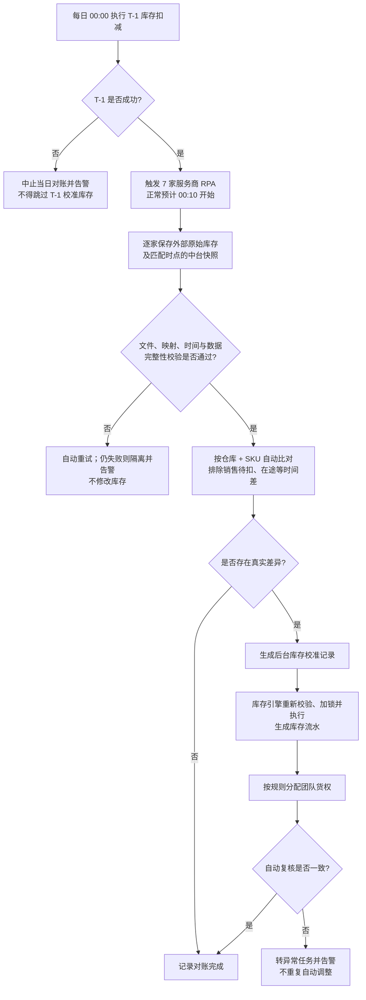
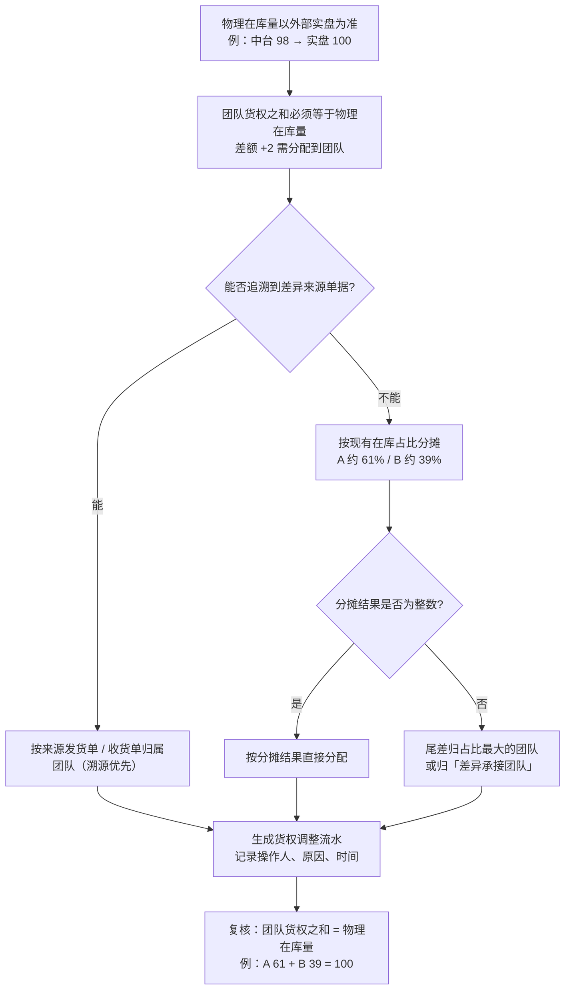

# 库存对账与校准方案

> 背景：中台库存（海外仓、平台仓、自营仓、供应商仓、物流中转仓）在上线初始化时导入，采购收货会加库存、发货单会扣库存。但中台未与海外仓/平台仓对接库存接口，所有流转都在中台内计算，可能与外部实物库存产生差异，且差异可能越来越大。

## 一、本次目标

每天 00:00 完成前一日已出库订单的 T-1 库存扣减后，自动拉取海外仓库存，与中台按「仓库 + SKU」维度比对，识别差异并自动完成库存校准。

> 本期对账范围：**仅海外仓**，当前纳入下列 7 家海外仓服务商。平台仓（Amazon FBA、AliExpress、Temu、Shopee）**暂不纳入**，后续再扩展。

### 1.1 本期海外仓服务商范围

| 序号 | 服务商 / 系统 | 本期是否纳入 | 取数方式 |
|---|---|---|---|
| 1 | 万邑通 | 纳入 | 待逐家确认，优先 API；未接接口时使用报表导出或 RPA |
| 2 | 跨越猫海外仓 OMS | 纳入 | 待逐家确认，优先 API；未接接口时使用报表导出或 RPA |
| 3 | 九方新系统 | 纳入 | 待逐家确认，优先 API；未接接口时使用报表导出或 RPA |
| 4 | 千象 | 纳入 | 待逐家确认，优先 API；未接接口时使用报表导出或 RPA |
| 5 | 海晨 | 纳入 | 待逐家确认，优先 API；未接接口时使用报表导出或 RPA |
| 6 | 远去娜海外仓 | 纳入 | 待逐家确认，优先 API；未接接口时使用报表导出或 RPA |
| 7 | 喀秋莎 | 纳入 | 待逐家确认，优先 API；未接接口时使用报表导出或 RPA |

> 服务商后台地址及登录凭证由权限系统或独立凭证台账维护，本方案文档不记录账号和密码。

## 二、对账前先对齐口径

| 口径项 | 建议 | 说明 |
|---|---|---|
| 对账维度 | 仓库 + SKU | 中台有「团队」维度、海外仓没有；先在 Excel 把中台按仓库+SKU 求和汇总 |
| 对账数量 | 先只对「在库」 | 在库是最核心的实物口径；在途、占用、待确认后面单独对 |
| 取数时点 | T-1 扣减成功后启动，预计北京时间 00:10 开始 | 当前只有实时库存接口或 RPA 实时导出，没有历史时点库存接口；需记录每家服务商的实际取数时间 |
| 对账范围 | 海外仓（本期暂不含平台仓） | 平台仓本期不参与；自营仓、供应商仓、物流中转仓中台自身即权威，暂不参与 |

**为什么不在 00:00 直接取数：**中台需要先完成前一日已出库订单的 T-1 扣减，海外仓系统也可能正在执行日切和库存同步。00:10 只是预计启动时间，系统必须以“T-1 任务成功”为实际启动条件；若 T-1 延迟或失败，当日 RPA 对账任务不得启动。7 家服务商仍需分别记录实际取数时间、时区和取数方式。

> 关键提醒：在途是差异的最大来源。中台认为「已发货未收货=在途」，海外仓可能已经上架入库（外部在库多、中台在途多），这类属于时间差，不是货损货差。

## 三、操作步骤

1. 每天北京时间 00:00 执行 T-1 库存扣减，扣减前一日已出库发货订单，并记录任务状态、完成时间、处理订单数和扣减数量。
2. T-1 任务成功后自动触发 RPA，预计 00:10 开始；若任务延迟则顺延，若任务失败则中止当日对账并告警，不允许跳过 T-1 直接校准库存。
3. RPA 拉取外部库存，并按服务商分别保存报表数据截止时间、点击导出时间、下载完成时间、时区、原始文件和任务编号；字段需含仓库、SKU、在库数量、在途数量：

| 仓库类型 | 数据来源 | 导出方式 | 本期是否纳入 |
|---|---|---|---|
| 海外仓（万邑通、跨越猫海外仓 OMS、九方新系统、千象、海晨、远去娜海外仓、喀秋莎） | 各服务商后台 | 优先通过 API 获取；未接接口时使用库存报表导出或 RPA | 纳入 |
| 平台仓 Amazon FBA | 亚马逊后台或领星 | FBA 库存报告（fulfillable 可售 / inbound 在途 / unfulfillable 不可售） | 暂不纳入 |
| 平台仓 AliExpress / Temu / Shopee | 各平台后台 | 库存导出 | 暂不纳入 |

4. 每取得一家服务商的外部库存，同步保存该服务商对应仓库的中台库存快照（仓库、SKU、团队、在库、在途等字段）。
5. 系统以「仓库 + SKU」为主键自动比对，计算差异并排除 T-1 完成后至实际取数时点之间新产生的销售待扣、在途流转和其他已知时间差。
6. 通过自动校验的数据生成后台库存校准记录并由库存引擎执行；文件、映射、时间或任务状态异常的数据中止处理并告警，不修改库存。

| 归类 | 特征 | 处理 |
|---|---|---|
| 销售待扣时间差 | T-1 完成后至该服务商实际取数时点之间，海外仓又产生销售出库，但中台尚未扣减 | 自动识别并从对账差异中排除，不调整库存 |
| 时间差（在途未转） | 在库+在途合计能对平 | 不改，等流转完成 |
| 待查差异 | 排除已知时间差后仍对不平 | 先核对流水和业务单据，不直接判定为盘盈 / 盘亏 |
| 口径 / 映射错误 | SKU 未配对、仓库未对应 | 先修映射再重新比对 |

## 四、差异原因怎么判断

方法：别只看「现在差多少」，去追「这个数是怎么一步步变过来的」（对流水）。

1. 先校验当日 T-1 扣减任务已成功完成，再识别从 T-1 完成时间到各服务商实际取数时间之间新产生的海外仓销售出库；该部分作为销售待扣时间差自动排除。
2. 对其余差异，只有在双方「在库」「在途」定义和范围已确认一致时，才可用「在库+在途」合计辅助过滤在途未转的时间差。
3. 排除已知时间差后仍对不平时，拉两边流水逐笔对：中台侧拉库存明细 / 批次（初始化、发货单收货、调拨入库出库、T-1 销售扣减）；海外仓侧拉出入库记录（上架、销售出库、调拨、报损、退货）。
4. 对照下表定位原因：

| 现象 | 最常见原因 | 去查哪里 |
|---|---|---|
| 中台比海外仓多 | T-1 完成后，海外仓又产生了新的销售出库，中台尚未扣减 | T-1 完成时间、海外仓出库流水、订单出库时间和实际取数时间 |
| 中台比海外仓多 | 中台收货多记 / 重复记 | 发货单收货数量 |
| 中台比海外仓少 | 海外仓有中台没记的入库（退货上架、调拨入） | 海外仓入库流水 |
| 中台比海外仓少 | 中台收货漏记 / 少记 | 发货单收货 vs 海外仓上架数 |
| 合计平、在库在途此消彼长 | 时间差 | 不用改 |

> 根因提醒：T-1 成功是启动对账的前置条件，但 RPA 下载 7 家服务商可能持续一段时间。T-1 完成后到各服务商实际取数之间仍可能产生新的海外仓销售出库，使中台在库暂时高于海外仓。这类差异必须按订单出库时间自动识别和排除，不能直接记为盘亏。

### 4.1 识别销售待扣时间差所需数据

库存查询接口只能发现数量差异，不能单独判断差异是否由取数期间的新销售出库引起。要自动识别销售时间差，至少具备以下任一数据能力：

- 中台可查询「T-1 完成后已发货、但尚未扣减」的销售订单、SKU、仓库、数量和出库时间；
- 海外仓提供销售出库流水接口，可按仓库、SKU、订单和出库时间查询；
- 海外仓库存 API 提供库存数据截止时间，并支持按时间查询库存或出库变动。

对账批次需保存 T-1 完成时间、外部数据截止时间、时区和实际取数时间。无法自动识别销售待扣量时，对应仓库和 SKU 必须中止自动校准并告警，不得直接修改库存。

## 五、团队维度怎么分配

账平铁律：一个「仓库+SKU」下，各团队货权之和 = 这个「仓库+SKU」的物理在库量。

以中台 98（A 团队 60 + B 团队 38）、海外仓实盘 100 为例：

1. 物理在库量以海外仓为准，改成 100。
2. 团队货权之和必须等于 100，现在是 98，差 +2 要补。
3. 这 +2 补给谁，按下面优先级选规则：

| 优先级 | 规则 | 适用场景 |
|---|---|---|
| ① 溯源优先 | 差异来自哪张发货单 / 哪笔收货，就归那个团队 | 能查到来源，最准 |
| ② 比例分摊 | 按现有在库占比摊：A 约 61%、B 约 39%，+2 → A 补 1、B 补 1 | 查不到来源时 |
| ③ 尾差规则 | 除不尽时尾差归占比最大团队，或设「差异承接团队」 | 保证账永远平 |

结果：A 60→61、B 38→39，合计 100，账平。

库存校准导致团队库存需要同步变化时，后台按「溯源优先 → 比例分摊 → 尾差兜底」计算团队调整结果，并调用中台现有货权调整接口自动生成货权调整记录。

> 两个提醒：
>
> 1. 这是「货权调整」，不是「盘点」。盘点管数量对不对，货权调整管货算谁的。不要用盘点单改团队，也不要用货权调整改总数。
> 2. Amazon 多店铺要溯源到店铺 / 货件，不能简单按比例摊（不同店铺默认不共享库存）。

## 六、差异出来后怎么改中台库存

现实：中台目前没有「盘点单」，也没有其他能支撑库存调整的单据。本次首次历史校准可由开发临时写 SQL 改数据库；日常对账不得因发现差异即直接改库。这是临时方案，务必做好备份、留痕与审批，避免直接改出问题。

短期（本次）——开发写 SQL 改库：

1. 整理并审批差异清单：仓库、SKU、中台当前在库数、海外仓 WMS 账面数、差异数、原因、证据和处理意见。
2. 改库前保存中台与海外仓原始快照，并为本次调整生成唯一批次号；确认取数后未发生未纳入计算的收货、发货、调拨或 T-1 销售扣减。
3. 开发按已审批清单写 SQL，在同一事务内更新库存和团队货权；不得仅覆盖库存余额而不留下调整记录。
4. 留存操作日志：批次号、操作人、复核人、原因、时间、改前值 / 改后值、对应证据；脚本需具备失败回滚或按批次恢复的能力。
5. 团队货权同步调整：若同一 SKU 下区分团队，按「溯源优先 → 比例分摊 → 尾差规则」一并更新，使团队货权之和等于物理在库量。

长期（建议立项）：

- 新增「盘点单」：选择仓库 → 录入 SKU + 实盘数量 → 系统算 差异 = 实盘 − 账面 → 差异大于 0 生成盘盈入库、小于 0 生成盘亏出库 → 自动把账面在库调整到实盘数，全程留流水、留操作人、留原因。
- 「盘点单」管数量，「货权调整」管团队归属，两个能力分开落地，让后续改库不再依赖 SQL。

## 七、长期机制

1. 海外仓每天执行自动对账与校准，月末汇总对账结果并复盘异常；平台仓后续纳入后再确定频率。
2. 逐步以库存 API 替代 RPA；在接口未完成前，由 RPA 自动下载并导入报表。
3. 自动识别销售待扣、在途流转和映射问题；无法可靠判断的数据中止校准并告警。
4. 每次库存校准必须经过统一库存引擎，生成校准单、库存流水和完整任务日志。

## 八、每日自动库存校准方案

核心思路：每天 00:00 先完成前一日已出库订单的 T-1 库存扣减，成功后自动触发 RPA；系统自动导入、比对、排除已知时间差并执行库存校准。正常数据不进入人工确认；文件、映射、任务或数据异常时自动隔离并告警，不修改库存。

| 档位 | 渠道 | 获取方式 |
|---|---|---|
| A | 7 家海外仓服务商中已完成 API 对接的服务商 | T-1 成功后自动调用 API 获取实时库存 |
| B | 7 家海外仓服务商中尚未完成 API 对接的服务商 | T-1 成功后由 RPA 自动登录、下载并导入库存报表 |
| C | 平台仓 | 暂不纳入，后续再对 |

每日执行（SOP）：

1. 每天 00:00 执行 T-1 库存扣减。
2. T-1 成功后触发 7 家服务商的取数任务，正常情况下预计 00:10 开始；失败或超时则中止对账并告警。
3. 每取得一家服务商库存，立即保存外部原始快照及同一时点的中台库存快照。
4. 系统自动完成字段标准化、仓库与 SKU 映射、数量比对和已知时间差排除。
5. 校验通过的真实差异自动生成后台库存校准记录，由库存引擎加锁执行并生成流水。
6. 执行完成后自动复核；仍不一致则转异常任务并告警，不重复自动调整。

注意：

- 优先 API；暂未接入接口的服务商使用 RPA，并配置页面变更监控、失败重试和告警
- 外部「在库」口径需与中台一致（可售 + 不可售 = 在库，在途单独对）
- T-1 成功是取数和校准的强制前置条件；系统还需排除 T-1 完成后至实际取数期间的新销售待扣，避免重复扣减
- 自动校准只处理通过完整性、映射、时间和幂等校验的数据；异常数据只告警，不修改库存
- 第一次务必清干净历史差异，避免每天快照把历史错误带下去

## 九、RPA 落地与快照时间点

分工：RPA 负责下载 7 家海外仓原始库存；后端负责保存匹配时点的中台库存快照、计算差异、排除时间差，并按公式（溯源优先 → 比例分摊 → 尾差规则）分配团队。

时间规则：每天 00:00 执行 T-1 库存扣减；任务成功后才触发 RPA，正常情况下预计 00:10 开始。由于 7 家服务商下载可能持续约 1 小时，不能把 00:10 当作共同快照时点。系统必须分别保存每家服务商的数据截止时间、点击导出时间、下载完成时间、时区和取数方式，并在取得外部数据时保存相匹配的中台库存快照。

## 十、处理流程图（讨论用）

### 10.1 库存校验与差异处理主流程

### 10.2 差异如何分配到团队

说明：

- 10.1 是每天的自动标准流程。T-1 成功后才允许取数；通过校验的数据自动完成对账与校准，异常数据自动隔离并告警。
- 10.2 是校准时的团队分配规则，重点在「溯源优先、比例兜底、尾差兜底」三级，保证团队货权之和永远等于物理在库量。
- 例外：Amazon 多店铺场景需溯源到店铺 / 货件，不能简单按比例分摊（不同店铺默认不共享库存）。
