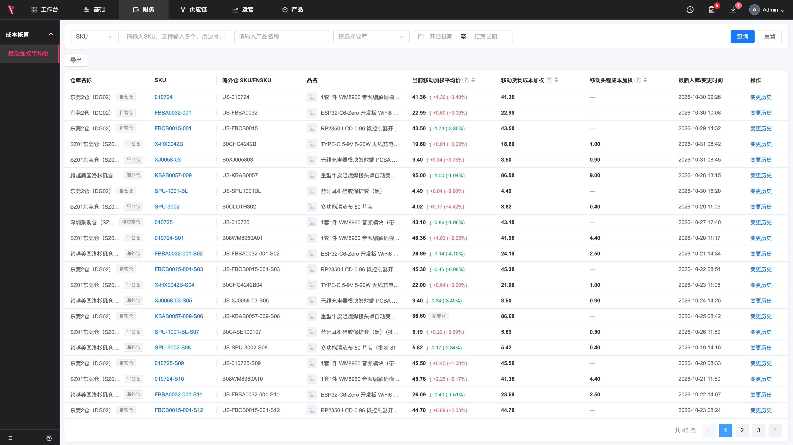

# 0 原型图

以下为移动加权平均价页面的原型截图，交互与字段口径以第 3 章为准。



---

# 1 需求概述

## 1.1 业务背景

公司同时经营国内仓、海外仓与平台仓，同一 SKU 会在多个仓库之间流转。财务目前对库存成本单价以手工核算为主，口径较粗：货物成本直接取最近一个月内最新一笔采购成本，未做月度加权。结果是同一 SKU 的成本容易随单笔采购价跳动，不同仓库、不同批次的成本差异体现不出来，月末库存成本与毛利会失真，也无法解释某个单价是怎么来的。

当前存在三个问题：

- **单价不统一**：同一 SKU 在不同仓库、不同批次入库的单价不同，缺少以仓库为单位、按统一公式滚动的当前库存成本。
- **货物与头程混算**：海外仓的成本包含货物成本和头程费用，头程按整票结算、未按 SKU 归集，无法说明单件成本是怎么来的。
- **无法追溯**：库存反复出入库后，没人能回答「现在这个价是怎么算出来的」，成本异常时无法定位到具体单据。

## 1.2 目标与效益

### （1）目标

- **统一**：所有仓库使用同一条移动加权公式，入库重算、出库只引用不改价。
- **可解释**：任一价格都能用「（原在库 × 变动前 + 本次入库成本）÷ 总数量」复算出来。
- **可追溯**：每次变动有记录，能看到触发单据和前后单价。
- **可导出**：变动明细可导出，供财务二次分析。

### （2）效益

1. **减少成本层计算**：不需要维护每个批次的剩余成本层，只维护当前数量、当前库存金额、当前移动加权单价；批次数量明细仍保留，但不再承担财务上的成本层扣减。以 SKU-A 为例，FIFO 要维护 4 个批次（10 件 ×8、35 件 ×9、80 件 ×12、100 件 ×13），出库跨批次时金额很难追踪核验；移动平均只需归并为 225 件、金额 2,655.00、单价 11.80。
2. **更适合高频出入库业务**：跨境电商 SKU 多、出入库频繁、同一 SKU 多次采购，还有退货、报损等场景。逐笔匹配批次会让成本关系表快速膨胀；移动平均只维护当前成本池，系统计算和查询都更简单。
3. **经营结果更平稳**：单品毛利变化更稳定，团队绩效不易被偶然的批次成本差异拉偏，经营分析也更容易理解。
4. **成本变动可查**：通过变更历史页面承载每次变动的单据与前后单价，支撑经营分析与业务分析。

## 1.3 名词定义

| 名词 | 定义 ||---|---|
| 移动加权平均价 | 当前库存单位成本，按 SKU + 仓库核算，与团队无关；每次入库按统一公式重算，出库不重算 |
| 移动货物成本加权 | 货物库存总金额 ÷ 库存总数量，未税单件成本 |
| 移动头程成本加权 | 累计分摊头程费用 ÷ 库存总数量，未税单件成本 |
| 当前移动加权平均价 | 货物成本加权 + 头程成本加权 |
| P_out | 海外仓发货出库时记录的国内仓移动加权单价，作为该批货上架时的货物入库单价 |
| 在途库存 | 国内已发货、海外仓未上架的库存，不单独核算成本 |
| 分仓核算 | 同一 SKU 在不同仓库分别计算成本，单价可以不同 |
| 组合 SKU | 由若干子件按配比组成的 SKU，如 C = A × 1 + B × 2；加工入库后形成独立库存与价格 |
| 配比 | 一个组合 SKU 中各子件的数量构成，如 A:B = 1:2 |
| 加工入库 | 加工单产出组合 SKU 的入库事件，是国内仓组合 SKU 唯一的变价来源 |

---

# 2 产品方案总览

## 2.1 核心模型

```
仓库属性 ──> 成本构成 ──> 三个价格
国内仓（自营/供应商/中转） → 只有货物成本 → 当前价 = 货物成本加权
海外仓 / 平台仓（含 FBA）   → 货物成本 + 头程成本 → 当前价 = 货物 + 头程
```

所有仓库共用一条滚动公式；差异只在海外仓的货物取「发货出库时点」的价格，头程取上架前已分摊好的固定出库成本。

## 2.2 页面结构

```
查询卡片（SKU 类型 / SKU / 品名 / 仓库 / 日期）
操作行（导出）
列表卡片（9 列价格数据 + 分页）
  └─ 变更历史抽屉（三个口径当前值 + 三个页签明细 + 日期筛选 + 分页）
```

## 2.3 数据主线

```
业务单据（采购入库 / 采购收货 / 海外仓上架 / 头程费用调整）
   → 按公式滚动一次，写入一条变动记录
   → 列表展示最新价格与较上次变动
   → 变更历史展示该 SKU 的全部变动链路
```

出库类单据（销售、调拨、其他）只引用当前价，不产生变动记录。

---

# 3 功能需求

## 3.1 成本列表

**目的**：让用户一屏看到各仓库、各 SKU 的当前成本，并快速识别最近一次涨跌。

### （1）字段

| 列 | 内容与规则 |
|---|---|
| 仓库名称 | 仓库名称 +（仓库编码）+ 属性标签；属性为 海外仓 / 平台仓 / 自营仓 / 供应商仓 / 中转仓 |
| SKU | 商品编码 |
| 海外仓 SKU / FNSKU | 合并列。海外仓展示海外仓 SKU，平台仓（含亚马逊 FBA）展示 FNSKU；两者都无时显示「—」 |
| 品名 | 商品名称，超长省略并悬浮展示全称 |
| 当前移动加权平均价 | 货物 + 头程合计，加粗；右侧展示「较上次变动」：箭头 + 金额 + 百分比 |
| 移动货物成本加权 | 单独展示数值，不展示涨跌 |
| 移动头程成本加权 | 单独展示数值；无头程仓库显示「—」 |
| 最新入库/变更时间 | 最近一次影响加权价的业务时间；仅出库不刷新 |
| 操作 | 文本按钮「变更历史」 |

### （2）展示规则

- 全部价格四舍五入保留 2 位小数，涨跌值与金额同为 2 位，涨跌百分比 2 位，数量为整数，均为未税价。
- 「较上次变动」只出现在当前移动加权平均价列；上涨红色、下跌绿色、持平灰色，计算口径见下。
- 当前价 = 货物成本加权 + 头程成本加权，三者数值必须能对上。
- 前两列（仓库名称、SKU）固定，横向滚动时保持可见。
- 分页条数按列表可视高度自适应：第一页铺满可视区域，剩余数据进入后续页；筛选后重新计算。
- 列表无数据时展示空状态，不显示空白表头。

### （3）涨跌计算口径

涨跌不单独存值，由该 SKU 在该仓库「变更历史」中最近一条记录推导：

```
变动前单价 P0 = 最近一条记录的「变动前」
变动后单价 P1 = 最近一条记录的「变动后」（等于列表当前移动加权平均价）
涨跌额   ΔP = P1 − P0
变化率    r = ΔP ÷ P0 × 100%
```

- 变化率的分母是**变动前单价**，不是当前价、也不是上一次的展示值。
- 涨跌额与变化率均四舍五入 2 位，先算 ΔP 再算 r，保证与列表展示的数字能对上。
- 当前价的涨跌额 = 变动后总价 − 变动前总价；变化率 = 该涨跌额 ÷ 变动前总价（货物 + 头程），不是货物与头程两个变化率相加。
- 展示格式：`↑ +1.36（+3.40%）`。ΔP > 0 红色 ↑，ΔP < 0 绿色 ↓，ΔP = 0 时展示灰色「无变化」标识。
- P0 = 0（期初第一条）或该 SKU 无变更记录时，不计算变化率，不展示涨跌。
- 例：变动前 40.00、变动后 41.36 → ΔP = +1.36，r = 1.36 ÷ 40.00 = +3.40%。

## 3.2 查询

| 条件 | 规则 |
|---|---|
| SKU 类型 | 可选 SKU / 海外仓 SKU / FNSKU，决定下方输入值匹配的字段 |
| SKU / 海外仓 SKU / FNSKU | 支持多值（逗号、空格、换行分隔），按包含匹配 |
| 品名 | 模糊匹配 |
| 仓库 | 多选，选项展示「仓库名称（编码）」 |
| 日期区间 | 按「最新入库/变更时间」过滤，含首尾两天 |

- 点击查询后生效，重置清空全部条件并回到第 1 页。
- 查询结果条数变化时，分页总数与页码同步更新。

## 3.3 排序

- 三个价格列支持排序：当前移动加权平均价、移动货物成本加权、移动头程成本加权。
- 按数值排序，不按涨跌幅排序；三态循环：升序 → 降序 → 取消。
- 无该项成本的数据（如无头程仓库）在升序与降序下均置底。
- 排序与筛选可叠加，排序后回到第 1 页。

## 3.4 变更历史

**目的**：回答「这个价格是怎么算出来的」，支持逐条验算与单据定位。

**入口**：列表操作列「变更历史」。

### （1）抽屉头部

| 区域 | 内容 |
|---|---|
| 商品信息 | SKU、仓库（名称 + 编码 + 属性）、品名 |
| 三个当前值 | 当前移动加权平均价、移动货物成本加权、移动头程成本加权，卡片展示；无头程时显示「—（无头程）」 |

### （2）页签与明细

| 页签 | 内容 |
|---|---|
| 当前移动加权平均价 | 货物与头程事件按时间合并，逐条递推总额，末行等于列表当前价 |
| 移动货物成本加权 | 仅货物成本事件 |
| 移动头程成本加权 | 仅头程成本事件；无头程仓库展示空状态 |

明细列：

| 列 | 规则 |
|---|---|
| 变动时间 | 业务发生时间，精确到分钟 |
| 入库类型 / 单据 | 入库类型直接取库存流水类型：期初初始化、采购入库、采购收货、加工入库、海外仓上架、头程入库、头程费用调整；下方展示单据号 |
| 变动前 | 变动前单价；下方展示「原在库：数量」 |
| 本次入库数量 / 成本 | 本次入库数量与入库总成本，金额不带币种符号 |
| 变动后 | 变动后单价；与变动前一致时右侧展示灰色「无变化」标识 |
| 涨跌 | 该行变动相对变动前的变化额与变化率，口径见 3.1；首条无上次值显示「—」 |

### （3）规则

- 每条记录必须可复算：`（原在库 × 变动前 + 本次入库成本）÷（原在库 + 本次入库数量） = 变动后`。
- 「当前移动加权平均价」页签为货物与头程合并视图，用于解释当前价的构成；单口径问题走对应页签。
- 支持按变动日期区间筛选，点击查询后生效；三个页签独立分页。
- 出库类事件不出现在变更历史中。
- 同一时间点的货物与头程事件，按各自单据时间排序展示。

## 3.5 导出

- 导出当前筛选与排序后的列表数据，顺序与页面一致。
- 字段与列表一致，包含三个价格与较上次变动的金额、百分比；表头与页面列名一致。
- 导出为 Excel 可读格式，文件名包含页面名与导出时间。

## 3.6 导入海外仓上架流水

**目的**：未对接接口的海外仓取不到上架前的库存流水，通过导入上架流水补录「原在库数量 + 本次入库数量」，让系统能按移动加权公式算出该 SKU 的最新价格。

**入口**：列表操作行「导入海外仓上架流水」。

**模板**：在线模板（WPS）<https://www.kdocs.cn/l/caigDqifgmQq>。第 1 行为表头，第 2 行为填写说明，导入时自动跳过第 2 行。

### （1）字段

| 列 | 必填 | 说明 |
|---|---|---|
| 仓库编码 | 是 | 海外仓编码，如 KY-LAX-01，需与中台仓库档案一致 |
| 仓库名称 | 是 | 系统以仓库编码为准 |
| 海外仓 SKU | 是 | 系统按映射关系转换为中台 SKU |
| 中台发货单号 | 是 | 用于关联发货时的移动加权价 `P_out` |
| 海外仓后台操作单据号 | 是 | 海外仓后台的入库流水单号 |
| 本次入库时间 | 是 | 格式如 2026-11-01 10:20，按时间从早到晚填写 |
| 本次入库数量 | 是 | 大于 0 |
| 本次入库前的原在库数量 | 是 | 该 SKU 在上架前的仓库库存数量（SKU 维度，不是团队库存）；不小于 0，无库存填 0 |

### （2）导入规则

- 仅处理海外仓上架流水，导入记录的入库类型统一记为「头程入库」。
- 仅支持导入上线日及之后产生的海外仓上架流水；早于上线日的流水按行提示，不允许导入。上线日以系统配置为准（示例：2026-11-20 上线，可导入 2026-11-20 及之后的流水）。
- 查重键为「仓库编码 + 海外仓 SKU + 中台发货单号 + 本次入库时间」；命中重复的行**直接过滤，不导入**，不覆盖原记录，也不重算价格。
- 同一文件内出现重复键时，保留第一行，后续重复行按重复过滤；同一次上架在文件中只应出现一行。
- 海外仓后台操作单据号仅用于业务核对与失败定位，**不参与查重**：同一发货单分多次上架时，该单号可能相同。
- 本次入库时间先统一归一化为 `YYYY-MM-DD HH:mm` 再参与查重，避免 2026/11/20 与 2026-11-20 被当成两条。
- 预览页顶部提示：重复导入的行会按「仓库编码 + 海外仓 SKU + 中台发货单号 + 本次入库时间」自动过滤，不会覆盖已有记录；同一发货单分多批上架时，请填写各自不同的入库时间。
- 本次入库成本不在模板中填写：系统按中台发货单号取该发货单的 `P_out`，并取该 SKU 的头程出库成本，分别乘本次入库数量后参与滚动。
- 按 SKU 分行填写；同一发货单多个 SKU、同一 SKU 多批上架各占一行，中台发货单号可重复。
- 选择文件后进入「数据预览」页签，展示全部行、行号与校验结果；重复行标注「重复，已过滤」，有错误行或没有可导入行时不能确认导入。
- 必填缺失、数量非数字或为负时，按行号提示，整批不允许导入。
- 导入成功后，按本次入库时间顺序重算该 SKU 在该仓库的移动加权价，并写入变更历史。

### （3）确认导入前的校验

| 校验项 | 处理 |
|---|---|
| 仓库编码不存在 | 报错，提示具体行，不允许导入 |
| 仓库属性不是海外仓 | 报错，提示具体行，不允许导入 |
| 海外仓 SKU 未维护映射 | 报错，提示具体行，不允许导入 |
| 中台发货单号不存在 / 不属于该仓库 / 不包含该 SKU | 报错，提示具体行，不允许导入 |
| 累计上架数量大于发货数量 | 报错，提示具体行，不允许导入 |
| 头程分摊结果缺失 | 允许导入，头程不重算，沿用当前移动头程成本加权 |

### （4）导入记录

弹窗包含「导入」「数据预览」「导入记录」三个页签。

| 列 | 说明 |
|---|---|
| 文件名 | 本次导入的 Excel 文件名 |
| 操作人 | 导入账号 |
| 导入时间 | 精确到分钟 |
| 行数 | 文件内有效数据行数 |
| 新增 / 重复过滤 / 失败 | 本次导入的新增、被过滤的重复行、失败行数 |
| 状态 | 成功 / 部分失败；失败状态使用红色标签 |
| 操作 | 查看失败明细、下载源文件 |

- 失败明细展示行号、海外仓 SKU、中台发货单号、失败原因。
- 「下载源文件」下载本次导入的原始 Excel，便于线下修正后重新导入。

### （5）异常

| 场景 | 处理 |
|---|---|
| 文件不是 .xlsx | 提示另存为 .xlsx 后上传 |
| 表头缺列 | 提示使用最新模板 |
| 第 2 行说明 | 自动跳过，不计入行数与校验 |
| 本次入库时间早于上线日 | 按行提示，不允许导入 |
| 命中重复记录 | 该行过滤，不导入、不覆盖、不重算价格 |
| 某行校验失败 | 展示行号与原因，确认导入置灰 |

---

# 4 成本计算规则

> 本章是第 3 章展示与追溯的规则来源；页面上的每个数值都能在此找到计算依据。

## 4.1 触发与公式

```
新加权单价 =（原库存成本 + 本次入库成本）÷（原库存数量 + 本次入库数量）
原库存成本 = 原在库数量 × 变动前单价
本次入库成本 = 本次入库金额（未税）
```

### （1）核算维度

移动加权平均价按「SKU + 仓库」核算，与团队无关。公式中的原库存数量（原在库数量）、本次入库数量，均指该 SKU 在该仓库的库存数量，不按团队拆分；团队库存不参与加权价计算。

所有入库类事件都重算移动加权价并写入变更历史；所有出库类事件都不重算、不写变更历史。

- 入库：期初初始化、采购入库、采购收货、加工入库（组合 SKU）、海外仓上架（货物 + 头程）、头程入库（导入上架流水）、头程费用调整。
- 出库：销售出库、调拨出库、其他出库。

### （2）采购入库的含税 / 未税转换

采购单分为含税采购与未税采购，移动加权价一律以未税成本计算：

| 采购单类型 | 本次入库成本口径 |
|---|---|
| 未税采购 | 采购单价 × 本次入库数量 |
| 含税采购 | 先按采购单行税率把含税单价换算为未税单价，再 × 本次入库数量 |

```
未税采购单价 = 含税采购单价 ÷（1 + 税率）
本次入库成本 = 未税采购单价 × 本次入库数量
```

- 税率取采购单行上的税率，同一采购单不同 SKU 可以不同。
- 未税单价四舍五入保留 2 位后再参与滚动，先换算再入库，不做二次分摊。
- 采购收货与采购入库同口径。
- 运费、关税等不并入货物成本，头程成本单独核算。

### （3）案例（2 位小数）

原库存 100 件 × 100.00 = 10,000.00。采购单为含税采购：含税单价 135.60，税率 13%，本次入库 50 件。

| 项目 | 计算 | 结果 |
|---|---|---|
| 未税采购单价 | 135.60 ÷（1 + 13%） | 120.00 |
| 单件税额 | 135.60 − 120.00 | 15.60 |
| 本次入库成本（未税） | 120.00 × 50 | 6,000.00 |
| 入库后数量 | 100 + 50 | 150 |
| 入库后成本 | 10,000.00 + 6,000.00 | 16,000.00 |
| 新加权单价 | 16,000.00 ÷ 150 | 106.67 |

若该采购单为未税采购、单价直接为 120.00，则本次入库成本同为 6,000.00，滚动结果一致。

### （4）案例：出库不改价

出库按当前移动加权价结转成本，只减少库存数量与库存金额，不进入公式重算。

原库存 100 件，当前移动加权价 20.00，库存金额 2,000.00；销售出库 30 件，按 20.00 结转。

| 项目 | 出库前 | 出库后 |
|---|---|---|
| 库存数量 | 100 | 70 |
| 库存金额 | 2,000.00 | 1,400.00 |
| 移动加权价 | 20.00 | 20.00 |

- 出库成本 = 30 × 20.00 = 600.00；出库后金额 = 2,000.00 − 600.00 = 1,400.00。
- 出库后单价 = 1,400.00 ÷ 70 = 20.00，与出库前完全一致。
- 销售出库、调拨出库、其他出库同理：不写入变更历史，不刷新「最新入库/变更时间」。

### （5）案例：入库单价等于现价

原库存 100 件，当前移动加权价 20.00，库存金额 2,000.00；本次入库 50 件，入库单价同为 20.00。

| 项目 | 计算 | 结果 |
|---|---|---|
| 原库存成本 | 100 × 20.00 | 2,000.00 |
| 本次入库成本 | 50 × 20.00 | 1,000.00 |
| 入库后数量 | 100 + 50 | 150 |
| 入库后成本 | 2,000.00 + 1,000.00 | 3,000.00 |
| 新移动加权价 | 3,000.00 ÷ 150 | 20.00 |

- 新入库单价与变动前一致时，加权价保持 20.00，不涨不跌。
- 入库仍写入一条变更记录：变动前 20.00、变动后 20.00，列表与变更历史展示灰色「无变化」，不显示红绿箭头。
- 这条记录必须保留：数量与金额已经变化，后续出库结转和复算都依赖它。

### （6）组合 SKU

组合 SKU（BOM）由子件按配比组成，例：C = A × 1 + B × 2。组合 SKU 的移动加权价**只在子件加工成组合 SKU 时变动**，即由加工单的「加工入库」驱动；采购入库、采购收货只作用于子件，出库不改价。加工入库后，C 成为独立 SKU，有自己的库存、当前价和变更历史。

```
本批入库成本 = Σ（子件移动加权价 × 配比 × 加工数量）= 子件出库金额合计
C 新价 =（C 原库存成本 + 本批入库成本）÷（C 原数量 + 加工数量）
```

- 加工费不计入货物成本，C 的入库成本只由子件出库金额构成。
- 子件出库金额按加工单实际出库数量计算，损耗据实，不按理论配比反推。
- 配比取加工单上的 BOM 快照，后续配比变更不影响历史记录。

案例（2 位小数）：A 单价 12.00、B 单价 1.00，配比 A:B = 1:2，加工 100 件 C。

| 步骤 | 动作 | 金额 |
|---|---|---|
| ① | A 出库 100 件 @12.00 | 1,200.00 |
| ② | B 出库 200 件 @1.00 | 200.00 |
| ③ | 本批入库成本（不含加工费） | 1,400.00 |

C 原有 50 件 @13.00（650.00）：

```
C 新价 =（650.00 + 1,400.00）÷（50 + 100）= 2,050.00 ÷ 150 = 13.67
```

变更历史记一条「加工入库」，单据号为加工单号：变动前 13.00、变动后 13.67（+0.67，+5.15%）。

与入库类型的关系：

| 入库类型 | 是否改变组合 SKU 的价 | 说明 |
|---|---|---|
| 期初初始化 | 是 | 财务按仓库 + SKU 提供 C 的初始单价 |
| 采购入库 / 采购收货 | 否 | 只影响子件 A、B 的价格 |
| 加工入库 | 是 | 国内仓组合 SKU 唯一的变价来源 |
| 海外仓上架 | 是 | 已加工完成的 C 发往海外仓后，按 4.3 的 `P_out` + 头程在海外仓维度独立滚动 |
| 所有出库 | 否 | 只引用当前价，不重算、不写变更历史 |

边界：

- 嵌套组合（C 内含组合品 D）递归展开到最底层子件后再汇总。
- 组合 SKU 拆解 / 退回一期不做；若后续支持，按同一配比反算。
- 加工单实际耗用与标准配比不一致时，以实际出库数量为准。

## 4.2 国内仓

国内仓没有跨境物流，头程为 0，当前价等于货物成本加权。

### （1）案例（2 位小数）

| 步骤 | 业务事件 | 原库存 | 本次入库 | 入库后 | 新单价 |
|---|---|---|---|---|---|
| ① | 期初初始化 | — | 300 件 / 26,400.00 | 300 件 / 26,400.00 | 88.00 |
| ② | 采购入库 | 300 件 × 88.00 | +40 件 / 3,360.00 | 340 件 / 29,760.00 | 87.53 |
| ③ | 采购入库 | 340 件 × 87.53 | +60 件 / 5,400.00 | 400 件 / 35,160.20 | 87.90 |

方向：入库单价低于现价拉低加权价，高于现价拉高。

## 4.3 海外仓 / 平台仓

货物成本与头程成本各自滚动后相加。

### （1）货物成本

- 发货出库时，系统记录发货仓当时的移动加权单价 `P_out`，随发货单留存。
- 上架时以 `P_out` 作为货物入库单价，不取上架时点的价格。
- 原因：国内发货到海外上架通常间隔一个多月，期间发货仓价格已滚动多次；按上架时价格入库会与发货单成本对不上。
- `P_out` 只是发货时点的价格快照。

### （2）初始化与 P_out

- 系统上线时海外仓已有存量库存，其对应的发货出库可能发生在 2 个月前，系统没有当时的滚动价格。
- 不为这段历史单独向财务要一套初始化单价；海外仓原库存的货物成本单价，直接取财务统一提供的最新初始化单价，作为滚动起点。
- 初始化之前的出库不追溯 `P_out`；初始化之后发生的发货出库，才记录并按 `P_out` 入库。

### （3）头程成本

- 头程费用在上架前完成分摊，形成该 SKU 固定的头程出库成本。
- 上架时按同一发货单找到该 SKU 的分摊结果，按本批上架数量取用。
- 同一发货单多批上架：共用同一 `P_out` 与同一头程出库成本，各批按上架数量分别滚动，不重新分摊。

### （4）案例（2 位小数）

上架前：100 件，货物 20.00（2,000.00），头程 2.00（200.00），当前价 22.00。发货 80 件，`P_out = 15.00`，头程出库成本 15.00 / 件。

| 步骤 | 业务事件 | 库存数量 | 货物加权 | 头程加权 | 当前价 |
|---|---|---|---|---|---|
| 上架前 | 海外仓原库存 | 100 | 20.00（2,000.00） | 2.00（200.00） | 22.00 |
| — | 国内发货出库，记录 P_out = 15.00 | — | 价格不变 | 价格不变 | — |
| 第 1 批 | 上架 50 件，头程 50 × 15.00 = 750.00 | 150 | 18.33 | 6.33 | 24.66 |
| 第 2 批 | 上架 30 件，头程 30 × 15.00 = 450.00 | 180 | 17.78 | 7.78 | 25.56 |

## 4.4 精度与汇率

| 项目 | 口径 |
|---|---|
| 单价 | 2 位小数，四舍五入 |
| 金额 | 2 位小数，四舍五入 |
| 中间计算 | 每一步滚动后立即四舍五入到 2 位，下一步以该单价为基数继续滚动 |
| 涨跌 | 涨跌值与单价同为 2 位；涨跌百分比 2 位 |
| 数量 | 整数，不保留小数 |
| 税额 | 货物成本、头程成本均为未税价 |
| 汇率 | 头程结算以人民币为准；美金支付按财务指导汇率换算，不用实时汇率 |

> 逐步舍入会产生分位误差：单价 × 数量可能与库存金额相差 0.01~0.02，属预期行为，不做回溯调账。

---

# 5 初始化

| 项目 | 要求 |
|---|---|
| 提供方 | 财务 |
| 粒度 | 仓库 + SKU 维度，按各仓库分别提供 |
| 内容 | 各仓库的初始货物成本单价；有头程的仓库另提供头程单价 |
| 库存数量 | 财务不提供，由系统从各仓库存数据拉取，海外仓与国内仓同口径 |
| 海外仓原库存 | 货物成本单价取财务提供的最新初始化单价，作为滚动起点；上线前的发货出库不追溯 `P_out` |
| 精度 | 不要求绝对精准，后续按入库滚动修正 |
| 时间 | 2026-11-20 前提交 |
| 呈现 | 作为各 SKU 滚动第一条记录，货物与头程各一条，可在变更历史查看 |

---

# 6 功能清单

| 序号 | 功能 | 说明 | PRD 章节 |
|---|---|---|---|
| 1 | 原型图 | 页面原型截图，交互与字段以第 3 章为准 | 0 原型图 |
| 2 | 成本列表 | 展示各仓库各 SKU 的三个价格、涨跌与最新变更时间 | 3.1 成本列表 |
| 3 | 查询 | 按 SKU 类型、SKU、品名、仓库、日期筛选 | 3.2 查询 |
| 4 | 排序 | 三个价格列按数值排序，升序 / 降序 / 取消三态循环 | 3.3 排序 |
| 5 | 变更历史 | 三个口径页签，逐条展示变动前后与触发单据 | 3.4 变更历史 |
| 6 | 导出 | 导出当前筛选与排序后的列表数据 | 3.5 导出 |
| 7 | 导入海外仓上架流水 | 导入未接接口海外仓的上架流水并重算价格 | 3.6 导入海外仓上架流水 |
| 8 | 触发与公式 | 入库重算、出库不重算，按 SKU + 仓库核算 | 4.1 触发与公式 |
| 9 | 组合 SKU 计算 | 仅在加工入库时按子件出库金额重算，加工费不计入 | 4.1（6）组合 SKU |
| 10 | 国内仓计算 | 头程为 0，当前价等于货物成本加权 | 4.2 国内仓 |
| 11 | 海外仓 / 平台仓计算 | 货物取 P_out、头程取分摊结果，分线滚动 | 4.3 海外仓 / 平台仓 |
| 12 | 精度与汇率 | 2 位小数、四舍五入、汇率口径 | 4.4 精度与汇率 |
| 13 | 初始化 | 财务按仓库 + SKU 提供初始单价，库存数量由系统拉取 | 5 初始化 |
| 14 | 异常与边界 | 零库存、无头程、负金额等场景的处理方式 | 7 异常与边界 |
| 15 | 验收摘要 | 面向测试与产品经理的逐条验收标准 | 8 验收摘要 |

---

# 7 异常与边界

| 场景 | 处理 |
|---|---|
| 库存数量为 0 | 不做除法，成本不适用，展示「—」 |
| 无头程仓库 | 头程列与当前价中的头程部分显示「—」，不参与计算 |
| 头程分摊结果晚于上架 | 上架时取不到分摊结果，头程不重算，沿用当前移动头程成本加权 |
| 同一时间点多条入库 | 按系统实际处理顺序逐条滚动，不额外定义优先级，最终单价以最后一条为准 |
| 同一 SKU 多仓单价不同 | 正常展示，不合并 |
| 负金额 / 负数量 | 不允许，入库成本不得为负 |
| 数据未接入仓库 | 不展示，待接入后回补 |
| 汇率缺失 | 该笔头程暂不计算，标记待处理 |
| 筛选无结果 | 展示空状态，保留查询条件 |
| 变更历史无记录 | 展示空状态并说明「暂无变动记录」 |

---

# 8 验收摘要

面向测试与产品经理，逐条验证；每条都能在页面上直接操作复现。

| # | 验收项 | 验收标准 |
|---|---|---|
| 1 | 入库必重算 | 采购入库、采购收货、海外仓上架、头程费用调整发生后，该 SKU 该仓库单价重算，并新增一条变更记录 |
| 2 | 出库不重算 | 销售出库、调拨出库、其他出库发生后，列表单价不变，变更历史不新增记录 |
| 3 | 含税采购换算 | 含税采购按采购单行税率换算为未税单价后入库，未税采购直接取单价；同一采购单不同 SKU 可使用不同税率 |
| 4 | 加权公式 | 任取一条变动，用「原在库 × 变动前 + 本次入库成本」÷ 总数量复算，结果等于变动后 |
| 5 | 三个价格关系 | 当前移动加权平均价 = 移动货物成本加权 + 移动头程成本加权，数值完全对得上 |
| 6 | 精度 | 价格、金额、涨跌值、涨跌百分比均为 2 位，数量为整数，舍入规则为四舍五入 |
| 7 | 头程范围 | 仅海外仓、平台仓展示头程；其他仓库头程列显示「—」，当前价不含头程 |
| 8 | 涨跌计算 | 涨跌额 = 变动后 − 变动前，变化率 = 涨跌额 ÷ 变动前；上涨红色、下跌绿色、持平灰色；首条记录不展示涨跌 |
| 9 | 查询 | SKU 支持多值（逗号、空格、换行），切换 SKU 类型后匹配对应字段；仓库多选；日期含首尾；重置清空全部条件 |
| 10 | 排序 | 三个价格列按数值排序，升序 → 降序 → 取消三态循环；无该项成本的数据升降序均置底 |
| 11 | 变更历史 | 三个页签独立分页；日期筛选只作用于当前页签；合计页签末行的变动后等于列表当前价 |
| 12 | 导出 | 导出当前筛选与排序后的结果，字段、顺序、数值与页面一致 |
| 13 | 空状态 | 无数据、无变更记录时展示空状态，不显示空白表头 |
| 14 | 初始化 | 初始化单价按仓库 + SKU 提供；库存数量由系统拉取，不作为财务输入 |
| 15 | 导入海外仓上架流水 | 点击「导入海外仓上架流水」打开弹窗；「下载模板」跳转在线模板；上传 .xlsx 后进入「数据预览」页签，展示全部行与错误行号，校验通过且存在可导入行时才可确认；导入记录入库类型为「头程入库」 |
| 16 | 重复导入与时效 | 查重键为仓库编码 + 海外仓 SKU + 中台发货单号 + 本次入库时间；重复导入的行被过滤，不覆盖原记录、不重算价格；同一文件内重复键保留第一行；海外仓后台操作单据号不参与查重；早于上线日的流水不允许导入 |
| 17 | 导入前置校验 | 仓库编码不存在或非海外仓、SKU 未映射、发货单不存在/不归属/不含 SKU、累计上架超发，均在确认导入时报错并提示具体行 |
| 18 | 导入记录 | 导入弹窗含「导入 / 数据预览 / 导入记录」三个页签；预览页展示全部行、重复过滤与错误标记，并在顶部提示重复行会自动过滤；记录展示文件名、操作人、导入时间、行数、新增/重复过滤/失败、状态；失败状态红色标签；可查看失败明细、下载源文件 |
| 19 | 组合 SKU | 子件加工成组合 SKU 时，C 的入库成本 = 子件出库金额合计（不含加工费），再按加权公式重算；仅加工入库改变国内仓 C 的价格，采购入库只影响子件；海外仓 C 上架按 P_out + 头程滚动 |
